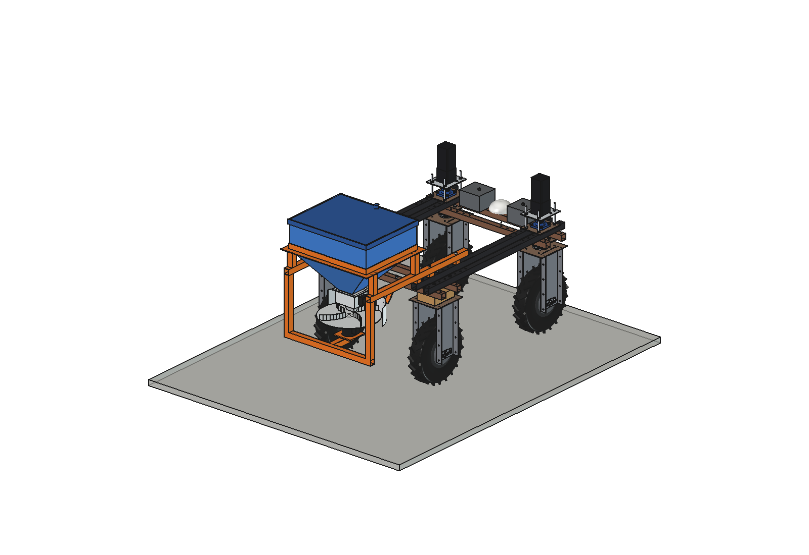
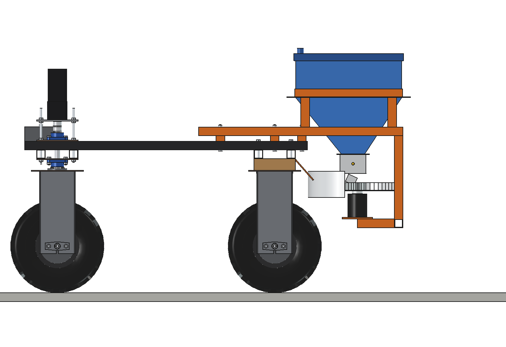
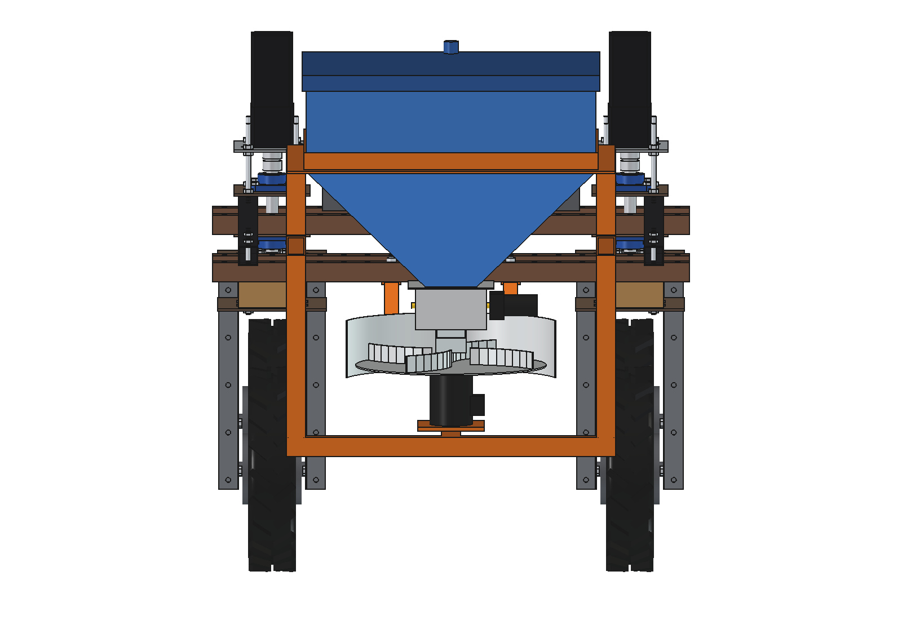
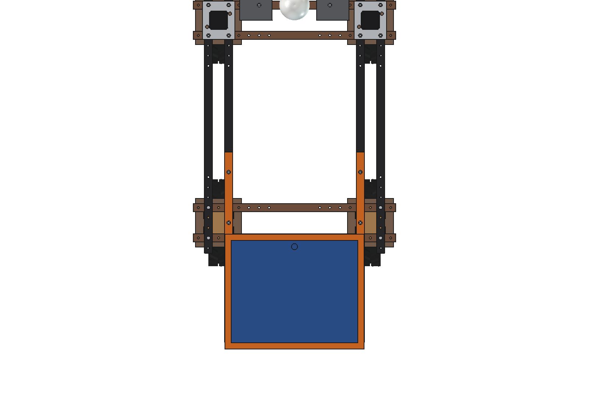
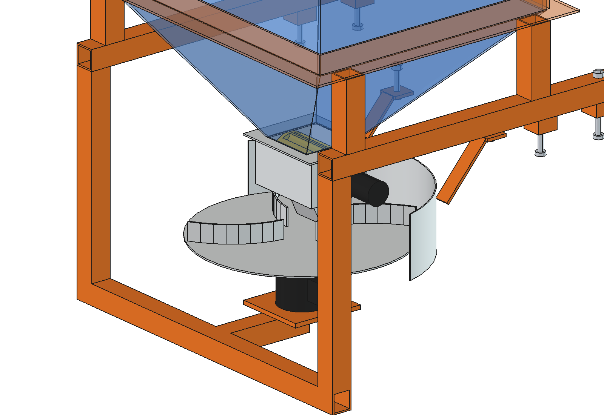

# Fertilizer spreader (simple)

Spinning-disc spreader for granular fertilizer on the Bruut OpenAgbot (standard robot). An 88 l hopper over and behind
the rear axle, a fluted metering roller whose speed follows the driving speed (and a task map for variable rate), and a
vaned disc O400 behind the robot. Driving width 4.1 to 6.7 m, set by the disc speed. With a coarser roller the same
machine spreads granular lime (see also the [lime spreader](../../lime%20spreader/simple/README.md), a drop spreader for large lime doses).

<p align="center">
  
</p>

| Side | Rear |
| --- | --- |
|  |  |
|  |  |

## Build

- **Mount**: 2 rails 40 x 40 x 3 on 25 mm spacers on top of the inner upper beams (x = +-325), 3 x M10 each,
  running back past the beam ends. The spacers keep the rails clear of the wheel-unit bolts that stick up at
  y -425 / -575. 4 posts carry an angle ring (40 x 40 x 4) round the hopper.
- **Hopper**: PE, 600 x 480, straight part 200 high, pyramid funnel to a 100 x 100 outlet (walls 46..57 degrees), lid.
- **Metering**: stainless housing under the outlet, fluted roller O80 x 120 (10 flutes, 196 ml per turn) on a 12 V
  gearmotor (100 rpm), short drop chute 35 mm in front of the disc centre.
- **Spinner**: disc O400 with 4 backward-curved vanes on a 48 V BLDC motor (300 W) on a weldment of 2 legs, a cross tube
  and an arm under the disc. A curved guard round the front half keeps the throw off the robot; it hangs on 2 straps
  from the rear lower beam.
- **Counterweight** (optional): 2 x 20 kg on the front lower beams, for a full hopper.

Mass 42 kg empty, 130 kg full (88 kg fertilizer); counterweight 40 kg. Size 690 x 1774 x 828 mm.

## Key figures (`fsp_calc.report()`)

| | |
| --- | --- |
| Hopper | 88 l (~88 kg CAN) |
| Driving width at 500 / 700 / 900 rpm | 4.1 / 5.4 / 6.7 m |
| Roller speed at 100 / 300 / 500 kg/ha, 1 m/s, 700 rpm | 17 / 50 / 83 rpm (max 541 kg/ha at 90 rpm) |
| Area per fill at 100 / 300 kg/ha | 0.88 / 0.29 ha |
| Capacity | ~1.6 ha/h (5.4 m, 1 m/s, 80 % field efficiency) |
| Spinner power at 300 kg/ha, 700 / 900 rpm | 74 / 151 W |
| Axle load front / rear, full hopper | 37 / 254 kg (front 13 %); with counterweight 80 / 251 kg (24 %) |
| Side slope before tipping, full | 30 degrees (static) |

Why and how these come out: see [RATIONALE.md](RATIONALE.md), including the list *Estimated, not measured*.

## Files

| File | Contents |
| --- | --- |
| `fsp_params.py` | all dimensions, robot interface, work parameters, masses from the model |
| `fsp_parts.py` | one function per part, robot coordinates |
| `build_fsp.py` | model tree (disc in its own sub-Part), `set_disc()`, checks (`check_interference`, `check_holes`, `clearance`), mass (empty / full), `render_all()`, STEP |
| `fsp_calc.py` | hopper volume and funnel angles, throw width (ballistic with air drag), dose and roller speed, spinner power, axle loads and tipping |
| `run_in_freecad.py` | reload, build, print the key figures |
| `Fertilizer_Spreader.FCStd`, `Fertilizer_Spreader.step` | generated model (robot hidden in the FCStd) |

## Use

```python
exec(open(r"F:\veldrobot\aanbouwdelen\fertilizer spreader\simple\run_in_freecad.py").read())
import build_fsp
build_fsp.check_interference()     # must be []
```

No animation yet (simple variant).
