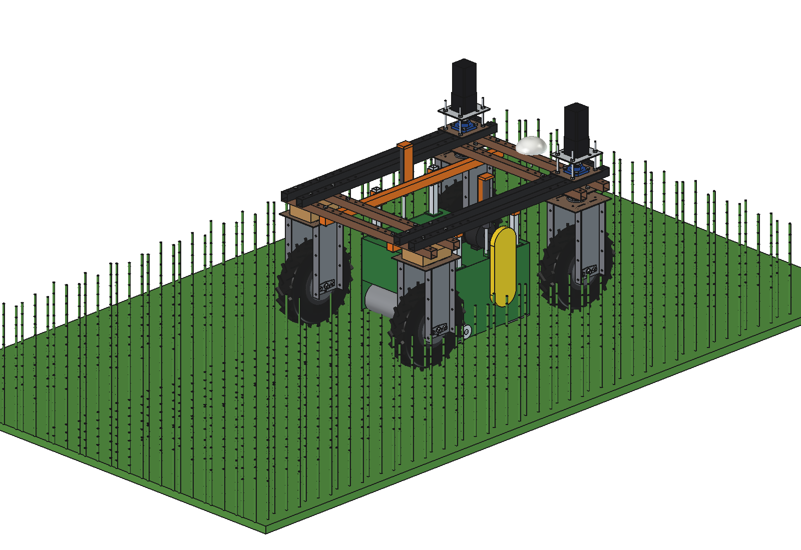
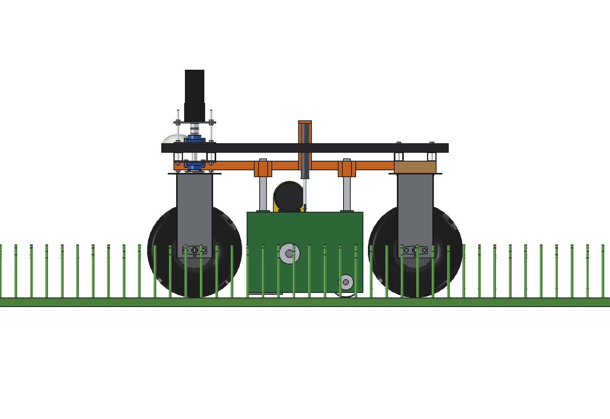
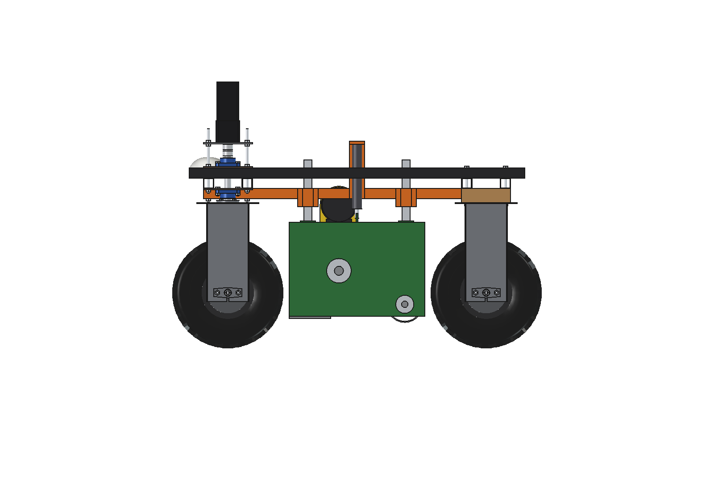
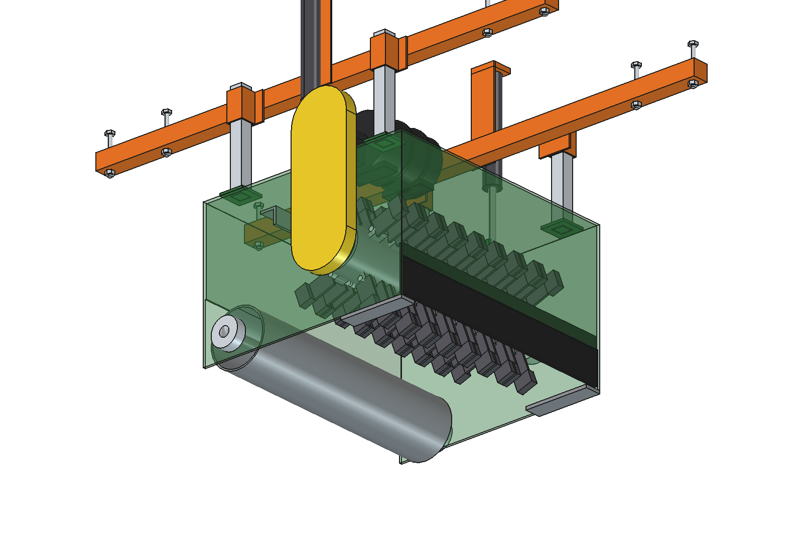
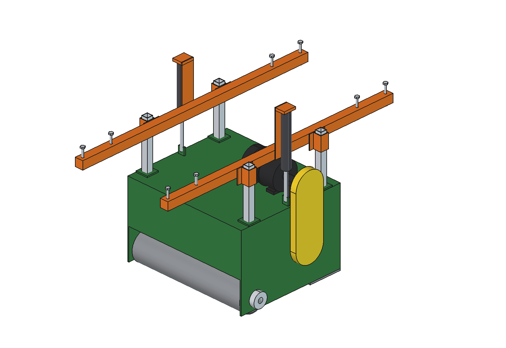

# Flail mulcher (simple)

Shreds tough grass, stubble, crop residues and thin prunings between the rows instead of only cutting them. The
mulcher hangs **under the belly** of the Bruut OpenAgbot (standard robot), between the wheels: its mass sits between
the axles, so no ballast is needed (a rear-mounted mulcher in the three-point hitch would need ~90 kg on the front, see
the [power harrow](../../power%20harrow/simple/)).

- **Mount**: 2 belly rails 40 x 40 x 3 under the lower beams at x +-225 (grid holes, 4 x M10 each), as for the
  drop-on-demand boom and the insect vacuum; 4 mm side plates with guide sleeves and tall actuator brackets.
- **Housing** x +-300, y +-262 (inside the tyres and the steering sweep): 3 mm top, 6 mm side plates, front wall
  with a 6 mm rubber flap, rear wall above the roller, front skids, a shear bar (angle 40 x 6) behind the rotor.
- **Rotor**: tube O108 x 6, 4 rows of 9 shackles (staggered), 72 **Y-knives** 40 x 5 on O12 pins, O320 tip circle,
  2700 rpm (45 m/s tips), 548 mm wide.
- **Rear roller** O140 sets the cutting height (40 mm) and rolls the mulch down.
- **Drive**: a 48 V 2 kW motor between the rails on the housing top, a poly-V belt (0.9 : 1) in a guard on the right.
- **Lift**: 4 guide posts in sleeves and 2 linear actuators (24 V, 1500 N, stroke 100): the housing floats on its
  roller in work, and lifts 100 mm for driving.

<p align="center">
  
</p>

| Work | Lifted 100 mm |
| --- | --- |
|  |  |
|  |  |

## Key figures (`flm_calc.report()`)

| | |
| --- | --- |
| Rotor | 2700 rpm, 45 m/s tips, 72 knives, 360 cuts per metre at 0.5 m/s |
| Grass (1 kJ/m2) | 0.8 m/s: 1.1 kW in all, ~1.5 h, ~1580 m2/h, ~2400 m2 per charge |
| Stubble, residues (2 kJ/m2) | 0.8 m/s: 1.5 kW, ~1.05 h, ~1660 m2 per charge |
| Prunings (4 kJ/m2) | 0.71 m/s at the motor rating: 2.25 kW, ~0.7 h, ~1000 m2 per charge |
| Mass | 116 kg (99 kg lifts, rotor 33 kg) |
| Axle loads | 277 kg with the robot, front 56 %, 78 kg per wheel at most |
| Lift | 970 N needed, 2 x 1500 N (factor 3.1) |

Checks: `check_interference()` [], `check_poses()` {} (work and lifted, front wheels at -30 / 0 / +30 degrees, 3 rotor
angles), `check_holes()` [] (8 rail bolts in lower-beam grid holes), `ground_contact()`: roller on the ground, knives
40 mm, skids 15 mm; all +100 mm lifted. See [RATIONALE.md](RATIONALE.md), including *Estimated, not measured*.

## Usage

```python
exec(open(r"F:\veldrobot\aanbouwdelen\flail mulcher\simple\run_in_freecad.py").read())
import build_flm
build_flm.set_lift(100); build_flm.set_rotor(30)
build_flm.check_interference(); build_flm.check_poses(); build_flm.check_holes()
build_flm.render_all()
```

```bash
"C:/Program Files/FreeCAD 1.1/bin/python.exe" -B flm_calc.py
```

## Files

| File | Contents |
| --- | --- |
| `flm_params.py` | rails, housing, rotor, roller, drive, lift, operation |
| `flm_parts.py` | one function per part (housing in the work position); grass for the renders |
| `build_flm.py` | model tree (lift group and rotor as sub-Parts), checks, mass, `render_all()`, STEP |
| `flm_calc.py` | tip speed and cuts, power per material, battery and area, axle loads, lift force |
| `run_in_freecad.py` | reload, build, print the key figures |
| `Flail_Mulcher.FCStd`, `Flail_Mulcher.step` | generated model (robot hidden in the FCStd) |
| `previews/` | images |
