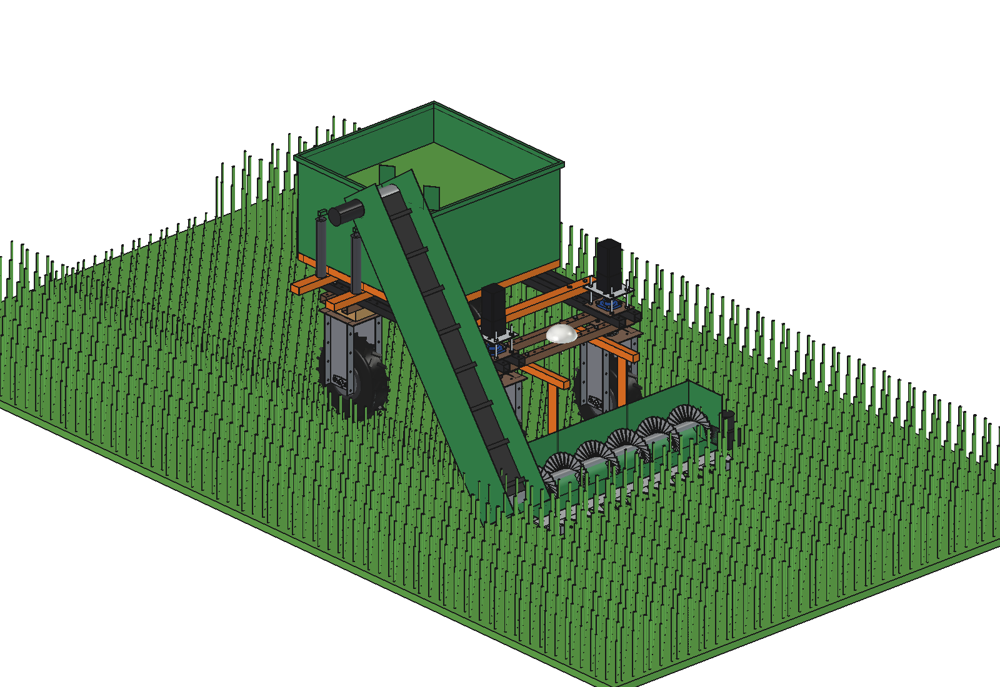
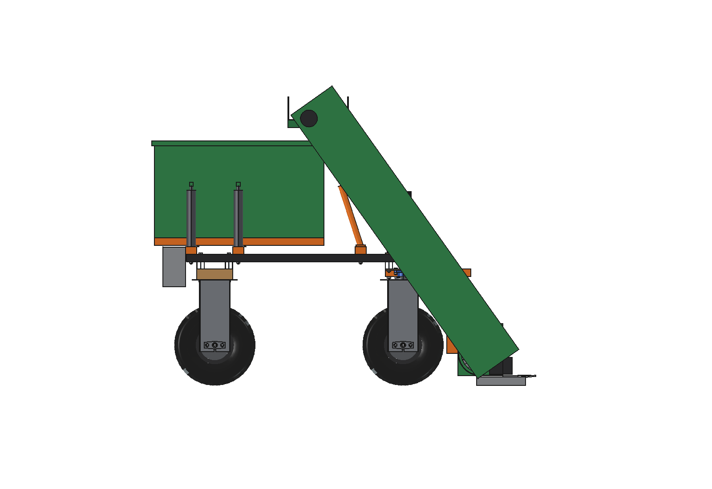
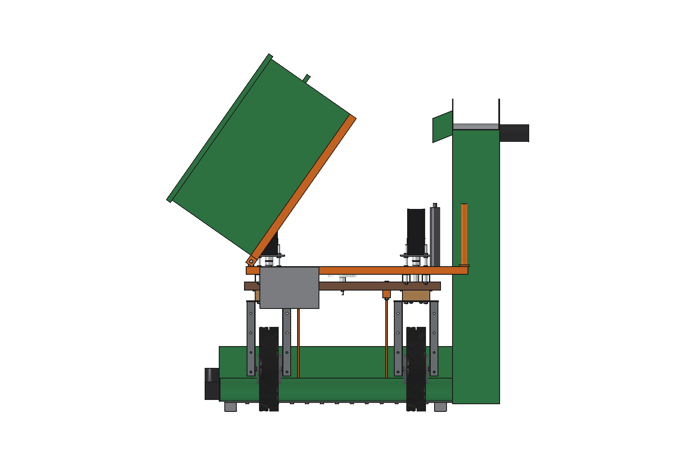
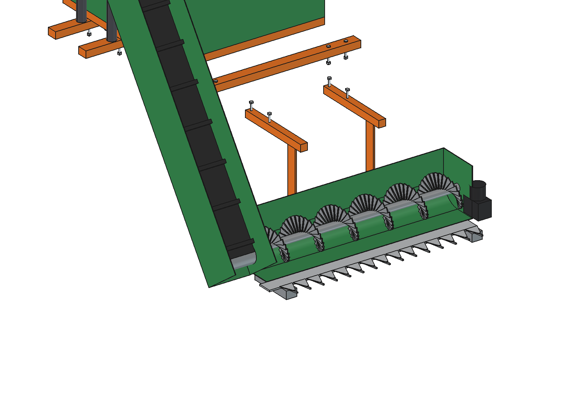
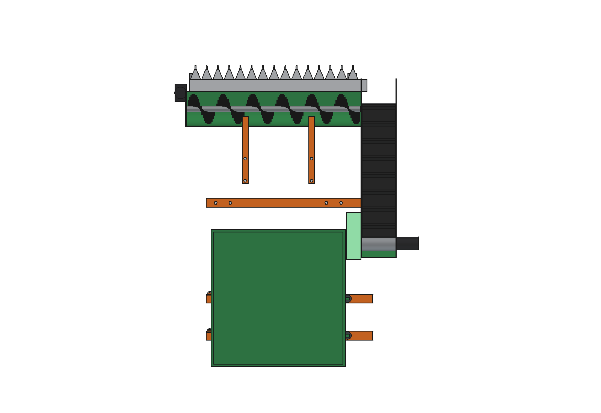

# Fresh grass harvester (zero grazing), simple

Mows fresh grass in the field, loads it and brings it to the feed fence, many small loads a day.

- **Front**: 2 arms 40 x 40 x 3 under the front lower beams (x +-225, grid holes; low enough for the steered top
  plates), 8 mm drop plates, an **auger trough** with a cross auger O200 (pitch 200) that pushes the grass to the right,
  a **1.2 m sickle bar** (sections at 76.2 mm, guard fingers) on 2 skids, its crank box and motor at the left end.
- **Elevator**: a slatted belt 300 wide in a 3 mm channel **outside the right front wheel** (x 560-800, 26 mm outside
  the steering sweep), from the auger end (y 900) up and back to y 0, z 1.42 m; a 24 V motor on the upper roller, a
  short spout (the belt throws the grass over it into the container), a stay O30 to the front cross tube.
- **Container** 0.41 m3 (2 mm), on a tipping frame over 2 cross tubes (y -625, -375, grid holes), hinged on the left
  and tipped 55 degrees by 2 actuators: it **unloads on the left**, along the feed fence.
- **Ballast**: a 60 kg block behind the robot on the rear cross tube (the cutter bar, auger and elevator are in front
  and on the right).

<p align="center">
  
</p>

| Side | Tipped (rear) |
| --- | --- |
|  |  |
|  |  |

## Key figures (`fgh_calc.report()`)

| | |
| --- | --- |
| Load | 0.41 m3, ~73 kg fresh grass (200 kg/m3, 90 % full) |
| Mowing | 1.5 t DM/ha at 18 % DM = 0.83 kg/m2: 88 m2, a 73 m strip per load, ~2.5 min at 0.5 m/s |
| Trip | 300 m to the fence and back at 1.5 m/s + 2 min unloading: ~11 min, ~92 Wh |
| Per charge | ~17 trips, ~1.3 t of grass in ~3.3 h: ~21 cows at 60 kg a day |
| Power while mowing | ~1.05 kW (bar 360 W, auger 150 W, elevator 200 W, drive 300 W) |
| Mass | 286 kg (front 64, elevator 71, container and frame 70, ballast 60, cross tubes) |
| Axle loads | empty 448 kg, front 57 %; full 521 kg, front 51 %; 154 kg on the front right wheel at most |
| Stability | sideways tip angle 25 degrees full |

Checks: `check_interference()` [], `check_poses()` {} (container 25 and 55 degrees, auger, front wheels at +-30
degrees), `check_holes()` [] (12 upper-beam and 4 lower-beam bolts in grid holes). See [RATIONALE.md](RATIONALE.md),
including the list *Estimated, not measured*.

## Usage

```python
exec(open(r"F:\veldrobot\aanbouwdelen\fresh grass harvester\simple\run_in_freecad.py").read())
import build_fgh
build_fgh.set_tip(55); build_fgh.set_auger(30)
build_fgh.check_interference(); build_fgh.check_poses(); build_fgh.check_holes()
build_fgh.render_all()
```

```bash
"C:/Program Files/FreeCAD 1.1/bin/python.exe" -B fgh_calc.py
```

## Files

| File | Contents |
| --- | --- |
| `fgh_params.py` | front arms, trough, auger, cutter bar, elevator, container, ballast, operation |
| `fgh_parts.py` | one function per part; the elevator is drawn in a local belt frame and transformed; grass for the renders |
| `build_fgh.py` | model tree (auger and container as sub-Parts), checks, mass, `render_all()`, STEP |
| `fgh_calc.py` | load per trip, mowing strip, trip time and energy, cows per charge, axle loads |
| `run_in_freecad.py` | reload, build, print the key figures |
| `Fresh_Grass_Harvester.FCStd`, `Fresh_Grass_Harvester.step` | generated model (robot hidden in the FCStd) |
| `previews/` | images |
