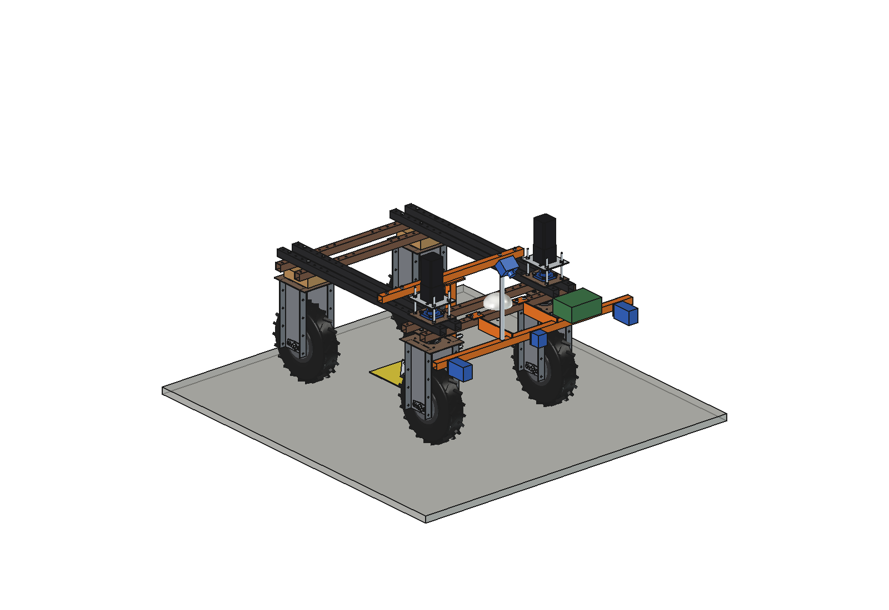
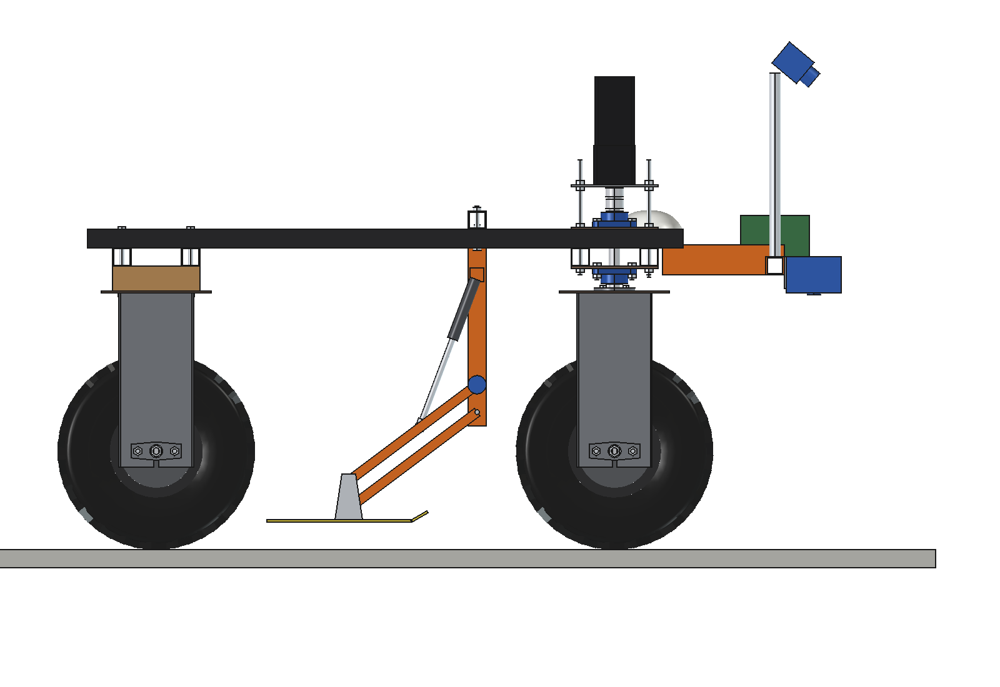
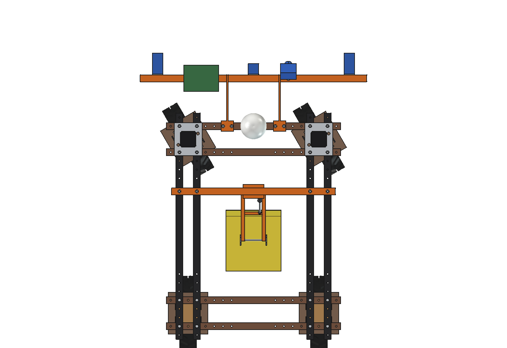
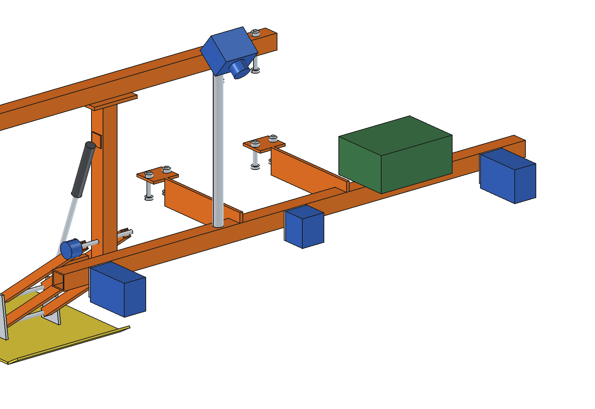
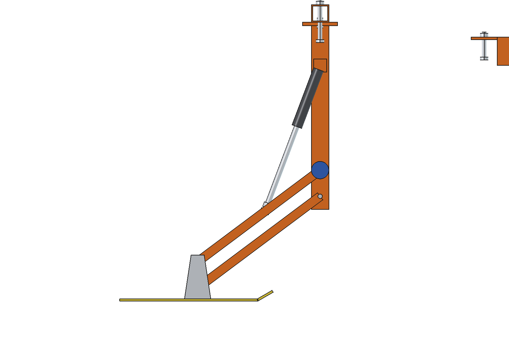
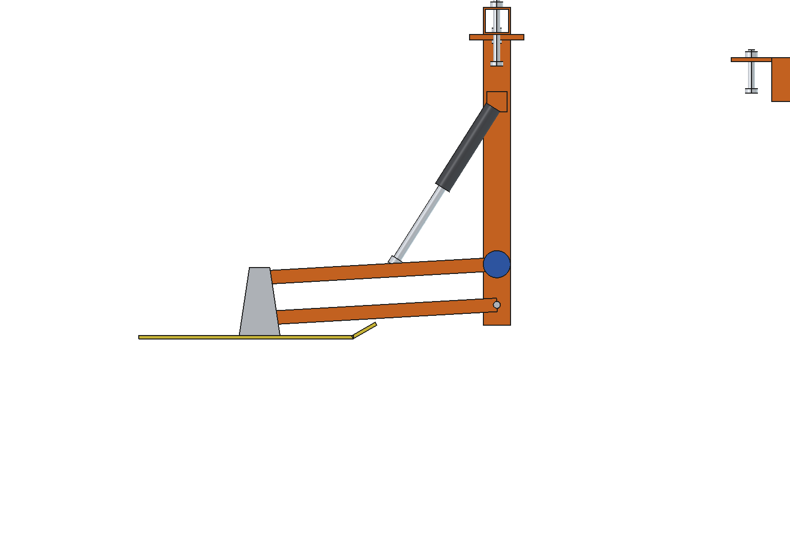

# Grass meter / crop scanner (simple)

Sensor kit for the Bruut OpenAgbot (standard robot) that maps grass cover while driving: a front boom with 2 active
NDVI sensors, a lidar for canopy height and a camera, and a sledge plate meter under the robot between the axles that
measures the compressed sward height (the farmer's dry-matter measure). Height, NDVI and dry matter are logged per GNSS
position and become task maps for the fertilizer spreader and the liquid applicator. Covers the *NIR sensor* idea.

<p align="center">
  
</p>

| Side | Top, wheels steered 30 degrees |
| --- | --- |
|  |  |
|  |  |



## Build

- **Boom**: 2 flat brackets 8 mm on base plates on the front outer lower beam (2 x M10 each), cross tube 40 x 40 x 3,
  1300 long at y 830..870, z 600..640. 2 active NDVI sensors at x +-550 (lens 560 above the ground), a lidar distance
  sensor at x 0, an RGB camera on a O25 mast (tilted 40 degrees down), a logger / RTK box.
- **Plate meter**: bearer 40 x 40 x 3 across the upper beams at y 200, a post 40 x 40 down to 2 pivots, 2 pairs of
  arms 20 x 20 x 2 (350 between pins, parallelogram), plate 316 x 316 (0.1 m2) PE 5 mm with a turned-up lip, an angle
  sensor on the upper pivot, a 24 V 200 N actuator with a slotted rod eye to lift it.

Mass 22 kg (boom 12.5, plate meter 9.5). Size 1300 x 1253 x 1048 mm. No interference over the plate range (0..200 mm,
lifted 250) and with the wheels steered +-30 degrees; boom 181 mm from the front tyres, plate 167 mm from the rear tyres.

## Key figures (`gmt_calc.report()`)

| | |
| --- | --- |
| Plate | 0.1 m2, 5 kg/m2, arm 50.5..11.5 degrees over 0..200 mm, resolution 0.3..0.5 mm |
| Dry matter (to calibrate) | 30 mm: 920, 60 mm: 1340, 100 mm: 1900, 150 mm: 2600 kg DM/ha |
| Readings along the track at 1.5 m/s | plate and NDVI every 150 mm, lidar every 75 mm, photo every 1.5 m |
| NDVI | 2 strips 0.46 m wide at x +-0.55 m |
| Capacity | 4.4 ha/h on 10 m transects, 6700 plate readings per ha |
| Energy | 239 W (sensors 25 W), ~8 h and ~35 ha per battery |

Why and how these come out: see [RATIONALE.md](RATIONALE.md), including the list *Estimated, not measured*.

## Files

| File | Contents |
| --- | --- |
| `gmt_params.py` | all dimensions, robot interface, sensors, plate meter geometry (`arm_angle`, `arm_end`), work parameters |
| `gmt_parts.py` | one function per part, robot coordinates; plate meter parts take the sward height |
| `build_gmt.py` | model tree, `set_height()`, checks (`check_interference`, `check_poses`, `clearance`), mass, `render_all()`, STEP |
| `gmt_calc.py` | plate pressure and resolution, dry matter, reading spacing, NDVI footprint, capacity and energy |
| `run_in_freecad.py` | reload, build, print the key figures |
| `Grass_Meter.FCStd`, `Grass_Meter.step` | generated model (robot hidden in the FCStd) |
| `previews/` | images |

## Use

```python
exec(open(r"F:\veldrobot\aanbouwdelen\grass meter\simple\run_in_freecad.py").read())
import build_gmt
build_gmt.set_height(250)       # plate lifted
build_gmt.check_poses()         # must be {}
```
