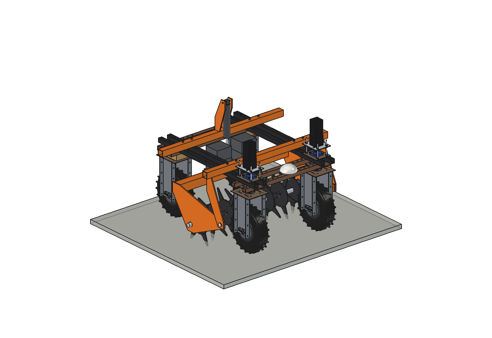
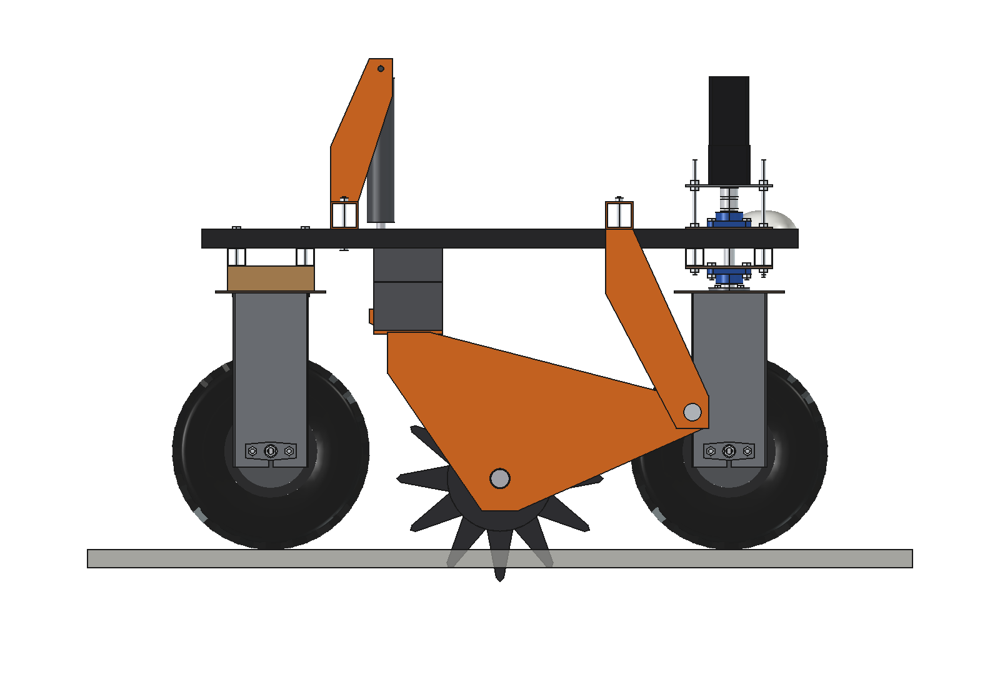
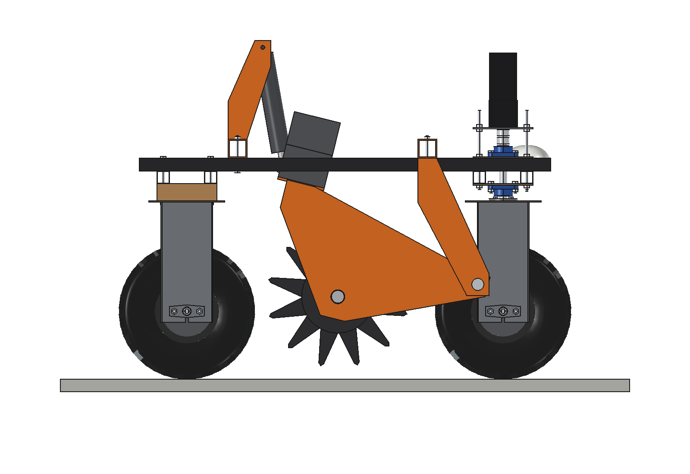
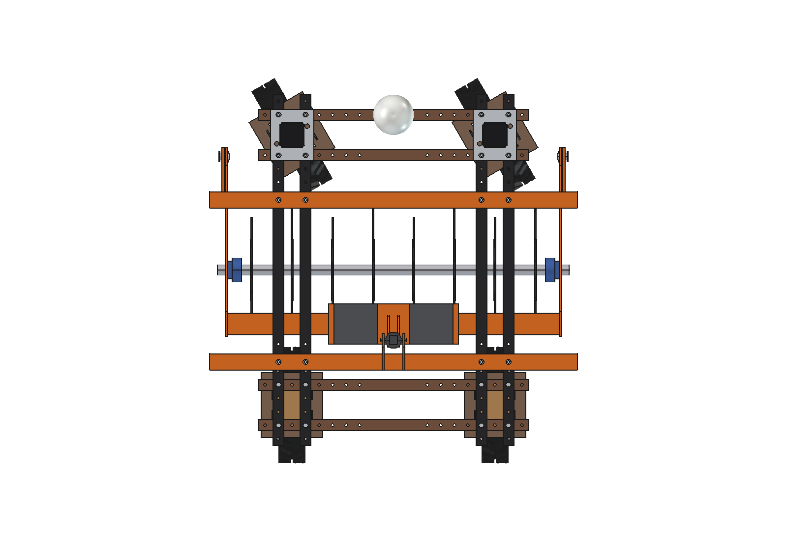
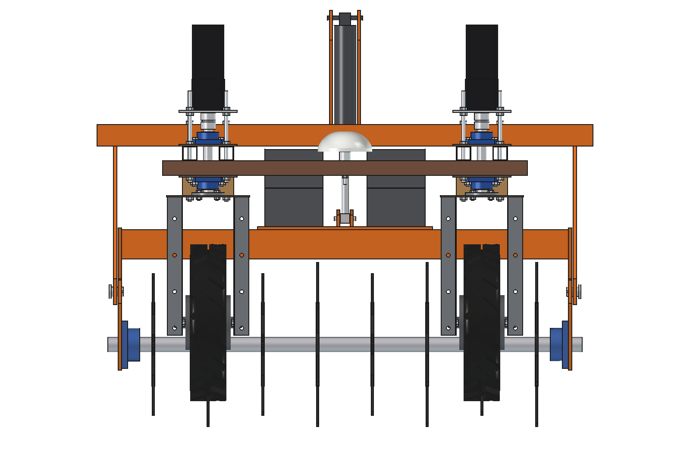
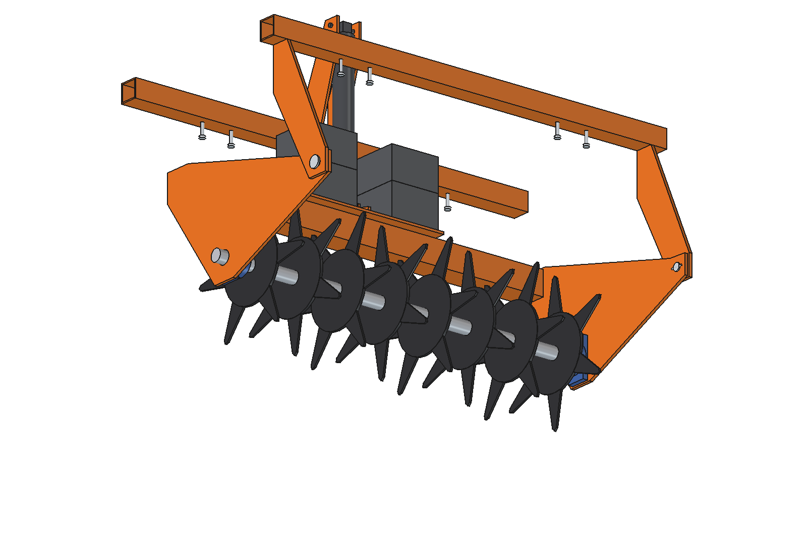
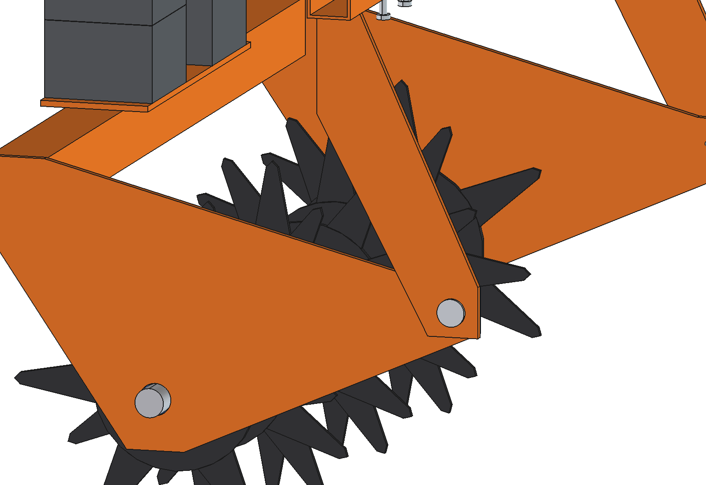

# Grassland aerator (simple)

Slitter aerator in the middle of the Bruut OpenAgbot (standard robot), between the axles: a passive roller with 8 star
discs (6 slitting knives each, O450) cuts slits 150 mm apart and 70 mm deep into grassland. Frame weight and 80 kg of
ballast press the knives in, both axles share the reaction; a 24 V actuator lifts the roller 14 degrees for the headland
and can add down force.

<p align="center">
  
</p>

| Work (knives 70 mm deep) | Transport (lifted 14 degrees) |
| --- | --- |
|  |  |
|  |  |
|  |  |

## Build

- **Mount**: 2 bridges 60 x 60 x 4 (L 1360) on top of the upper beams, 4 x M10 each; 2 hanger plates 10 mm under the
  ends of the front bridge, outside the steering sweep, with the O25 arm pivots; actuator mast (2 x 8 mm) on the rear
  bridge.
- **Roller frame**: 2 side arms 10 mm, cross beam 80 x 80 x 4 behind the roller, ballast tray with 2 stacks of 2 x 20 kg
  blocks (between the inner upper beams), rod lugs.
- **Roller**: O40 shaft in 2 UCFL208 flange bearings, 8 stars (hub O230 x 8, 6 knives 6 mm, root 60 / tip 16 wide),
  neighbours turned 30 degrees.
- **Actuator**: 24 V 2000 N, stroke 200, vertical from the mast to the lugs; retracts to lift, pushes to press.

Mass ~201 kg (lift group 167 kg incl. 80 kg ballast, mount 30 kg). Size 1360 x 825 x 1142 mm (x, y, z).

## Key figures (`gae_calc.report()`)

| | |
| --- | --- |
| Working width / slits | 1.2 m, 150 x 236 mm, 28 slits per m2 |
| Capacity at 1.2 m/s | ~0.41 ha/h (80 % field efficiency) |
| Down force needed / from weight / grip limit | 1980 / 1790 / 2420 N; actuator pushes ~120 N |
| Pull | 325 N (roller 238, rolling 87), grip margin 2.0, ~0.5 kW |
| Lift actuator | ~1.1 .. 1.3 kN (rating 2 kN), full lift ~13 s, knife tips 36 mm up |
| Axle load front / rear, transport | 166 / 184 kg (front 47 %) |
| Clearance to tyres (front steered 30) / to upper beams | 47 mm / 34 mm in transport |

Why and how these come out: see [RATIONALE.md](RATIONALE.md), including the list *Estimated, not measured*.

## Files

| File | Contents |
| --- | --- |
| `gae_params.py` | all dimensions, robot interface, poses, work parameters, masses from the model |
| `gae_parts.py` | one function per part, robot coordinates, work pose |
| `build_gae.py` | model tree, `set_pose(lift)`, checks (`check_interference`, `check_poses` with steering, `clearance`, `ground_contact`), mass, `render_all()`, STEP |
| `gae_calc.py` | slit pattern, down force against knives and grip, pull, actuator, axle loads |
| `run_in_freecad.py` | reload, build, print the key figures |
| `Grassland_Aerator.FCStd`, `Grassland_Aerator.step` | generated model (robot hidden in the FCStd) |
| `previews/` | images |

## Use

```python
exec(open(r"F:\veldrobot\aanbouwdelen\grassland aerator\simple\run_in_freecad.py").read())
import build_gae
build_gae.set_pose(lift=14)
build_gae.check_poses()        # lift -3..14 x steering -30..30: must be {}
```

No animation yet (simple variant): the poses are checked statically with `check_poses()`.
