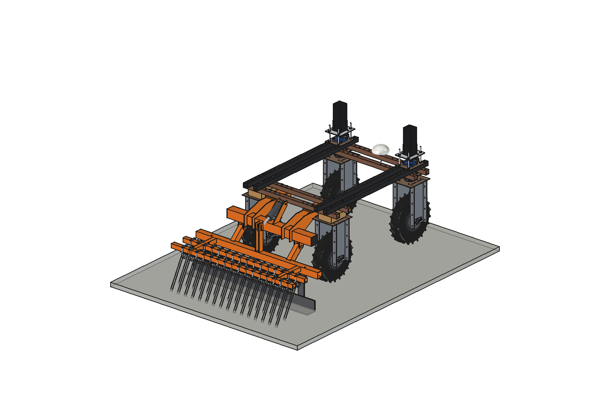
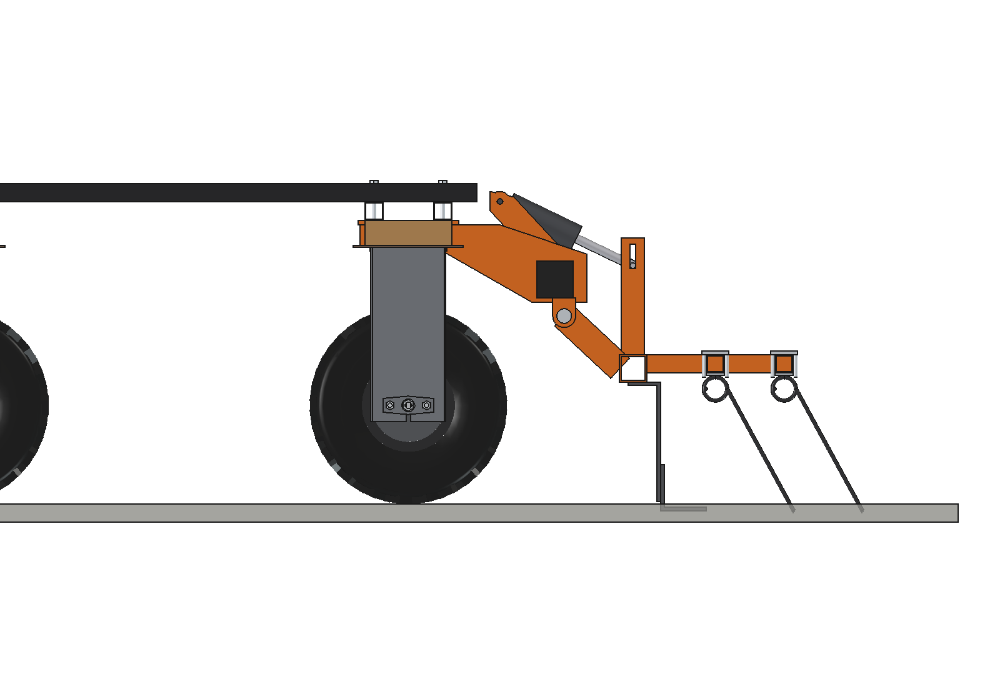
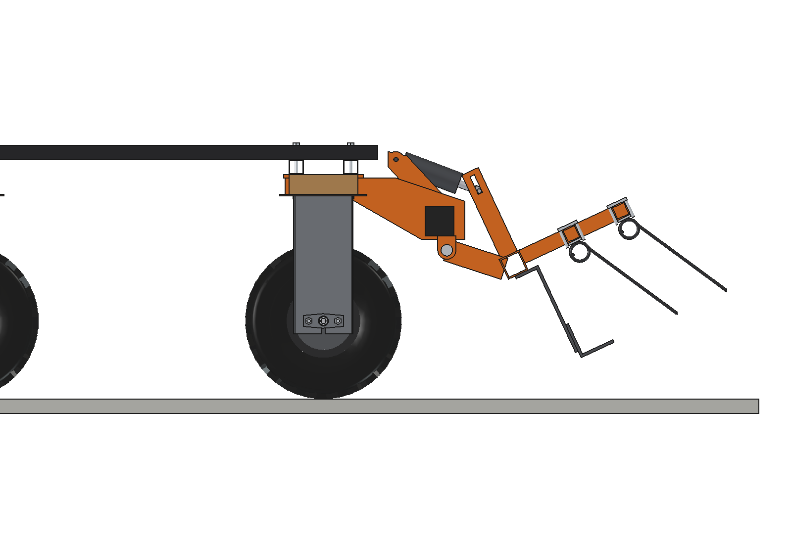
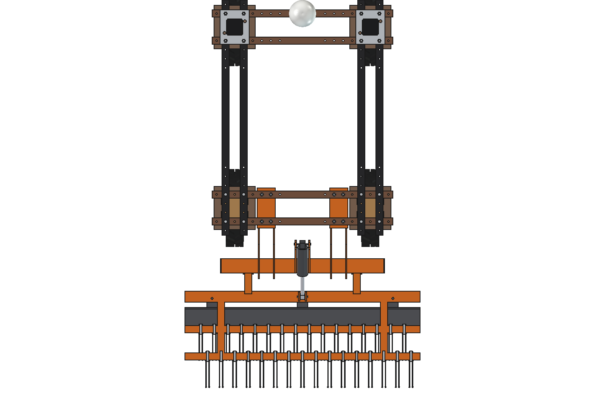
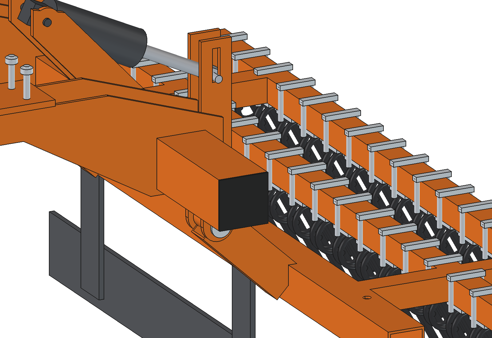

# Grassland harrow (simple)

Rear-mounted pasture harrow for the Bruut OpenAgbot (standard robot). A levelling board spreads molehills and dung pats,
two rows of spring tines behind it rake out moss and dead grass and work overseeded seed in. 1300 mm wide, floats on the
sward, lifted 114 mm (board) / 232 mm (tines) by a linear actuator. Covers the *molehill spreader* idea.

  

| Work (floating) | Transport (lifted 25 degrees) |
| --- | --- |
|  |  |
|  |  |

## Build

- **Mount**: rear toolbar 80 x 80 x 4 (L 900) on 2 hangers under the rear lower beams, 8 x M10 in the hole grid
  (x = +-175 / +-225). Pivot forks and actuator mast as the push blade, mirrored: the same toolbar carries both.
- **Harrow**: one weldment of 2 arms 60 x 40 x 3, main beam 60 x 60 x 4 (L 1300), 2 side members and 2 tine bars
  40 x 40 x 3. Levelling board: angle 100 x 100 x 8, upright leg in front, flat leg trailing, on 3 flat bars with
  depth holes. 32 double spring tines O8 (75 mm per row, rows offset: a track every 37.5 mm), clamped with U-bolts.
- **Actuator**: 24 V, 1500 N, stroke 100 (240..340 pin to pin), rod pin in a 40 mm float slot.

Mass ~85 kg (harrow 60 kg, mount 22 kg). Size 1300 x 1104 x 701 mm.

## Key figures (`gha_calc.report()`)

| | |
| --- | --- |
| Weight on the ground (floating) | board 11 kg, tines 27 kg (8 N per tine, 12 mm tine deflection) |
| Pull force on grass | 629 N (tines 397, board 111, rolling 121); grip 905 N, margin 1.44 |
| Power at 1.5 m/s | ~1260 W |
| Actuator force to lift | 1100..1180 N (rating 1500 N), lift time ~9 s |
| Capacity | ~0.56 ha/h (1.3 m, 1.5 m/s, 80 %) |
| Axle load front / rear, lifted | 36 / 206 kg (front 15 %) |

Why and how these come out: see [RATIONALE.md](RATIONALE.md), including the list *Estimated, not measured*.

## Files

| File | Contents |
| --- | --- |
| `gha_params.py` | all dimensions, robot interface, poses, work parameters, masses from the model |
| `gha_parts.py` | one function per part, robot coordinates, work pose (toolbar, forks, mast, actuator: push blade parts mirrored) |
| `build_gha.py` | model tree, `set_pose(lift)`, checks (`check_interference`, `check_poses`, `clearance`, `ground_contact`), mass, `render_all()`, STEP |
| `gha_calc.py` | weight on board and tines, pull force against grip and motors, molehill soil, actuator, axle loads |
| `run_in_freecad.py` | reload, build, print the key figures |
| `Grassland_Harrow.FCStd`, `Grassland_Harrow.step` | generated model (robot hidden in the FCStd) |

No animation yet (simple variant): the lift poses are checked with `check_poses()`.
