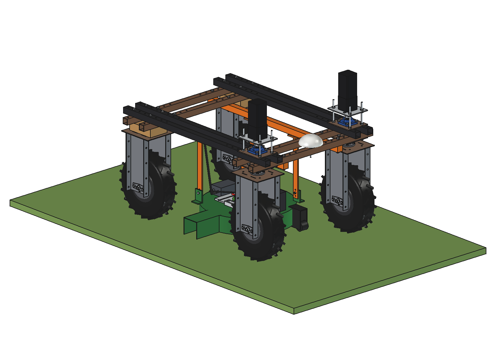
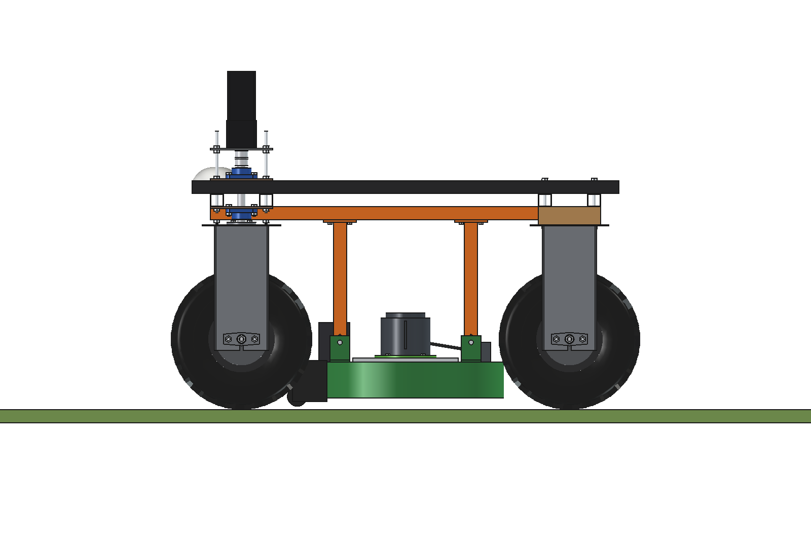
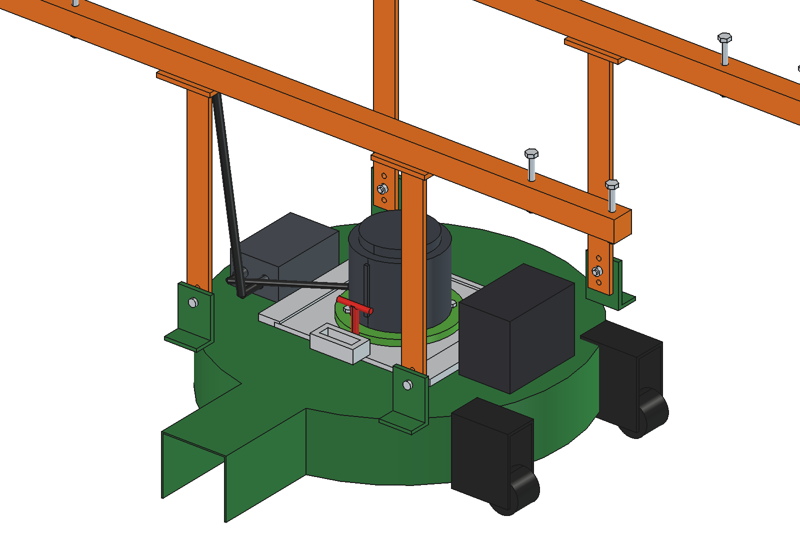
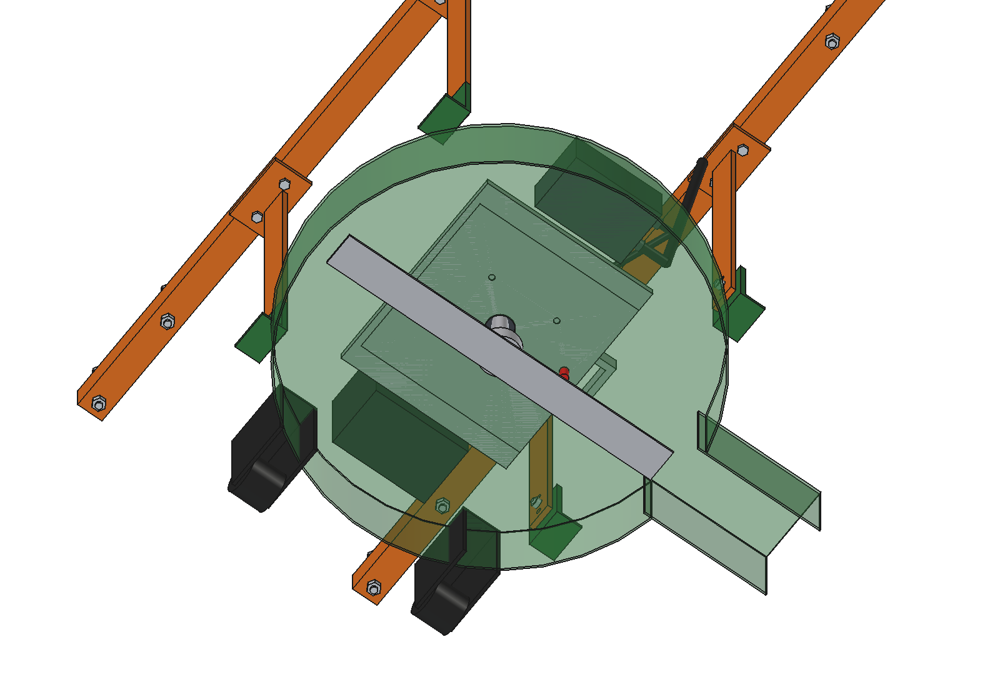

# Heavy-duty electric motors (simple)

A universal motor module for bought battery garden-tool motors (EGO Power+ / Greenworks class 56-60 V brushless
lawnmower motors, ~2 kW), so an implement that needs real power gets a cheap, ready drive instead of a small petrol
engine or a custom 48 V BLDC. Shown on a demonstrator: a 530 mm mid-mower deck under the belly of the robot.

- **Interface plate** (aluminium 8 mm, 260 x 260) with a 4 x M8 pattern on PCD 150; every motor brand gets its own
  **adapter ring** (O190) between its flange and the plate.
- **Dovetail receiver** on the implement: the plate slides in from the right and a spring **lock pin** with a T-handle
  holds it. Changing the motor between implements takes a minute and no tools.
- **Supply**: a generic BLDC controller (75 V class) in an IP67 box, on the robot's 48 V bus through an Anderson SB50
  plug (the tool's own controller and battery handshake are not used). Option: the tool's own battery in a clip, for
  short jobs away from the robot.
- **Demonstrator**: mower deck O600 with side discharge, blade 530 mm, 2 anti-scalp rollers, hung from 2 rails under
  the lower beams (as on the drop-on-demand boom) by 4 flat hangers with 3 cutting heights (40 / 60 / 80 mm).

  

| Side | Module and quick change | Deck from below |
| --- | --- | --- |
|  |  |  |

## Key figures (`hdm_calc.report()`)

| | |
| --- | --- |
| Blade | 3300 rpm: tip 91.6 m/s (limit 96.5); on the 48 V bus ~2830 rpm, 78.5 m/s (still cuts well) |
| Mowing power | ~1.3 kW mechanical at 1 m/s in dense grass (motor at 66 % of 2 kW), ~1.55 kW electric, 32 A at 48 V |
| Area | 0.47 m net width: ~1350 m2/h |
| Robot battery (2.4 kWh) | ~1.3 h with driving, ~1750 m2 per charge |
| Tool battery (280 Wh) alone | ~11 min, ~240 m2: only for short jobs |
| Mass | demonstrator ~39 kg; the motor module that changes hands ~8 kg |

Checks: `check_interference()` [], `check_poses()` {} (3 cutting heights x steering +-30). See
[RATIONALE.md](RATIONALE.md), including the list *Estimated, not measured*.

## Files

| File | Contents |
| --- | --- |
| `hdm_params.py` | module (plate, ring, receiver, motor, controller, battery), deck, belly rails and hangers, mowing figures |
| `hdm_parts.py` | one function per part, robot coordinates |
| `build_hdm.py` | model tree, `set_height(dz)`, checks (`check_interference`, `check_poses`), mass, `render_all()`, STEP |
| `hdm_calc.py` | tip speed, mowing power and current, area per hour, per robot charge and per tool battery |
| `run_in_freecad.py` | reload, build, print the key figures |
| `Heavy_Duty_Motor.FCStd`, `Heavy_Duty_Motor.step` | generated model (robot hidden in the FCStd) |
| `previews/` | images |
