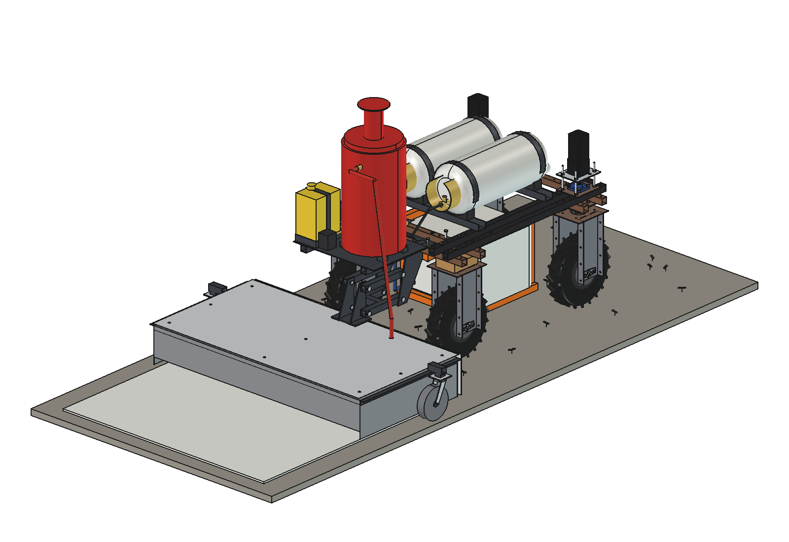
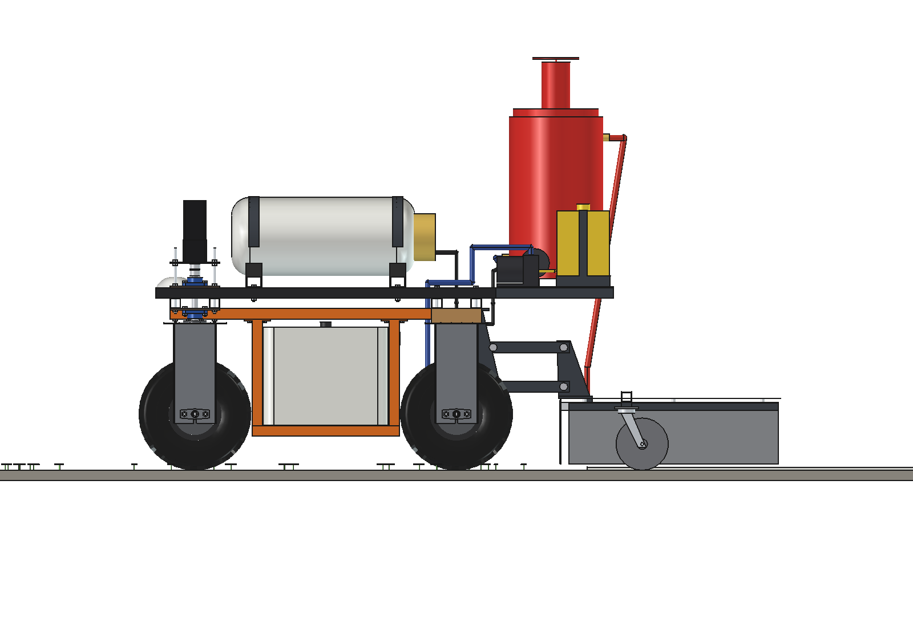
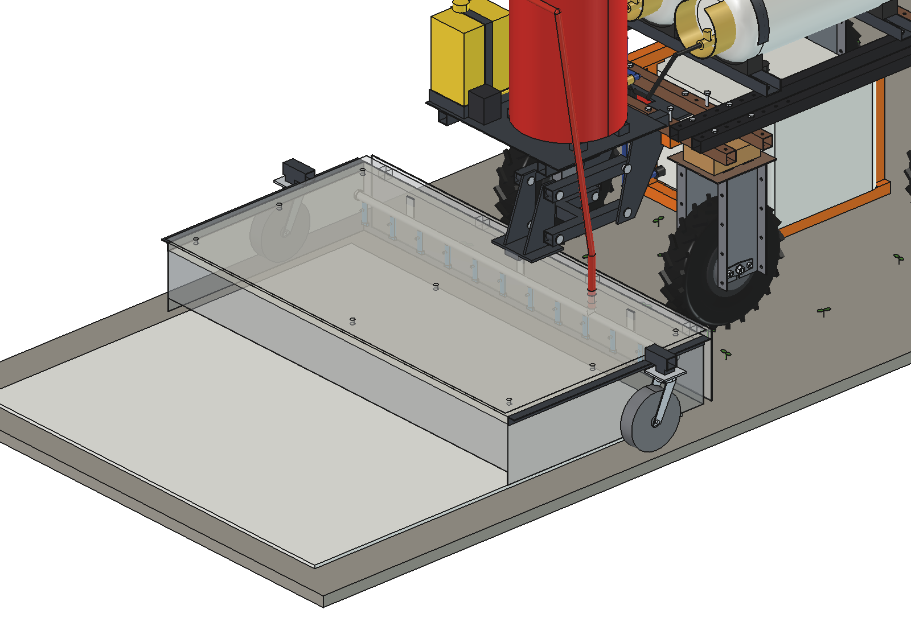
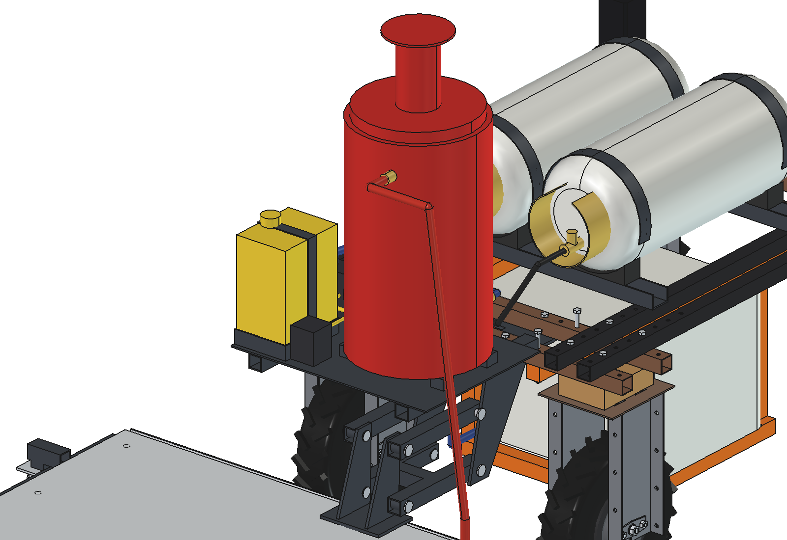
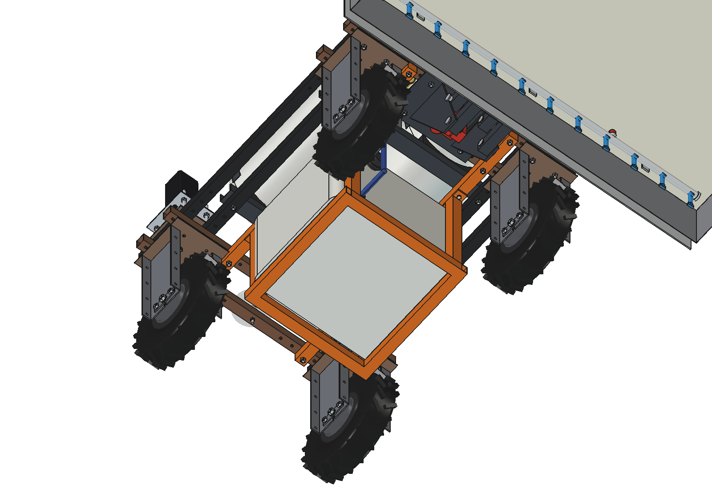
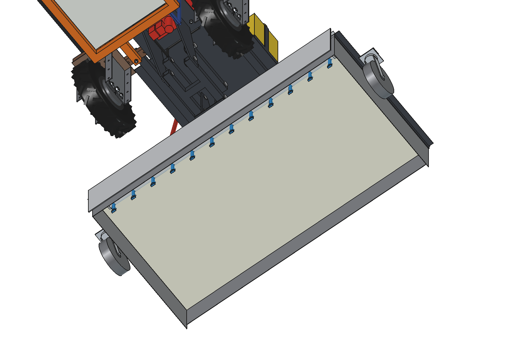
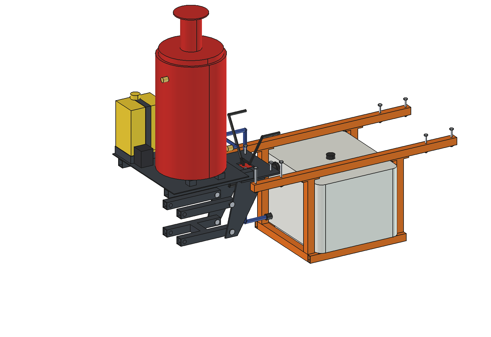

# Hot foam weeder (simple)

Kills weeds on paths, pavements, yards, fence lines and tree rows with **hot water (96 C) and 0.5 % foam
concentrate**, under the insulated hood of the flame weeder. The foam holds the heat on the leaves (~20 s instead of
~3 s for water alone), and there is no flame on the ground: also where flaming is a fire risk (dry grass, straw,
next to buildings and fences).

Reused (imported, not copied) from the [flame weeder](../../weeds%20burner/propane_hood/README.md): the 1.5 m hood with
its ceramic blanket, the 2 steel castors, the free parallelogram and the mount plate, the 2 x 18 kg propane cylinders
and the liquid gas valves. The 6 burners in the hood are replaced by a **foam bar with 12 nozzles**. New:
- a **~95 l water tank under the belly**, on a frame hung from 2 rails under the lower beams (as on the
  [drop-on-demand boom](../../drop%20on%20demand%20boom/simple/README.md));
- a **rear rack** on the rear lower beams with a **40 kW propane coil boiler** (hot-water pressure-washer type), the
  24 V water pump and a 10 l foam can with a dosing pump.

<p align="center">
  
</p>

| Side | Foam bar through the hood |
| --- | --- |
|  |  |
|  |  |
|  |  |

## Build

- **Water**: PE tank 560 x 476 x 375 (~95 l) on a frame of 40 x 40 x 3 at 130-170 mm above the ground, 4 hangers to
  the belly rails (x +-225, y +-262), filled through a camlock coupling at the rear. Suction hose up in front of the
  rear beams, over them, to the pump.
- **Rear rack**: 2 tubes 40 x 40 x 3 on top of the rear lower beams (one long M10 per hole through rack, beam and
  belly rail), deck plate 4 mm from y -660 to -1100, over the parallelogram.
- **Boiler**: insulated drum O360 x 620 with a stainless coil, burner firing up inside the bottom, fan and gas valve
  on the left side, flue with rain cap. Liquid propane from the cylinders through the flame weeder's main valves.
- **Pump** 24 V diaphragm, 11 l/min; **foam** 10 l can, dosing pump into the suction side (0.5 %).
- **Foam bar**: stainless 3/4" across the hood front (y -1000, z 190), 12 foam nozzles at 125 mm (flat jet with an
  air inlet), on 3 straps to the hood top; the insulated hot hose comes down through the hood top.

Mass ~224 kg empty (rack 58 kg, hood 72 kg on its castors, gas group 44 kg incl. cylinder tare, water group 31 kg,
mount 20 kg). Size 1770 x 2335 x 1579 mm (x, y, z).

## Key figures (`hfw_calc.report()`)

| | |
| --- | --- |
| Boiler | 40 kW into the water: 6.8 l/min from 12 to 96 C, 3.7 kg/h propane |
| Speed and rate | 0.4 l/m2 over 1.5 m: **0.19 m/s**, ~1000 m2/h; 4.2 s under the hood |
| Heat on the soil | ~136 kJ/m2 (flame weeder ~162); propane ~36 kg/ha, the same as flaming |
| Water | 95 l = ~240 m2 (158 m of 1.5 m path) in ~14 min: refill from the mobile refiller or a tap |
| Propane, foam | 2 x 18 kg = ~1 ha; 10 l concentrate = ~5000 m2 |
| Battery | ~460 W (drive 250, pump 110, fan 60, control, doser): ~5 h, ~4300 m2 per charge |
| Running cost | ~1.9 EUR per 100 m2 (foam 1.2, propane 0.6, water 0.1) |
| Axle load front / rear | 174 / 271 kg full (rear 61 %), 109 / 205 kg empty; max 136 kg per wheel |
| Clearance | tank frame 30 mm from a front tyre at 30 degrees steering |

Why and how these come out: see [RATIONALE.md](RATIONALE.md), including the list *Estimated, not measured*.

## Animation

| Animation | Shows |
| --- | --- |
| `previews/animation_hot_foam.gif` (generated, not in git; also in `animations/`) | the robot drives 3.6 m over a paved path at 0.19 m/s (6 x speed), the hood see-through; the bar lays a white layer of hot foam, weeds under it turn orange and black after 2 s. 40 weeds, 5.4 m2, 2.2 l water, 19 g propane. |

```python
import animate_hfw
animate_hfw.build(); animate_hfw.play()
animate_hfw.render_all(r"C:\temp\hfw_frames")
import make_gif_hfw; make_gif_hfw.main(r"C:\temp\hfw_frames", r"previews\animation_hot_foam.gif")
```

## Files

| File | Contents |
| --- | --- |
| `hfw_params.py` | all dimensions; robot interface, hood, mount and propane via `flw_params`; process figures; masses from the model |
| `hfw_parts.py` | one function per part, robot coordinates; flame-weeder hood shell with the hose hole; path, weeds and foam for the renders |
| `build_hfw.py` | model tree (gas group from build_flw), `set_pose(float_h)`, checks (`check_interference`, `check_holes`, `check_fit`, `clearance`), mass, `render_all()`, STEP |
| `hfw_calc.py` | boiler flow and gas, speed for the dose, heat against flaming, ranges per tank / fill / charge, cost, axle loads |
| `hfw_field.py` | process model: weeds on a path, drive, foam strip, heat time per weed, water and gas used |
| `animate_hfw.py`, `make_gif_hfw.py` | animation on the robot, frames to GIF with caption and legend |
| `run_in_freecad.py` | reload, build, print the key figures |
| `Hot_Foam_Weeder.FCStd`, `Hot_Foam_Weeder.step` | generated model (robot hidden in the FCStd) |
| `previews/` | images |

## Use

```python
exec(open(r"F:\veldrobot\aanbouwdelen\hot foam weeder\simple\run_in_freecad.py").read())
import build_hfw
build_hfw.check_interference()  # []
build_hfw.check_holes()         # {}
build_hfw.check_fit()           # hood float -60 / 0 / 80 and steering +-30: {}
build_hfw.clearance()           # 30.5 mm, tank frame to the front tyre at 30 degrees
```
