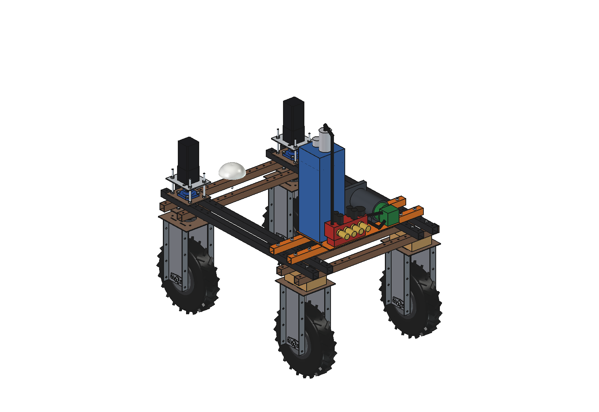
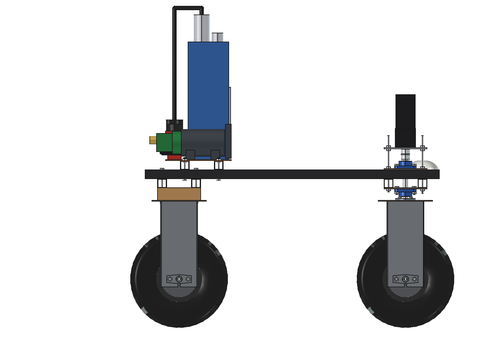
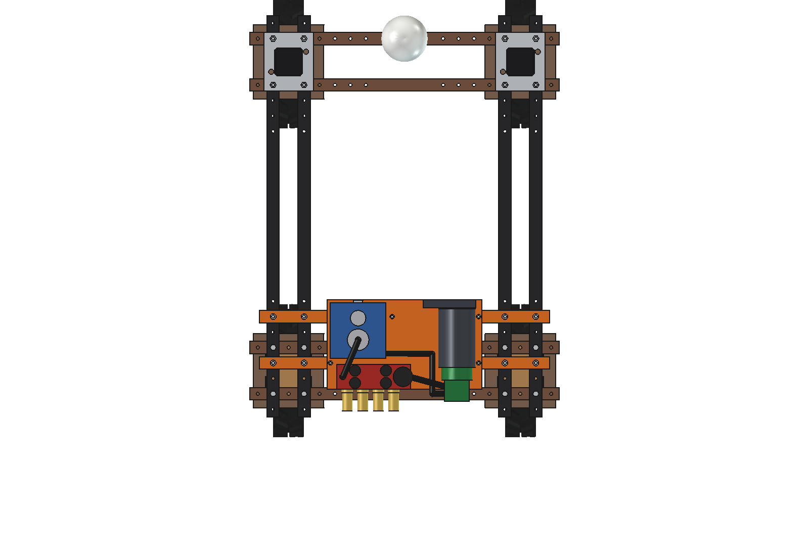
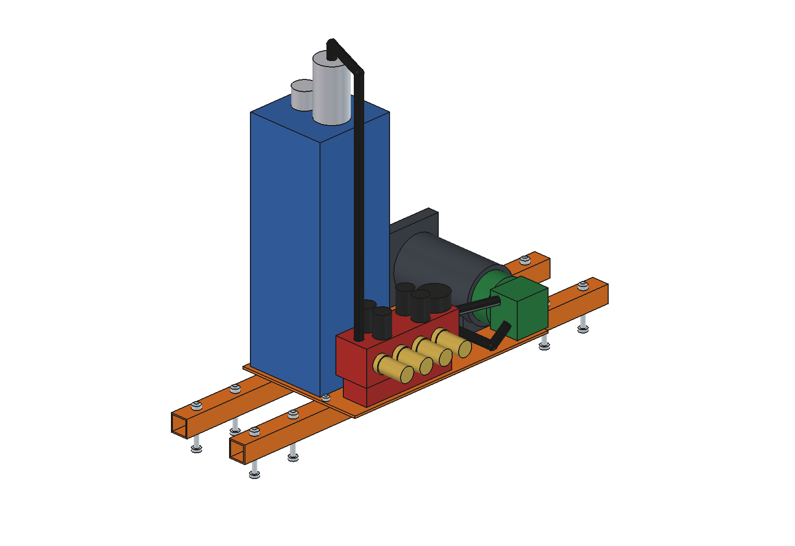
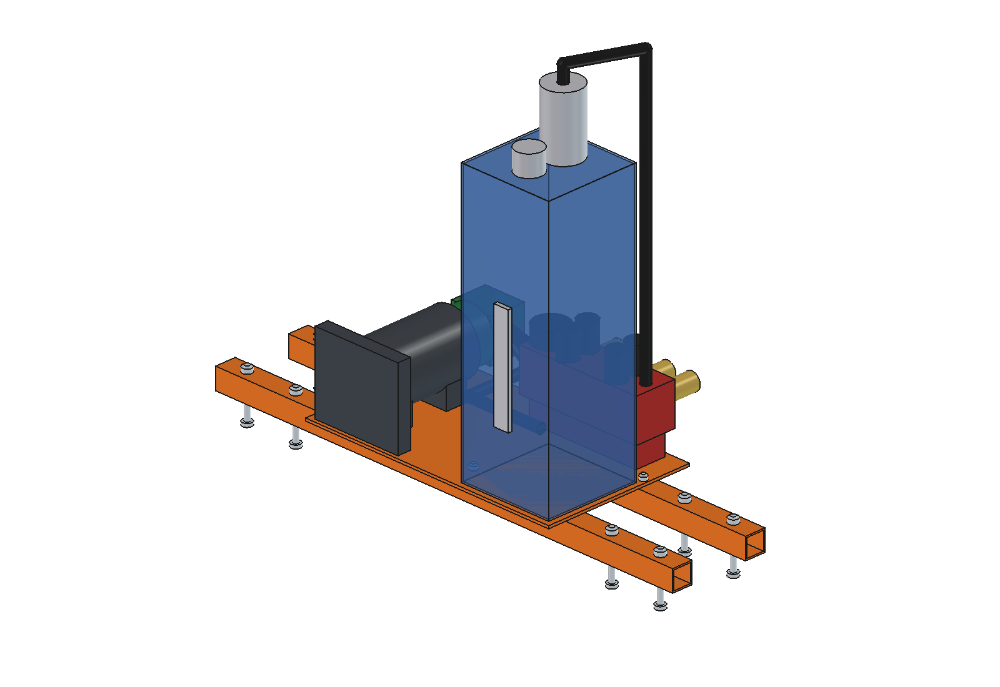

# Hydraulic power pack (simple)

48 V hydraulic power unit on the rear half of the Bruut OpenAgbot (standard robot): a BLDC motor with a 4 cc gear pump,
a 16 l tank with return filter, a 2-section solenoid valve block with relief valve and gauge, and 2 pairs of ISO-A 1/2"
quick couplers at the rear for hydraulic implements (cylinders, small motors). High force at slow speed, where linear
actuators are too weak or too slow.

<p align="center">
  
</p>

| Side | Top |
| --- | --- |
|  |  |
|  |  |

## Build

- **Mount**: 2 bearers 40 x 40 x 3 across the 4 upper beams at y -325 / -475 (beam holes, clear of the wheel-unit bolts),
  base plate 5 mm (500 x 290) on top with 4 x M8.
- **Tank**: steel 2 mm, 180 x 180 x 520 (16 l, ~12 kg of oil at the working level), return filter and filler/breather on
  the lid, sight glass, suction at the bottom.
- **Drive**: BLDC 48 V 3.5 kW (O120 x 190) along y with a bell housing and a group-1 gear pump 4 cc/rev; motor
  controller in front of it.
- **Valves**: block at the rear edge with an inlet section (relief valve 150 bar, gauge) and 2 double-acting sections
  with 24 V solenoids on top; the 4 quick couplers screw straight into its rear face (A1 B1 A2 B2).
- **Hoses** 3/8": suction, pressure and return (drawn as routing only).

Mass ~49 kg + 12 kg of oil. Size 940 x 360 x 771 mm (the bearers are the widest part).

## Key figures (`hpu_calc.report()`)

| | |
| --- | --- |
| Flow | 11 l/min at 3000 rpm |
| Pressure | relief 150 bar; the 3.5 kW motor holds ~149 bar at full flow |
| Power at 50 / 100 / 150 bar | 0.9 / 1.8 / 2.8 kW hydraulic, 1.3 / 2.6 / 3.9 kW from the battery |
| Battery at full flow | 87 / 44 / 29 minutes at 50 / 100 / 150 bar (1.9 kWh usable) |
| Cylinder 40/20 x 200 at 150 bar | push 18.8 kN, pull 14.1 kN, out 146 mm/s (1.4 s per stroke) |
| Cylinder 50/25 x 300 at 150 bar | push 29.5 kN, pull 22.1 kN, out 94 mm/s (3.2 s per stroke) |
| Oil temperature | at 100 bar and 50 % duty, 60 C after ~35 min without a cooler |
| Axle load front / rear | 84 / 136 kg (rear 62 %) |

Why and how these come out: see [RATIONALE.md](RATIONALE.md), including the list *Estimated, not measured*.

## Files

| File | Contents |
| --- | --- |
| `hpu_params.py` | all dimensions, robot interface, pump, motor, oil and work parameters, masses from the model |
| `hpu_parts.py` | one function per part, robot coordinates; hose routing |
| `build_hpu.py` | model tree (Mount, Tank, Drive, Valves; oil apart), checks (`check_interference`, `check_holes`, `check_steering`, `clearance`), mass, `render_all()`, STEP |
| `hpu_calc.py` | flow, power and battery time per pressure, cylinder forces and speeds, oil heating, axle loads |
| `run_in_freecad.py` | reload, build, print the key figures |
| `Hydraulic_Power_Pack.FCStd`, `Hydraulic_Power_Pack.step` | generated model (robot hidden in the FCStd) |
| `previews/` | images |

## Use

```python
exec(open(r"F:\veldrobot\aanbouwdelen\hydraulic pump\simple\run_in_freecad.py").read())
import build_hpu
build_hpu.check_interference()   # []
```

No moving axes (simple variant), so no animation.
