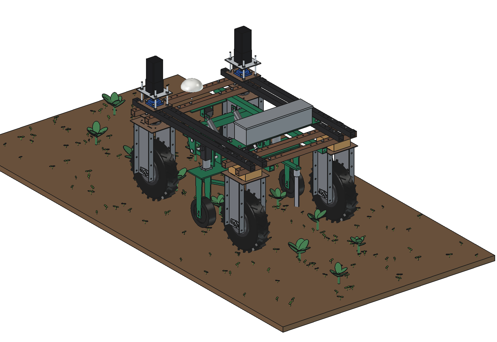
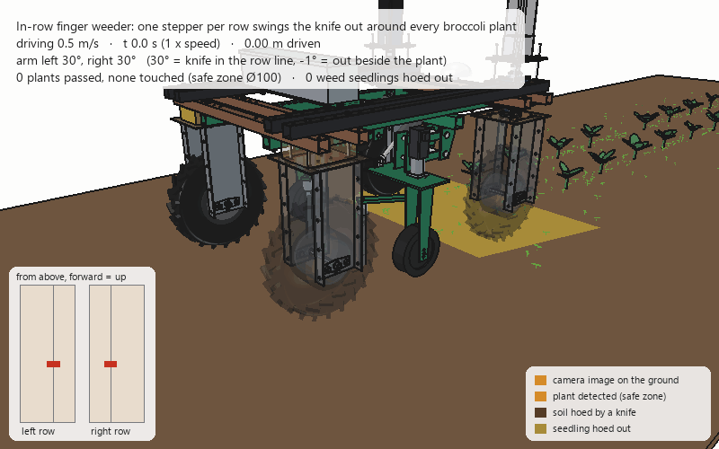

# In-row weeder for the Bruut

Weeds **inside the crop row**, between the plants, where an inter-row hoe cannot come. A camera finds the crop plants;
a knife runs in the row line and swings out around every plant. The first variant is made for two rows of broccoli
(transplanted, 450 mm apart in the row) and works under the belly of the robot.

| | Variant | Contents |
| --- | --- | --- |
| [Finger weeder, 2 rows](finger/README.md) | `finger/` | FreeCAD model: two row units on parallelograms with a gauge wheel, a swing arm per row on a NEMA 23 stepper with a 10:1 gearbox, a spring-steel finger with a flat knife 20 mm deep; camera with LED bars under the front beams. Calculations (stepper move time, soil forces, the zone around each plant, camera, lift), animation with broccoli and weed seedlings, parts list (≈ €2,240); why: [RATIONALE](finger/RATIONALE.md) |
| [Double arms, 2 rows](double_arm/README.md) | `double_arm/` | FreeCAD model: the same units with **two arms per row**, one on each side, each on its own stepper (4 in total). The knives (50 mm) close in the row between the plants and open to both sides around each plant; the inner arm runs 75 mm behind the outer one so they never touch. Swings of 78 mm in 89 / 118 ms, timed by the real distance knife – stem (≥ 55 mm): 90 % of the row band outside the safe zones hoed, 82 % of the seedlings, from 0.3 to 0.7 m/s. 68 kg, ≈ €2,820; why and how it compares: [RATIONALE](double_arm/RATIONALE.md) |

## Concept

1. **See the plants.** A camera looks down at both rows from under the front beams (in the shade of the robot, with
   LED light) and gives each stem a position on the ground.
2. **Carry the position.** Odometry carries every stem back to the knives (0.4–1.1 m).
3. **Hoe the row line.** Each knife runs 20 mm deep in the row line between the plants.
4. **Dodge the plant.** Just before the stem the stepper swings the finger out beside the row (98 ms), past the stem
   back in (148 ms). A safe zone of Ø100 mm around each stem is never touched. With double arms two knives per row
   open to both sides and close behind the plant.

## Requirements

| | |
| --- | --- |
| Robot | standard Bruut OpenAgbot, bolted to the hole grid of the lower beams; nothing drilled |
| Crop | 2 rows of broccoli, 375 mm apart (the wheels run in the inter-rows), plants every ≈ 450 mm |
| Drive | stepper motors: 2 (finger, one per row) or 4 (double arms, one per arm) |
| Camera | above the rows |
| Speed | 0.5 m/s (0.11 ha/h net, 6,400 plants/h) |

## Options for later

| Option | What it adds |
| --- | --- |
| Finger-weeder discs (rubber fingers) behind the knives | loosen the soil right next to the stem |
| Inter-row knives on the same toolbar | the whole bed in one pass (the wheels already run in the inter-rows) |
| More rows | units are copies; the toolbar and the camera get wider (or a second camera) |
| Other crops | lettuce, cabbage, celeriac, leek: plant spacing and safe zone are parameters |
| Plant map | every plant is logged with its position: a map of missing plants and plant size |
