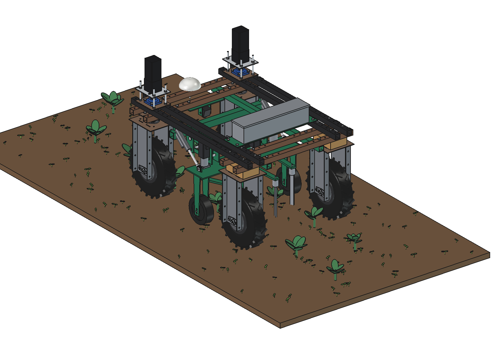
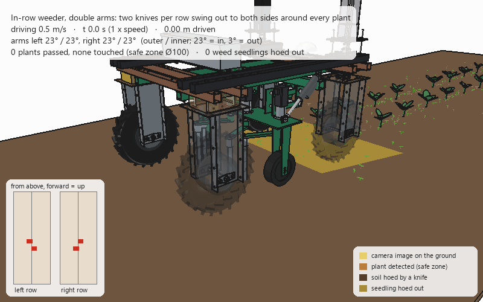
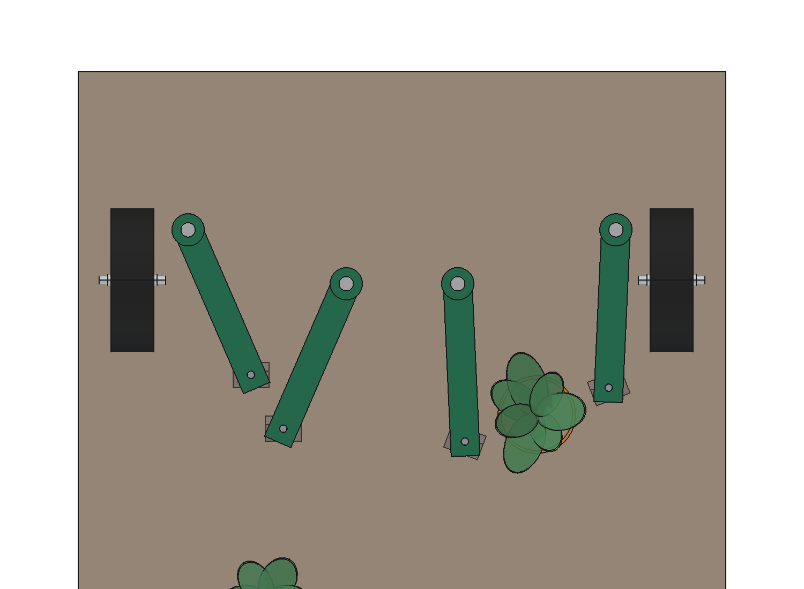
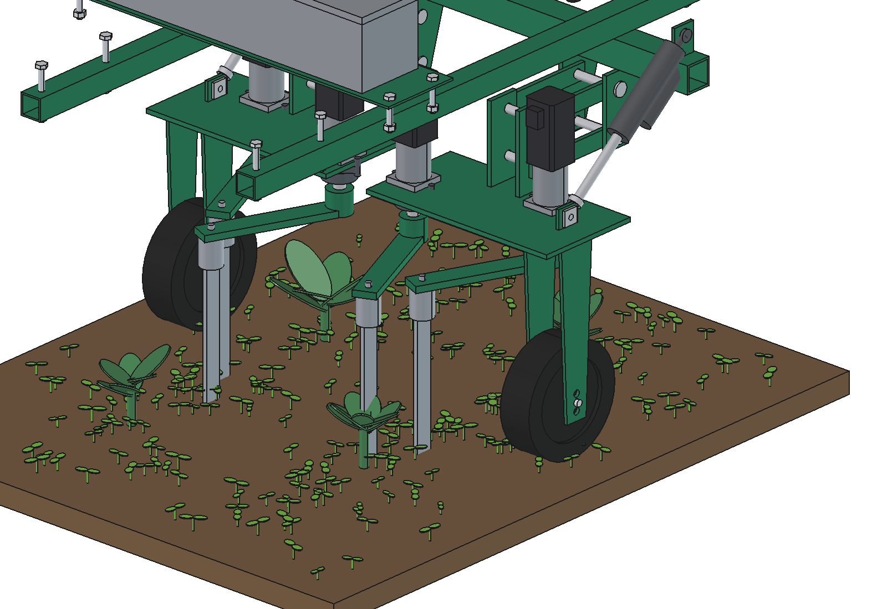
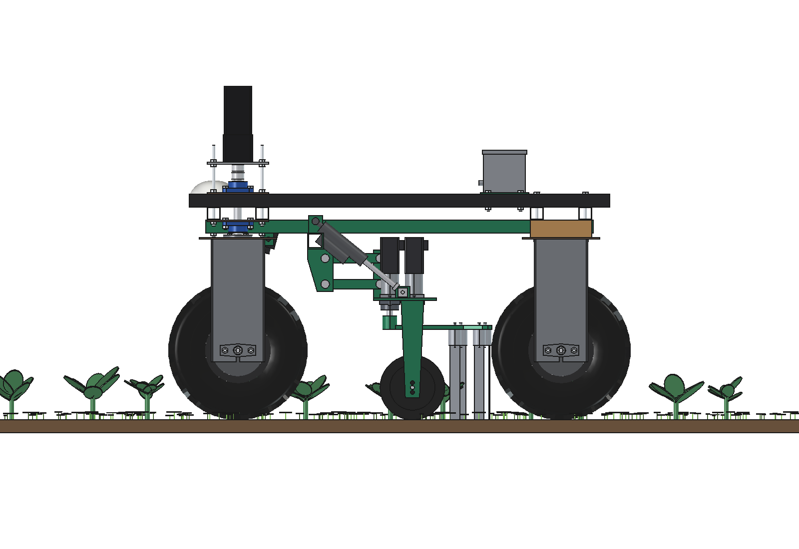
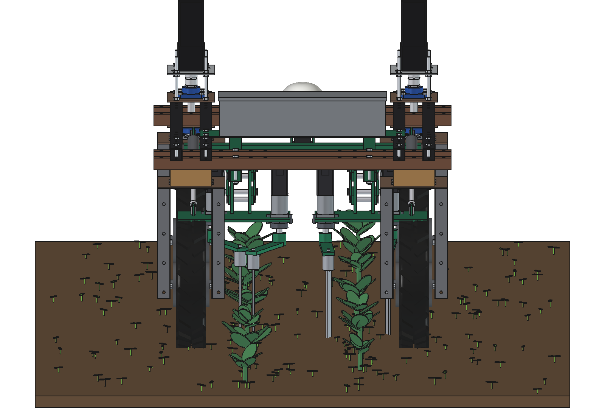
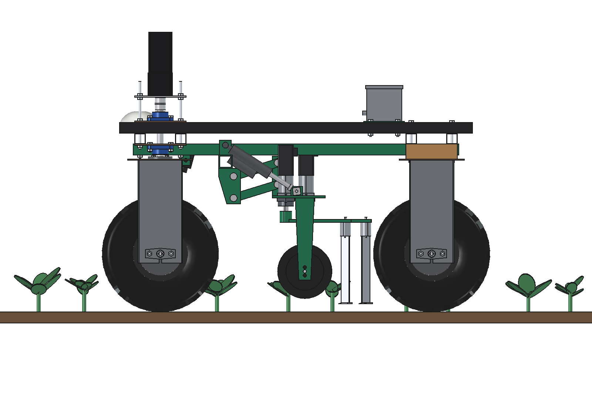
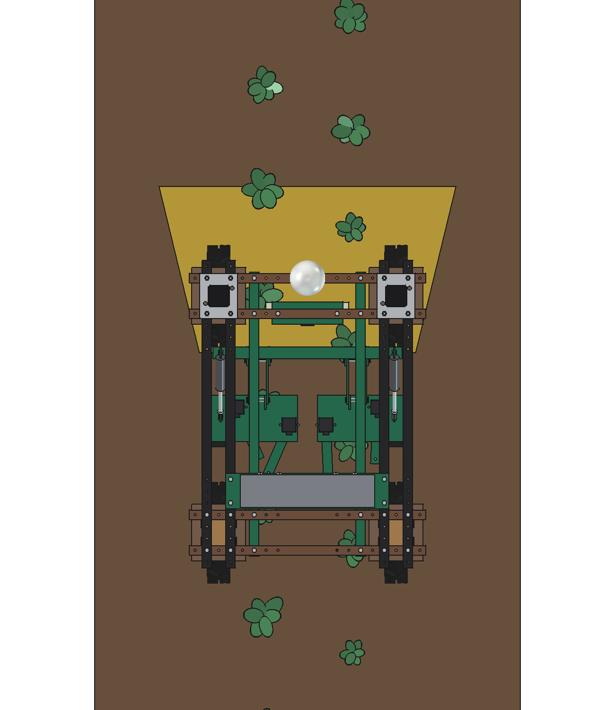

# In-row weeder with double arms, 2 rows: FreeCAD model

The same job as the [finger weeder](../finger/README.md), hoeing inside two rows of broccoli. Here every row has **two
swing arms, one on each side of the row**, each on its own stepper motor (4 in total). Between the plants both knives
are in: each covers its half of the row band and they overlap 5 mm in the row line. At a plant **both swing out, each
to its own side, and swing back in behind it**. The two knives of a row run 75 mm apart along the travel, so they never
touch.

- **Knives:** 50 × 35 mm, 20 mm deep; in at 23.4° (row band 95 mm), out at 2.6°: each knife moves only 78 mm, so
  **out in 89 ms, back in 118 ms** (the single finger: 115 mm, 98 / 148 ms).
- **Timing by distance:** the camera gives each stem's real position. Each knife starts its swing out as late as
  possible and comes back in as early as possible while its edge stays **≥ 55 mm from the stem** (with ±10 mm of
  odometry uncertainty along the row).
- **Drive:** 4 × NEMA 23 closed-loop stepper (3 Nm) with a 10:1 planetary gearbox; holding a knife in the row needs
  0.4 Nm at the motor.
- Everything else as in the finger variant: parallelogram units with a gauge wheel in the robot's wheel track, a 24 V
  lift actuator per unit (here on the outer side), camera with LED bars under the front beams, control box on the
  upper beams.

Why two arms, and how much they gain: [RATIONALE.md](RATIONALE.md).





*The robot drives at 0.5 m/s. Yellow: what the camera sees; orange ring: plant detected (Ø100 safe zone). In each row
the two knives hoe the dark strip; at every plant they open to both sides and close behind it. The panel bottom left
shows both rows from above around the knives (red). Real speed.*

| | | |
| --- | --- | --- |
|  |  |  |
| from above: right row both knives out around a plant (orange: safe zone), left row both in | row unit: two shafts, two steppers, two arms, gauge wheel, lift actuator | side view: the units under the belly |
|  |  |  |
| from behind: four arms over two rows | headland: units up 50 mm, knives out | camera image on the ground (yellow) |

## Key figures

From the model (`build_ird.mass_properties`, `check_fit`, `clearance`), `ird_calc.report()` and
`animate_ird.summary()` / `ird_field.summary()`. Robot 161.5 kg (agbot comparison, not weighed).

| | |
| --- | --- |
| Rows | 2 rows at x ±187.5 (375 mm apart), plants every 450 mm; 0.75 m per pass |
| Arms | 4 × 220 mm, shafts 110 mm beside the row on both sides; inner arm 75 mm further back |
| Swing | 20.8° per arm, knife 78 mm sideways; out 89 ms, in 118 ms (inertia 0.053 kg m², soil load up to 13 Nm) |
| Result (animation, 4.5 m of two rows, 0.5 m/s) | 17 plants passed, closest knife edge 55.5 mm from a stem; **90 % of the row band outside the safe zones hoed, 82 % of the seedlings in the band hoed out** |
| Speed | the same within 1 % from 0.3 to 0.7 m/s (the distance timing adapts) |
| Knife forces | draft 41 N, sideways 47 N per knife |
| Camera | as the finger variant: 86° × 61°, image edge → front knife 0.86 s |
| Capacity | 0.135 ha/h gross, 0.11 ha/h net at 0.5 m/s, 6,400 plants/h |
| Mass | 68 kg (frame 17, each row unit 20.5, camera 2.5, control box 8) |
| Axle loads | robot + weeder 230 kg: front 130 / rear 100 kg, max 65 kg per wheel of 500 |
| Power | 4 steppers 111 W, knife draft 83 W, ≈ 545 W with driving: 4.4 h, 0.48 ha on 2.4 kWh |
| Clearances | knives ≥ 83 mm from the rear tyres; frame bolts 12 mm from the front wheel top plates at 30° steering; camera 91 mm from the front units; motors 44 mm under the upper beams when lifted |

## Parts list

Quantities for one weeder. Prices are rough estimates (2026), not quotes. The difference from the finger variant: two
more steppers, gearboxes, bearings, arms and fingers, a longer toolbar and bigger unit heads.

| Qty | Part | Specification | Price (est.) |
| --- | --- | --- | --- |
| 1 | Laser-cut steel, welded | 2 rails 40 × 40 × 3 × 1200, toolbar 50 × 50 × 4 × 800, 4 toolbar brackets, 2 unit heads (deck 377 × 195, cheeks, gauge fork), lugs, camera plate, box base; painted | €320 |
| 1 | Parallelograms | 8 link bars 30 × 8 × 206, 8 pins Ø16 | €60 |
| 4 | Stepper motors | NEMA 23 closed loop, 3 Nm, encoder, with 48 V driver | €440 |
| 4 | Planetary gearboxes | NEMA 23, 10:1 | €360 |
| 4 | Shaft bearings | flange bearing UCFL204, shaft Ø20, clamp hub | €100 |
| 4 | Arms and fingers | aluminium flat 40 × 12, spring-steel shank 30 × 8 with coil, hardened knife 50 × 35 × 4 | €150 |
| 2 | Gauge wheels | Ø200 × 60 with axle | €50 |
| 2 | Lift actuators | 24 V, 500 N, stroke 100, slotted rod end | €140 |
| 1 | Camera | 2.3 MP global shutter, 6 mm lens, IP67 housing | €450 |
| 2 | LED bars | 24 V, 12 W | €60 |
| 1 | Vision computer | Jetson Orin Nano class | €450 |
| 1 | Control box | IP66, DC-DC 48 → 24 V, relays, wiring | €220 |
| | Bolts | M10, M8 | €20 |
| | **Total** | | **≈ €2,820** |

## Files

| File | Contents |
| --- | --- |
| `In_Row_Double_Arm_Weeder.FCStd`, `.step` | the model (generated; robot hidden in the FCStd, not in the STEP) |
| `ird_params.py` | all dimensions, including the robot interface; `SIDES` (+1 outer, −1 inner arm) |
| `ird_parts.py` | one function per part (right unit; arm parts per side; the left unit is mirrored) |
| `build_ird.py` | model tree, pose (lift, 4 arm angles), interference and fit check, clearances, mass, arm inertia, renders, STEP |
| `ird_calc.py` | kinematics of both arms, knife forces, stepper move, plant zone, camera, lift, capacity, power, axle loads |
| `ird_field.py` | process model: plants, weeds, swing schedule per knife (`RULE = "distance"` or `"simple"`), hoed strips, coverage |
| `animate_ird.py` | animation on the robot: `build()`, `play()`, `stop()`, `summary()`, `render_all(folder)` |
| `make_gif_ird.py` | frames to GIF with caption and row panel |
| `run_in_freecad.py` | macro: reload, build, print the key figures |
| `previews/` | images and the GIF |

## Usage

```python
import build_ird
build_ird.build()                                   # FCStd + STEP
build_ird.set_pose(lift=0, right=2.6, left=(23.4, 2.6))   # a number for both arms of a row, or (outer, inner)
build_ird.check_interference()                      # []
build_ird.check_fit()                               # {}
build_ird.clearance()
build_ird.mass_properties()
build_ird.render_all()

import ird_field as F
F.summary()                                         # distance timing
F.RULE = "simple"; F._SIM.clear(); F._SCHED.clear(); F.summary()   # the simple rule of the finger variant
```

Animation:

```python
import animate_ird
animate_ird.build(); animate_ird.play()
animate_ird.render_all(r"C:\temp\ird_frames")
import make_gif_ird; make_gif_ird.main(r"C:\temp\ird_frames", r"previews\animation_double_arm_weeding.gif")
```

## Estimated, not measured

As the finger variant (soil 4 N/cm², stepper curve, camera, crop, masses of bought parts), plus:

- Odometry uncertainty along the row ±10 mm in the distance timing; the minimum distance knife edge – stem 55 mm.
- The camera gives the stem position to a few mm (the detector is not part of this model).
