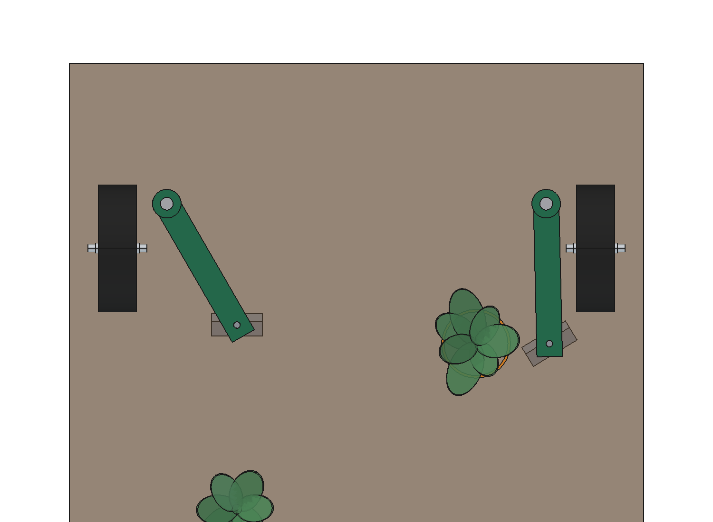
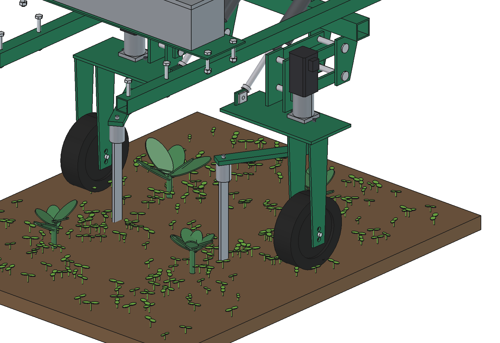
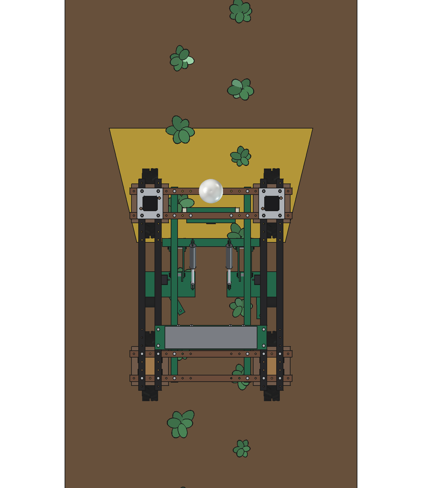
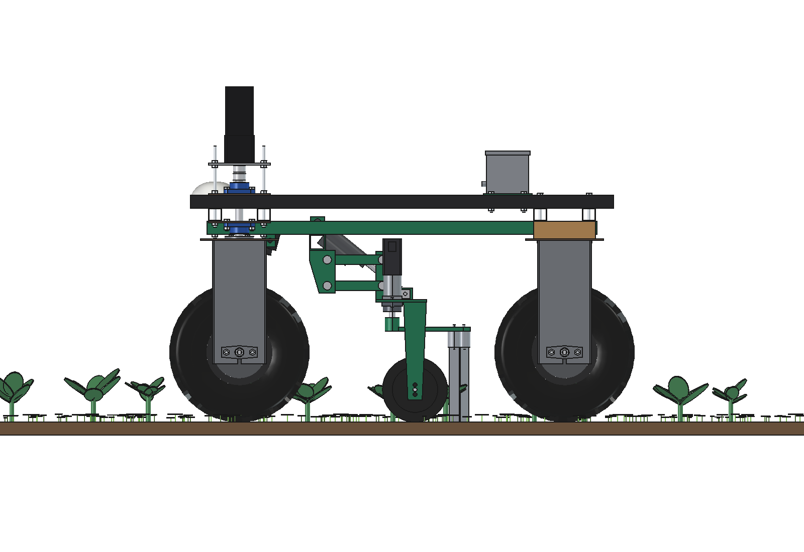
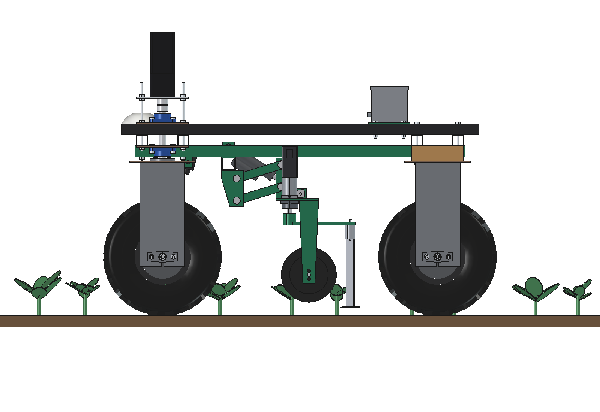
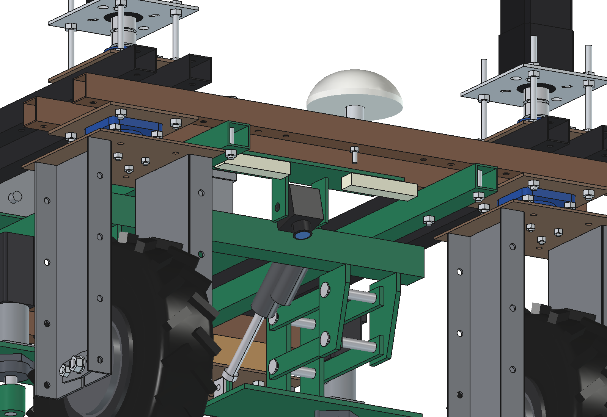

# In-row finger weeder, 2 rows: FreeCAD model

Hoes **inside the crop row**, between the plants, in two rows of broccoli at once. Two row units hang under the belly
of the standard Bruut OpenAgbot. Each unit has a **swing arm on a vertical shaft, turned by its own stepper motor**;
at the end of the arm a **finger**: a spring-steel shank with a small flat knife that runs 20 mm deep. Between the
plants the knife runs in the row line and cuts the weed seedlings; just before a plant the stepper swings the finger
out beside the row, past the plant it swings back in. A **camera under the front beams** sees both rows and finds
the plants; wheel odometry carries each plant position 0.4–1.1 m back to the knives.

- **Rows:** two rows 375 mm apart (= half the track), the robot wheels run in the middle of the inter-rows; plants
  every 450 mm. The next pass has its rows at 562.5 and 937.5 mm: a uniform 375 mm row pattern.
- **Finger:** aluminium arm 220 mm, knife 80 × 35 mm (hardened, replaceable) on a 30 × 8 spring-steel shank with a
  coil. In: 30° (knife on the row line), out: −1° (knife 115 mm beside the row, at least 57 mm from any stem).
- **Drive:** NEMA 23 closed-loop stepper (3 Nm) with a 10:1 planetary gearbox per row: **out in 98 ms, back in
  148 ms** against the soil.
- **Depth:** each unit on a parallelogram, a gauge wheel Ø200 in the robot's own wheel track; a 24 V actuator per
  unit lifts it 50 mm for the headland (slotted rod end: free float in work).
- **Camera:** 2.3 MP global shutter, 6 mm lens, 545 mm high, 15° forward, with two LED bars (it works in the shade
  of the robot).

Why it is designed this way: [RATIONALE.md](RATIONALE.md); the concept and the other options: the
[in-row weeder README](../README.md).


*The robot drives at 0.5 m/s. Yellow: what the camera sees on the ground; orange ring: plant detected (Ø100 safe
zone). The knives hoe the dark strip: in the row line between the plants, out around each plant. The seedlings they
pass lie flat. The panel bottom left shows both rows from above around the knife (red). Real speed.*

| | | |
| --- | --- | --- |
|  |  |  |
| from above: right knife out beside a plant (orange: safe zone), left knife in the row line | row unit: parallelogram, stepper + gearbox, flange bearing, arm, finger, gauge wheel | camera image on the ground (yellow), in front of the knives |
|  |  |  |
| side view: the units under the belly, between the wheels | headland: units up 50 mm, fingers out | camera on its tilt lugs under the front inner beam, LED bars |

## Key figures

From the model (`build_irw.mass_properties`, `check_fit`, `clearance`), `irw_calc.report()` and
`animate_irw.summary()`. Robot 161.5 kg (agbot comparison, not weighed).

| | |
| --- | --- |
| Rows | 2 rows at x ±187.5 (375 mm apart), plants every 450 mm; working width 0.75 m |
| Swing | 31.3° between in and out; knife 115 mm sideways, 29 mm back |
| Stepper | NEMA 23, 3 Nm closed loop, 10:1: 17.6 Nm usable at the shaft (70 % of the curve); soil load up to 16.2 Nm when it swings in; holding in the row 0.8 Nm at the motor (× 3.8) |
| Swing time | out 98 ms, in 148 ms (inertia 0.055 kg m², peak 531 rpm at the motor) |
| Around each plant | out starts 132 mm before the stem, back in 82 mm after it; ≈ 200 mm of the 450 mm row line is not hoed |
| Result (animation, 4.5 m of two rows) | 17 plants passed, closest knife edge 57 mm from a stem (safe zone 50); 68 % of the row band outside the safe zones hoed, 62 % of the seedlings in the band hoed out |
| Speed | 0.5 m/s: 0.135 ha/h gross, 0.11 ha/h net, 6,400 plants/h; at 0.3 m/s 76 % of the band hoed, at 0.7 m/s 60 % |
| Knife forces | draft 65 N, sideways 47 N per finger at 20 mm deep (estimated soil) |
| Camera | 86° × 61°, ground y 260 … 962 (914 mm wide at the near edge: both rows and their leaves), 0.53 mm/px; a plant is seen in 28 frames; image edge → knife 0.84 s (needs ≈ 90 ms) |
| Lift | actuator 348 → 313 mm, 262 N to hold a unit (× 1.9), 2.4 s |
| Mass | 55 kg (frame 16, each row unit 14.5, camera 2.5, control box 8) |
| Axle loads | robot + weeder 217 kg: front 124 / rear 92 kg, max 62 kg per wheel of 500 |
| Power | ≈ 475 W with driving (steppers 60 W): ≈ 5 h, 0.55 ha on 2.4 kWh |
| Clearances | knives ≥ 78 mm from the rear tyres; frame ≥ 12 mm from the front wheel units at 30° steering; camera 91 mm from the front units; motors 44 mm under the upper beams when lifted |

## How it weeds

1. The camera takes 20 frames per second; the computer finds the broccoli plants and gives each stem a position on
   the ground (robot coordinates).
2. Odometry carries each stem back to its row's knife. When the knife (in the row line) gets to 132 mm before the
   stem, the stepper swings the finger out; it is fully out when the knife's front edge is 65 mm before the stem.
3. When the knife's rear edge is 65 mm past the stem, the stepper swings it back in. A gap in the row (a missing plant)
   is simply hoed through; two plants closer than ≈ 250 mm get one long swing out.
4. In the headland the actuators lift both units 50 mm, the fingers stay out beside the row.

## Parts list

Quantities for one weeder. Prices are rough estimates (2026) to give an idea of the total, not quotes.

| Qty | Part | Specification | Price (est.) |
| --- | --- | --- | --- |
| 1 | Laser-cut steel, welded | 2 rails 40 × 40 × 3 × 1200, toolbar 50 × 50 × 4 × 600, 4 toolbar brackets 8 mm, 2 unit heads (deck, cheeks, gauge fork), lugs, camera plate, box base; painted | €280 |
| 1 | Parallelograms | 8 link bars 30 × 8 × 206, 8 pins Ø16 with split pins | €60 |
| 2 | Stepper motors | NEMA 23 closed loop, 3 Nm, encoder, with 48 V driver | €220 |
| 2 | Planetary gearboxes | NEMA 23, 10:1, ≥ 20 Nm output | €180 |
| 2 | Shaft bearings | flange bearing UCFL204, shaft Ø20, clamp hub | €50 |
| 2 | Arms and fingers | aluminium flat 40 × 12, spring-steel shank 30 × 8 with coil, hardened knife 80 × 35 × 4 (spare knives) | €80 |
| 2 | Gauge wheels | Ø200 × 60 with axle | €50 |
| 2 | Lift actuators | 24 V, 500 N, stroke 100, slotted rod end | €140 |
| 1 | Camera | 2.3 MP global shutter (IMX174 class), 6 mm lens, IP67 housing | €450 |
| 2 | LED bars | 24 V, 12 W | €60 |
| 1 | Vision computer | Jetson Orin Nano class | €450 |
| 1 | Control box | IP66, DC-DC 48 → 24 V, relays, wiring, glands | €200 |
| | Bolts | M10 (8 + 2 + 4), M8 | €20 |
| | **Total** | | **≈ €2,240** |

## Files

| File | Contents |
| --- | --- |
| `In_Row_Finger_Weeder.FCStd`, `.step` | the model (generated; robot hidden in the FCStd, not in the STEP) |
| `irw_params.py` | all dimensions, including the robot interface |
| `irw_parts.py` | one function per part (right unit; the left one is mirrored), broccoli and weed shapes |
| `build_irw.py` | model tree, colours, pose (lift, arm angles), interference and fit check, clearances, mass, arm inertia, renders, STEP |
| `irw_calc.py` | arm kinematics, knife forces, stepper move (torque curve, inertia), zone around a plant, camera, lift, capacity, power, axle loads |
| `irw_field.py` | process model: plants, weeds, swing schedule, hoed strip, seedlings hoed out, coverage |
| `animate_irw.py` | animation on the robot: `build()`, `play()`, `stop()`, `summary()`, `render_all(folder)` |
| `make_gif_irw.py` | frames to GIF with caption and row panel |
| `run_in_freecad.py` | macro: reload, build, print the key figures |
| `previews/` | images and the GIF |

## Usage

In FreeCAD 1.1, run `run_in_freecad.py` (or in the Python console):

```python
import build_irw
build_irw.build()                              # FCStd + STEP
build_irw.set_pose(lift=0, right=-1.3, left=30) # arm angles in degrees (30 = in, -1.3 = out)
build_irw.check_interference()                 # []
build_irw.check_fit()                          # {} over lift and swing
build_irw.clearance()
build_irw.mass_properties()
build_irw.render_all()                         # previews/
```

Animation:

```python
import animate_irw
animate_irw.build(); animate_irw.play()
animate_irw.render_all(r"C:\temp\irw_frames")
import make_gif_irw; make_gif_irw.main(r"C:\temp\irw_frames", r"previews\animation_in_row_weeding.gif")
```

## Estimated, not measured

- Robot mass 161.5 kg and its centre of gravity (agbot comparison); drive power 300 W at 0.5 m/s on soil.
- Soil: 4 N/cm² of worked cross-section for the knife (2–6 in the literature for shallow hoeing), 1 N/cm² on the
  shank; in heavy or crusted soil the swing in gets slower (see RATIONALE).
- Stepper torque curve (NEMA 23, 3 Nm, 48 V, typical catalogue values), 70 % of it used; gearbox efficiency 90 %.
- Camera: 6 mm lens on a 1/1.2" sensor; 40 ms per frame for detection; odometry error 1 % of the distance.
- Crop: broccoli 2–5 weeks after planting, rosette Ø150–260, stem offset ±15 mm from the row line, ±30 mm along it.
  The plant detector itself (training data) is not part of this model.
- Masses of the bought parts from catalogue classes (motor 1.4 kg, gearbox 1.0 kg, camera 0.35 kg, control box 4.5
  kg); the arm and hub as aluminium, the rest of the steel from the volumes.
- Not modelled: cables, the stepper drivers in the box, a scraper for wet soil on the knife, a shade curtain.
