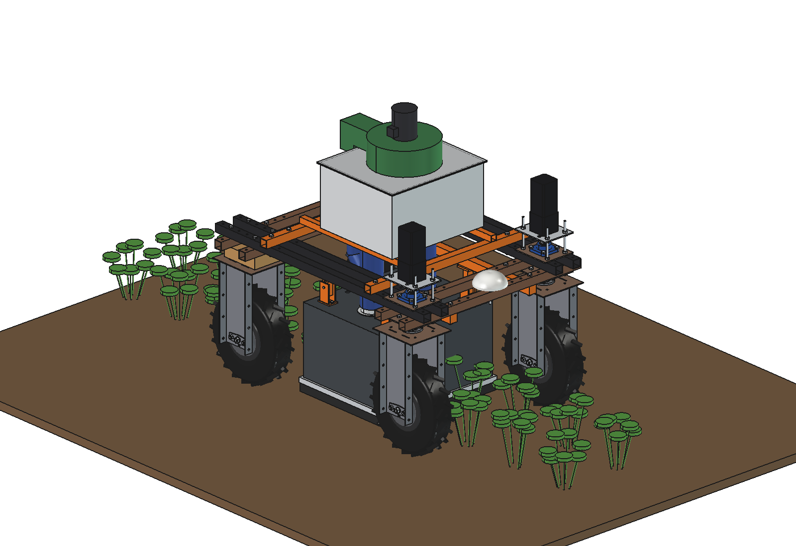
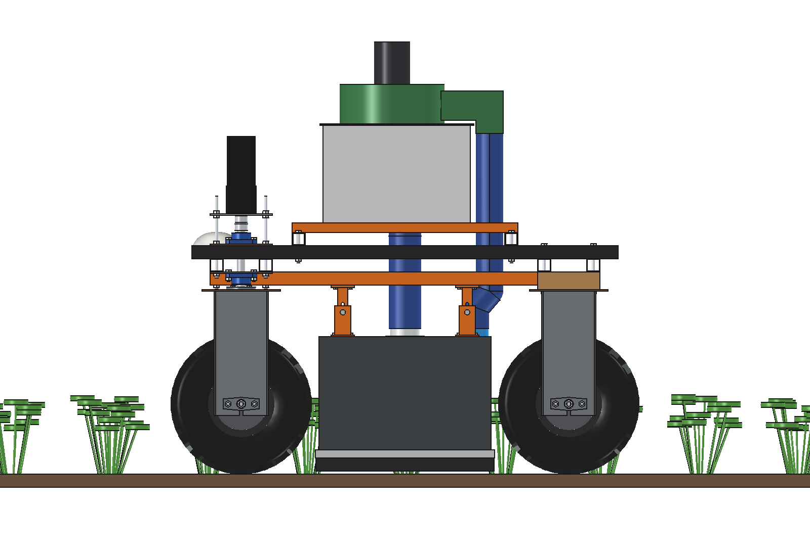
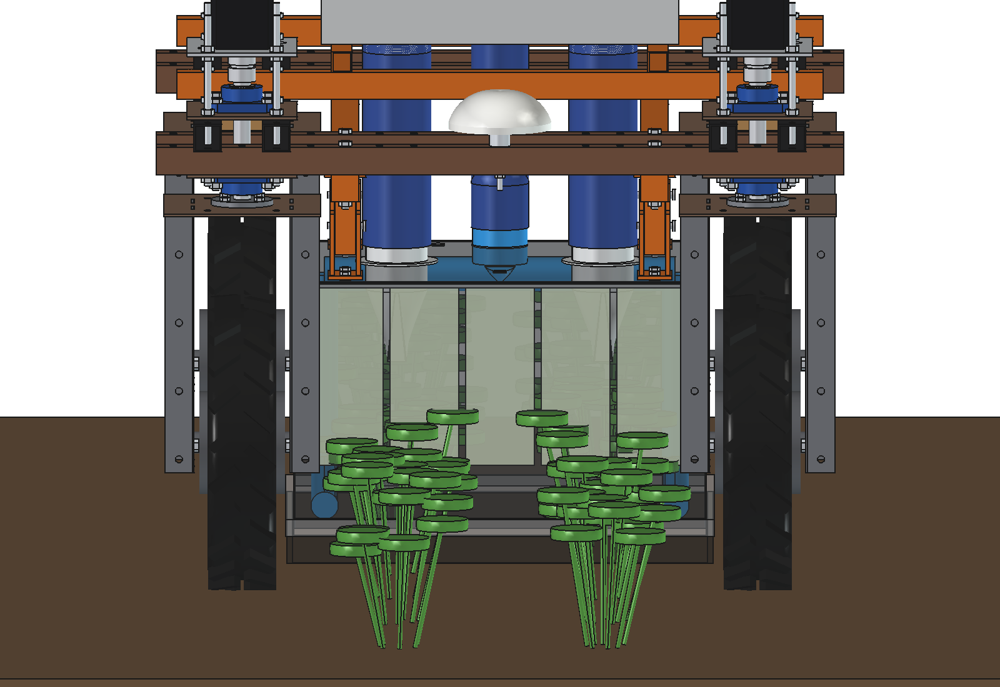
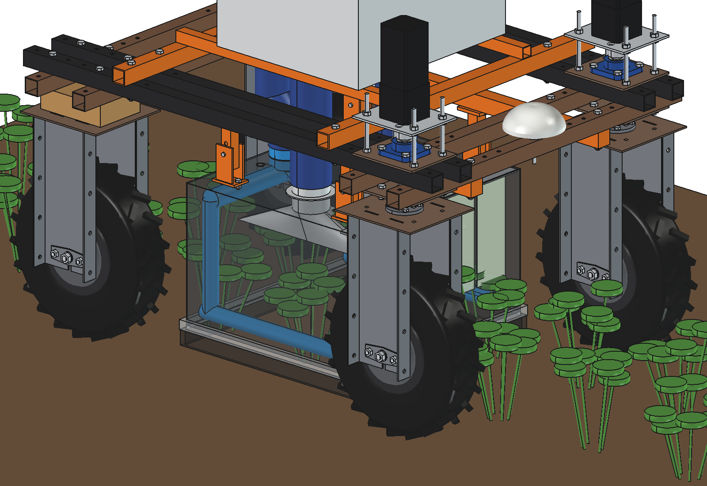
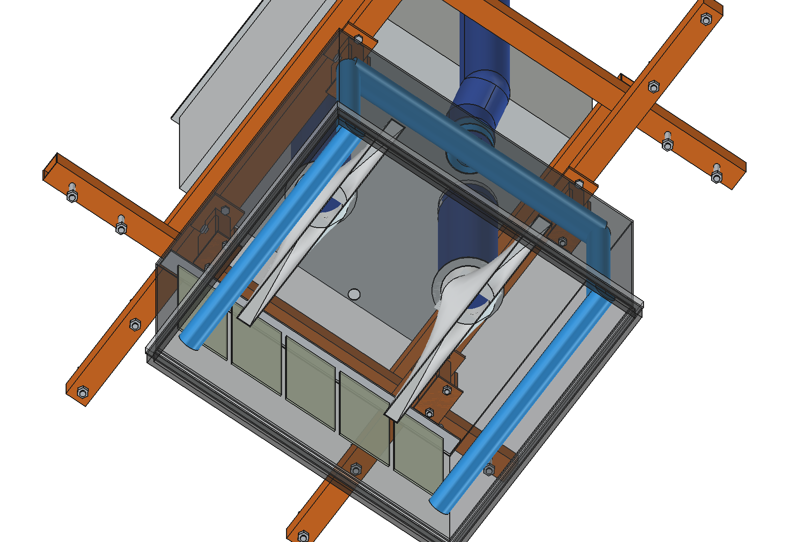
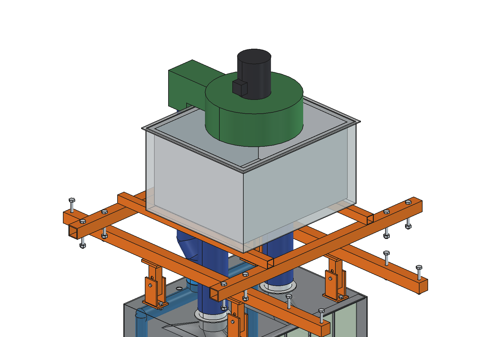
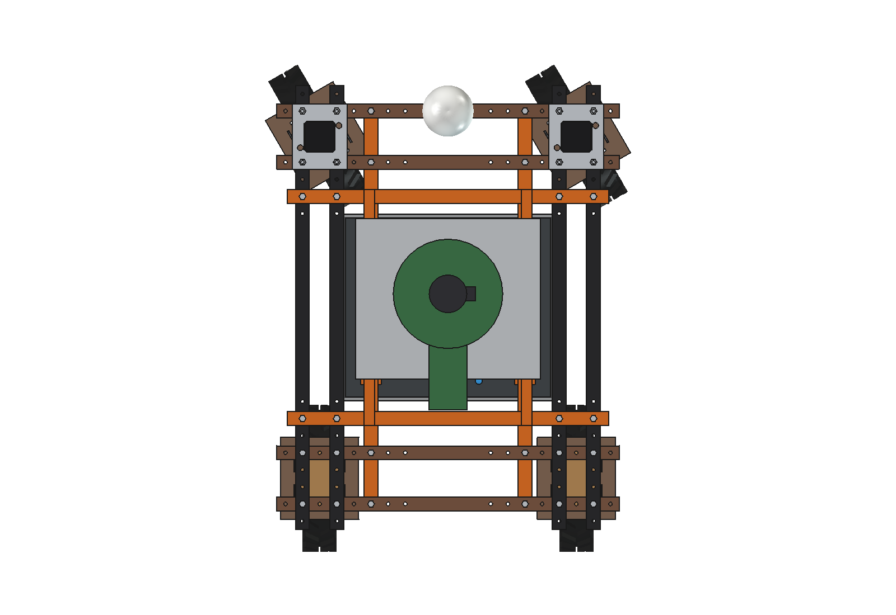

# Insect vacuum (simple): FreeCAD model

Sucks pest insects off the crop instead of spraying: lygus bugs in strawberries, Colorado beetles and larvae in
potatoes. The robot straddles one bed; under its belly hangs the light-tight hood of the
[drop-on-demand boom](../../drop%20on%20demand%20boom/simple/README.md) (rails, hanger posts, hood shell, brush skirt:
imported, not copied). Inside it works **push-pull**:

- **2 air knives** (pipe O40 with an 8 mm slot, 440 long) low along the sides of the bed blow inward and up (30°)
  under the leaves, where lygus bugs hide: 36 m/s at the slot, ~23 m/s at the near row, ~13 m/s at the far row.
- **2 slot nozzles** (25 × 440) 50 mm over the rows suck the dislodged insects up. The hood is closed, so the air
  that the knives blow in has to leave through the nozzles.
- A **strip curtain** (PVC 100 × 3) at the front of the hood brushes through the canopy and shakes the plants.
- The suction hoses (O100) go straight up into a **catch box** on the upper beams with a **mesh basket** (0.8 mm):
  the insects stay in the basket, the clean air goes through the **fan** (48 V BLDC, ~670 W) on the lid and back down
  to the air knives through one exhaust hose. Closed loop: no second blower, nothing blown out over the field.

Why it is designed this way: [RATIONALE.md](RATIONALE.md).

| | | |
| --- | --- | --- |
|  |  |  |
| side | hood transparent: curtain, nozzles, knives | nozzles over the rows, knives along the sides |
|  |  |  |
| inside from below | catch box, fan, exhaust duct | front wheels at 30°: hood free |

## Key figures

From the model (`build_isv.mass_properties`, checks) and `isv_calc.report()`.

| | |
| --- | --- |
| Mass | 68 kg (mount 21 kg, hood with nozzles and knives 12 kg, catch box, fan and hoses 35 kg) |
| Air | 0.25 m³/s in a closed loop; slots 11.4 m/s; knife jet 23.5 m/s at the near row, 12.7 m/s at the far row |
| Lifted (≥ 2 × terminal velocity, estimated) | lygus adults and nymphs at both rows; Colorado beetles and L4 larvae only at the near row |
| Fan | slots 116 + basket 250 + hoses 200 + knives 908 = ~1470 Pa, ~670 W |
| Work | 0.4 m/s, 1.5 m bed pitch: ~2160 m²/h, 1.3 s under the hood per plant |
| Battery | ~950 W in all: ~2 h, ~0.43 ha per charge |
| Size | 940 × 1190 × 1312 mm (the rails set the length; top of the fan motor at z 1322) |

Checks: `check_interference()` = [], `check_holes()` = {}, `check_steering()` = {} (front wheels ±30°).

## Files

| File | Contents |
| --- | --- |
| `isv_params.py` | all dimensions; imports `ddb_params` (hood, rails, posts) and `ssp_params` |
| `isv_parts.py` | hood with the stub holes, nozzles (lofted slot to round), knives, curtain, cross tubes, catch box, basket, fan, hoses, scene |
| `build_isv.py` | model tree, `check_interference`, `check_holes`, `check_steering`, `mass_properties`, `render_all` |
| `isv_calc.py` | slot and jet speeds, which insects are lifted, fan pressure and power, area per hour and per charge |
| `run_in_freecad.py` | reload, build, print the report |
| `Insect_Vacuum.FCStd`, `.step` | generated |

## Estimated, not measured

- Terminal velocities of the insects (lygus 3.5 m/s, nymph 2.5, Colorado beetle 7.5, larva 6.5, ladybird 5) and the
  lift factor 2: field trials decide the air speed.
- Pressure losses of the basket (250 Pa half full) and of the hoses (200 Pa); fan efficiency 55 %; drive 250 W.
- Canopy height 250 mm, beds 1.5 m apart, 2 rows at x ±150.
- Catch rate: not calculated. Published vacuum trials in strawberries report roughly half of the lygus adults per pass
  and fewer nymphs; several passes a week are normal.
