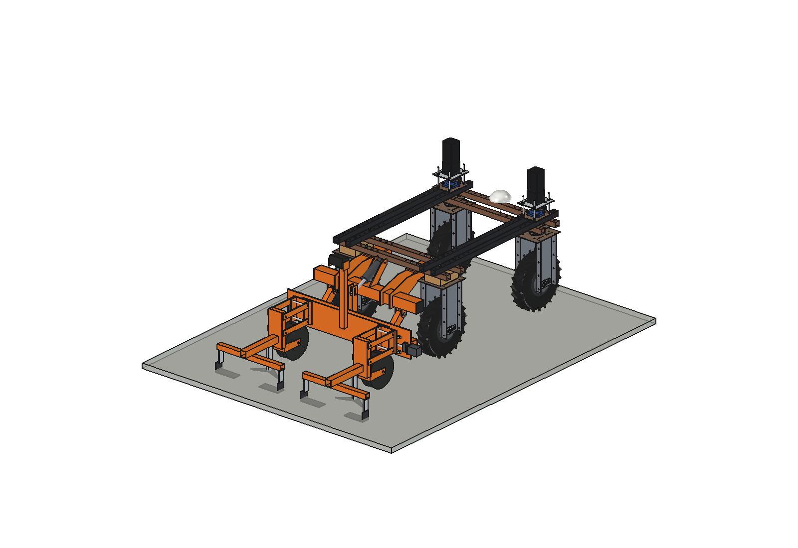
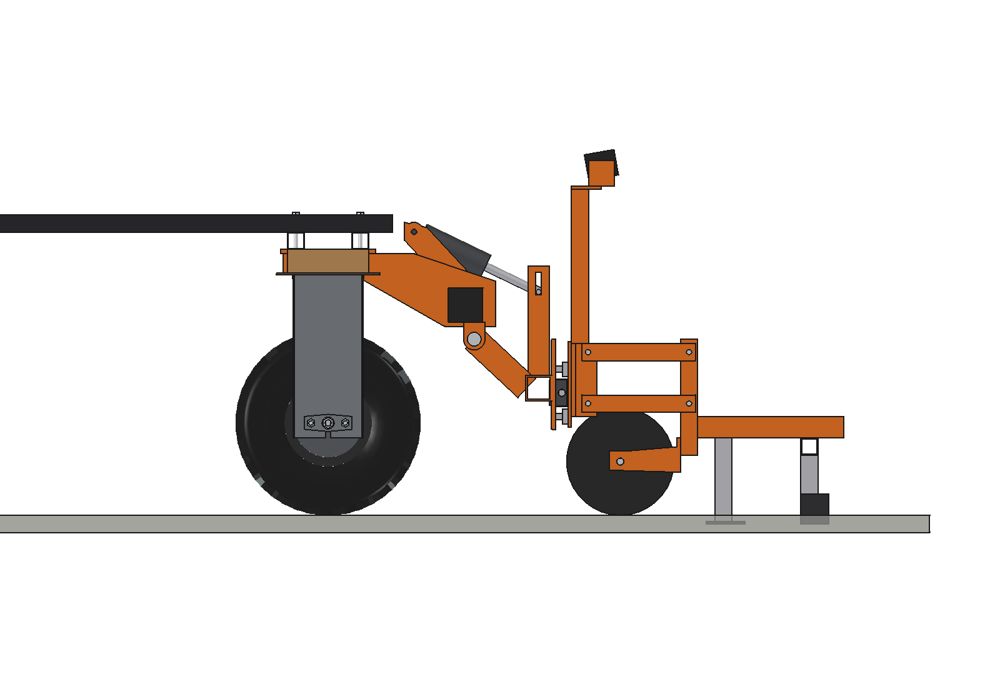
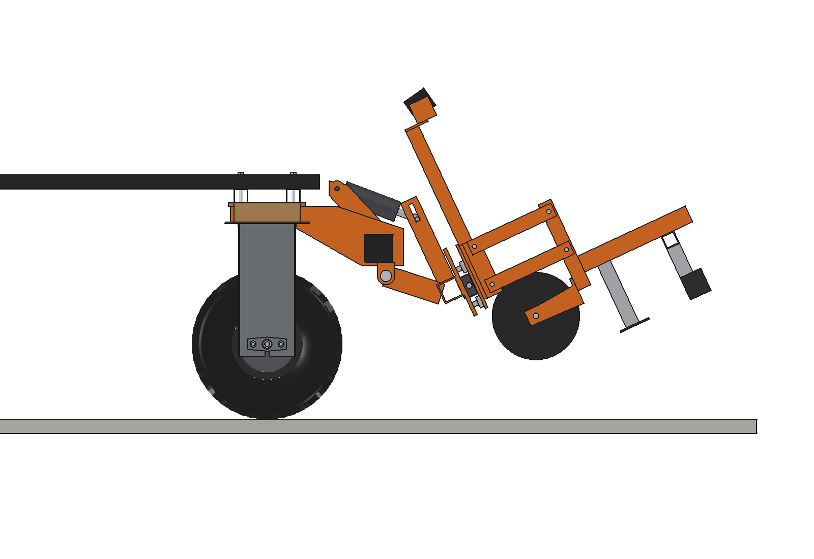
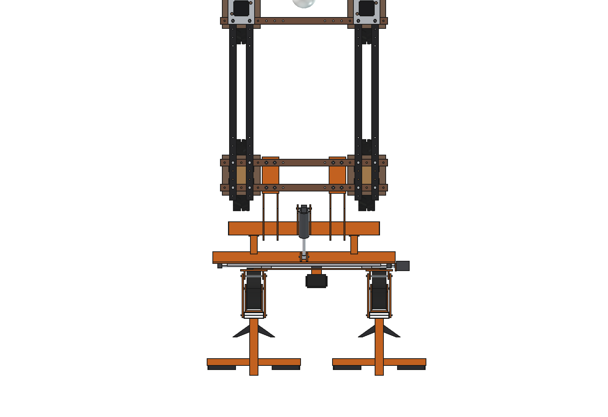
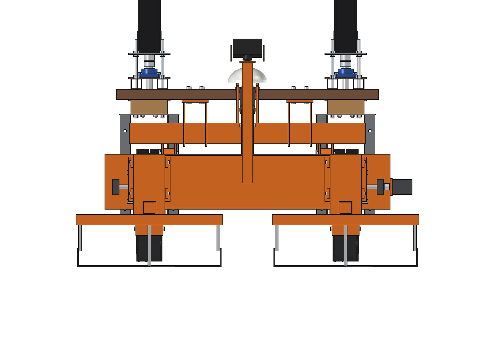
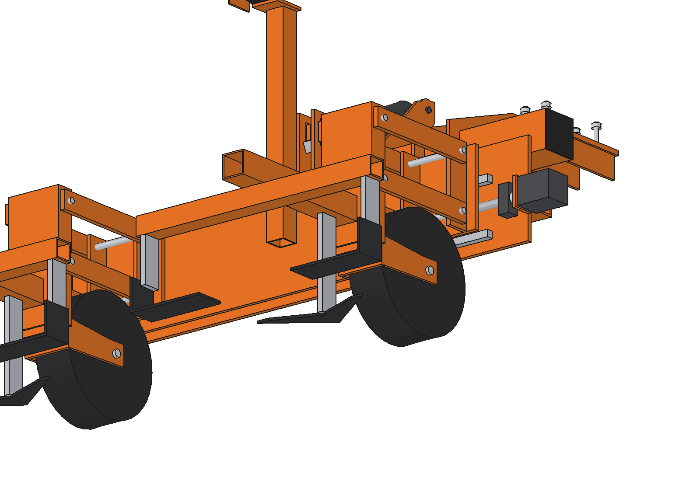
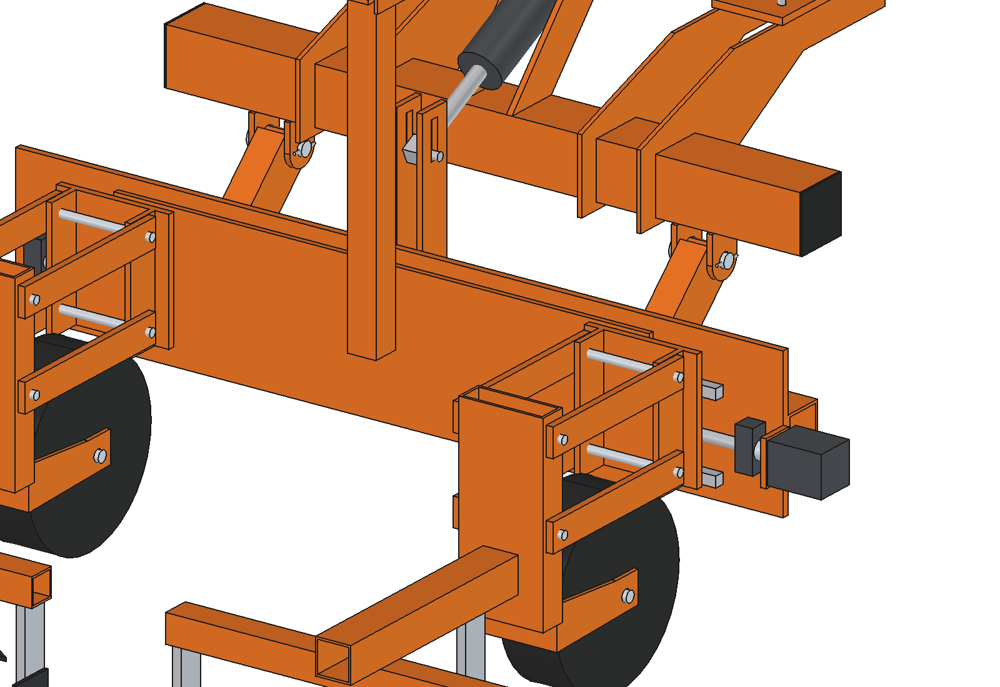

# Inter-row hoe (simple)

Single-axis guided hoe behind the Bruut OpenAgbot (standard robot), for row crops such as maize at 75 cm. Two hoe units
work the two inter-rows the robot's wheels run in; a ball-screw side shift (+-75 mm) keeps them on the rows, steered by a
camera above the middle row (RTK row map as fallback). 550 mm hoed per inter-row, 100 mm untouched each side of a row.

<p align="center">
  
</p>

| Work (units on their gauge wheels) | Transport (lifted 25 degrees) |
| --- | --- |
|  |  |
|  |  |
|  |  |

## Build

- **Mount**: the rear toolbar of the grassland harrow (80 x 80 x 4 on 2 hangers under the rear lower beams, 8 x M10 in
  the hole grid), pivot forks and actuator mast.
- **Lift**: carrier weldment (2 arms 60 x 40 x 3, main beam 60 x 60 x 4, 10 mm rail plate) on O20 pins, 24 V 3000 N
  actuator (stroke 100) with the rod pin in a 40 mm float slot.
- **Side shift**: 2 HGR15 rails, 4 HGH15CA carriages, 8 mm shift plate, ball screw SFU1610 in BK12 / BF12, 2 Nm
  closed-loop NEMA23 with a jaw coupling. Stroke +-75 mm, 80 mm/s.
- **Units (2)**: parallelogram head on the shift plate, 2 x 2 links 40 x 10, post 120 x 40, gauge wheel O250 x 80,
  beam 50 x 50 back to a cross bar; goosefoot share 250 in the middle and 2 L-blades (wall on the row side) on rigid
  shanks, 20 mm deep.
- **Camera** on a 40 x 40 mast on the shift plate, 80 degrees down, above the middle row.

Mass ~119 kg (lift group 94 kg, of which the shift group with the units 58 kg; mount 22 kg).
Size 1310 x 1310 x 872 mm (x, y, z). Needs the 2 x 20 kg front counterweight.

## Key figures (`irh_calc.report()`)

| | |
| --- | --- |
| Pass width / hoed share | 1.5 m (2 inter-rows of 750) / 73 % |
| Capacity at 1 m/s | ~0.43 ha/h (80 % field efficiency) |
| Pull: cutting / rolling / total | 550 / 214 / 764 N, grip 938 N, margin 1.23, ~1.0 kW |
| Side shift | 80 mm/s at 480 rpm, nut force ~340 N, 0.6 Nm (motor 1.2 Nm), full stroke 1.9 s |
| Guidance | band 100 mm against ~10 mm camera / ~20 mm RTK error |
| Lift actuator | ~2.2 kN (rating 3 kN), lift ~15 s |
| Clearance to rear tyres / brackets | 148 mm (work), 155 mm (transport) |
| Axle load front / rear, transport | 51 / 262 kg with the counterweight (front 16 %); 3 % without |

Why and how these come out: see [RATIONALE.md](RATIONALE.md), including the list *Estimated, not measured*.

## Files

| File | Contents |
| --- | --- |
| `irh_params.py` | all dimensions, robot interface, crop rows, poses, work parameters, masses from the model |
| `irh_parts.py` | one function per part, robot coordinates, work pose, shift 0 |
| `build_irh.py` | model tree, `set_pose(lift, shift)`, checks (`check_interference`, `check_poses`, `clearance`, `ground_contact`, `row_margin`), mass, `render_all()`, STEP |
| `irh_calc.py` | coverage, pull against grip and motors, side-shift drive, guidance error budget, lift actuator, axle loads |
| `run_in_freecad.py` | reload, build, print the key figures |
| `Inter_Row_Hoe.FCStd`, `Inter_Row_Hoe.step` | generated model (robot hidden in the FCStd) |
| `previews/` | images |

## Use

```python
exec(open(r"F:\veldrobot\aanbouwdelen\inter row hoe\simple\run_in_freecad.py").read())
import build_irh
build_irh.set_pose(lift=0, shift=75)
build_irh.check_poses()        # lift -4..25 x shift -75..75: must be {}
```

No animation yet (simple variant): the poses are checked statically with `check_poses()`.
