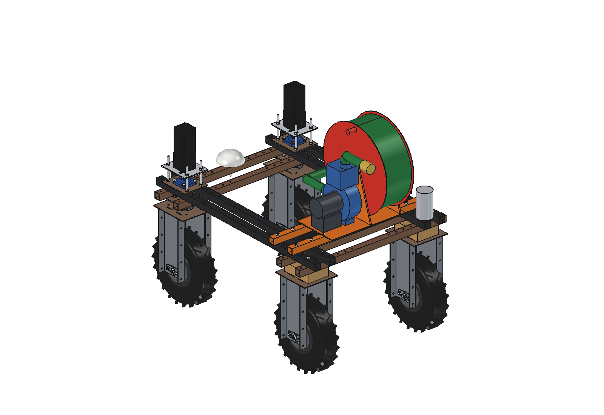
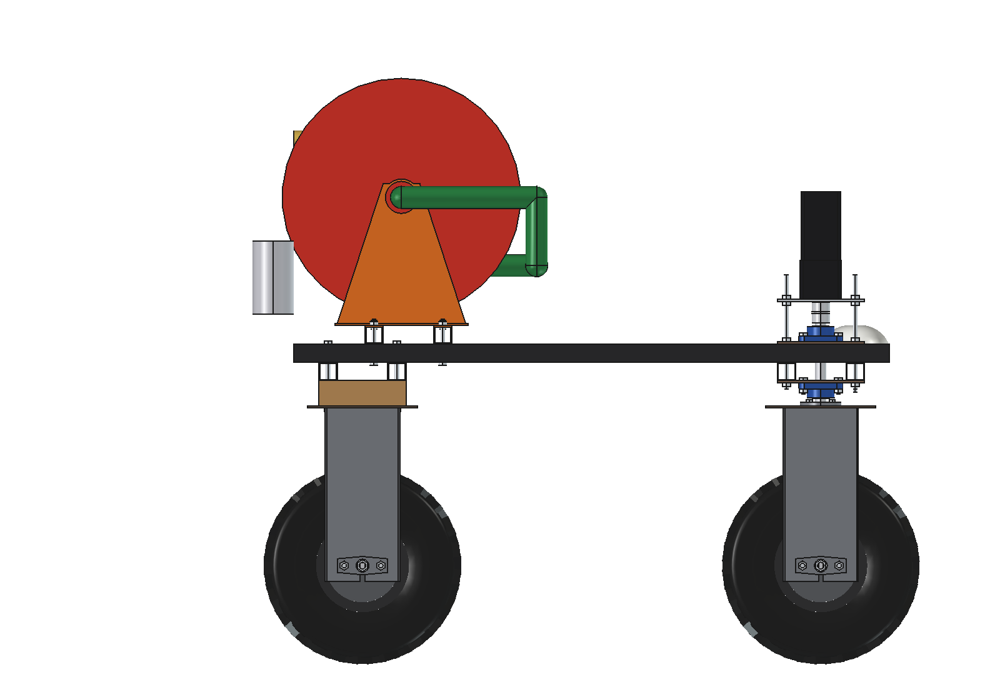
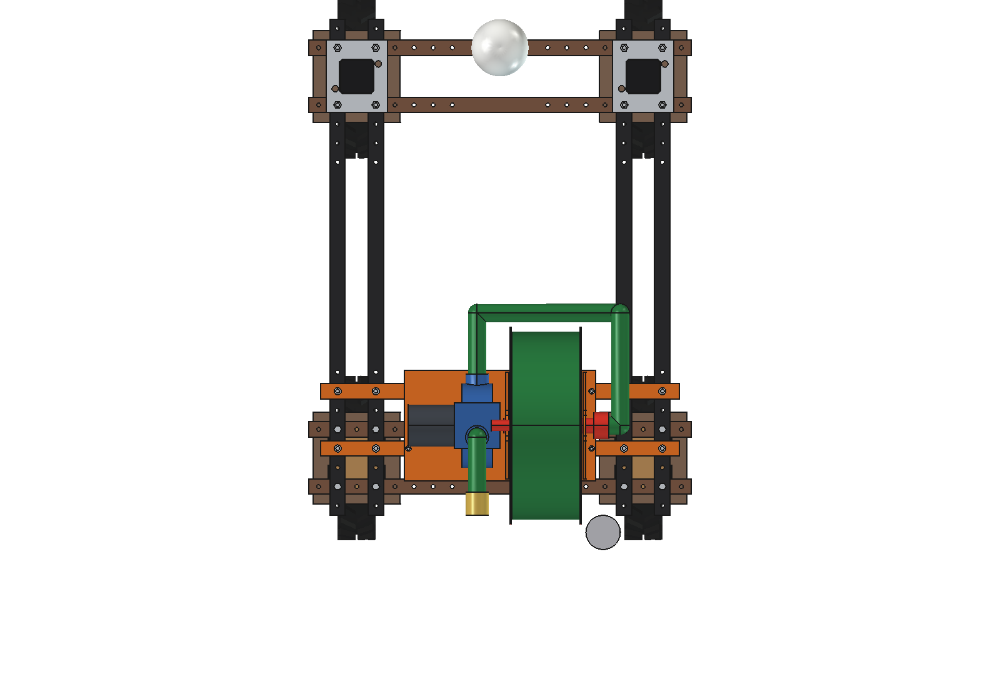
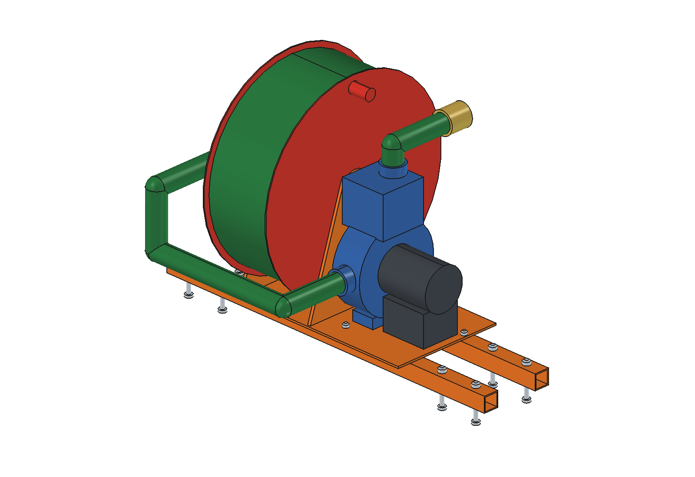
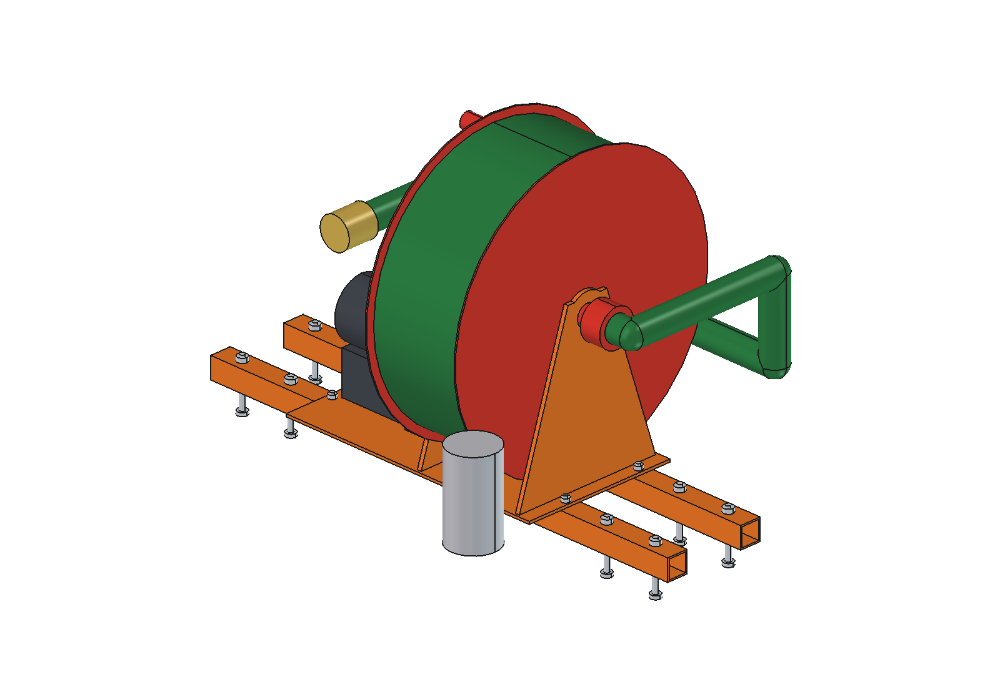

# Irrigation pump (simple)

Direct pump for the Bruut OpenAgbot (standard robot): the robot drives to a ditch or pond, the 8 m suction hose with
strainer and foot valve is unrolled into the water, and a self-priming centrifugal pump on a 48 V BLDC motor delivers to
a 1.5" Camlock coupling at the rear: a lay-flat hose, the [hose reel irrigator](../../irrigation/) or a spray boom. The
bearers and base plate are those of the [hydraulic power pack](../../hydraulic%20pump/simple/README.md) (imported).

<p align="center">
  
</p>

| Side | Top |
| --- | --- |
|  |  |
|  |  |

## Build

- **Mount**: 2 bearers 40 x 40 x 3 on the upper beams at y -325 / -475 and a 5 mm base plate (from `hpu_parts`).
- **Pump**: self-priming centrifugal pump 1.5", casing O220 with priming chamber, inlet at the front, outlet on top;
  BLDC 48 V 1.5 kW.
- **Reel**: drum O300 x 180 (3 mm tube) with flanges O520 on 2 side plates, 8 m of 1.5" spiral suction hose in 2 layers,
  hollow axle with a rotary union on the right end, crank knob on the left flange; strainer with foot valve clipped
  behind the reel.
- **Pipes**: suction hose from the union forward round the reel to the pump inlet; discharge from the priming chamber
  back to the Camlock coupling at the rear edge.

Mass ~62 kg. Size 940 x 644 x 626 mm.

## Key figures (`idp_calc.report()`)

| Suction lift / end head | Flow | Head | Power | Per charge (1.9 kWh) |
| --- | --- | --- | --- | --- |
| 1.5 m / open hose | 10.8 m3/h | 17 m | 1.2 kW | 17 m3, 1700 m2 at 10 mm |
| 3 m / drip line 10 m | 8.5 m3/h | 23 m | 1.2 kW | 13 m3, 1300 m2 |
| 3 m / sprinkler 20 m | 5.9 m3/h | 28 m | 1.0 kW | 11 m3, 1080 m2 |
| 5 m / sprinkler 20 m | 5.2 m3/h | 29 m | 1.0 kW | 10 m3, 1040 m2 |

With 50 m of 1.5" lay-flat hose. NPSH available 4.9 / 3.4 / 1.4 m at 1.5 / 3 / 5 m lift: keep the pump within ~4 m
of the water level. For longer runs, park the robot at the [charging dock](../../charging%20dock/) or under the
[solar canopy](../../solar/) while it pumps.

Why and how these come out: see [RATIONALE.md](RATIONALE.md), including the list *Estimated, not measured*.

## Files

| File | Contents |
| --- | --- |
| `idp_params.py` | pump, reel and hose dimensions; mount and robot interface from `hpu_params`; pump curve and hydraulics |
| `idp_parts.py` | one function per part, robot coordinates; bearers, plate and bolts from `hpu_parts` |
| `build_idp.py` | model tree (Mount, Pump, Reel, Pipes), checks (`check_interference`, `check_holes`, `check_steering`, `clearance`), mass, `render_all()`, STEP |
| `idp_calc.py` | operating point (pump curve against suction lift, end head and hose friction), power, volume and area per charge, NPSH |
| `run_in_freecad.py` | reload, build, print the key figures |
| `Irrigation_Pump.FCStd`, `Irrigation_Pump.step` | generated model (robot hidden in the FCStd) |
| `previews/` | images |

## Use

```python
exec(open(r"F:\veldrobot\aanbouwdelen\irrigation pump\simple\run_in_freecad.py").read())
import build_idp
build_idp.check_interference()   # []
```

No animation (simple variant).
