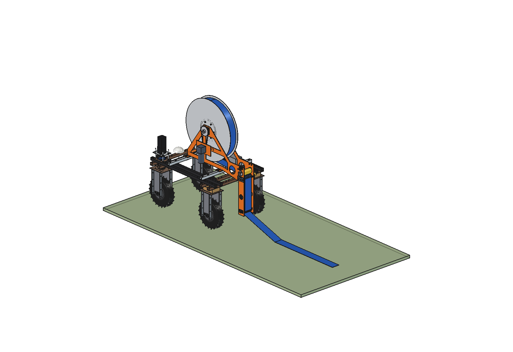
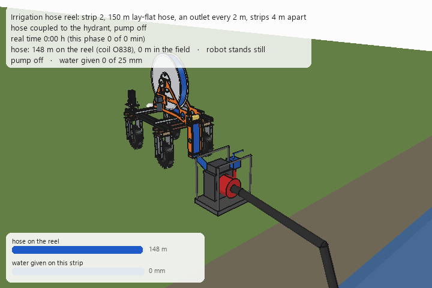
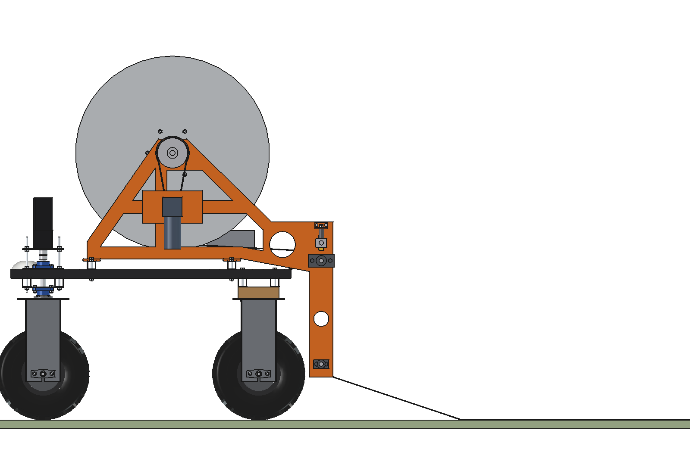
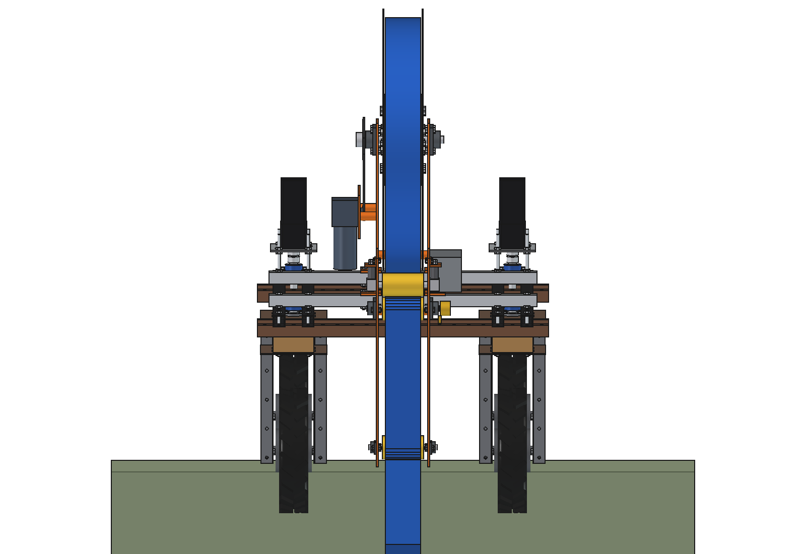
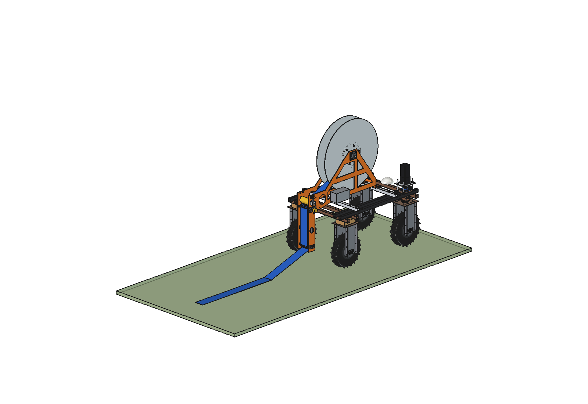
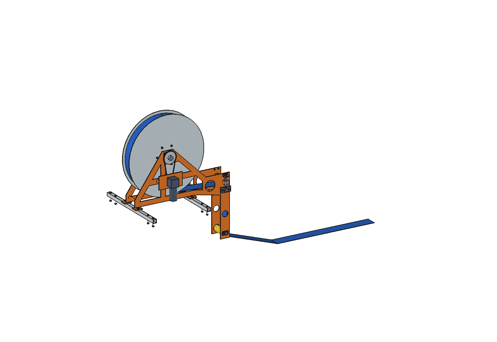
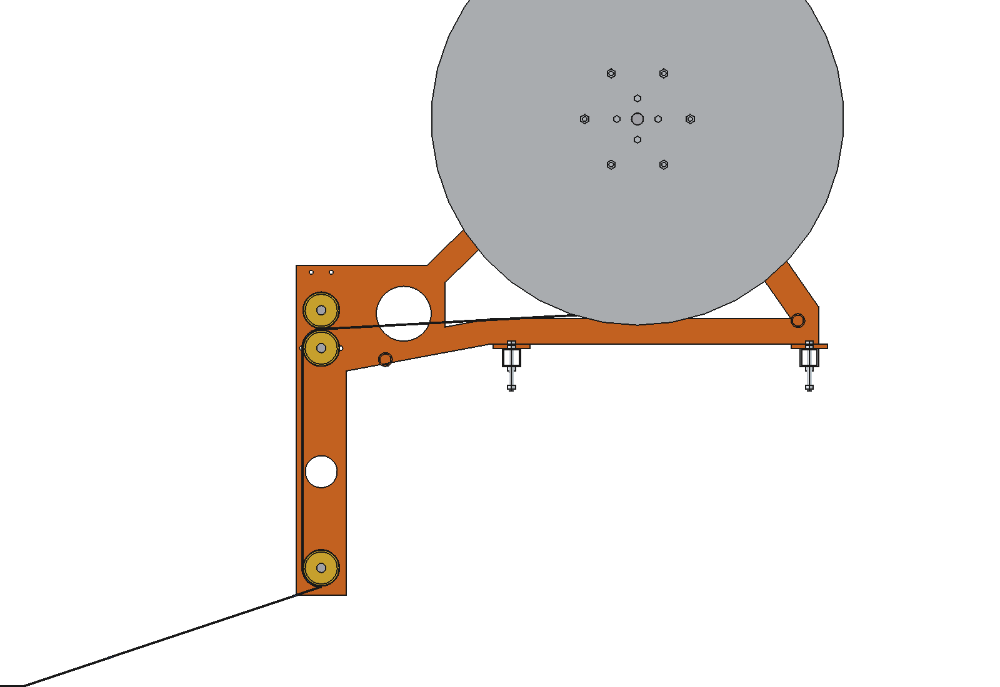
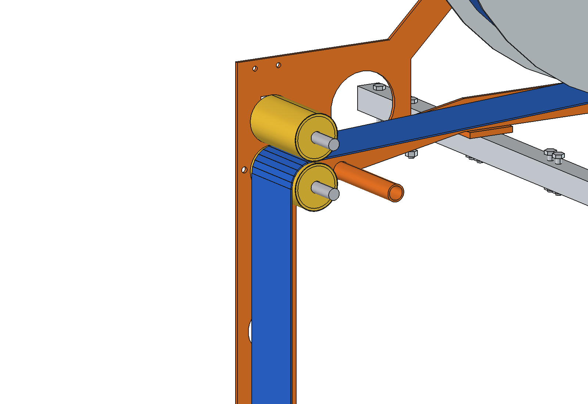

# Irrigation, stationary pump + hose reel: FreeCAD model

Irrigates grassland at **low pressure with a lot of water**: the water floods the field from many outlets, it is not
sprayed. A petrol pump stays at the ditch. The robot carries a reel with **150 m of 3" lay-flat hose** and works one
strip at a time:

1. **Lay out.** The hose is coupled to the hydrant valve at the pump. The robot drives into the field and the empty
   hose pays out at the rear. The hose lies still on the grass: the robot pulls nothing.
2. **Irrigate.** The pump runs at 0.17 bar. Every 2 m a small outlet (3.5 mm restrictor with a flat drop tail) lets
   out ~120 l/h. The water spreads over a strip about 4 m wide and soaks in. The **pinch rollers** on the robot clamp
   the hose shut, so the coil on the reel stays empty and light.
3. **Drain.** The pump stops and the valve switches to drain. The hose runs empty by gravity.
4. **Roll up.** The robot drives back in reverse and winds the flat hose. The pinch rollers squeeze the last water
   back towards the hydrant.
5. **Next strip.** The first 20 m of hose (the lead, no outlets) curve over the headland to the start of the next
   strip, 4 m further.

The heavy part, a full hose of 650 l, always stays in the field. The robot only carries the empty hose (60 kg).

Why it is designed this way is explained in [RATIONALE.md](RATIONALE.md). The concept and the other options are in the
[irrigation README](../README.md).





*One strip: lay out, fill, irrigate, drain, wind. The previous strip (darker green on the left) is already done. Time
is compressed per phase; the caption gives the real time (about 2 hours per strip).*

| | | |
| --- | --- | --- |
|  |  |  |
| side view: reel above the robot, pinch rollers behind the rear beam | from behind: the hose runs between the wheels | reel almost empty, the hose lies behind the robot |
|  |  |  |
| left: worm gearmotor, chain 12 → 36 | the hose path with the right plate hidden: coil → nip → down → guide roller → ground | pinch rollers: top roller pressed down by 2 springs (2 × 150 N) |

## Key figures

From the model (`build_irr.mass_properties`, `check_interference`, `check_fit`, `clearance`, `size`) and
`irr_calc.report()`. Robot 161.5 kg (agbot comparison, not weighed).

| | |
| --- | --- |
| Hose | 3" lay-flat PVC, 150 m, flat 121 × 2.6 mm, 0.38 kg/m; 65 outlets every 2 m from 21 m on (62 in the field) |
| Coil | Ø843 mm full (flanges Ø900), Ø334 with the 3 m reserve; 82 turns, one hose wide: no level-wind needed |
| Flow | 7.4 m³/h at 1.77 m head at the hydrant (0.17 bar); 119 … 124 l/h per outlet, CU 98.9 % on level ground |
| Slope ±0.5 % along the strip | CU 96 / 94 %, smallest / largest outlet 0.87 / 0.79 |
| Pump | 3.6 m total head: a 3" petrol pump runs almost at idle (throttle 0.37), ≈ 0.35 l/h petrol |
| Strip | 124 × 4 m = 496 m², 25 mm in 100 min (infiltration 15 mm/h, estimated) |
| Cycle per strip | lay out 4.0 min, fill 6.4, irrigate 100, drain 6, wind 4.0, shift 1.5 = **122 min** |
| Capacity, 24 h a day | 11.8 strips = 0.59 ha at 25 mm a day; keeps up with 3.5 mm/day evaporation on **≈ 4.2 ha**; ≈ 7 l petrol a day |
| Reel drive | 48 V worm gearmotor 350 W, 100 rpm, 30 Nm; chain 3:1 → 86 Nm on the reel (63 Nm needed for 150 N winding tension), 33 rpm max; winding 0.58 … 0.60 m/s |
| Pinch rollers | clamp 300 N (2 springs), ~19 N needed to seal at 15 kPa; the water pulls 69 N on the robot (grip ≈ 1050 N) |
| Mass | 146 kg: mount 7.6, frame 34.7, reel 21.3, drive 10.9, pinch 10.3, hose 61.5 kg |
| Robot + reel | 308 kg, centre of gravity 788 mm high; front axle 139 kg, rear 169 kg; tips sideways at 25°, backwards at 30° (static) |
| Overall size | 920 × 1200 × 1490 mm (x × y × z), from z 200 to 1690; pinch arm 130 mm behind the rear tyres |
| Clearance to the robot | ≥ 37 mm (foot bolts to the rear lower beam); hose run ≥ 13 mm from the bearing nuts |
| Robot energy | 80 Wh per strip, ≈ 950 Wh a day: 2.5 days on a 2.4 kWh battery |

## Files

| File | Contents |
| --- | --- |
| `irr_params.py` | all dimensions, the robot interface, hose, outlets, soil and pump data |
| `irr_parts.py` | one function per part (robot coordinates), the coil and hose path, field items for the animation |
| `build_irr.py` | model tree, colours, `set_hose()`, interference / fit / clearance checks, mass, images, STEP export |
| `irr_calc.py` | hydraulics (Hazen-Williams with orifices), pump point, reel drive, pinch, cycle, capacity, energy, axle loads |
| `animate_irr.py` | animation of one strip on the robot in a separate document |
| `make_gif_irr.py` | frames to GIF with caption and bars |
| `run_in_freecad.py` | macro: reload, build, print the key figures |
| `Irrigation_Hose_Reel.FCStd`, `.step` | generated model (reel full, robot hidden) |
| `previews/` | images and the GIF |

## Use

In FreeCAD 1.1 (Python console, or run `run_in_freecad.py` as a macro):

```python
import sys; sys.path.insert(0, r"F:\veldrobot\aanbouwdelen\irrigation\stationary + roller")
import build_irr, irr_calc
build_irr.build()                          # FCStd + STEP; build(show_robot=True) with the robot visible
build_irr.set_hose(l_reel=40.0)            # 40 m on the reel: reel angle, coil and hose path follow
build_irr.check_interference()             # [] = no overlap
build_irr.check_fit()                      # {} = the reel turns freely
build_irr.clearance(); build_irr.hose_check(); build_irr.mass_properties()
build_irr.render_all()                     # images in previews/
irr_calc.report()                          # also without FreeCAD: python irr_calc.py

import animate_irr, make_gif_irr
animate_irr.build(); animate_irr.play()    # live; animate_irr.stop()
animate_irr.render_all(r"C:\temp\irr_frames")
make_gif_irr.main(r"C:\temp\irr_frames", r"previews\animation_one_strip.gif")
```

Change the field in `irr_params.py` (`hose_len`, `lead_len`, `outlet_pitch`, `outlet_d`, `infiltration`, `strip_w`,
`gift`, `slope`) and run `irr_calc.report()`: the flow, pressure, uniformity, cycle and capacity follow. If the coil
no longer fits the flanges, `hose()["flange_margin"]` goes negative.

## Estimated, not measured

- **Infiltration** of the grassland, 15 mm/h, and with it the **strip width**, 4 m: how far the water spreads from an
  outlet depends on the soil, the sod and the slope. Measure this first (a ring infiltrometer, or one outlet for an
  hour). Both set the flow and the time per strip.
- Lay-flat hose: mass 0.38 kg/m, Hazen-Williams C 140, mean coil thickness per wrap 3.2 mm (hose + outlets).
- Outlets: discharge coefficient 0.62 of the 3.5 mm restrictor, mass 50 g, a flat tail that winds onto the reel well.
- Pump curve (28 m / 66 m³/h), efficiency far left of the best point, petrol use at idle 0.35 l/h; suction and valve
  losses.
- Winding tension 150 N, drive power on grass
  150 W, electronics 25 W.
- Sealing of the pinch rollers (line load over a 10 mm contact band).
- Robot: mass and centre of gravity (agbot comparison), the steering stack, stepper motor and gearbox, `steering_gap`
  55, wooden blocks, antenna position, hub motor and tyre (STLs are missing).
