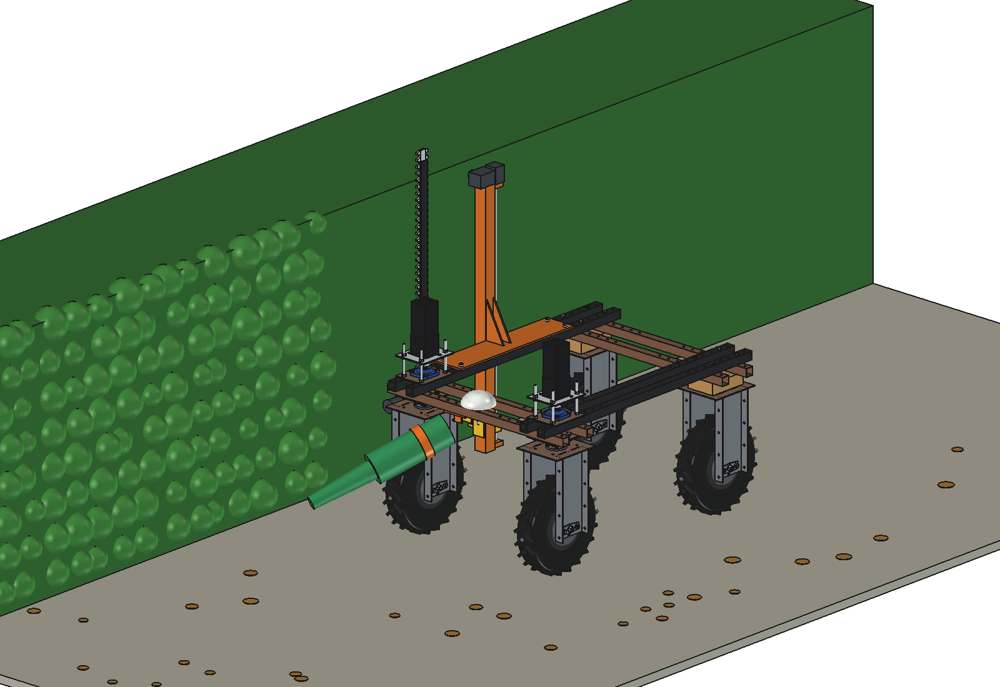
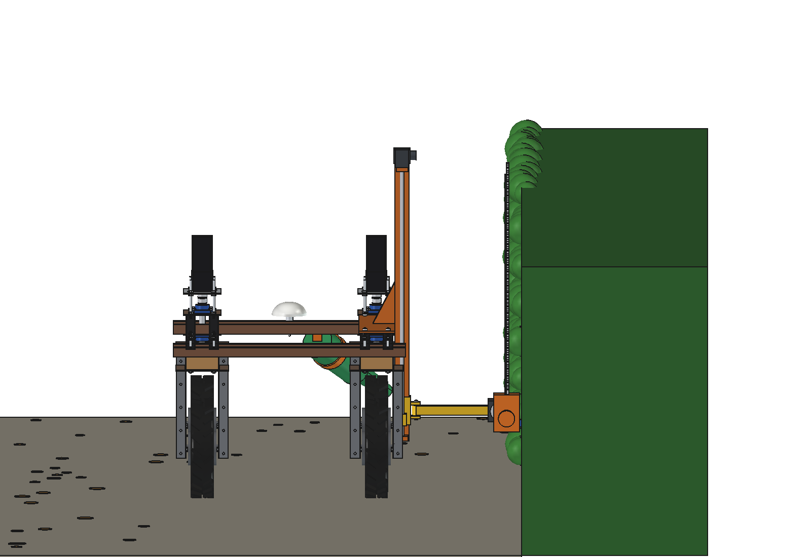
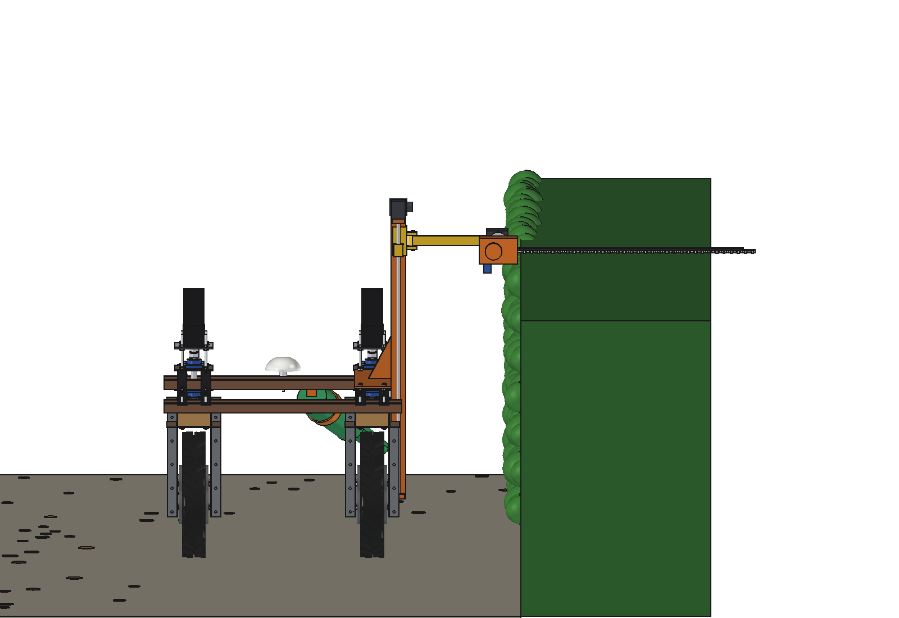
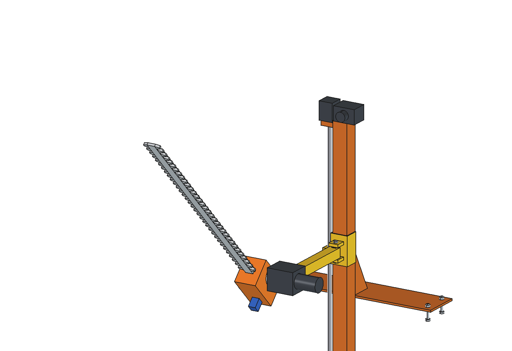
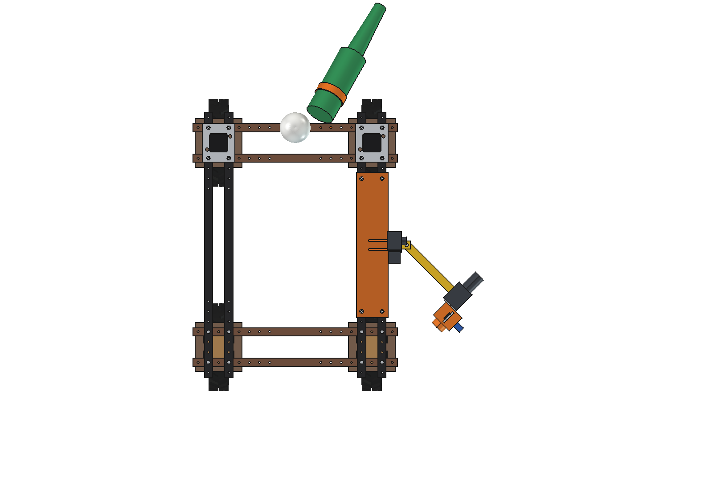
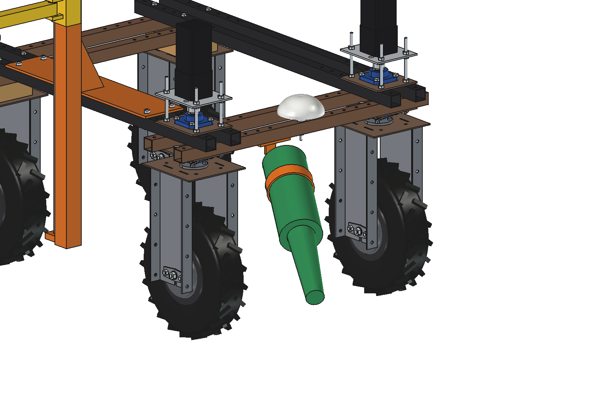

# Hedge trimmer and leaf blower (simple): FreeCAD model

Trims hedges along a stored RTK line and blows the clippings and leaves off the path, without a gardener walking
along. On the right of the robot: the **mast, lead screw, stepper, carriage and spring-hinged arm of the
[fence inspector](../../fence%20inspector/simple/README.md)** (imported, not copied). New:

- **Tilt head** at the arm tip: a 24 V worm gearmotor with its output along y.
- **Hedge trimmer**: a garden-tool motor and gearbox (~600 W) with a **double-sided bar of 1000 mm** (teeth 30 mm),
  a finger guard strip and a ToF distance sensor that keeps the bar 60 mm off the hedge face.
  - tilt 0: the bar stands up from the head and cuts the **side** of the hedge from z 0.39 m up to 2.37 m (carriage
    305 … 1290 mm);
  - tilt 90: the bar lies along +x and cuts the **top** up to z 1.26 m, 1 m into the hedge;
  - tilt 45: a chamfer on the top edge.
- **Leaf blower** in front: a 48 V axial blower (~900 W) on a bracket under the front lower beam, blowing forward-right
  and down over the path: the clippings and leaves go into a windrow along the hedge foot (for the broom sweeper or the
  debris vacuum).
- The arm swings back on its spring hinge when the bar meets a post or a branch; the stop is at **45°** (at 80° the
  head would reach the rear wheel bracket at the lowest height).

Why it is designed this way: [RATIONALE.md](RATIONALE.md).

| | | |
| --- | --- | --- |
|  |  |  |
| side cut, bar up | top cut, bar along +x | tilt head at 45° |
|  |  | |
| arm swung back 45° (spring hinge) | front blower | |

## Key figures

From the model (`build_hdg.mass_properties`, `ground_clear`, checks) and `hdg_calc.report()`.

| | |
| --- | --- |
| Mass | 36 kg (mast and plate 19 kg, carriage, arm and tilt motor 12 kg, trimmer 7 kg, blower 5 kg) |
| Reach | side cut z 0.39 … 2.37 m; top cut up to z 1.26 m, x 0.99 … 1.99 m |
| Cutting | 0.25 m/s at 3000 strokes/min: 5 mm feed per stroke (teeth 30 mm), a clean cut |
| Hedge 1.25 m high, 0.8 m wide | 5 passes (2 per side, 1 top): ~180 m of hedge per hour, ~810 W, ~420 m per charge |
| Blower | 45 m/s at the nozzle, ~28 m/s on the path 0.6 m away (wet leaves move from ~8 m/s); 1.8 h at full power |
| Stability | arm and trimmer out at x 0.9 m: 7× against tipping over the right wheels |
| Noise at 7 m (estimated) | blower ~74 dB(A), trimmer ~68 dB(A) |

Checks: `check_interference()` = [], `check_poses()` = {} (arm 305 / 1290 × tilt 0 / 45 / 90 × swing 0 / 45°, and the
blower against the front wheels at ±30° steering).

## Files

| File | Contents |
| --- | --- |
| `hdg_params.py` | all dimensions and work figures; imports `fin_params` |
| `hdg_parts.py` | tilt motor and flange, trimmer housing, bar with teeth, guard, ToF, blower and bracket, scene |
| `build_hdg.py` | model (mount, carriage, arm from `build_fin` / `fin_parts`), `set_pose(arm_z, tilt, swing)`, checks, `ground_clear`, mass, `render_all` |
| `hdg_calc.py` | reach, feed per stroke, hedge per hour and per charge, blower air speed, tipping, noise |
| `run_in_freecad.py` | reload, build, print the report |
| `Hedge_Trimmer.FCStd`, `.step` | generated |

## Estimated, not measured

- Trimmer 600 W and 3000 strokes/min, blower 900 W / 45 m/s (garden-tool classes), noise levels.
- Air speed needed for wet leaves 8 m/s; free-jet decay 6.2 u0 d / x.
- Not in the simple variant: the lawn edger disc (a head for the same tilt flange is the next step), and the hedge
  base below 0.39 m (tilt 45 at the lowest height reaches 0.17 m).
- Safety: the trimmer runs only with the robot moving along the stored line, a person detected within 3 m stops it.
