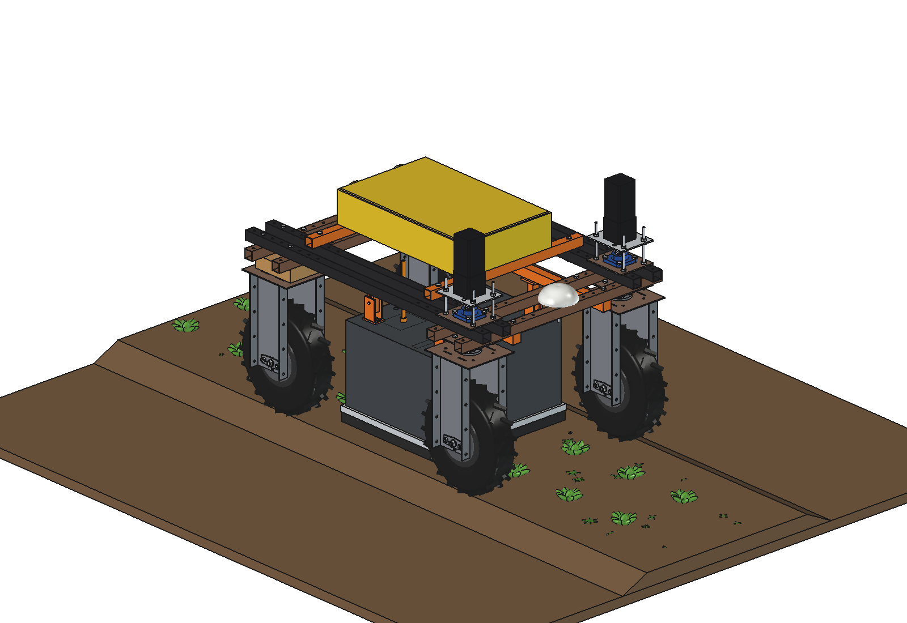

# Laser weeder (simple)

Kills weed seedlings with a laser, under the light-tight hood of the
[drop-on-demand boom](../../drop%20on%20demand%20boom/simple/README.md) (belly rails, hanger posts, hood with brush
strip, camera and LED bars, imported). Instead of the injector rail, 2 galvo scan heads (one per 300 mm of the
0.6 m bed) aim the beam of a fibre-coupled 60 W diode laser at the growing point of each weed. The 2 laser sources sit
in an air-cooled box on a cradle on top of the robot; 2 armoured fibre cables go straight down to the heads.
Class 4 laser: it only fires inside the closed hood, with interlocks on hood height and robot tilt.

## Key figures (`lzw_calc.report()`)

| | |
| --- | --- |
| Scan field | 304 mm per head (+-27 degrees, lens 298 mm above the ground) |
| Per weed | ~19 J (mix of cotyledon / 2-leaf / 4-leaf), 0.33 s at 60 W |
| Speed | 0.2 m/s: laser duty 0.39 at 20 weeds/m2; max ~0.5 m/s; a weed stays 1.5 s in the field |
| Power | ~620 W (lasers ~134 W average): ~3 h, ~990 m2 (1650 m of bed) per charge |
| Mass | ~48 kg; 119 / 90 kg front / rear with the robot |
| Checks | `check_interference()` [], `check_poses()` {} (height steps x steering +-30), `clearance()` 28.9 mm |

Files as in the other implements: `lzw_params.py`, `lzw_parts.py`, `build_lzw.py`, `lzw_calc.py`, `run_in_freecad.py`,
`Laser_Weeder.FCStd/.step`, `previews/`. See [RATIONALE.md](RATIONALE.md).
