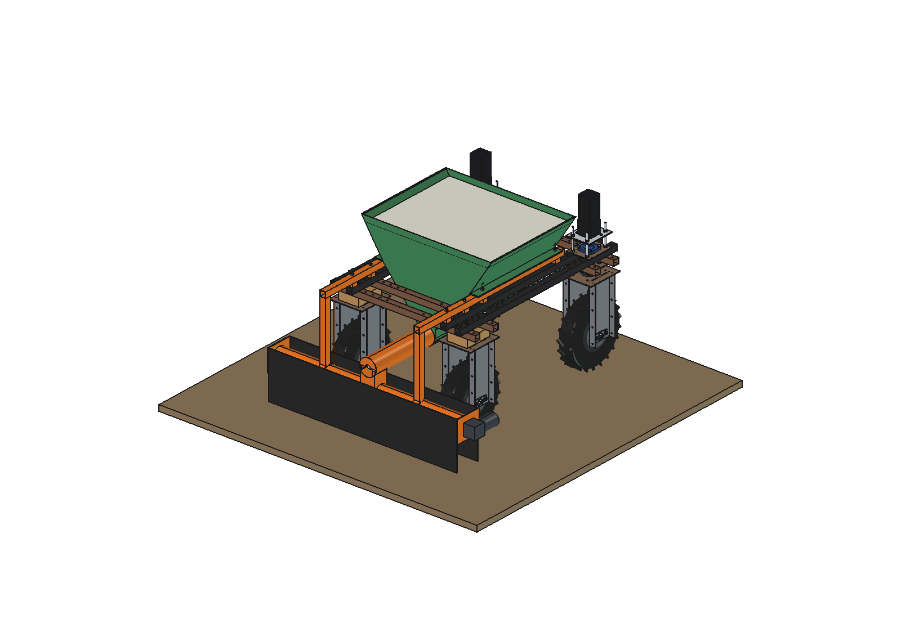
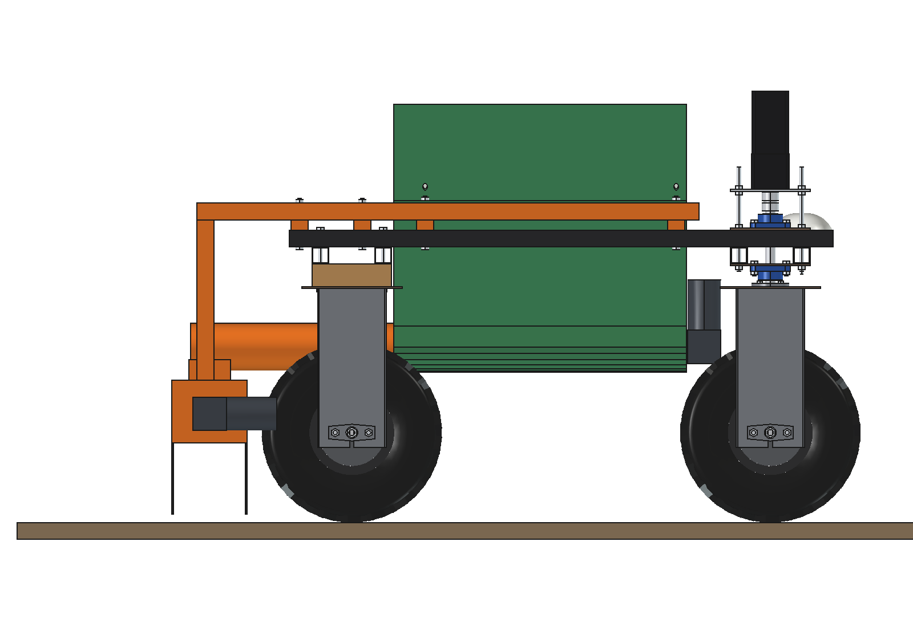
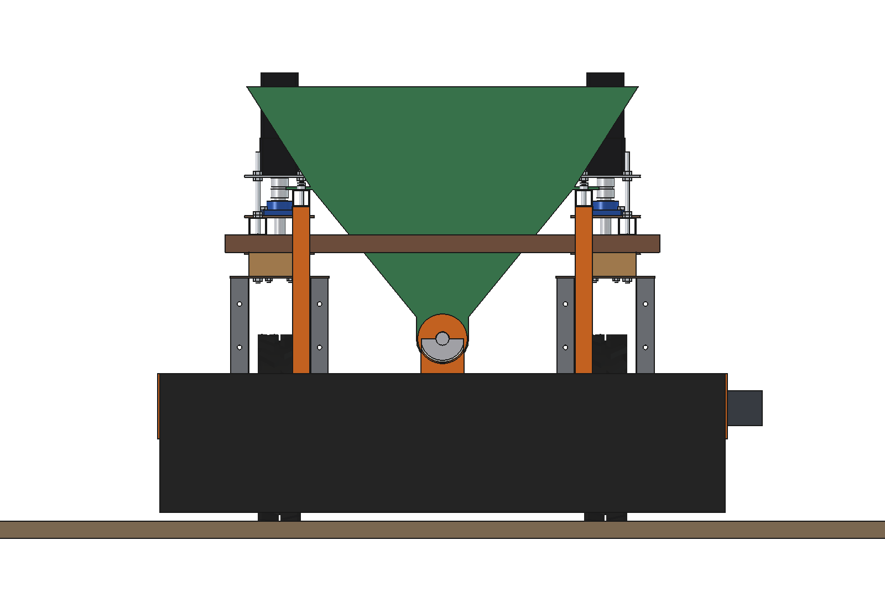
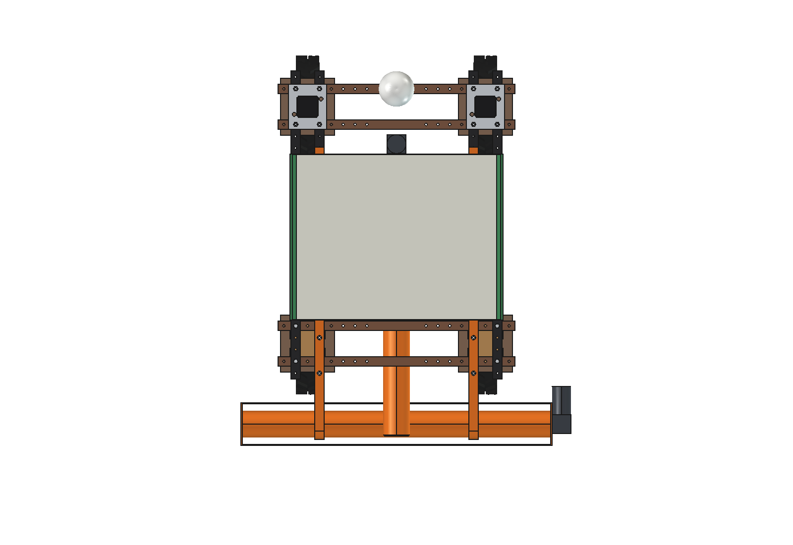
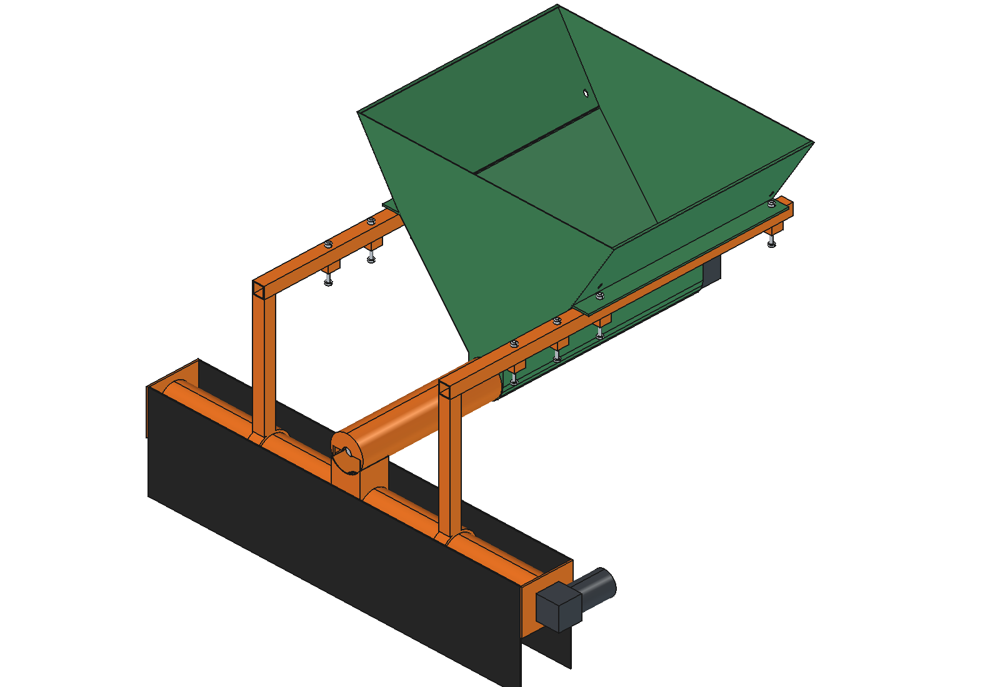

# Lime spreader (simple)

Drop spreader for granulated or ground lime on the Bruut OpenAgbot (standard robot). A V-hopper of ~180 l sits on
2 rails on the inner upper beams, centred over the robot. A trough auger carries the lime backward in a tube under the
rear lower beams to a cross auger behind the rear wheels, which spreads it over 1.3 m and lets it fall through a row of
O20 holes, 0.2 m above the ground, inside a rubber dust skirt. No spinner: no dust cloud and no drift.

<p align="center">
  
</p>

| Side | Rear |
| --- | --- |
|  |  |
|  |  |

## Build

- **Mount**: 2 rails 40 x 40 x 3 on 25 mm spacers on the inner upper beams (x = +-325), 4 x M10 each in the beam
  holes at y -625, -475, -325, 275 (the upper beams have no holes between y -275 and 275), as on the fertilizer
  spreader. 2 legs 40 x 40 from the rail ends down to saddles on the cross tube.
- **Hopper**: steel 2 mm, V-section across the robot: x +-450 at the top (z 1000), +-300 on the rails, down between the
  inner upper beams to a U-trough round the auger at z 420. Walls 57 / 51 degrees. Aluminium lid. 178 l to 40 mm under
  the lid.
- **Trough auger**: flights O100 pitch 100 on a O30 shaft, from the front wall to over the cross auger, in a tube
  O114.3 x 3 under the rear lower beams; 24 V worm gearmotor on the front wall.
- **Cross auger**: tube O114.3 x 1300 at y -840 (behind the rear tyres), flights from the middle to both ends, 25 outlet
  holes O20 every 50 mm in the bottom; own 24 V worm gearmotor on the right end. Drop chute 100 x 100 between the tubes.
- **Dust skirt**: rubber 4 mm front and rear between the 6 mm end plates, 20 mm above the ground.

Mass 97 kg empty, ~300 kg full (205 kg granulated lime). Size 1392 x 1312 x 983 mm (x, y, z).

## Key figures (`lsp_calc.report()`)

| | |
| --- | --- |
| Load | 178 l: 205 kg granulated, 178 kg ground dry, 223 kg ground damp |
| Width | 1.3 m (covers the wheel tracks) |
| Auger speed at 500 / 1000 / 2000 kg/ha, 0.8 m/s | 8 / 17 / 34 rpm (max 3560 kg/ha at 60 rpm) |
| Area per fill at 500 / 1000 / 2000 kg/ha | 0.41 / 0.21 / 0.10 ha |
| Work rate | 0.30 ha/h (80 % field efficiency), a fill lasts 33 min at 1000 kg/ha |
| Power | augers ~45 W, driving ~390 W; ~4.5 h per charge, ~6 fills |
| Axle load front / rear, full | 183 / 280 kg (rear 60 %), ~140 kg per rear tyre |
| Side slope before tipping, full | 32 degrees (static); up to ~9 degrees uphill on the hub motors |

Why and how these come out: see [RATIONALE.md](RATIONALE.md), including the list *Estimated, not measured*.
Refill from big bags with the [mobile refiller](../../mobile%20refiller/).

## Files

| File | Contents |
| --- | --- |
| `lsp_params.py` | all dimensions, robot interface, work parameters, masses and hopper volume from the model |
| `lsp_parts.py` | one function per part, robot coordinates |
| `build_lsp.py` | model tree (Mount, Hopper, Metering, Load), checks (`check_interference`, `check_holes`, `check_steering`, `clearance`, `ground_clearance`), `hopper_volume()`, mass, `render_all()`, STEP |
| `lsp_calc.py` | load per lime type, dose and auger speed, area per fill, auger and drive power, axle loads, tipping |
| `run_in_freecad.py` | reload, build, print the key figures |
| `Lime_Spreader.FCStd`, `Lime_Spreader.step` | generated model (robot hidden in the FCStd) |
| `previews/` | images |

## Use

```python
exec(open(r"F:\veldrobot\aanbouwdelen\lime spreader\simple\run_in_freecad.py").read())
import build_lsp
build_lsp.check_interference()   # []
build_lsp.check_steering()       # {} (front wheels +-30 degrees)
build_lsp.clearance()            # 35 mm: dust skirt to the rear tyres
```

No moving axes besides the augers (simple variant), so no animation.
