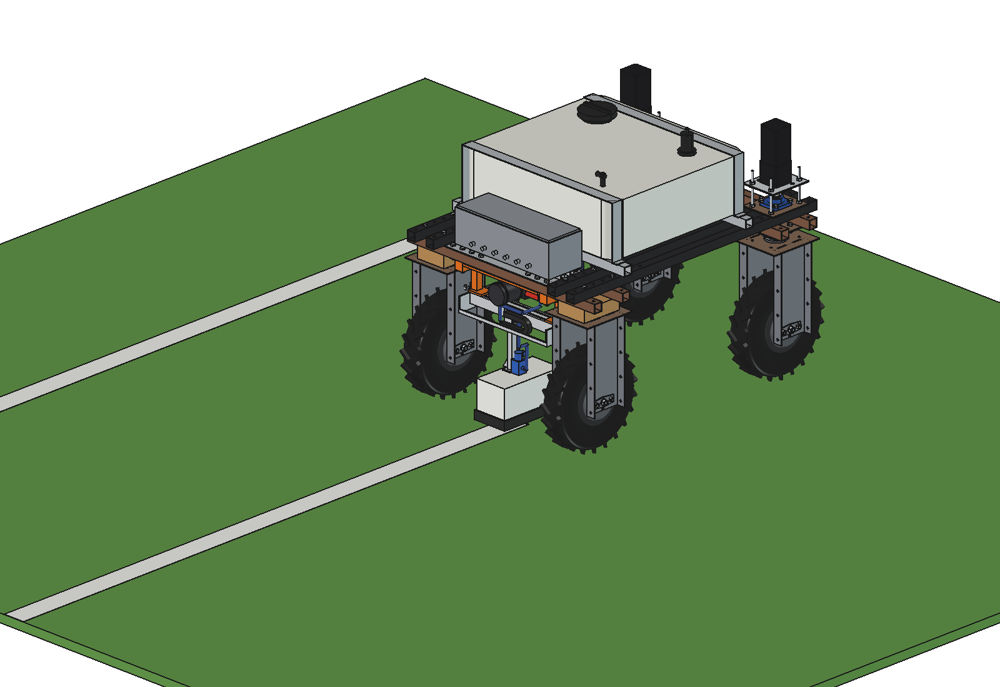
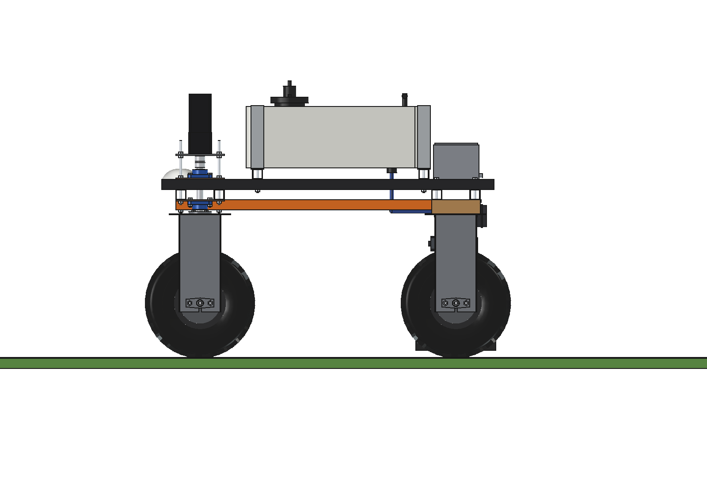
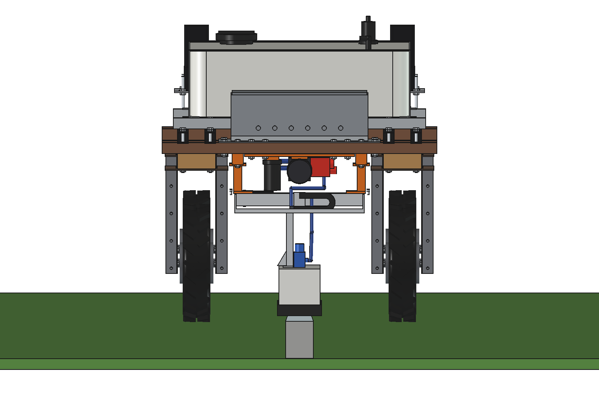
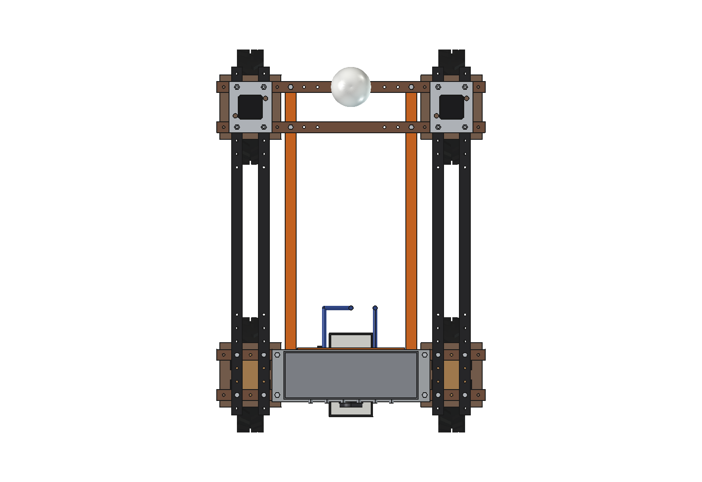
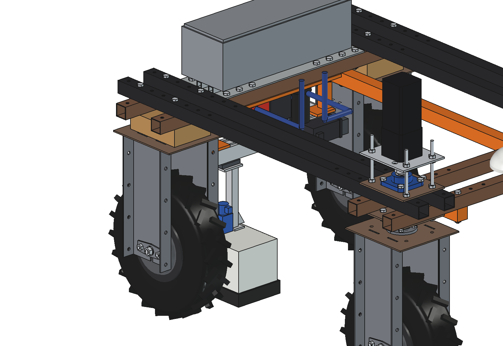
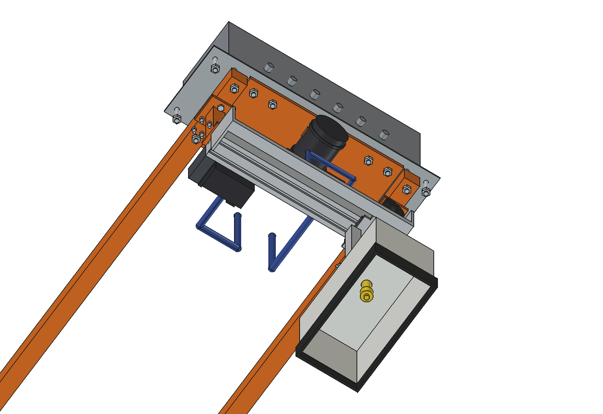
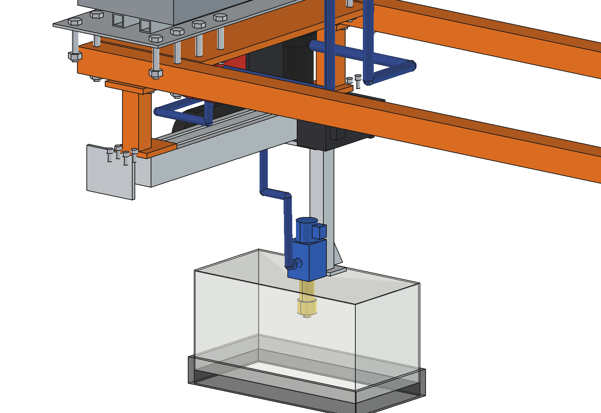

# Sports field line marker (simple): FreeCAD model

Paints the lines of a sports field (football, hockey) from a stored layout. The layout is placed on two measured
corners (like an AB line); the robot drives the lines on RTK and one paint nozzle under its belly switches on and off
at the line ends.

- **Nozzle on the rear axle line** (x 0, y −500). The Bruut steers with the front wheels, so the middle of the rear
  axle is the point that follows the path without slipping sideways: a curve the robot steers is exactly the curve the
  nozzle paints. The centre circle (r 9.15 m) and the penalty arcs need only 6.2° of steering.
- **Short slide across the robot**: the nozzle sits on the carriage of a belt module (stroke 340, x −170 … +170). It
  corrects the cross-track error at the nozzle in real time, and draws arcs that are tighter than the robot can steer
  (minimum radius 1.73 m at 30°): for a corner arc (r 1 m) the robot drives straight along the chord and the slide
  follows the arc (sagitta 293 mm).
- **Paint head**: a 12 V solenoid valve directly on the nozzle body (sharp line ends), an even flat-fan tip 4002E
  (40°, fan across the line), in an aluminium shroud 150 × 300 with a brush skirt (wind shield, sharp edges). The tip
  height in 3 holes sets the line width: 75 mm (hockey), 100 mm, 120 mm (football).
- **Tank, pump, filter, regulator and control box** are the [spot sprayer](../../spotspray%20unit/boom/README.md)'s
  (imported, not copied): 120 l tank filled with ~40 l of ready-mixed line paint, the regulator's bypass return keeps
  the paint stirred in the tank. The **belly rails** are the
  [drop-on-demand boom](../../drop%20on%20demand%20boom/simple/README.md)'s (same bolts, same holes).

Why it is designed this way is explained in [RATIONALE.md](RATIONALE.md).



| | | |
| --- | --- | --- |
|  |  |  |
| side: nozzle on the rear axle line | from behind: slide between the rear tyres | from above |
|  |  |  |
| head at x +170 (tank hidden) | slide, drag chain and head from below | head at x −170: stem, valve, nozzle, shroud |

## Build

- **Belly rails**: 2 × square tube 40 × 40 × 3 along y under the lower beams at x ±225, 4 × M10 each through the beam
  grid holes (the drop-on-demand boom's rails, with 2 extra M8 rivet nuts per side for the posts). The rear bolts also
  clamp the control-box base plate of the spot sprayer.
- **Hanger posts**: 30 × 30 × 2 at x ±225, y −500, foot plate 8 mm with 2 × M8, bottom plate 8 mm with 4 × M6 into T-nuts
  in the top slots of the module. They stay outside the spot-sprayer pump, filter and regulator (x −130 … +110).
- **Belt module** 60 × 45, 460 long, hung upside down (carriage underneath), NEMA 23 closed-loop folded back in front
  of the body (1:1 belt box), all inside the wheel brackets (x ±261).
- **Drag chain** 15 × 20, r 25 behind the module, lower run on an aluminium tray hung from the module end faces; the
  paint hose runs from the regulator into its fixed end and from its moving end down to the valve.
- **Paint head** on the carriage: plate 6 mm with an arm to the chain, stem 25 × 25, shroud, brush skirt, valve, nozzle.

## Key figures

From the model (`build_lmk.mass_properties`, `check_poses`, `clearance`, `size`) and `lmk_calc.report()`.

| | |
| --- | --- |
| Mass | 62 kg empty (tank + cradle 21 kg, mount 29 kg, plumbing 6 kg, slide 3.8 kg, head 2.2 kg); + 52 kg paint (40 l) |
| Football field 105 × 68 | 717 m of line, 27 elements, ~10.4 l ready mix, **~19 min** (paint 13 min, line ends 3.6 min, transit 2 min) |
| Hockey field | 557 m of line, ~8.2 l, ~14 min |
| Paint | 4002E at 3 bar: 0.79 l/min; 100 mm line at 1.0 m/s = 0.13 l/m²; 40 l = ~3.9 football fields |
| Line width | tip at 103 / 140 / 165 mm: 75 / 102 / 120 mm |
| Curves | centre circle r 9.15 m: 6.2° steering; corner arc r 1 m: chord 1414 mm, slide ±147 mm around its middle, 4.7 s |
| Accuracy (estimated) | 9 mm 1σ at the nozzle (RTK 8, heading 2.8, tilt 2.6, slide 1, lag 1), ~18 mm for 95 %; 3° roll uncorrected = 39 mm |
| Line ends | valve delay 25 / 15 ms compensated by look-ahead; spread ±3 mm at 1 m/s |
| Slide drive | 21 N, 0.34 Nm (3× reserve), 180 rpm for 300 mm/s |
| Clearance | brush ≥ 74 mm from the rear tyres at both stroke ends; module and motor inside the wheel brackets |
| Energy | ~415 W, ~130 Wh per football field: ~14 fields per charge (paint, not battery, is the limit) |
| Axle loads, 40 l paint | 275 kg in all, front 119 / rear 156 kg (43 % front) |
| Overall size | 920 × 1251 × 1054 mm (the tank sets it) |

## Files

| File | Contents |
| --- | --- |
| `lmk_params.py` | all dimensions; imports `ssp_params` (spot sprayer) and `ddb_params` (drop-on-demand boom) |
| `lmk_parts.py` | rails, posts, module, motor, drag chain (`chain(c)` for carriage x = c), tray, head, ground with lines |
| `build_lmk.py` | model tree, `set_head(x)`, `check_interference`, `check_holes`, `check_poses` (stroke × steering), `clearance`, `mass_properties`, `render_all` |
| `lmk_calc.py` | line lengths, paint, time per field, curves (steering / chord + slide), accuracy, slide drive, energy, axle loads |
| `run_in_freecad.py` | reload, build, print the report |
| `Line_Marker.FCStd`, `.step` | generated |

```python
exec(open(r"F:\veldrobot\aanbouwdelen\line marker\simple\run_in_freecad.py").read())
import build_lmk
build_lmk.set_head(170)
build_lmk.check_poses()     # {} = free over the stroke and +-30 degrees steering
```

Checks done: `check_interference()` = [], `check_holes()` = {}, `check_poses()` = {} (stroke −170, −90, 0, 90, 170 ×
steering −30, 0, 30).

## Estimated, not measured

- Robot 161.5 kg (agbot comparison, not weighed); spot-sprayer parts as in its README.
- Tip flow (datasheet class of a 4002E), paint density 1.3 kg/l, paint rate 0.13 l/m² (ready mix, one coat).
- RTK 8 mm, heading 0.15°, residual tilt 0.2° after IMU correction, control lag 20 ms; valve delays 25 / 15 ms.
- Speeds 1.0 / 0.6 / 1.5 m/s, 8 s per line end, transit 25 % of the line length; drive power 250 W on turf.
- Belt module mass and friction, motor run torque 1.0 Nm at 600 rpm.
- Not modelled: the spot nozzle (centre / penalty spots, a short dwell), the user interface and field templates.
