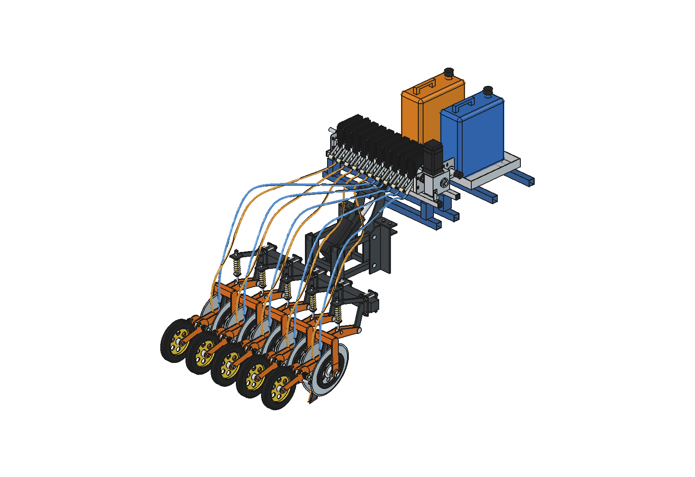
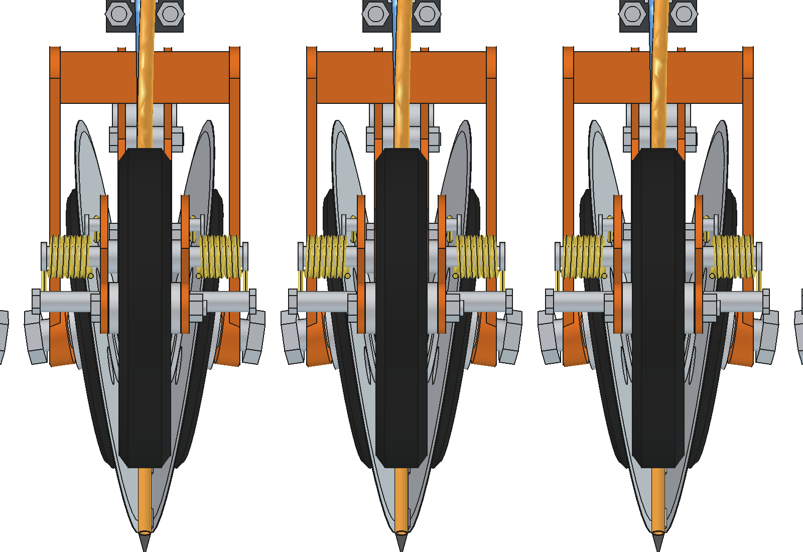
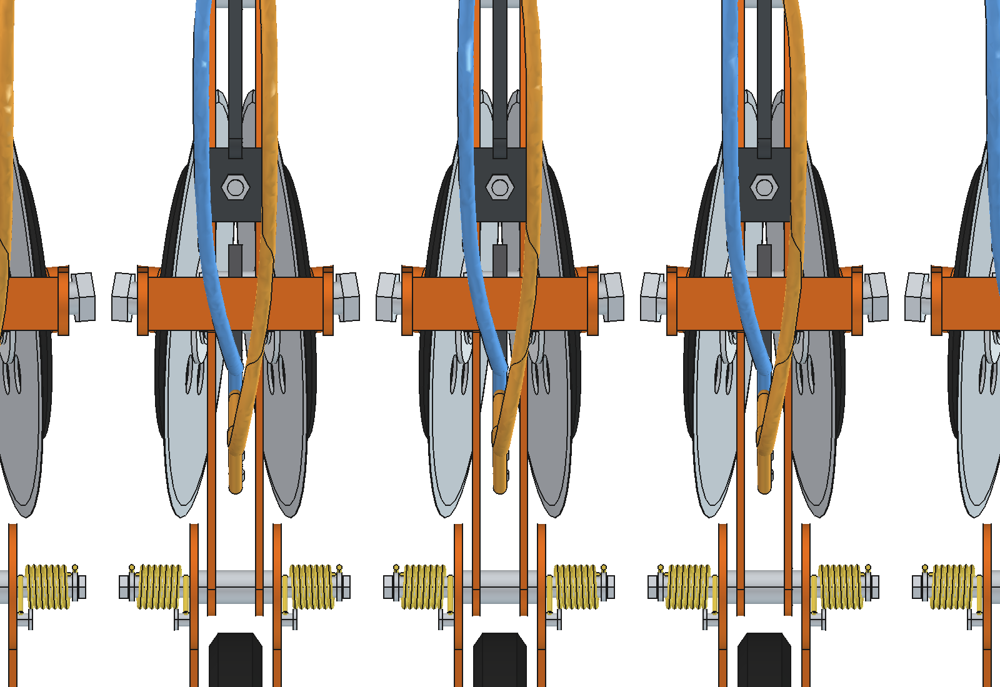
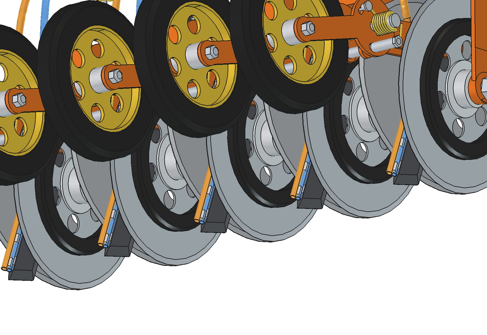
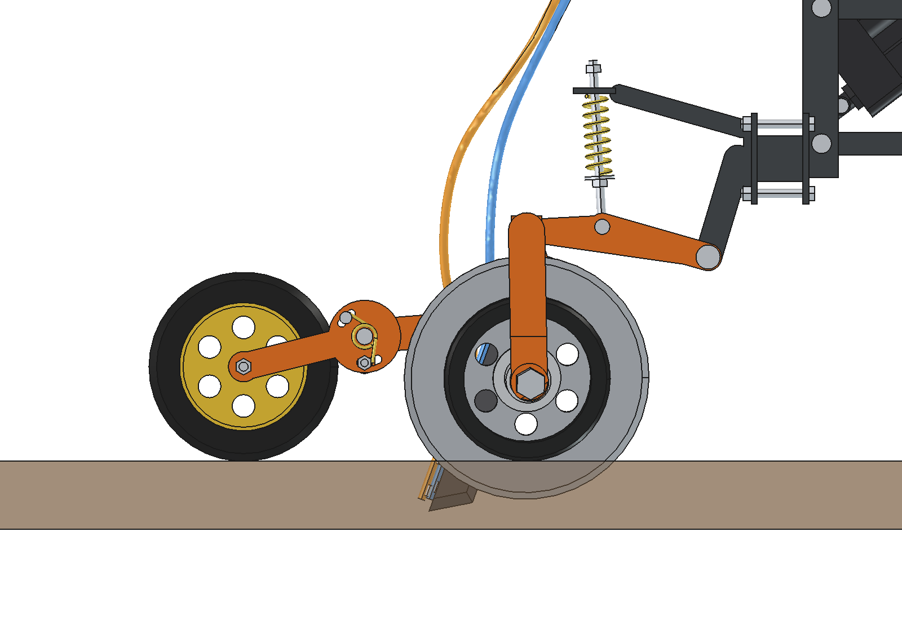
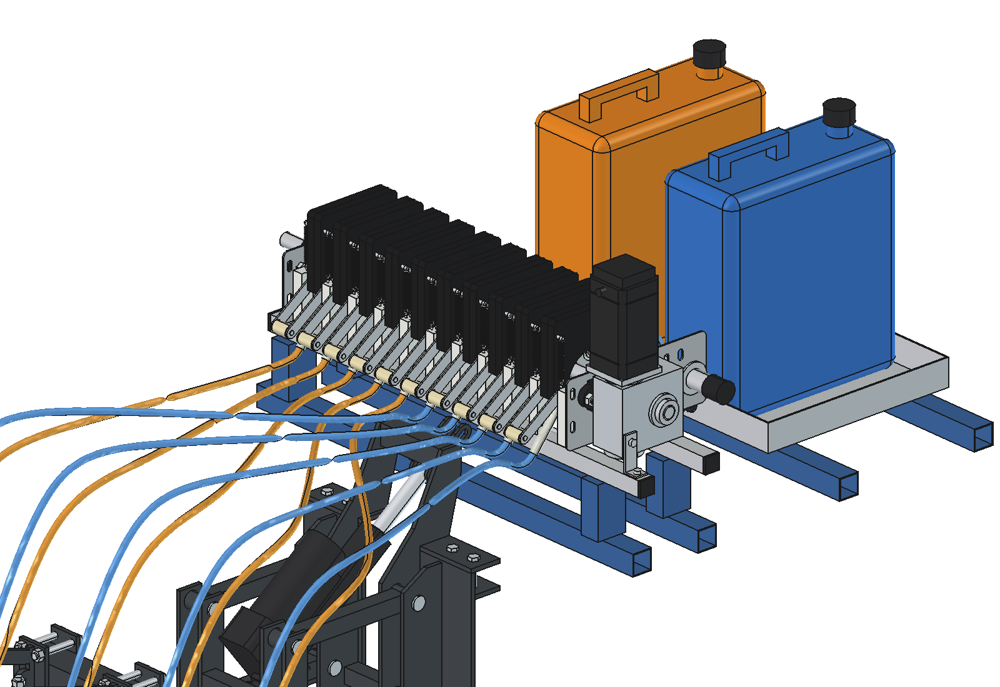
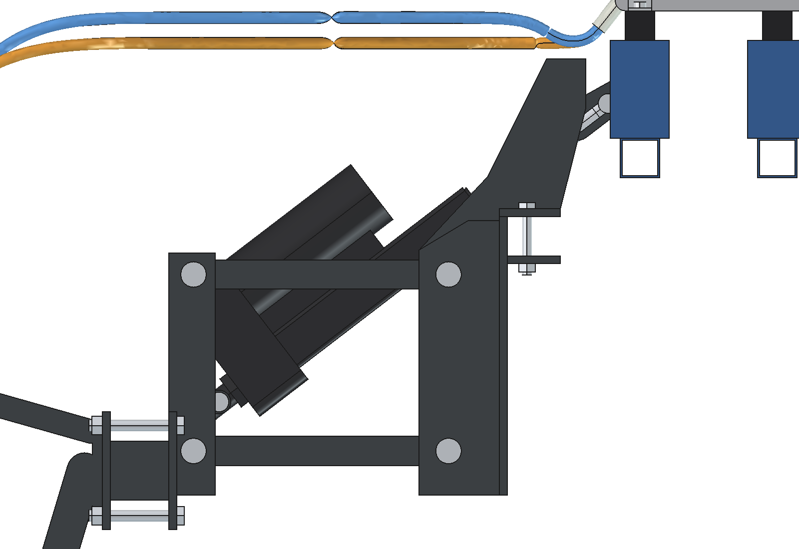
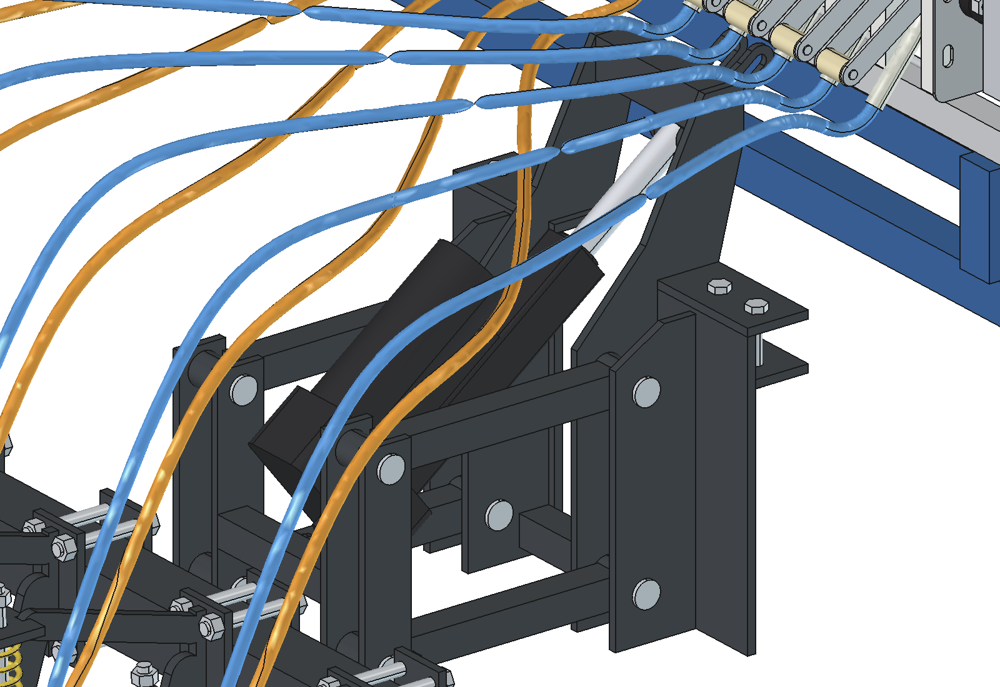

# Liquid fertilizer applicator advanced V2: V-discs, double knife, roller pump (FreeCAD model)

Improved version of [`../advanced/`](../advanced/README.md) for the Bruut OpenAgbot. The **suspension is advanced's**
(headstock on the rear beam, parallel linkage, electric actuator with the slotted hole so the toolbar floats, spring
struts, swing arms, press wheel on a spring-loaded trailing arm). Per row the single disc and raked knife are replaced:

- a **pair of V-discs** (Ø 325) as on the twin injector in `../inspiration/`: the discs run almost together at the
  front-bottom (2 mm apart, 26 mm deep) and open towards the back, so they cut one narrow slit, then lift the sod a
  little and push it aside;
- the **double injector knife** of precision applicator V3 ([`../../precision_applicator/parts/injector_knife_double/`](../../precision_applicator/parts/injector_knife_double/README.md)):
  **trailing 20°** (tip back, it slides over stones and roots), placed close behind and between the discs in the open
  V, **both outlets 50 mm deep**, tube A for liquid A and tube B for liquid B;
- the **press wheel** of advanced right behind the knife, which closes the slot again;
- the **10-section roller pump** of the precision applicator ([`../../precision_applicator/roller_pump/`](../../precision_applicator/roller_pump/README.md))
  on the robot, with the split manifold and the two jerrycans of [`combined_v3`](../../precision_applicator/combined_v3/README.md):
  right half liquid A (blue), left half liquid B (orange), 10 hoses to the knives;
- a **Linak LA36** lift actuator (24 V, 12 mm spindle, 2600 N, stroke 150), drawn and calculated from the datasheet
  in [`parts/actuator/`](../../../parts/actuator/linear-actuator-la36-data-sheet-eng.pdf): see [Actuator](#actuator-linak-la36).

Why it is built this way: [RATIONALE.md](RATIONALE.md).

| Rear, on the robot frame | One element from behind: V-discs, knife, press wheel |
| --- | --- |
|  |  |
|  |  |
|  |  |
|  |  |

## Animation

| Animation | File |
| --- | --- |
| Robot drives a bumpy strip: the actuator lowers the applicator, the toolbar floats, every element follows the ground, both discs turn about their tilted axles, the roller pump turns with the driving speed, liquid A (blue) and B (orange) lie in the open V-slot until the press wheel closes it, the actuator lifts at the end | `previews/animation_v_discs_double_knife.gif` (generated, not in git; also copied to `animations/`) |

Run of the GIF (`animate_lfa2.summary()`): 14.6 s, 176 frames, pump 45 rpm (500 l/ha per liquid at 0.75 m/s and
200 mm rows), toolbar floats −51 … +62 mm, knife depth 42 … 88 mm (in the pit and over the ridge), 89 % of the slot
closed by the press wheels. The LA36 moves at its datasheet speed (34.8 mm/s, 4.2 s to lift), so the robot drives
further while the elements come out at the end: that last bit of slot stays open (97 % with the old 60 mm/s). In the slot the two liquids are drawn side by side; in reality B lies 10 mm behind A in
the same slot.

## Heavier or lighter than advanced? (`lfa2_draft.py`)

V2 pulls **about 2.4 × as hard** as advanced and needs about twice the down force. Same soil assumptions for both
(estimated, not measured; see the top of `lfa2_draft.py`), 5 rows, 0.75 m/s:

| Per element (N), normal soil | advanced | V2 | why |
| --- | --- | --- | --- |
| Cutting with the disc edge | 30 | 75 | two discs instead of one, 50 instead of 40 mm deep |
| Rolling of the depth bands | 9 | 11 | a bit more weight on the bands |
| Pushing the soil aside (open V, 1311 mm², 39 mm wide at the top) | 0 | 66 | the V-discs lift and move the sod: that is the job, and it costs draft |
| Knife | 51 | 69 | V2's knife only displaces soil below the discs (16 mm × 10), but trailing costs more than raked forward |
| Press wheel | 5 | 5 | same wheel |
| **Total per element** | **95** | **226** | |

| Whole machine | advanced | V2 |
| --- | --- | --- |
| Draft, normal soil | 475 N (48 kgf), 360 W | 1130 N (115 kgf), 850 W |
| Draft, heavy soil | 850 N, 640 W | 2080 N, 1560 W |
| Down force needed per element, normal | 85 N (forward knife pulls itself in) | 275 N (2 discs, trailing knife pushes up) |
| Down force on the discs when floating | 117 N: reaches depth | 141 N: **only about 28 mm deep instead of 50** |
| Robot, usable continuous pull (4 hub motors, 70 %) | about 516 N | about 516 N |

So: advanced just fits the robot in normal soil; V2 with 5 rows does not, and its own weight is not enough to push
the disc pairs to 50 mm. With 2 rows (450 N) V2 fits; with 5 rows it needs more down force (stiffer struts or ballast
on the toolbar, which also raises the draft) and more pull, or smaller disc angles. These are estimates: measure the
draft of one element with a spring scale in the field before choosing.

## Element

| | |
| --- | --- |
| Discs | 2 × Ø 325 × 3, toe-in 5° each (fronts together), camber 8° each (bottoms together, tops apart), rims 2 mm apart at the closest point: 84 mm in front of the axle, 26 mm deep |
| Depth | rubber depth band Ø 220 on the outside of each disc: discs 50 mm deep (`work_depth`) |
| Mounting | each disc on its own hub and Ø 25 stub axle along the tilted disc axis, in a boss welded into an 8 mm hanger plate outside the disc (x 66 … 74); both hangers on a 40 × 40 cross tube over the discs, welded to the two fork plates of the swing arm |
| Fork plates | x ±15 … 21 (advanced ±21.5 … 27.5): narrower, so they and the knife bolts fit between the discs |
| Knife | double knife 370 × 50 × 10, trailing 20°, outlet A at 50.0 mm, B at 50.3 mm, tip 66 mm deep; as far forward as possible with 6 mm to both discs (`knife_origin`), 2 × M10 through the slots and both fork plates with spacers |
| Press wheel | advanced's Ø 250 × 40 on its trailing arm and torsion springs; pivot 75 mm behind the knife (`pw_behind_knife`), contact 246 mm behind the outlets |
| Element width | ±74 over the hangers: 52 mm between neighbouring rows at 200 mm |

## Pump on the robot

The 10-section roller pump (10 ml per revolution per hose, NEMA 34 + worm gearbox), split manifold, two 20 l
jerrycans in a tray: built from `roller_pump/build_rp.py` and `combined_v3/cmb3_parts.py`, nothing copied
(`lfa2_pumpkit.py` loads its own copy of the combined_v3 modules and sets only the pump height). The pump stands on four
100 mm blocks: advanced's headstock has a cross tube (top z 820) right behind the pump outlets, and the hoses have to go
over it.

Hoses (8 × 12) in two layers over the headstock: B at z 836, A at 862. In each layer all hoses move sideways together
between y −70 and −400 (start and end in the same order, so they stay ≥ 62 mm apart), then run back beside the spring
struts (row ±26) and drop onto their own tube end (A straight up, B up and back).

## Actuator: Linak LA36

The lift actuator is a Linak LA36 from the datasheet in [`parts/actuator/`](../../../parts/actuator/linear-actuator-la36-data-sheet-eng.pdf).
It still works as in advanced: in work it is fully out and the upper pin floats in a slot, so the toolbar follows the
ground; at the headland it pulls the slot closed and lifts the toolbar 140 mm. Choices and pin positions: [RATIONALE 10](RATIONALE.md#10-the-lift-actuator-is-a-linak-la36).

| | |
| --- | --- |
| Type | LA36, 24 V, 12 mm spindle, gear F 1:18, with slip clutch, reinforced IP66 housing, stroke 150 |
| Order code | `36 120 150 0 0 01 B 6 - 6 1 2 F 3 0350 N C S 0 0 0` (datasheet pp. 10–12) |
| Datasheet figures (24 V) | 2600 N push/pull, self-locking 3400 N, 44 mm/s unloaded, 32 mm/s at 2600 N, 2.4 … 10.4 A, duty 20 % |
| Length | 350 retracted, 500 extended (200 + stroke, solid back fixture and rod eye); 354 when lifted, 4 mm before the end stop |
| Eyes, pins | back fixture Ø 25.2 at 0°, rod eye Ø 27.8, both Ø 12.2; pins Ø 12, lugs 27.2 / 29.8 apart (1 mm play per side) |
| Pins | lower `act_b` (−314, 470) on the rear-frame cross tube, upper `act_a` (52, 751) = bottom of the 85 mm slot in the headstock plates |
| Mounting | motor on top of the outer tube; housing 76 wide between the inner cheeks (140 apart) |
| Floating range | −70 … +68 mm around the design height |
| Force to lift | 1530 N static at the start of the lift (elements hanging), 1990 N with 30 % for starting and friction: margin 1.31; 1860 N static when lifting out of a dip |
| Speed | 34.8 mm/s lifting, 44 mm/s lowering: 4.2 s up, 3.3 s down (the animation uses these) |
| Current, energy | 8.5 A while lifting, 0.24 Wh per lift; duty about 5 % with 100 m rows |
| Mass | 4.8 kg (4.55 kg at stroke 100 + 0.24 kg per 50 mm) |

`lfa2_calc.actuator_report()` gives these figures, `lfa2_calc.actuator_variants()` the other 24 V spindles.

## Files

| File | Contents |
| --- | --- |
| `Liquid_Fertilizer_Applicator_V2.FCStd/.step` | the model in working position (generated, not in git) |
| `lfa2_params.py` | all dimensions; LA36 dimensions and 24 V table (`LA36_24V`, `act_variant`), actuator pins; V-disc geometry (`disc_rot`, `DISC_CX`, `disc_z`, `meet_point`, `band_contact`, `disc_dist`), knife placement (`knife_origin` by bisection), pump and hose layout |
| `lfa2_parts.py` | one function per part: advanced's headstock, linkage, toolbar, strut and press wheel; new: LA36 (`actuator`, `actuator_pins`), fork plates, cross tube, hangers, stub axles, hubs, V-discs, depth bands, double knife, hoses, pump blocks |
| `lfa2_pumpkit.py` | pump mount, divider and inlets, jerrycans, tray, taps and supply hoses from combined_v3 (own copy, pump 100 mm higher) |
| `build_lfa2.py` | model tree, colours, `check_interference()`, `check_hoses()`, `check_poses()`, `mass_properties()`, `render_all()`, `export_step()` |
| `lfa2_calc.py` | dosing (roller pump), spring, down force, press wheel, floating position, LA36 force, speed, current and duty (`actuator_report`, `actuator_variants`), axle loads |
| `lfa2_draft.py` | draft and down force per element, advanced vs V2, and the robot's pull (`report()`) |
| `animate_lfa2.py` | animation on the robot over a bumpy strip (separate document `LFA2_on_robot_animation`) |
| `make_gif_lfa2.py` | frames to GIF with caption and ground-following panel |
| `run_in_freecad.py` | macro: rebuild (F6) |
| `previews/` | images (and the GIF) |

The knife comes from `precision_applicator/parts/injector_knife_double` (blade from `../injector_knife`), the pump from
`precision_applicator/roller_pump`: `lfa2_params.setup_path()` puts them on `sys.path`.

## Usage

```python
import sys; sys.path.insert(0, r"F:\veldrobot\aanbouwdelen\liquid fertilizer applicator\concept versions\advanced_V2")
exec(open(r"...\advanced_V2\run_in_freecad.py").read())      # or F6 in FreeCAD
import build_lfa2
build_lfa2.check_poses()          # working + lifted: parts and hoses (about 2 min, start with QTimer from MCP)
build_lfa2.mass_properties(); build_lfa2.render_all(); build_lfa2.export_step()
import lfa2_calc; lfa2_calc.report()
```

```python
import animate_lfa2
animate_lfa2.build(); animate_lfa2.play()          # animate_lfa2.stop()
animate_lfa2.summary(); animate_lfa2.check_fit()
animate_lfa2.render_all(r"C:\temp\lfa2_frames")   # several minutes: start with QtCore.QTimer.singleShot
import make_gif_lfa2; make_gif_lfa2.main(r"C:\temp\lfa2_frames", r"previews\animation_v_discs_double_knife.gif")
```

## Key figures

| | |
| --- | --- |
| Interference | none, working position and lifted 140 mm (`check_poses`), and the LA36, its pins and lugs at 8 more heights from −70 (lowest float) to +100; intended overlaps: knife welds, tap in the can, supply hose on the inlet |
| Hoses | nothing hit, at least 14 mm apart, smallest bend radius 26.6 mm, also lifted |
| Mass | applicator 130 kg (cg y −591), of which 104 kg moves with the lift; one swing arm 13.2 kg (advanced 8.1); pump kit on the robot 57 kg empty, about 107 kg with full cans |
| Floating | arm at 2.7° with the spring seat 18 mm up (`press_seat_shift`), 141 N on the disc pair and 62 N on the press wheel per row |
| Dose | 500 l/ha per liquid at 0.75 m/s = 45 rpm; at 60 rpm max: 500 l/ha up to 1.0 m/s |
| Actuator | Linak LA36 12 mm / F: 1990 N needed at the start of the lift (1530 N static + 30 %), 2600 N max (margin 1.31), 4.2 s up, 3.3 s down |

## Estimated, not measured

- Disc angles (toe 5°, camber 8°) and the 2 mm gap at the front: chosen to look like the twin injector; the lifting
  of the sod and the soil flow are not calculated.
- Soil figures in `lfa2_draft.py` (edge cutting, penetration, specific resistance of the V and of the knife, rake factor, rolling resistance) and the robot's motor torque; side forces and the bearing load on the stub axles.
- Hub, bearing and stub axle sizes (Ø 60 hub, Ø 25 axle), depth band rubber.
- LA36 details the datasheet does not give: where the housing starts behind the back eye (24), gearbox length (62),
  motor Ø 72, rod Ø 26, end of the outer tube (20 before the rod eye when retracted), back-fixture nut; speed and current
  between unloaded and nominal load taken linear (datasheet curves, ±10 % speed, ±20 % current); 30 % extra lift force
  for starting and pin friction (`ACT_DYN`); 0.6 kg of the 4.8 kg counted as rod.
- Press wheel force needed to close a V-slot (advanced assumed 50 … 75 N for a 10 mm slot; the V-slot is wider).
- Pump mass 33 kg, jerrycans and liquid 1.25 kg/l, hose 8 × 12 bend radius; robot mass and centre of gravity
  (`lfa2_calc.ROBOT`, the pump kit is not in `axle_loads` yet).
- Everything in `../advanced/README.md`, `../../precision_applicator/applicator_v3/README.md`, `../../precision_applicator/roller_pump/README.md`
  and `../../precision_applicator/combined_v3/README.md`.
