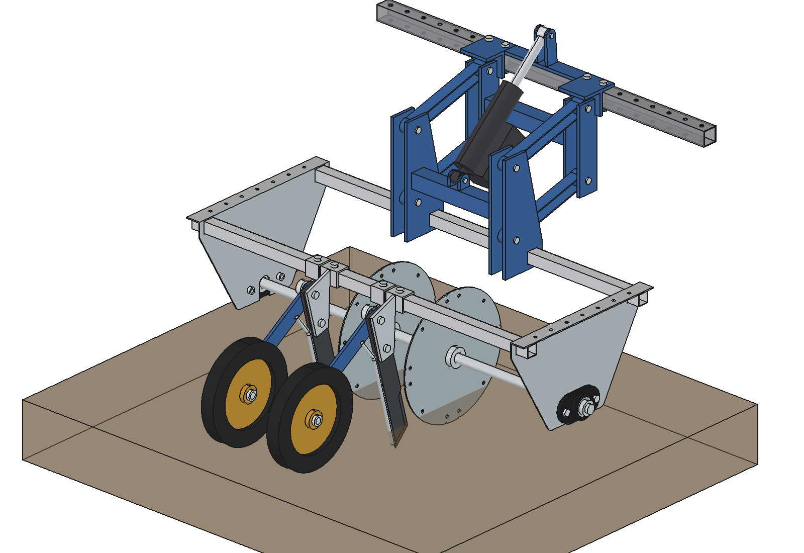
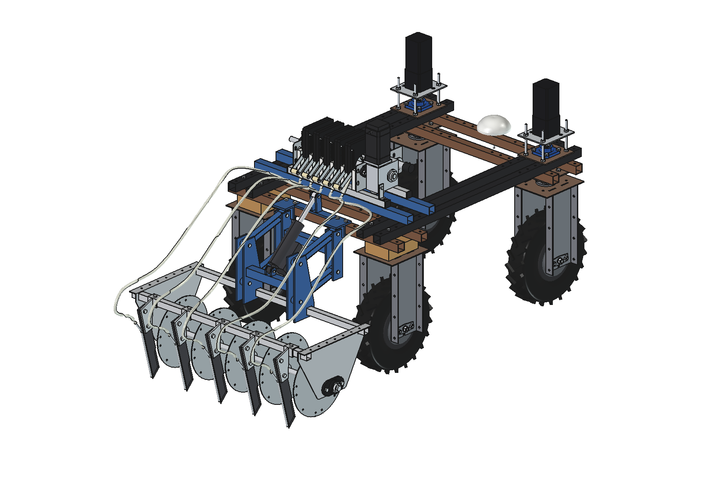
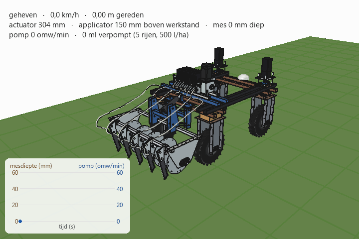

# Precision liquid applicator

The first production version of the liquid applicator, built together with Herre Bartlema. A roller pump on the
robot doses the liquid exactly (every revolution pushes the same volume through each tube, like a hospital drip),
and an applicator behind the robot cuts a slot with a disc and injects the liquid into it with a knife. Every part
is a parametric FreeCAD model generated from Python, measured from the real parts on the photos where they exist.

## Parts and versions

| Folder | What it is | Preview |
| --- | --- | --- |
| [`roller_pump/`](roller_pump/README.md) | Modular roller (peristaltic) pump, 62 mm per section, 10 ml per revolution per tube, NEMA 34 stepper with a worm gearbox. 5 or 10 sections, or any number |  |
| [`applicator/`](applicator/README.md) | Applicator V1: two folded side shields, 5 discs Ø 325 at 200 mm, an injector knife behind each disc, on a parallel linkage with an electric actuator. Also as **2 rows** in the middle. All dimensions: [`maten_applicator.md`](applicator/maten_applicator.md) |  |
| [`applicator/parts/injector_knife/`](applicator/parts/injector_knife/README.md) | The injector knife: 10 × 50 flat bar, sharpened on both faces, Ø 10 liquid tube on the back edge |  |
| [`applicator_v2/`](applicator_v2/README.md) | Applicator V2: 2 rows in the middle with a **press wheel** behind every knife that closes the slot again; also with 5 rows |  |
| [`combined/`](combined/README.md) | V1 on the Bruut OpenAgbot: 5-section pump on the robot, applicator behind the rear wheels, 5 hoses, animation |  |
| [`combined_v2/`](combined_v2/README.md) | V2 on the robot: pump, applicator V2 with press wheels and hoses, with 2 rows (2-section pump) or 5 rows (5-section pump), each with an animation |  |

## Animations

| V1: 5 rows | V2: 2 rows with press wheels | V2: 5 rows with press wheels |
| --- | --- | --- |
|  |  |  |

All three: lifted at the start, the actuator lowers the applicator while the robot drives off, the pump runs in step with
the speed (500 l/ha at 0.75 m/s = 45 rpm), and the actuator lifts again at the end of the strip.

## How the folders fit together

Nothing is copied between folders. Each part has its own `*_params.py` (all dimensions), `*_parts.py` (one function
per part) and `build_*.py`; the combinations load the robot from `agbots/agbot design` and the parts from their own
folders (`setup_path()`), so a change in one part folder shows up everywhere after a rebuild. Each folder has a
`run_in_freecad.py` macro (F6 in FreeCAD 1.1) and a `RATIONALE.md` with the reasons behind the choices.

The `.FCStd` and `.step` files are generated and not in git; the READMEs and previews are.

## Not yet

- Tank and supply hose to the pump manifold; electrics and control.
- Floating over bumps.
