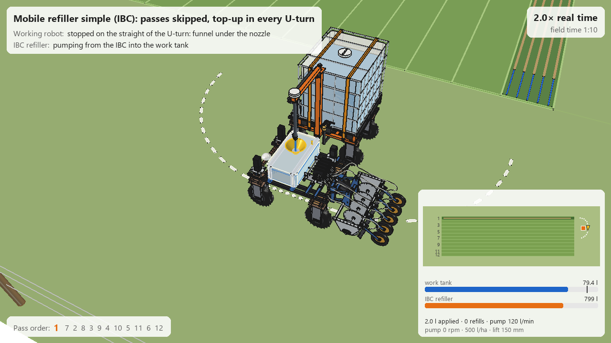
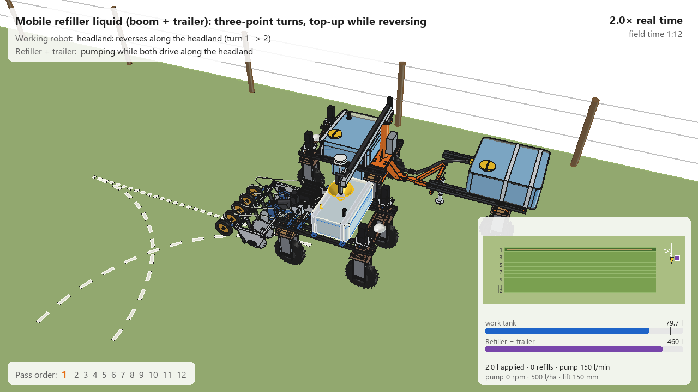
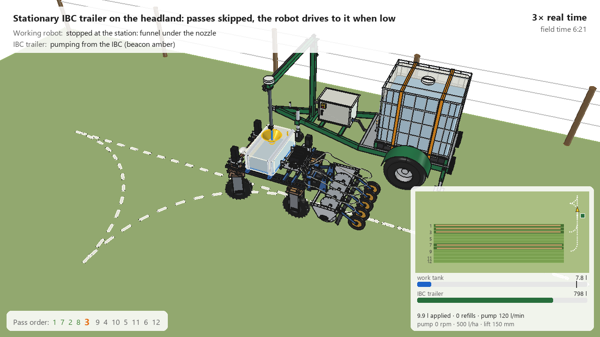
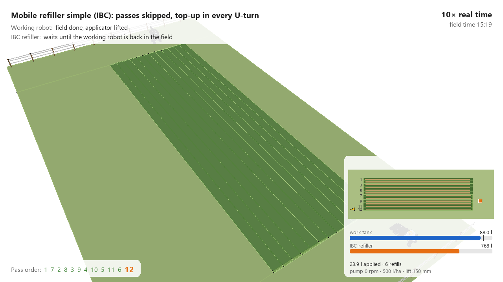
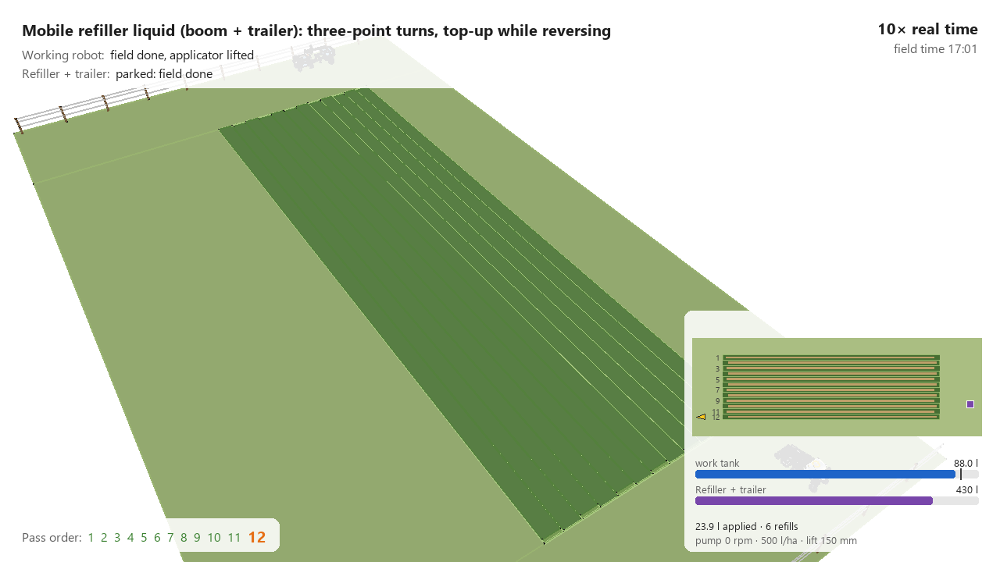
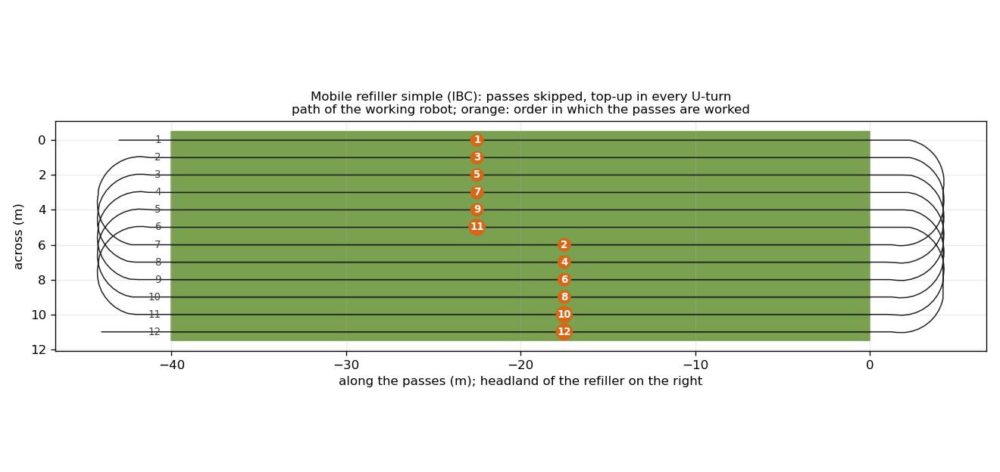
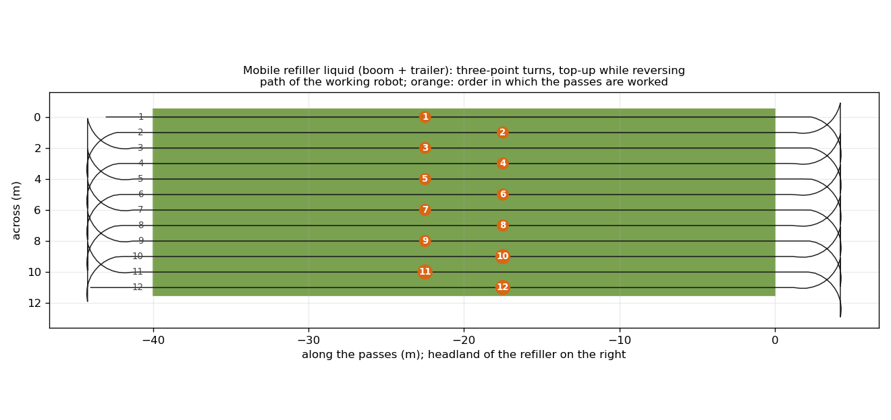
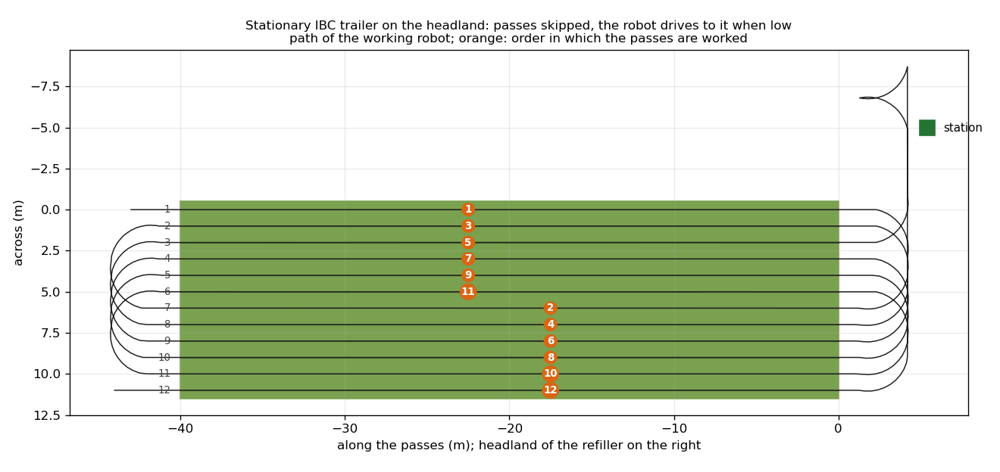

# Field runs: the precision applicator V2 working a whole field, with three ways of refilling

The [combination V2](../combined_v2/README.md) with **5 rows** (5-section roller pump, applicator V2 with press wheels)
works a complete field of 12 passes: it lowers the applicator at the field edge, injects, lifts at the other edge,
turns on the headland and starts the next pass. A small **work tank with a fill funnel** sits in front of the pump, and
one of the refillers from [`mobile refiller/`](../../../mobile%20refiller/README.md) keeps it topped up. Each run is
rendered in FreeCAD from the real models and made into an **MP4 (1280 × 720, 25 fps)** of the whole field and a GIF
of the first refill, with a caption, a map of the field and the tank levels.

| | Scenario | Field pattern | Refill |
| --- | --- | --- | --- |
| [MP4, 1:33](previews/field_run_simple.mp4) | **simple**: [IBC refiller](../../../mobile%20refiller/simple/README.md) | passes skipped (1, 7, 2, 8, 3, 9, ...): every turn is a U-turn, never reversing | the refiller stands inside the U-turn on the headland, the working robot stops on the straight with its funnel under the nozzle; afterwards the refiller drives 1 m on |
| [MP4, 1:49](previews/field_run_liquid.mp4) | **liquid**: [refiller with boom and trailer](../../../mobile%20refiller/liquid/README.md) | passes side by side, three-point turns (arc, reverse along the headland, arc) | the refiller waits beside the headland with its boom out, puts the spout in the funnel and drives along while the working robot reverses; then it reverses with its trailer two passes on |
| [MP4, 1:40](previews/field_run_station.mp4) | **station**: [IBC trailer](../../../mobile%20refiller/stationary/ibc_trailer/README.md) | passes skipped | the trailer stands still on the headland beside the field; when the work tank is too low for the next two passes the robot leaves its turn, drives to the station, is filled, turns round and drives back into its next pass |

All three after each other, each with a title card: [`previews/field_runs_all.mp4`](previews/field_runs_all.mp4)
(5:02, 117 MB). The GIFs below show the first refill (640 × 360, 12.5 fps); the MP4s show the whole field.

| simple | liquid | station |
| --- | --- | --- |
|  |  |  |
|  |  |  |
|  |  |  |

The path of the working robot and the order of the passes, seen from above:





## What the animation shows

- **Working robot**: driving, steering (Ackermann angles on the front wheels), wheels rolling; the actuator lifts and
  lowers the applicator (parallel linkage, hoses bend along), discs and press wheels turn while they are in the
  ground, the roller pump turns with the driving speed (45 rpm at 0.75 m/s for 500 l/ha), the level in the work
  tank drops while it injects and rises while it is filled.
- **Field**: per pass a darker strip where the knives were in the ground, open slots with liquid (blue) between
  knife and press wheel, the pressed seam (sand) behind the press wheels, and on the headland the planned path of
  the next turn (dotted).
- **Refiller**: the IBC robot drives along the headland and its IBC empties; the boom refiller drives, slews its boom,
  moves the trolley and the spout, and follows the funnel while both drive; the station's beacon turns amber while
  it pumps.
- **Caption**: what the working robot and the refiller are doing, the playback speed (× real time) and the field
  time; bottom right a map of the field (passes horizontal, headland of the refiller on the right, done passes
  darker, the seams sand, the working robot as a yellow arrow, the refiller as a square), the work tank and the
  refiller tank; bottom left the order of the passes (done green, current orange).
- **Time** runs at up to 40 × real time in the middle of a pass and slows down before every turn (3 × for the
  first turn on each headland, 10 × later) and while filling (2 × the first time); the speed profile is smoothed in
  both directions, so it slows down before the event and not after it. The camera follows: an overview of the whole
  field when time runs fast, close to the working robot and the refiller when it runs slowly.

## Key figures of the runs

Field 12 passes × 40 m (0.048 ha), 5 rows at 200 mm, 500 l/ha: 2.0 l per pass, 23.9 l for the field. Work tank
95.7 l (filled to 90 l). From `fld_plan.summary()`:

| | simple | liquid | station |
| --- | --- | --- | --- |
| Field time (real) | 919 s (15.3 min) | 1021 s (17.0 min) | 992 s (16.5 min) |
| of which injecting | 636 s | 636 s | 636 s |
| Video (with the 3 s title card) | 1:33 | 1:49 | 1:40 |
| Refills | 6 × in the turn: 12 l (6 s), then 3.9 l (2 s) | 6 × while reversing: 12 l (4.8 s), then 3.9 l (1.6 s) | 1 visit after pass 3: 84 l in 42 s |
| Standstill for refilling | 25 s in total (4.2 s per turn: check, pump, nozzle closes) | 16 s in total (2.7 s per turn: camera, spout down; the pump runs while reversing) | 44 s at the station + the detour on the headland (≈ 52 s driving) |
| Work tank | between 78 and 90 l | between 78 and 90 l | starts at 16 l, lowest 6.1 l, filled to 90 l |

The turns themselves differ more than the refills: a U-turn of the skip pattern takes 17–18 s, a three-point turn
about 29 s (two stops to steer over and a reverse). See [RATIONALE](RATIONALE.md) for the field length, the start
level of the station run and how the numbers scale to a real field.

## Checks

- Work tank kit against the robot, pump, applicator and hoses: no interference (`build_fld.check_interference()`);
  35 mm from the pump, 75 mm from the front stepper motors. Funnel rim at z 1144 (as the receiver kit of the
  refillers), pump top at z 1110, so the nozzles (tip 1250) and the raised spout (1265) pass over everything.
- Refiller against the working robot (`animate_fld.check_fit()`): `common()` between all solids of the refiller and
  of the working robot, in frames in which the two are less than 4.5 m apart (a check takes 0.5–5 min per frame).
  Every later refill is the same pose as the first one, shifted along the headland, so the first refill is checked
  completely:

| | simple | liquid | station |
| --- | --- | --- | --- |
| frames checked | 30 (every 4th frame up to frame 400: approach, the whole first refill, driving on) | 20 up to the first stop + 9 through the first refill (spout down, pumping while reversing, spout up, boom back) | 36 (every 4th frame of the whole run while near: approach, filling, turning round) |
| overlaps | none | none, after the strainer was moved to the bottom of the funnel (the lowered spout, tip z 1080, cut through it at z 1090) | none |

## Files

| File | Contents |
| --- | --- |
| `fld_params.py` | field (passes, length, turn radius), speeds, applicator lift and dose, work tank and funnel, scenarios, playback speeds and video size |
| `fld_plan.py` | pure calculation: route of the working robot over the whole field (passes, U-turns, three-point turns, visit to the station), driving with speed, steering, lifting and the tank level; the three refillers as state machines (positions, boom, pump, levels); playback speed; camera path; `summary()` |
| `fld_parts.py` | work tank, funnel, cradle, straps, sensors (robot coordinates); field, headlands, pass lines, fence, strips for the slots and seams, turn path, stream (field coordinates) |
| `build_fld.py` | the working robot with the work tank (from `../combined_v2`), the refiller of the scenario (from `mobile refiller`), the field; `check_interference()`, `clearance()` of the work tank |
| `animate_fld.py` | the frames on the model: `build(key)`, `apply_frame()`, `play()`, `stop()`, `summary()`, `check_fit()`, `render_all(folder)` |
| `render_fld.py` | macro for a separate FreeCAD process (`freecad.exe render_fld.py`, job and scenario in environment variables): all frames, test frames, the work tank check or `check_fit` |
| `make_video_fld.py` | frames → MP4 and GIF with caption, field map and tank levels; title cards, `field_runs_all.mp4`, the route figure and the stills |
| `previews/` | MP4s, GIFs, title cards, stills and route figures |

Nothing is copied: the robot comes from `agbots/agbot design`, the pump, applicator and hoses from
`../combined_v2` (5 rows), the refillers from `mobile refiller/simple`, `liquid` and `stationary/ibc_trailer`
(`fld_plan.setup_path()`); their dimensions, pump flows and speeds are read from their `*_params.py` and `*_calc.py`.

## Usage

Rendering takes about an hour per scenario (2,200–2,650 frames at 1280 × 720, three scenarios can run at the same
time). It runs in its own FreeCAD process, so the MCP time-out does not matter:

```bash
FLD_JOB=frames FLD_KEY=simple FLD_OUT=C:/temp/fld_simple FLD_LOG=C:/temp/fld_simple.log "C:/Program Files/FreeCAD 1.1/bin/freecad.exe" render_fld.py
```

```bash
"C:/Program Files/FreeCAD 1.1/bin/python.exe" make_video_fld.py C:/temp/fld_simple simple
```

```bash
"C:/Program Files/FreeCAD 1.1/bin/python.exe" make_video_fld.py --all C:/temp/fld_simple C:/temp/fld_liquid C:/temp/fld_station
```

`make_video_fld.py` needs ffmpeg for the MP4: on the PATH, in the environment variable `FFMPEG`, or from the Python
package `imageio-ffmpeg`. In the FreeCAD GUI:

```python
import animate_fld
animate_fld.build("liquid")      # "simple", "liquid" or "station"
animate_fld.play()               # animate_fld.stop()
animate_fld.summary()
animate_fld.check_fit()          # overlaps refiller - working robot, must be empty
```

The simulation alone (no FreeCAD document, a few seconds): `python fld_plan.py simple liquid station` with the Python
of FreeCAD.

## Estimated, not measured

- Everything in the lists of the [precision applicator](../combined_v2/README.md), the robot and the
  [refillers](../../../mobile%20refiller/README.md#estimated-not-measured) (pump flows, speeds, boom speeds).
- Work tank: rotomoulded PE, 840 × 480 × 260 mm, 95.7 l inside; not a bought part yet. Feed hose to the pump
  manifold only drawn as a stub.
- The press wheel lifts before the knife at the end of a pass (lift ≤ 0.5 mm vs. knife out at 50 mm): the last
  ≈ 1 m of every pass stays open in the animation. The lift timing (actuator 50 mm/s, lifting starts 0.75 m before
  the edge, lowering 1.3 m before) is a choice of the planner, not tuned.
- Turning: radius 2.4 m on every arc, steering 35 °/s, 0.5 m/s on the headland, 0.4 m/s reversing, 0.5 m/s².
