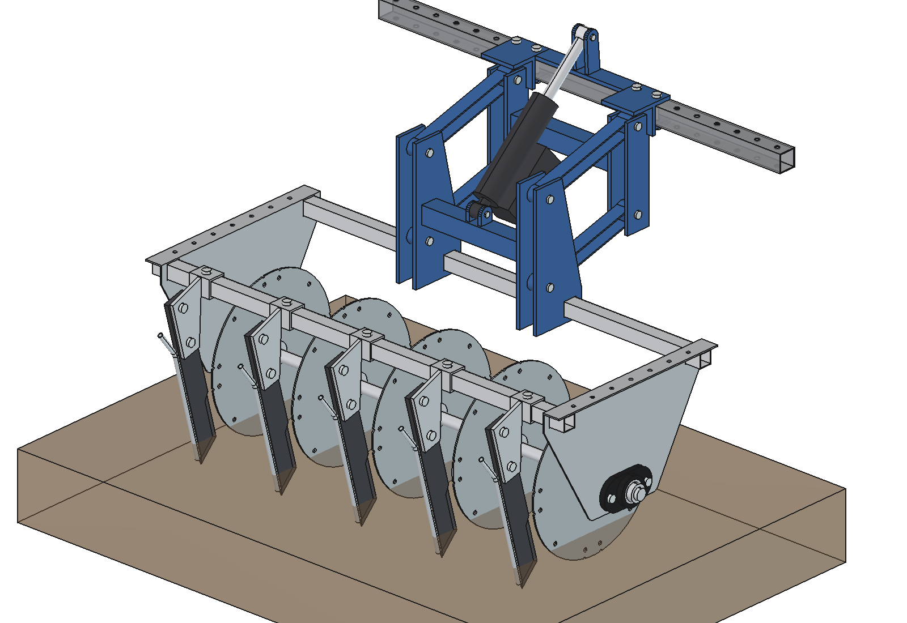
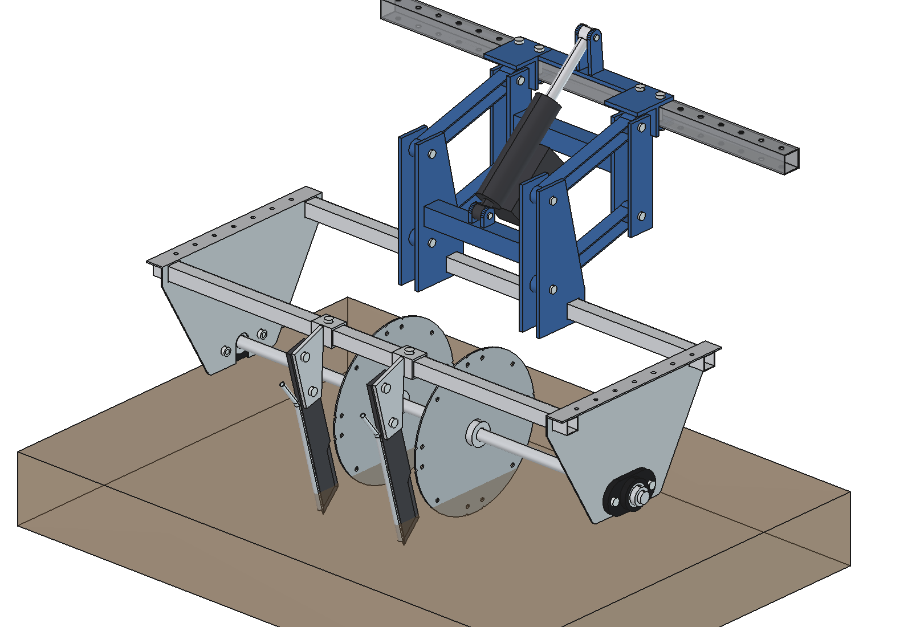
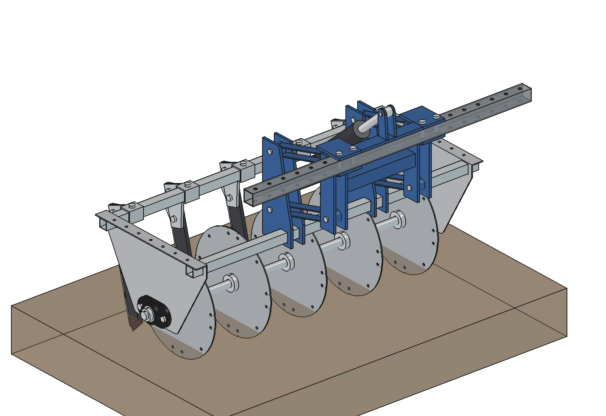
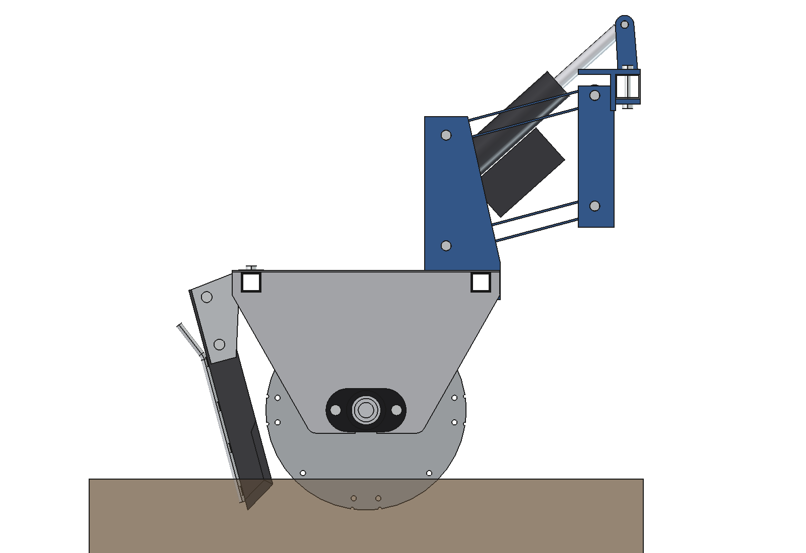
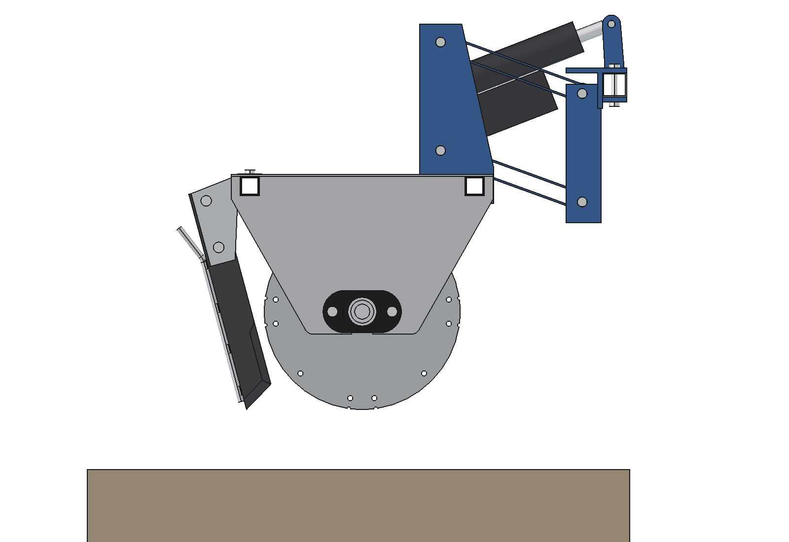
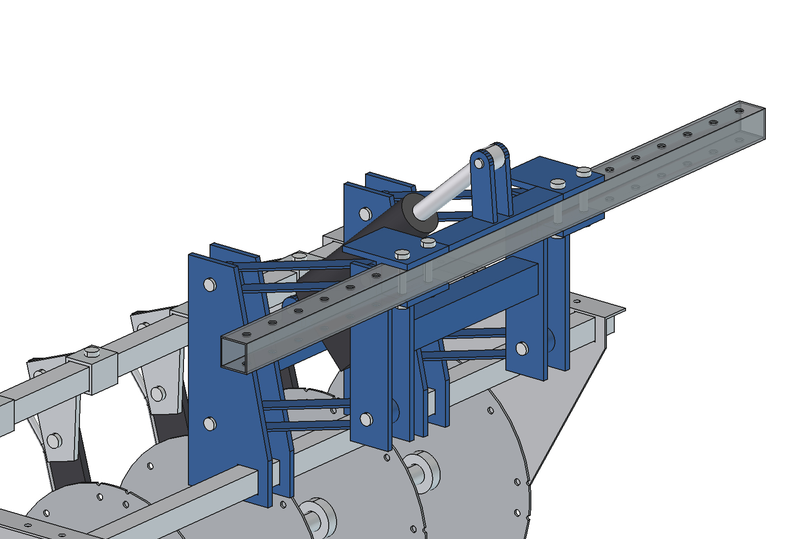
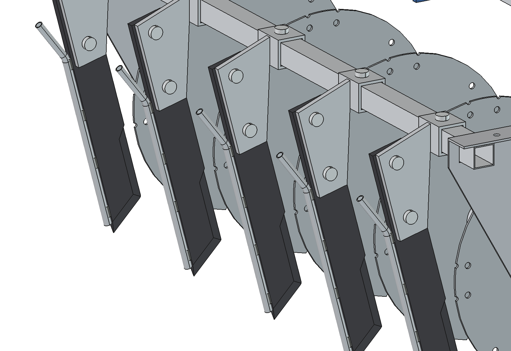

# Precision applicator: FreeCAD model

Disc-and-knife liquid injector for the precision applicator built with Herre Bartlema. Two folded stainless side
shields are joined by two 30 × 30 cross tubes that run through windows under their top flanges. A Ø 25 shaft in two
FL205 flange bearings carries 5 Ø 325 discs that roll in the soil and cut a slot. Behind each disc an injector knife
(`parts/injector_knife/`) runs in that slot; the liquid tube on its back edge leaves the liquid in the soil behind
the knife. Each knife hangs from a holder plate welded to a sleeve that slides on the rear cross tube, so the row
position is set with one clamp bolt.

The applicator hangs behind the robot on a **parallel linkage with an electric linear actuator**. Two headstocks
clamp on the robot's rear lower beam (2 × M10 each, in the 50 mm hole grid); four links of 250 mm run to a mast
on the front cross tube. The parallelogram keeps the applicator level. The actuator sits in the middle, from a
bridge plate on the robot beam to a cross tube between the masts: extended (389.5 mm) is the working position at
50 mm depth, retracted (304 mm) lifts the applicator 150 mm for headlands and transport.

## Two rows

The same applicator with **2 discs and knives in the middle** (x ±100, 200 apart); frame, shaft, suspension and
actuator stay as they are (`frame_rows = 5`). Set `N_DISCS = 2` in `run_in_freecad.py`, or
`build_pa.build(n_discs=2)`: it is saved as `Precision_Applicator_2rows.FCStd/.step`, images in `previews/2rows/`.
45.5 kg (lifted 30.4 kg); no interference, also over the lift range. With press wheels: [../applicator_v2/](../applicator_v2/README.md).

| 5 rows | 2 rows |
| --- | --- |
|  |  |

All dimensions with their source (given / measured on a photo / estimated): [maten_applicator.md](maten_applicator.md).
Why it is laid out this way: [RATIONALE.md](RATIONALE.md).

| Front | Rear |
| --- | --- |
|  |  |
|  |  |
|  |  |

## Files

| File | Contents |
| --- | --- |
| `Precision_Applicator.FCStd/.step` | the model (generated, do not edit by hand) |
| `Precision_Applicator_2rows.FCStd/.step` | the 2-row variant (generated) |
| `pa_params.py` | all dimensions: number of rows (`configure(n)`), working depth, discs, shaft and bearings, side shields, tubes, knife position and holder, robot interface, linkage and actuator; `implement_offset(lift)`, `actuator_length(lift)`, `lift_for_length(L)` |
| `pa_parts.py` | one function per part (side shield, cross tubes, shaft, FL205, disc, collars, sleeve, holder, bolts, headstock, clamp plate, links, mast, actuator bracket, actuator, robot beam reference, ground); `knife_placement(x)` puts the knife |
| `build_pa.py` | model tree, colors, `set_lift(lift)`, interference check, `check_poses()` over the lift range, clearances, mass, images, STEP export; `build_into(doc, parent, placement, prefix)` puts it into another document (`../combined/`) |
| `run_in_freecad.py` | macro: run in FreeCAD (F6) to rebuild and print the key figures |
| `parts/injector_knife/` | the knife as its own part (params, parts, build, README) |
| `previews/`, `previews/2rows/` | images |
| `specs.txt`, `inspiration/` | the original notes and photos |

The knife shapes come from `parts/injector_knife/ik_parts.py`; `run_in_freecad.py` puts that folder on `sys.path`.

## Model tree

```
Precision_applicator (App::Part, fixed to the robot)
  Implement      moves when lifting (Placement = translation from implement_offset)
    Frame        side_plate_L/R, brg_housing_L/R (FL205), brg_insert_L/R, brg_bolts_L/R, cross_tube_front/rear
    Rotor        shaft, disc_0..4, hubs_0..4               turns; an animation only sets its Placement
    Knives       sleeve_i, set_bolt_i, holder_i, knife_bolts_i, knife_i (sub-Part: blade_i, knife_tube_i, welds_i)
    Mast         mast_L/R, rear_pins_L/R, mast_cross, act_lower_lugs
  Suspension     headstock_L/R, clamp_plate_L/R, hs_bolts_L/R, front_pins_L/R, hs_cross, act_bracket,
                 link_upper/lower_L/R (Placement = rotation about the front pin), act_housing, act_rod, act_motor, act_pins
Robot_ref        piece of the robot's rear lower beam, for checking only
Ground           transparent, for the images only
```

```python
import build_pa
build_pa.set_lift(150)        # lifted; 0 = working position; the actuator has 5.5 mm left, about 12 mm deeper
build_pa.check_poses()        # moving parts against fixed parts at -40, 0, 75 and 150 mm
```

## Axes

x = across (along the shaft), y = driving direction (front = +y), z = up, soil surface = z 0, x 0 = middle.
The robot's rear lower beam lies at applicator y = 425 (robot y −575), so the applicator shaft is at robot
y −1000 (`mount_y`). On the robot: [../combined/](../combined/README.md).

## Key figures (run_in_freecad.py)

| | |
| --- | --- |
| Rows | 5 at 200 mm (discs at x −400 … 400) |
| Working depth | 50 (disc bottom and knife tip); shaft at z 112.5 |
| Knife | raked 15° (tip forward), tip 192 behind the shaft, front edge 15 behind the disc rim |
| Width | 950 between the side shields (rows + 2 × 75), 1026 over the cross tubes, 1046 over the shaft |
| Ground clearance | side shields 75, bearings 77.5 |
| Clearances | knife–disc 15, holder–disc 65, knife–rear tube 33, disc–side shield 73.5 |
| Suspension | links 250, −15° working, +19.9° lifted; lift 150; applicator moves 6.5 forward when lifted |
| Actuator | pin to pin 389.5 working, 304.1 lifted (range 295 … 395, stroke 100) |
| Mass | 59.0 kg with suspension, 43.9 kg lifted by the actuator; rotor 15.6 kg |
| Interference | none, also at lift −40, 75 and 150 (`check_poses`) |

## Estimated, not measured

- Working depth 50 (design choice, see RATIONALE.md). Row spacing 200 is given.
- Side shield gap follows from the rows (75 from the outer disc to the shield, chosen); disc collars Ø 50 × 15.
- Knife holder, sleeve 40 × 40 × 4 and clamp bolt: designed here, not on the photos.
- FL205 dimensions (flange 130 × 70, bolt pitch 99) and mass 0.5 kg per bearing.
- Plate thickness 3 for side shields and discs.
- Suspension: designed here (not on the photos): 8 mm plates, links 30 × 30 × 3 with Ø 16 pins, actuator 24 V
  stroke 100 (2500 N class, 2.5 + 0.6 + 1.6 kg), bridge plate welded between the headstock clamp plates.
- See also `parts/injector_knife/README.md`.
