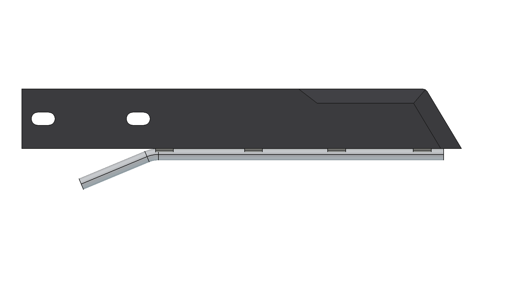
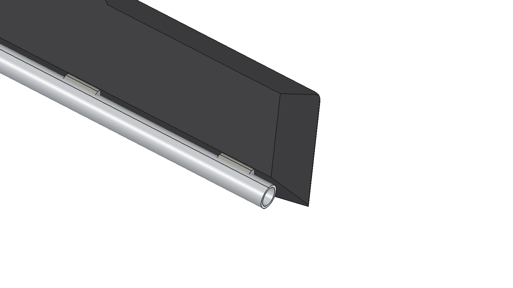
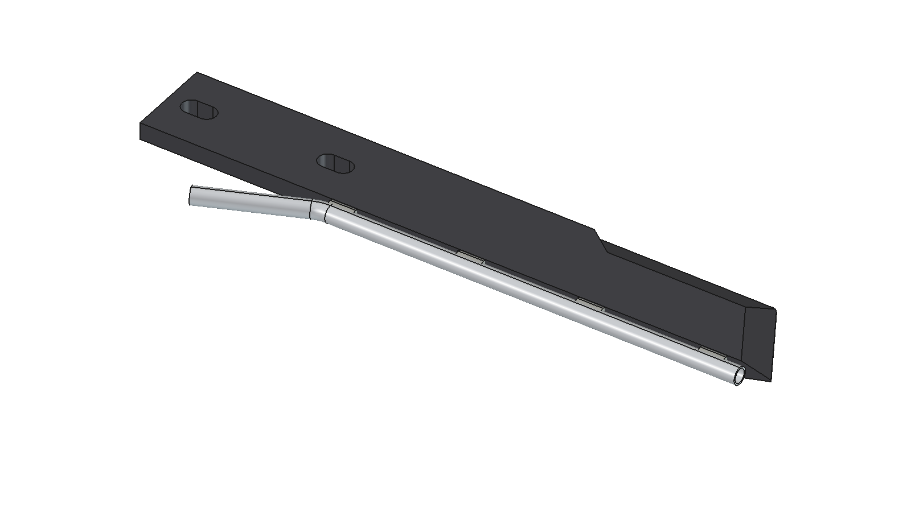
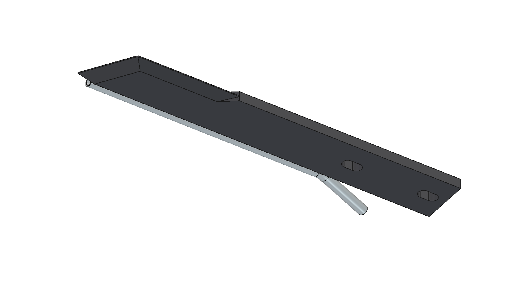

# Injector knife (precision applicator): FreeCAD model

First part of the precision applicator (the wheel of two Ø 325 discs in `../../inspiration/`): the injector knife.
A 10 × 50 flat bar, 370 mm along the back edge, with a 30 mm sloped tip (front edge 340), two slots for M10 at the
mounting end, and a stainless Ø 10 tube tack-welded along the back edge. The tube ends 15 mm before the tip (liquid
goes into the slot behind the knife); at the mounting end it bends away 23° to 30 mm behind the knife for the hose.

All dimensions with their source (given / measured on a photo / estimated):
[../../maten_applicator.md](../../maten_applicator.md), section 1. That file also holds the dimensions of the
discs, side plates and frame for the next parts.

| Top view | Tip |
| --- | --- |
|  |  |
|  |  |

## Files

| File | Contents |
| --- | --- |
| `Injector_Knife.FCStd/.step` | the model (generated, do not edit by hand) |
| `ik_params.py` | all dimensions |
| `ik_parts.py` | blade (outline, tip radius, bevels, slots), tube (swept along line–arc–line), tack welds |
| `build_ik.py` | model tree, colors, interference check, key figures, mass, images, STEP export; `build_into(doc, parent, placement)` puts the knife into another document (the applicator later) |
| `run_in_freecad.py` | macro: run in FreeCAD (F6) to rebuild and print the key figures |
| `previews/` | images |
| `specs.txt`, `inspiration/` | the original notes and photos |

## Axes

Knife frame: x = length (0 = mounting end, + towards the tip), y = width (0 = back edge with the tube, 50 = front /
cutting edge), z = thickness (0 … 10; sharpened on both faces, the cutting edge lies at z = 5). How the knife sits on the discs is not
known yet; the applicator will place it with a `Placement`.

## Key figures (run_in_freecad.py)

| | |
| --- | --- |
| Blade | 370 × 50 × 10, tip slope 59° to the length axis, sharpened on both faces |
| Slots | 11 × 20, centres at 18 and 98 (pitch 80) |
| Tube | Ø 10 × 1, x 48 … 355, 15 before the tip, bent end 30 behind the back edge, 22.6° |
| Mass | 1.38 kg (blade 1.29, tube 0.07, welds 0.01), centre of gravity x 175 |
| Interference | none (welds overlap blade and tube on purpose) |

## Estimated, not measured

- Slot pitch: 80 given, the photos show about 72–75. Check.
- Tube wall 1 mm (bore 8), bend radius 25.
- Bevels (both faces, given): width per face estimated, tip 15, front edge 12 over the last 120 mm, run-out 30, 1 mm land.
- Tip corner radius 5, tack weld size (15 long, Ø 6).
- Material: plain carbon steel 7.85 g/cm³ (hardened or boron steel not known).
