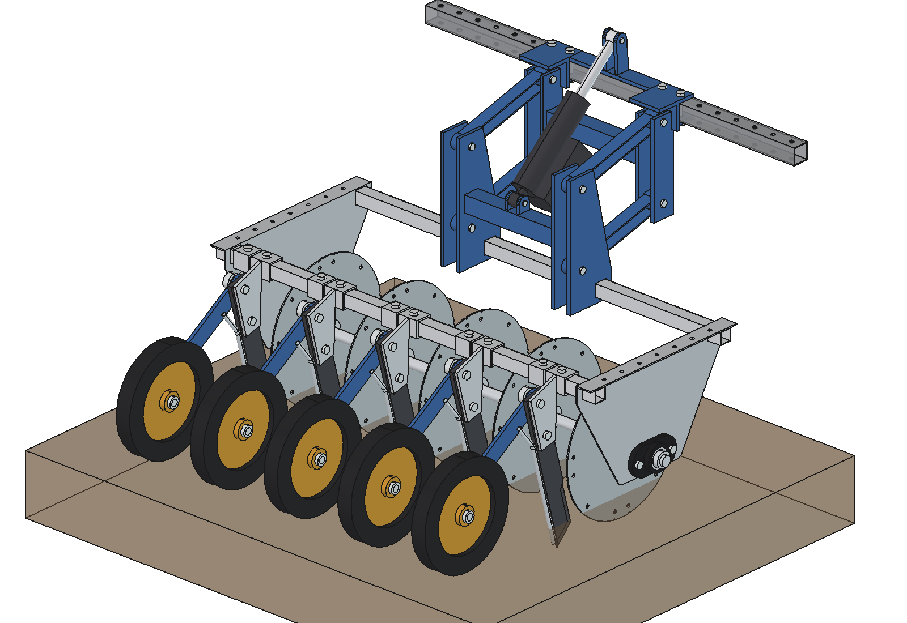
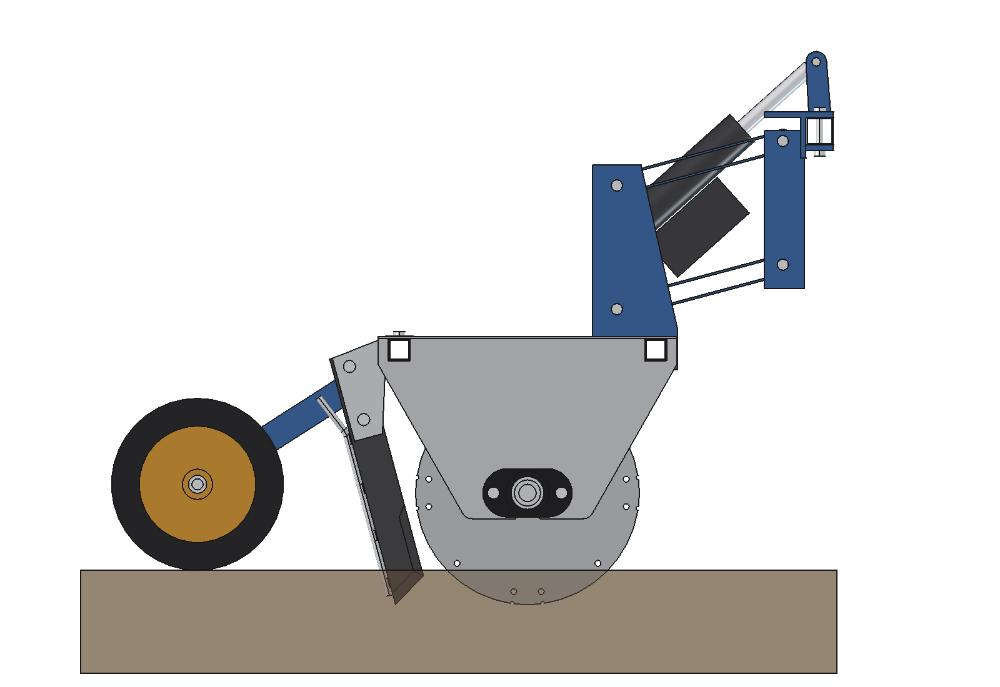
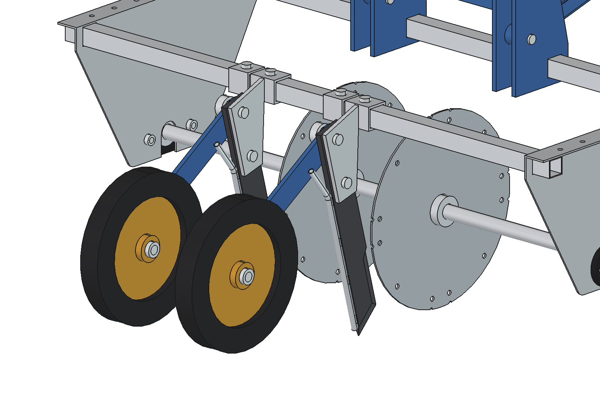
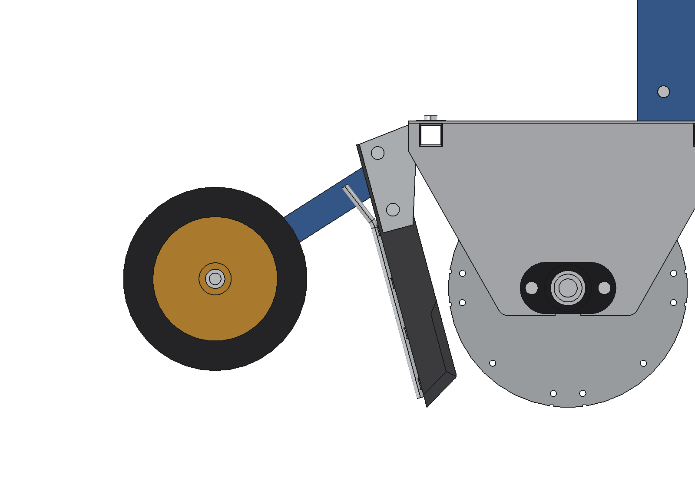

# Precision applicator V2: press wheels (FreeCAD model)

The precision applicator from [`../applicator/`](../applicator/README.md) with a **press wheel behind every knife**
that closes the slot again. Standard V2 has **2 rows in the middle** (x ±100, 200 apart); the frame, the
suspension with the actuator, the discs and the knives are the same as V1. A version with **all 5 rows** and
5 press wheels is built from the same files (`N_ROWS = 5`).

| 2 rows (standard) | 5 rows |
| --- | --- |
|  |  |
|  |  |

On the robot with the pump, hoses and an animation (2 and 5 rows): [`../combined_v2/`](../combined_v2/README.md).

## Press wheel

Per row: a 40 × 40 sleeve clamps on the rear cross tube next to the knife sleeve (left of it, 6 mm apart); a lug
under the sleeve carries a Ø 12 pin with a torsion spring. A flat arm of 40 × 8 trails 297 mm back to a Ø 250 × 36
press wheel on a Ø 16 axle. The wheel runs exactly in the row, 288 mm behind the knife tip, and presses the slot
and the liquid in it shut. The spring is estimated at 37.5 Nm for 150 N on the ground.



## Files

| File | Contents |
| --- | --- |
| `Precision_Applicator_V2.FCStd/.step` | 2 rows (generated, do not edit by hand) |
| `Precision_Applicator_V2_5rows.FCStd/.step` | 5 rows (generated) |
| `pa2_params.py` | press wheel dimensions, spring force; `configure(n)` sets the number of rows (2 or 5) |
| `pa2_parts.py` | sleeve, clamp bolt, lug, pin, torsion spring, arm, axle, tyre, rim |
| `build_pa2.py` | builds the applicator from `../applicator` and adds the press wheels; `set_wheels(angle)`, checks, mass, images, STEP; `build_into(doc, parent, placement, prefix)` for `../combined_v2` |
| `run_in_freecad.py` | macro: set `N_ROWS`, run in FreeCAD (F6) |
| `previews/`, `previews/5rows/` | images |

Nothing is copied: `build_pa2.setup_path()` puts `../applicator` and its knife folder on `sys.path`.

## Model tree

As `../applicator/build_pa.py`, with one extra Part in `Implement` (it lifts with the applicator):

```
Press_wheels   pw_sleeve_i, pw_set_bolt_i, pw_lug_i, pw_pin_i, pw_spring_i, pw_arm_i, pw_axle_i,
               pw_wheel_i (sub-Part: pw_tire_i, pw_rim_i; Placement = rotation about the axle)
```

## Key figures

| | 2 rows | 5 rows |
| --- | --- | --- |
| Rows | x −100, 100 | x −400 … 400 |
| Mass | 55.2 kg, lifted 40.1 kg | 83.3 kg, lifted 68.2 kg |
| Press wheels | 9.7 kg | 24.3 kg |
| Interference | none, also at lift −40, 0, 75, 150 | none, also at lift −40, 0, 75, 150 |

Clearances (both): wheel–knife 108, wheel–knife tube 87, arm–knife 17, arm–knife sleeve 10, press sleeve–knife
sleeve 6 mm; wheel on the ground (z 0) in the working position. All other figures as V1.

```python
import build_pa2
build_pa2.build(n_rows=5)             # or 2
build_pa2.check_interference(); build_pa2.check_poses()
build_pa2.clearance(); build_pa2.mass_properties()
```

## Estimated, not measured

- Press force 150 N per wheel and the spring torque that follows from it (37.5 Nm).
- Wheel Ø 250 × 36 with a rubber tyre (density 1.2 g/cm³), rim and hub steel.
- Arm geometry: pivot at (y −230, z 285), wheel 480 behind the shaft; designed here, not on the photos.
- Everything listed in `../applicator/README.md`.
