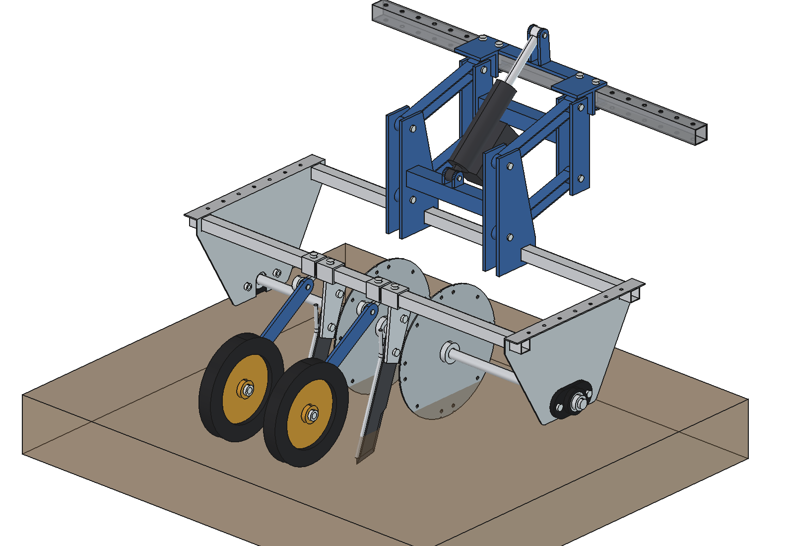
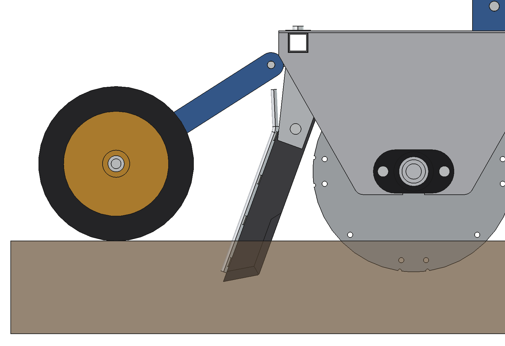
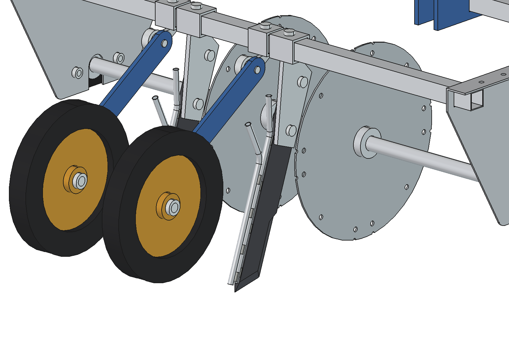

# Precision applicator V3: trailing knives, single or double (FreeCAD model)

V2 from [`../applicator_v2/`](../applicator_v2/README.md) (discs, press wheels, frame, suspension) with the
**knives trailing** instead of raked forward: the tip points back and the top forward, 20° from vertical. The knife
is placed so that the **liquid outlet lies 50 mm deep**. With the same files a **double knife**
([`../parts/injector_knife_double/`](../parts/injector_knife_double/README.md)) can be fitted: two tubes in line
behind the blade, for two liquids at once. 2 rows in the middle (standard) or 5 rows.

| Single knife | Double knife |
| --- | --- |
|  |  |
|  |  |

V1/V2 (raked forward 15°) for comparison: [`../applicator_v2/previews/3_side.png`](../applicator_v2/previews/3_side.png).

## Knife

- **Trailing 20°**: the cutting edge faces forward and down, the tip is the rear-bottom corner. The knife slides over
  stones and roots and presses the soil down instead of lifting it.
- **Outlet at 50 mm**: the centre of the outlet of tube A is at z −50; the tip is then 65.8 deep (the tube ends 15
  before the tip). The discs still cut 50 deep, so the slot is open where the liquid lands; the last 16 mm the knife
  cuts on its own.
- **15 mm from the disc**: the knife lies in the disc plane; it is moved back until its whole outline is 15 mm
  outside the disc rim (`pa3_params.knife_origin`, same `knife_gap` as V1). The closest point is now the upper
  part of the cutting edge.
- **Holder under the sleeve**: the top of the knife now sits under the rear cross tube, so the 8 mm holder plate is
  welded under the 40 × 40 sleeve (V1: on its rear face). Sleeve, clamp bolt and the 2 × M10 knife bolts are V1's.
- **Double knife**: same blade, same tube A, so the same placement; tube B lies 10 behind A and ends 4 mm further,
  so both outlets are at 50 mm (50.0 and 50.3). At the top B bends away earlier and sharper (45°), so the two hose
  ends are 61 mm apart, each with its own hose.

## Files

| File | Contents |
| --- | --- |
| `Precision_Applicator_V3[_double][_5rows].FCStd/.step` | 2 or 5 rows, single or double knife (generated) |
| `pa3_params.py` | trail angle, outlet depth, knife choice; `knife_origin()` solves the position; `configure(n, knife)` |
| `pa3_parts.py` | knife placement, holder under the sleeve; sleeve, set bolt and knife bolts from `../applicator/pa_parts.py` |
| `build_pa3.py` | builds frame, rotor, mast, suspension (`../applicator/build_pa`), V3 knives and press wheels (`../applicator_v2/build_pa2`); checks, clearance, mass, images, STEP |
| `run_in_freecad.py` | macro: set `N_ROWS` (2 or 5) and `KNIFE` ("single" or "double"), run in FreeCAD (F6) |
| `previews/`, `previews/double/` | images |

Nothing is copied: `build_pa3.setup_path()` puts V2, V1, `../parts/injector_knife` and
`../parts/injector_knife_double` on `sys.path`. `../applicator/pa_parts.py` got an optional `place=` argument on
`knife_point`, `holder` and `knife_bolts` (V1 and V2 build exactly as before); V3 uses it for the knife bolts.

```python
import build_pa3
build_pa3.build(n_rows=2, knife="double")
build_pa3.check_interference(); build_pa3.check_poses()
build_pa3.clearance(); build_pa3.mass_properties()
```

## Key figures

| | 2 rows single | 2 rows double | 5 rows single | 5 rows double |
| --- | --- | --- | --- | --- |
| Mass | 55.2 kg | 55.4 kg | 83.3 kg | 83.7 kg |
| Lifted | 40.1 kg | 40.3 kg | 68.2 kg | 68.6 kg |
| Outlet depth | 50.0 | 50.0 / 50.3 | 50.0 | 50.0 / 50.3 |
| Interference | none, also at lift −40, 0, 75, 150 | none, idem | none, idem | none, idem |

| Clearance (mm) | single | double |
| --- | --- | --- |
| Knife – disc rim | 15.0 | 15.0 |
| Holder – disc | 19.3 | 19.3 |
| Knife – rear cross tube | 24.1 | 24.1 |
| Press wheel – knife tubes | 92.8 | 82.8 |
| Press arm – knife tubes | 22.9 | 22.9 |
| Outlet behind the shaft | 306.6 | 306.6 |
| Press wheel contact behind the outlet | 173.4 | 173.4 |

## Estimated, not measured

- Trail angle 20°: chosen so the top of the knife stays under the rear cross tube and the press wheel stays
  80 mm or more from the tubes; 15–25° also fit (`knife_trail`).
- Outlet depth 50 (given) with the disc at 50: the knife tip goes 16 mm deeper than the disc.
- Draft force of a trailing knife at 66 mm: not calculated.
- Everything listed in `../applicator_v2/README.md` and `../parts/injector_knife_double/README.md`.
