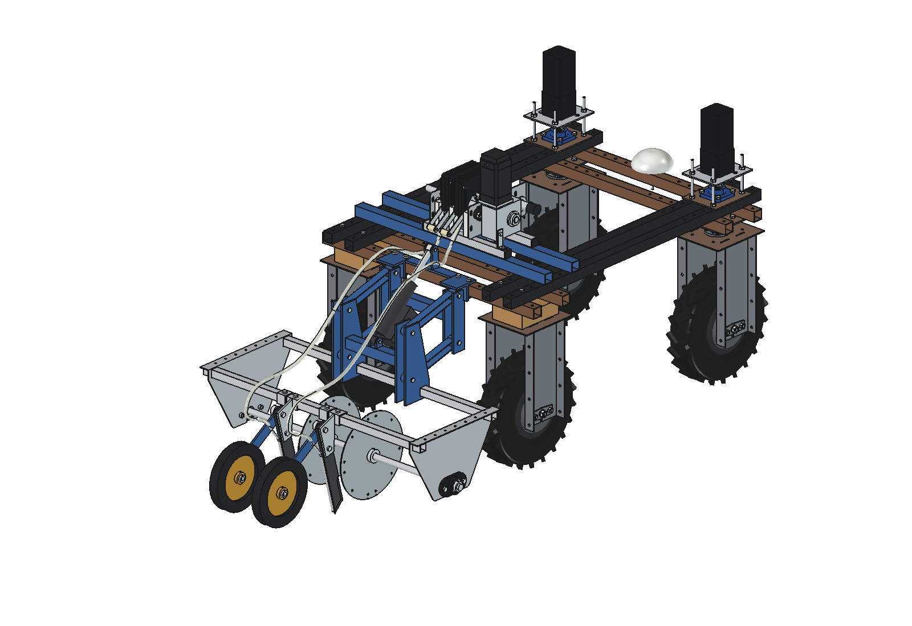
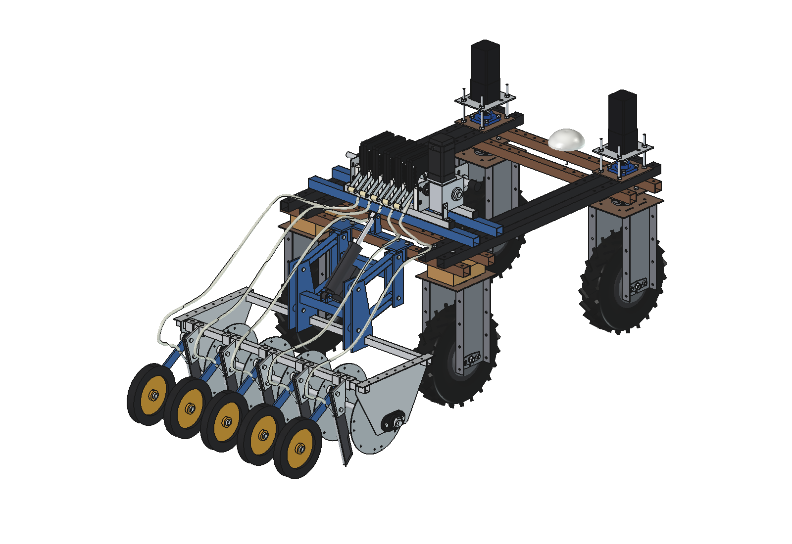
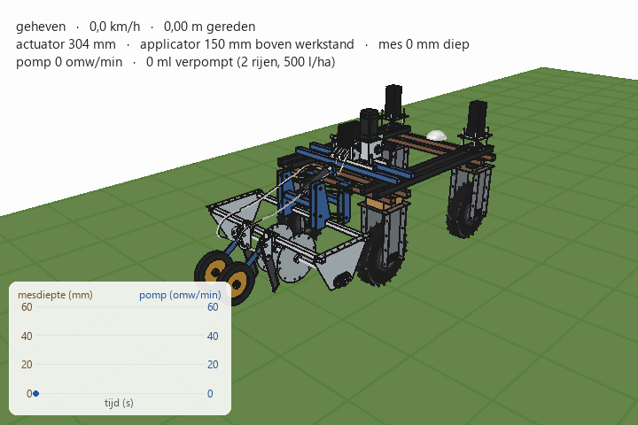
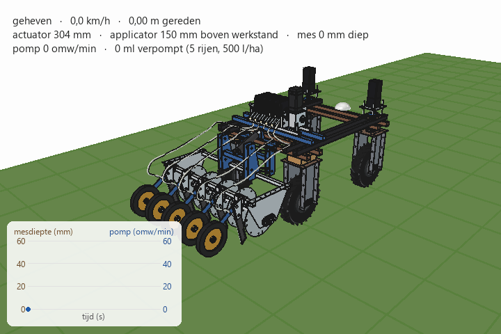

# Precision applicator V2 + roller pump on the Bruut OpenAgbot

Version 2 of the combination in [`../combined/`](../combined/README.md):

- the **applicator V2** ([`../applicator_v2/`](../applicator_v2/README.md)): 2 rows in the middle (x ±100) with discs,
  injector knives and **press wheels** that close the slot, on the parallel linkage with the electric actuator;
- the **roller pump** ([`../roller_pump/`](../roller_pump/README.md)) with **2 sections**, one per row, on the
  same mount tubes over the upper beams;
- **2 hoses** (8 × 12), pump channel *i* to knife *i*, over the rear beam, low past the actuator bracket, down behind
  the knives onto the tube ends.

No tank yet: the manifold of the pump is still open at the front.

The same combination is also built with **5 rows**: a 5-section pump, 5 hoses and the 5-row applicator V2 with
5 press wheels (`N_ROWS = 5` in `run_in_freecad.py`, or `build_cmb2.build(n_rows=5)`; saved as `..._5rows`, images
and GIF in `previews/5rows/`).

| 2 rows | 5 rows |
| --- | --- |
|  |  |
|  |  |

## Animation

The robot stands with the applicator lifted, drives off while the actuator lowers it, injects with the pump in
step with the speed (blue strip = liquid in the open slot between knife and press wheel) and the press wheels close
the slot behind them (sand-coloured seam). At the end of the strip the actuator lifts; the last 288 mm stays open,
because the wheel leaves the ground before the knife does.

| | |
| --- | --- |
| Run | 9.5 s, 5.25 m at 0.75 m/s; lowering 1.75 s |
| Pump | 45 rpm = 500 l/ha at 200 mm rows (10.2 ml per metre per row), 52.5 ml in 2.56 m |
| Slot | 3.31 m open per row, 2.63 m closed by the press wheel (89 % of the liquid strip) |
| Press wheels | 3.4 turns |

## Files

| File | Contents |
| --- | --- |
| `Precision_Applicator_V2_on_robot.FCStd/.step`, `..._5rows.FCStd/.step` | the combination with 2 or 5 rows in working position (generated) |
| `cmb2_params.py` | what differs from `../combined/cmb_params.py`: number of rows (`configure(n)`: 2 or 5), pump sections and position, hose route |
| `cmb2_parts.py` | pump mount, hose ends and hose path (uses the Catmull-Rom path of `../combined/cmb_parts.py`) |
| `build_cmb2.py` | builds the tree from the part folders, `set_lift()`, `check_fit()`, `check_hoses()`, clearances, axle loads, images, STEP |
| `animate_cmb2.py` | animation: uses the drive plan of `../combined/animate_cmb.py`, adds the press wheels and the closed seam |
| `run_in_freecad.py` | macro: run in FreeCAD (F6) to rebuild and print the key figures |
| `previews/`, `previews/5rows/` | images and the GIFs |

The GIF is made with `../combined/make_gif_cmb.py`.

## Key figures

| | 2 rows | 5 rows |
| --- | --- | --- |
| Interference | none (robot, pump, applicator, mount, hoses); hoses also free lifted 150 mm | same |
| Clearance | discs–rear tyres 260, front tube–tyres 96, side shields–tyres 95 | discs–tyres 132.5, rest the same |
| Hoses | 1294 mm each, 77 mm slack when lifted; 80 from the press wheel, 16 from its arm | 1297 … 1472 mm, same clearances |
| Pump | 2 sections, 184 over the side plates, 449 over all | 5 sections, 370 / 635 (pump x −32.5) |
| Added mass | applicator 55.2 kg (cg robot y −984), pump about 9 kg | applicator 83.3 kg (cg y −1084), pump about 16 kg |
| Axle loads, lifted | rear axle +90 kg, front axle −26 kg | rear axle +146 kg, front axle −47 kg |
| Animation | 52.5 ml in 2.56 m (2 rows) | 131 ml in 2.56 m (5 rows); same speed, dose and closing (89 %) |

## Usage

```python
import build_cmb2
build_cmb2.build(n_rows=5)       # or 2
build_cmb2.set_lift(150)
build_cmb2.check_fit()           # ~15 min; check_hoses() is quick
```

```python
import animate_cmb2
animate_cmb2.build(n_rows=5)     # or 2
animate_cmb2.play()              # animate_cmb2.stop()
animate_cmb2.summary()
animate_cmb2.render_all(r"C:\temp\cmb2_frames")
import make_gif_cmb; make_gif_cmb.main(r"C:\temp\cmb2_frames", r"previews\animation_inject_press_strip.gif")
```

Long runs take longer than the MCP time-out: start them with `QtCore.QTimer.singleShot` and write the result to a
file. If FreeCAD stops responding, restart it.
