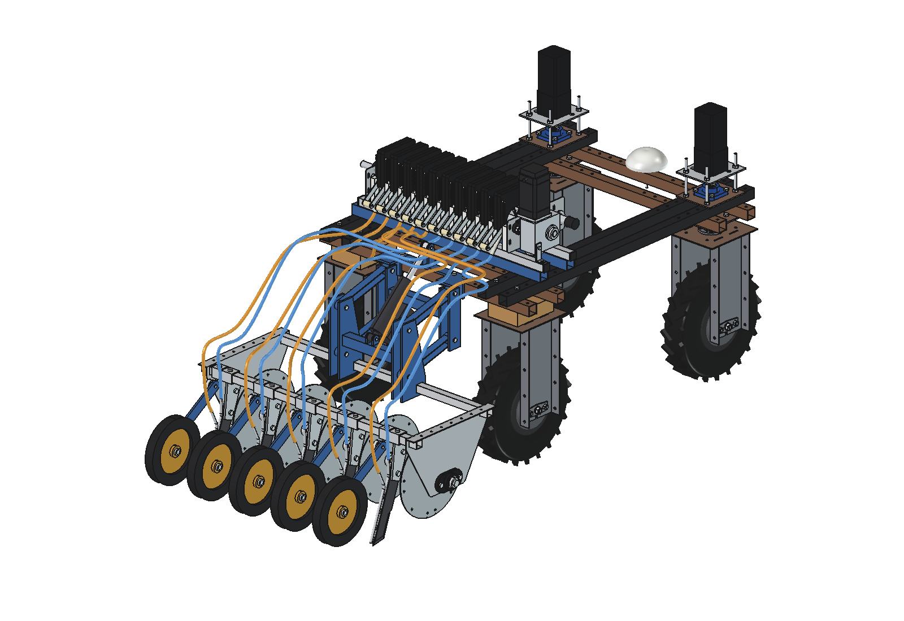
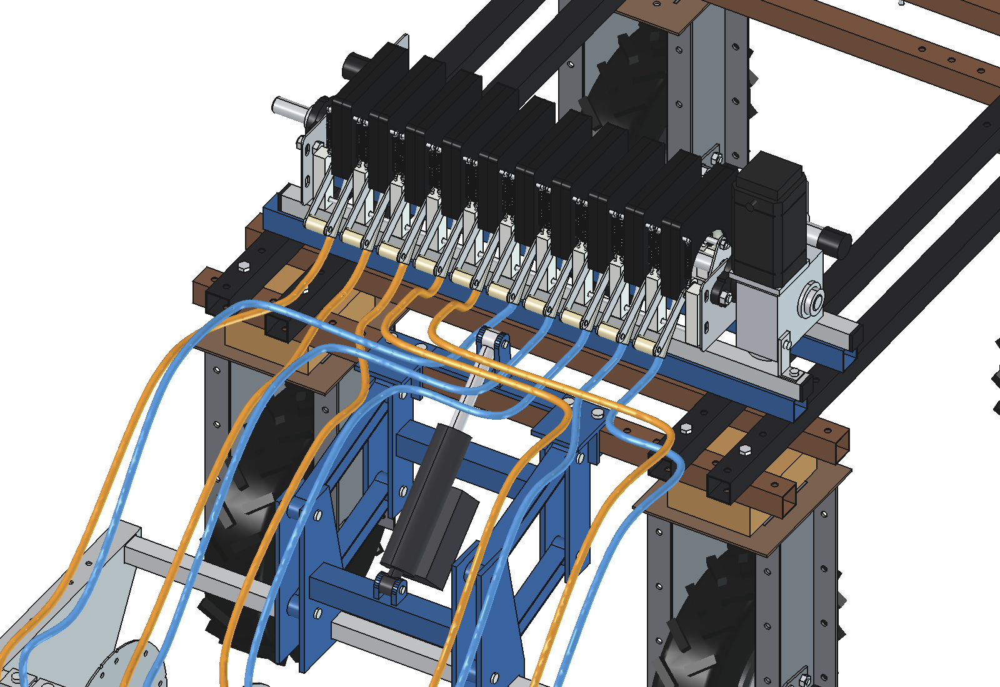
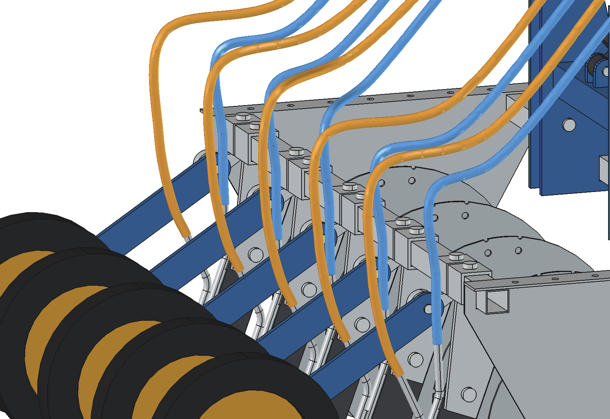
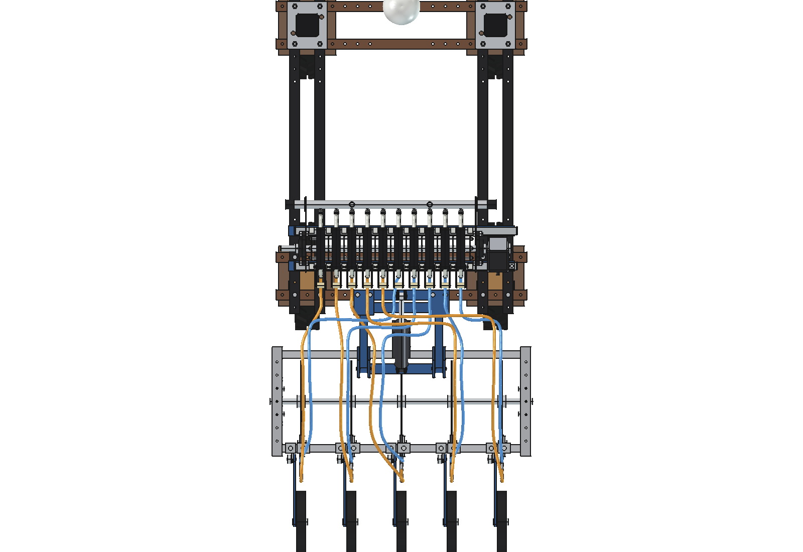
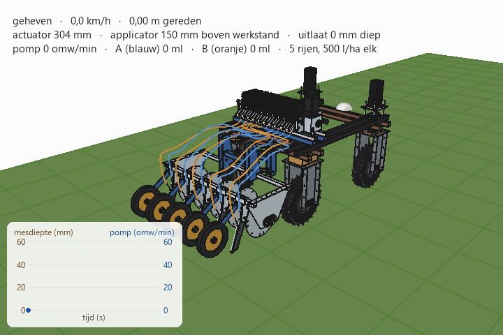

# Precision applicator V3 + 10-section roller pump on the Bruut OpenAgbot: two liquids

Version 3 of the combination ([`../combined_v2/`](../combined_v2/README.md) is V2):

- the **applicator V3** ([`../applicator_v3/`](../applicator_v3/README.md)) with **5 rows**, **trailing double
  knives** ([`../parts/injector_knife_double/`](../parts/injector_knife_double/README.md)) and press wheels; both
  outlets of each knife lie 50 mm deep;
- the **roller pump** ([`../roller_pump/`](../roller_pump/README.md)) with **10 sections**: the **right 5 pump
  liquid A** (blue hoses) to tube A of rows 0 … 4, the **left 5 pump liquid B** (orange hoses) to tube B;
- the **manifold split in two**: a plug between section 4 and 5 (red) and a ½" inlet on each half, one per tank;
- **10 hoses** (8 × 12) in three layers so that they cross without touching.

| Rear | Hoses at the pump |
| --- | --- |
|  |  |
|  |  |

## Animation



Same drive plan as V1/V2: lifted at the start, the actuator lowers the applicator while the robot drives off, the
pump runs in step with the speed, the press wheels close the slot, the actuator lifts at the end. In the slot the
two liquids are drawn side by side (blue A, orange B); in reality they lie in the same slot, B 11 mm behind A.

| | |
| --- | --- |
| Run | 9.5 s, 5.25 m at 0.75 m/s |
| Pump | 45 rpm = 500 l/ha **per liquid** at 200 mm rows (10.25 ml per metre per row per liquid) |
| Applied | 131 ml of A and 131 ml of B in 2.56 m (5 rows) |
| Slot | 3.31 m open per row; 93 % of both liquid strips closed by the press wheels |

## Hose layout

The outlets of the pump lie in the order B0 … B4 A0 … A4 (left to right), behind the robot every row needs an A and
a B hose side by side. Hoses that cross each other in the top view therefore run at different heights, from the
pump to behind the robot beam:

| Layer | Hoses | z (centre) | Why |
| --- | --- | --- | --- |
| low | B0, B1, B2 | 714 | just over the upper beam (top z 699) at x −325 |
| middle | A0 … A4 | 736 | over the low layer; A0 moves to x −30 to pass the actuator lugs (x ±19) |
| high | B3, B4 | 770 | they cross x 0 to the right: over the actuator lugs (top 755), the actuator (also lifted) and the A layer |

Within a layer the hoses never cross: each one moves sideways behind the robot beam on its own line, and the hose
that has to go furthest does so first (closest to the beam). Only at y −880, when all hoses lie in their lane, do they
come down to the applicator, A and B of a row 26 mm apart. Over the knife each hose drops in the knife plane onto
its own tube end (A straight up, B slanting back).

Crossing x 0 low was tried first: lifted, the actuator stands too high up to y −790, and behind that the lifted mast
(top z 740) is in the way; hence the high layer.

## Files

| File | Contents |
| --- | --- |
| `Precision_Applicator_V3_on_robot.FCStd/.step` | the combination in working position (generated) |
| `cmb3_params.py` | pump (10 sections, x −42.5), which channel feeds which row, manifold split, hose lanes and layers |
| `cmb3_parts.py` | manifold plug and inlets, hose route (arcs out of the pump, sideways bends, Catmull-Rom), hose solid |
| `build_cmb3.py` | builds robot, pump, applicator V3 and hoses from their folders; `set_lift()`, `check_fit()`, `check_hoses()`, `hose_gaps()`, clearances, axle loads, images, STEP |
| `animate_cmb3.py` | animation: drive plan of `../combined/animate_cmb.py`, press wheels of `../combined_v2/animate_cmb2.py`, two liquid strips per row |
| `make_gif_cmb3.py` | frames to GIF (uses `../combined/make_gif_cmb.py`, own caption) |
| `run_in_freecad.py` | macro: rebuild (F6) and print the key figures |
| `previews/` | images and the GIF |

## Key figures

| | |
| --- | --- |
| Interference | none: robot, pump, mount, applicator (`check_fit`); hoses against everything at lift 0, 75 and 150 (`check_hoses`) |
| Hoses | A 1075 … 1362 mm, B 1174 … 1619 mm; 96 mm slack when lifted; at least 10 mm apart |
| Hose bends | smallest radius about 20 mm (A0, round the actuator lugs), others 22 … 35 |
| Clearance | hose–press wheel 90, hose–press arm 16, hose–actuator 63; front tube–tyres 96, side shields–tyres 95 |
| Pump | 10 sections, 680 over the side plates, 945 over all, about 33 kg |
| Added mass | applicator 83.7 kg (cg robot y −1083), pump about 33 kg |
| Axle loads, lifted | rear axle +162 kg, front axle −45 kg |

## Usage

```python
import build_cmb3
build_cmb3.build()
build_cmb3.check_hoses(); build_cmb3.check_fit()      # each 1-2 minutes
```

```python
import animate_cmb3
animate_cmb3.build(); animate_cmb3.play()              # animate_cmb3.stop()
animate_cmb3.summary()
animate_cmb3.render_all(r"C:\temp\cmb3_frames")       # ~15 min: start with QtCore.QTimer.singleShot
import make_gif_cmb3; make_gif_cmb3.main(r"C:\temp\cmb3_frames", r"previews\animation_two_liquids.gif")
```

Long runs take longer than the MCP time-out: start them with `QtCore.QTimer.singleShot` and write the result to a
file.

## Checks: how and why

The hoses are swept in pieces of about 30 mm (`cmb3_parts.hose`): sweeping a whole hose at once gave wrong solids
in OCC (too big, or a blob) for these splines. Booleans between those swept pieces and the robot beams, tyres or
each other took tens of minutes, so `check_hoses` tests points instead: rings of 8 points on the hose surface every
5 mm against every solid (robot parts as their bounding box), and the distance between the centre lines for hose
against hose. `check_fit` does the other groups with booleans, tyres by bounding box.

## Estimated, not measured

- Hose 8 × 12 and its smallest bend radius (about 20 mm here); with a stiffer hose, raise `lateral_r`, `climb_r`.
- Pump mass 33 kg (roller pump README), manifold plug and inlets.
- One shaft for both liquids: both get the same dose per row (500 l/ha each here). A different ratio needs a
  different tube bore per half.
- Everything listed in `../applicator_v3/README.md` and `../combined_v2/README.md`.
