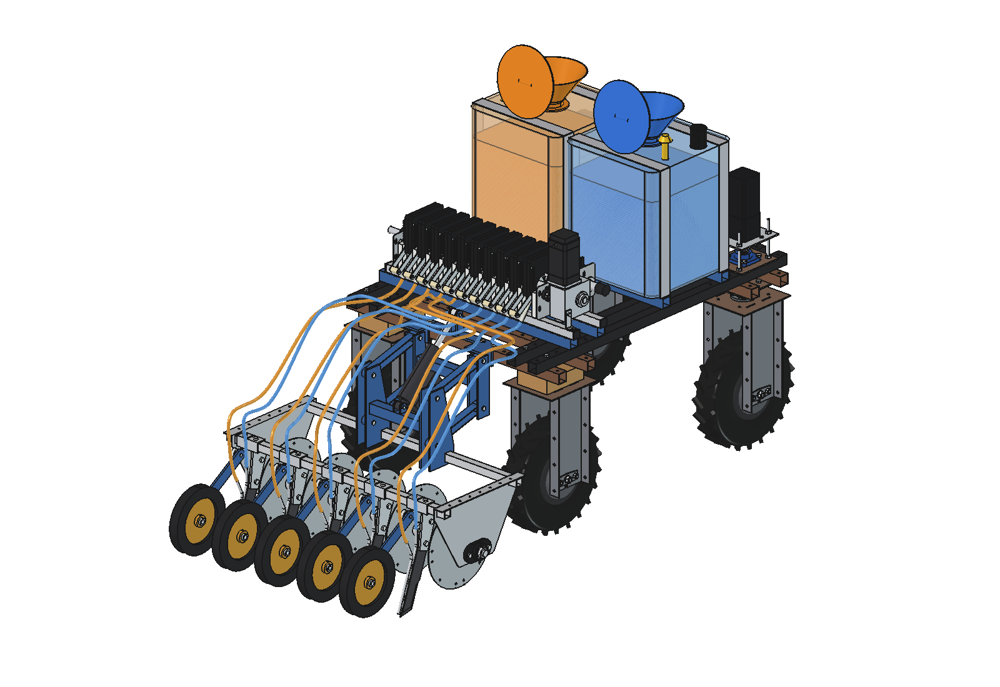
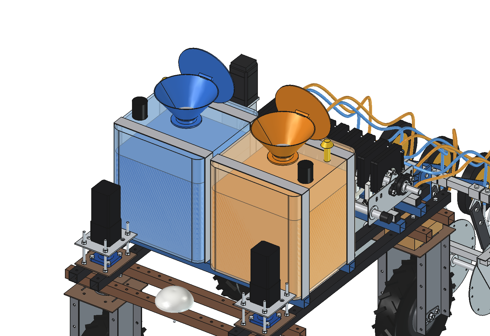
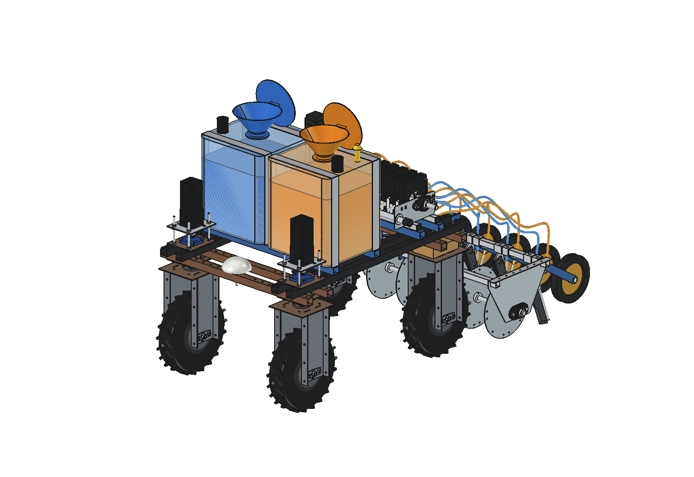
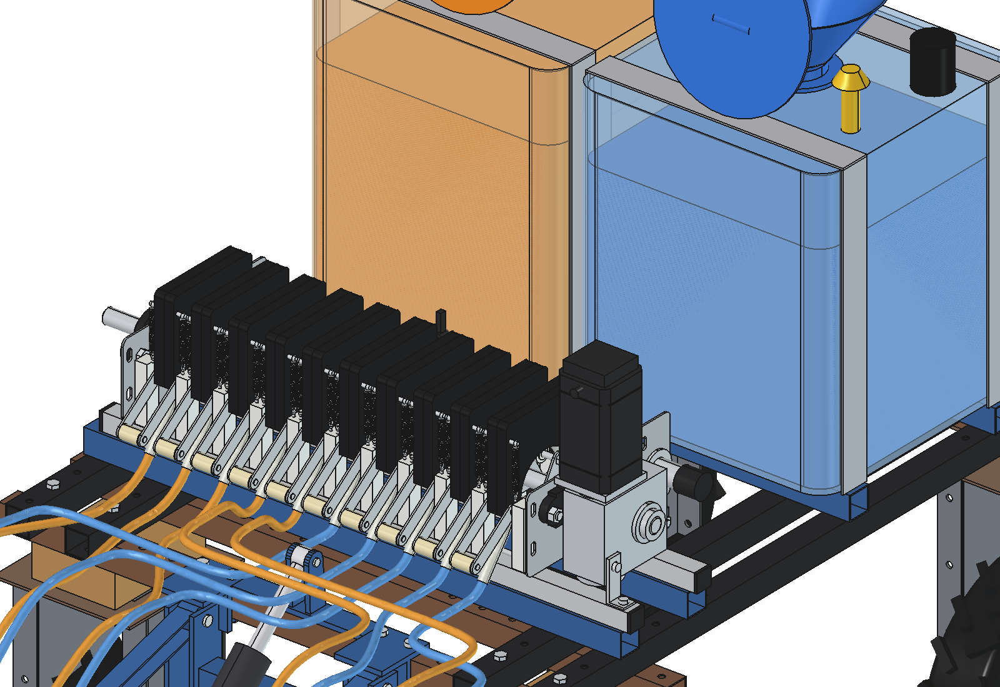
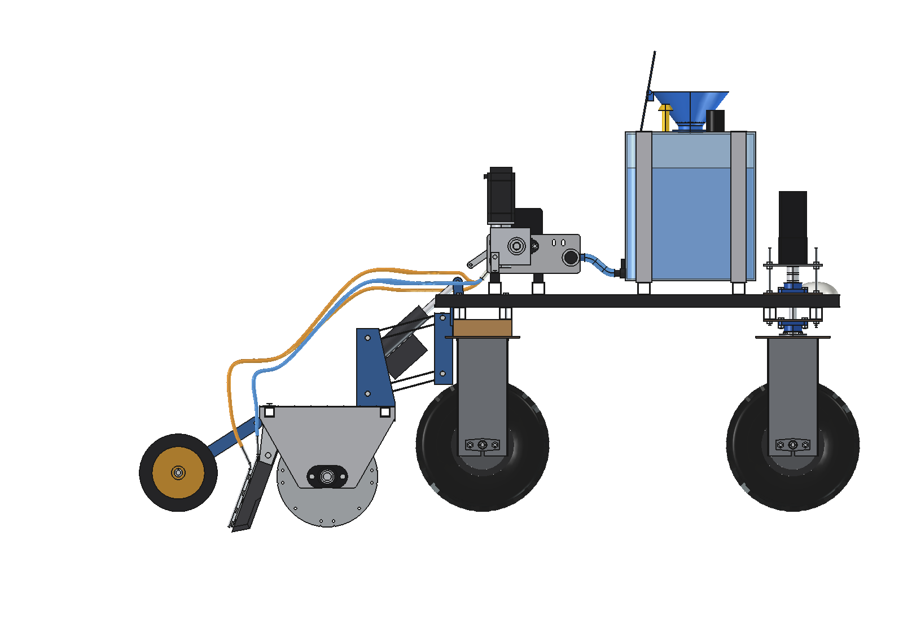
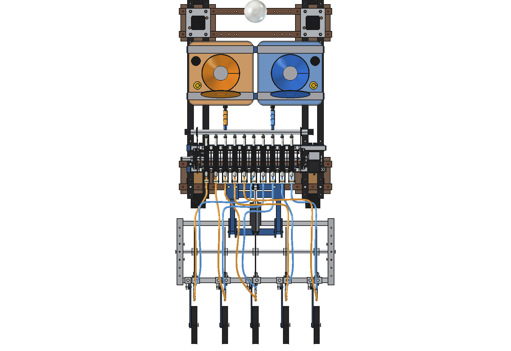

# Precision applicator V4: two work tanks with fill funnels (two liquids)

Version 4 of the combination is [combined_v3](../combined_v3/README.md) (10-section roller pump, right half liquid A,
left half liquid B, applicator V3 with 5 rows of trailing double knives, 10 hoses) with the **two 20 l jerrycans
replaced by two 78 l work tanks**. Each tank has **its own fill funnel** on top, so a refiller with two nozzles fills
both liquids in one stop:

- **tank A (blue) on the right, tank B (orange) on the left**, each straight in front of the manifold inlet of its own
  pump half (as the jerrycans), rotomoulded PE, 425 × 420 × 480 mm, **78.4 l each (157 l in total, 4 × the
  jerrycans)**;
- **fill funnel Ø250** in the middle of each tank, with a strainer at the bottom and a hinged lid (drawn open);
  funnel axes at x ±227.5, y 170: **455 mm apart**, rim at **z 1354**;
- ultrasonic level sensor (stops the refiller's pump) and a vent per tank, a tap low on the back and the same ¾"
  S-shaped supply hose to the ½" manifold inlet as V3;
- two cradle tubes 40 × 40 over all four upper beams (y 325 bolted in the grid, y 20 with U-bolts: no holes at
  |y| < 275), rubber strips, two stainless straps per tank.

The refillers with two nozzles at 455 mm: the [mobile refiller with two IBCs](../../../mobile%20refiller/simple_two_ibc/README.md)
(in the turn) and the [IBC trailer with two liquids](../../../mobile%20refiller/stationary/ibc_trailer_two_liquids/README.md)
(on the headland). Animations of both: [two_liquids_animations](../../../mobile%20refiller/two_liquids_animations/README.md).

| | |
| --- | --- |
|  |  |
|  |  |
|  |  |

## Key figures

From `build_cmb4.clearance()`, `check_tanks()` and `axle_loads()`:

| | |
| --- | --- |
| Tanks | 2 × 78.4 l inside (6 mm wall), x 15 … 440 (A) and −440 … −15 (B), y −40 … 380, z 744 … 1224 |
| Funnels | Ø250 rim / Ø80 outlet, 110 high on a 20 mm neck; axes (±227.5, 170), 455 apart; rim z 1354 → refiller nozzle tips at **z 1460** (106 above the rim, as the other refillers) |
| Clearance | tanks 25 mm behind the front stepper-motor plates (y 405), 130 mm in front of the manifold inlets, 145 mm from the pump |
| Interference | none: tank kit against itself, robot, pump, mount, applicator and hoses (`check_tanks`, booleans; tyres and the swept hoses by bounding box) |
| Mass | kit 28 kg empty (tanks 2 × 9, funnels, cradle), **224 kg with 2 × 78 l** (1.25 kg/l), centre of gravity y 170 |
| Axle loads, applicator lifted | tanks full: rear axle +236 kg, front axle +105 kg; tanks empty: rear +171 kg, front −27 kg (V3 with full jerrycans: +183 / −7). The full tanks in front of the middle keep the front wheels loaded when the applicator is lifted |
| Work | 500 l/ha per liquid at 200 mm rows: 78 l lasts 0.16 ha or 1.5 km of pass (1 m, 5 rows); a refill in every turn (2 × 20 l on 200 m passes) keeps it topped up |

## Files

| File | Contents |
| --- | --- |
| `Precision_Applicator_V4_two_tanks.FCStd/.step` | the combination in working position, 60 l in each tank (generated) |
| `cmb4_params.py` | tanks, cradle, funnels, sensors, vents, taps (the rest: `../combined_v3/cmb3_params.py`) |
| `cmb4_parts.py` | cradle tubes and pads, tank shell and liquid level, straps, funnel, strainer, lid, sensor, vent, tap, S-hose |
| `build_cmb4.py` | builds robot, pump, mount, applicator and hoses from combined_v3 and the tanks from here; `set_lift()`, `set_levels()`, `check_tanks()`, `clearance()`, `tanks_mass()`, `axle_loads()`, `render_all()`, STEP |
| `run_in_freecad.py` | macro: reload, build, print the key figures |
| `previews/` | images |

The animation of the applicator itself (two liquid strips in the slot) is V3's ([`../combined_v3/animate_cmb3.py`](../combined_v3/README.md#animation)):
the tanks do not change it.

## Usage

```python
import build_cmb4
build_cmb4.build()                         # FCStd + STEP
build_cmb4.set_levels(a=78, b=30)          # litres per tank
build_cmb4.check_tanks()                   # must be empty
build_cmb4.clearance(); build_cmb4.axle_loads()
build_cmb4.render_all()
```

Build and check together take about 40 s; run them with `QtCore.QTimer.singleShot` from the MCP (see
[AGENTS.md](../../../AGENTS.md)). `check_hoses()` and `check_fit()` of combined_v3 still apply to the pump, applicator
and hoses, which are unchanged.

## Estimated, not measured

- Work tanks: rotomoulded PE, 6 mm wall, 9 kg each, not a bought part yet; funnel 1.2 kg; liquid 1.25 kg/l.
- Level sensor and vent sizes; the lid is drawn open (it closes by a spring when the nozzle lifts).
- The U-bolts at y 20 (no grid holes there) are not modelled.
- Everything in the list of [combined_v3](../combined_v3/README.md#estimated-not-measured).
