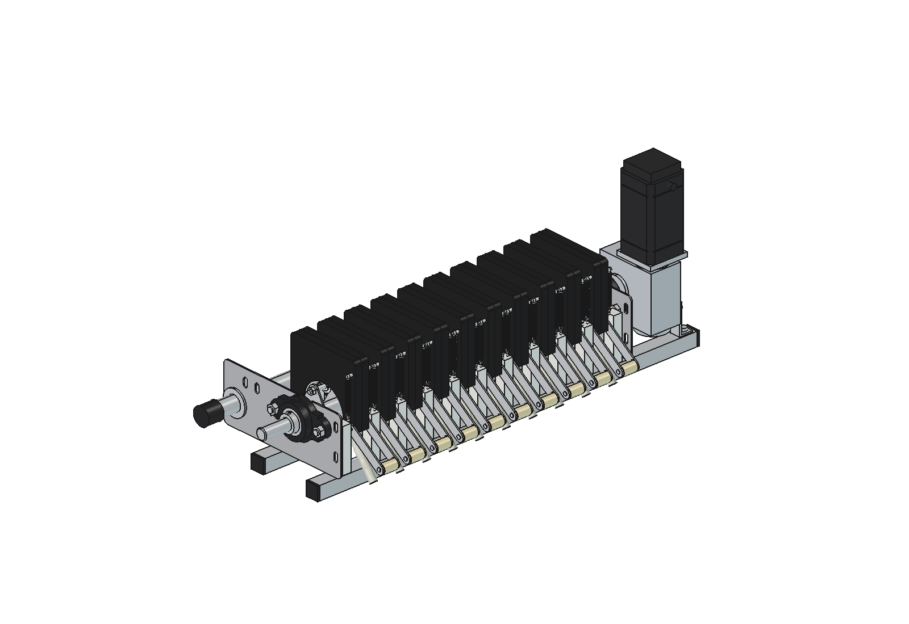
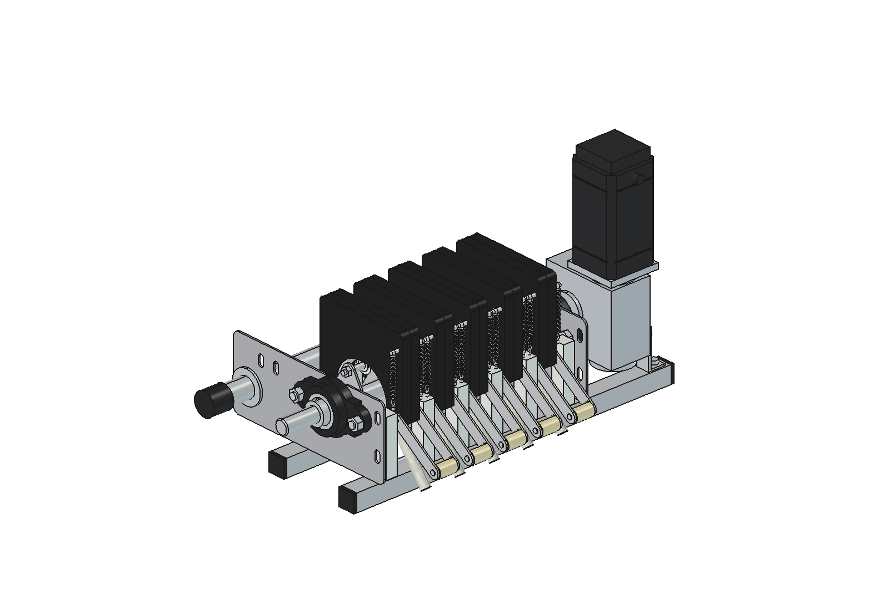
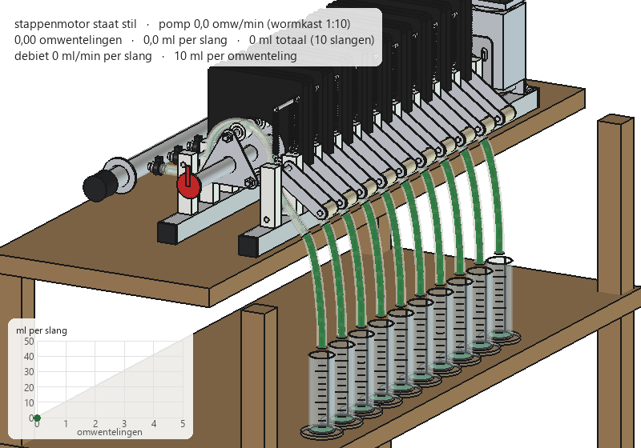
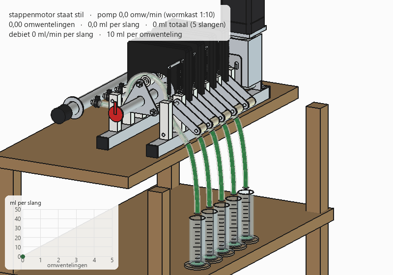
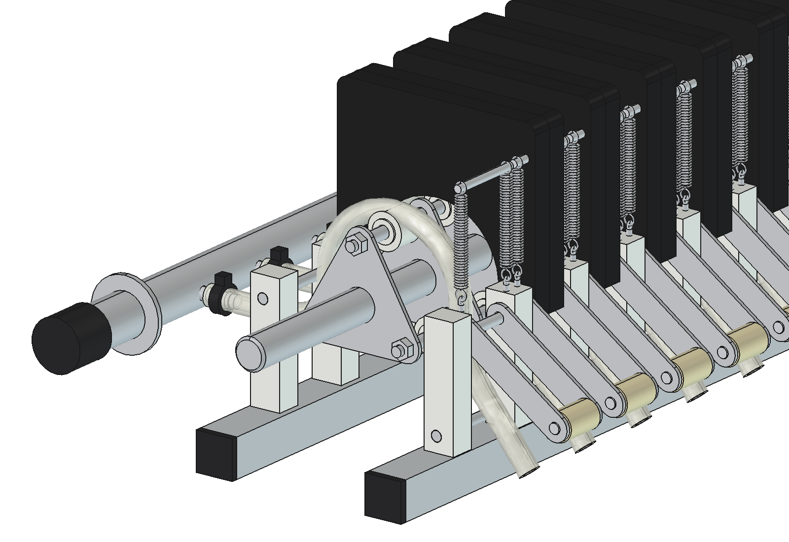
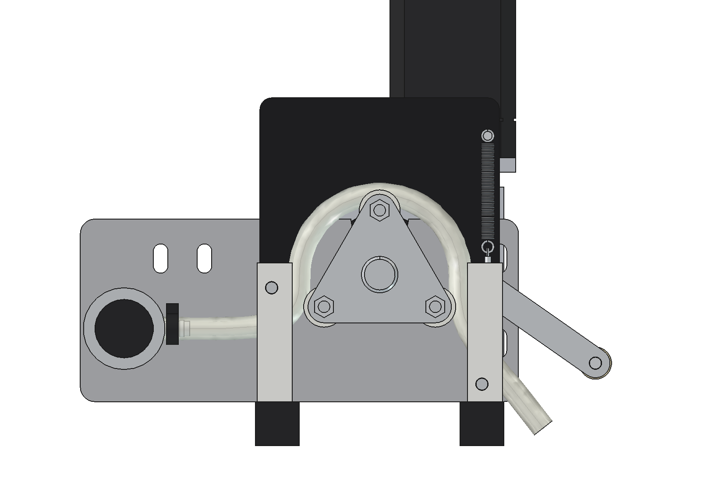
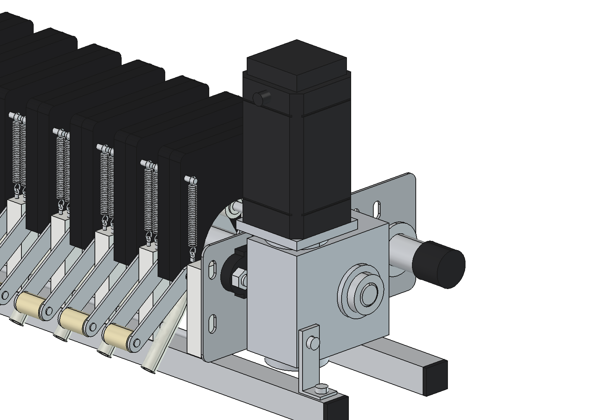

# Roller pump, modular (5 or 10 channels, or any number): FreeCAD model

Multi-channel peristaltic pump for the precision liquid applicator, modelled after the pump in `inspiration/`:
one Ø 25 shaft with a three-roller rotor runs through a row of black pump housings at 62 mm; each housing squeezes
one silicone tube (10 mm bore) against a 180° bed. A 1" manifold feeds all tubes, each tube is its own outlet.
A closed-loop NEMA 34 stepper (86HB250-156B) drives the shaft through an NMRV050 worm gearbox (i = 10) with a hollow
Ø 25 output. Output: 10 ml per revolution per channel (given).

The pump is built from equal **sections** of 62 mm (housing, rollers, rotor plate, PE blocks, tube, latch, springs,
nipple). The number of sections is one parameter: shaft, pins, rods, base bars, manifold and side plate positions
follow from it, and the drive moves along with the side plate. The photos show 10 sections; there is also a narrow
version with 5.

All dimensions with their source (given / measured on a photo / estimated), and the lengths per number of sections:
[maten_rollenpomp.md](maten_rollenpomp.md). Why it is designed this way: [RATIONALE.md](RATIONALE.md).

| 10 sections (680 mm over the side plates) | 5 sections (370 mm over the side plates) |
| --- | --- |
|  |  |
|  |  |

## Files

| File | Contents |
| --- | --- |
| `maten_rollenpomp.md` | all dimensions with their source, and the table of lengths per number of sections (Dutch) |
| `Roller_Pump_10ch.FCStd/.step`, `Roller_Pump_5ch.FCStd/.step` | the models (generated, do not edit by hand) |
| `rp_params.py` | all dimensions; `configure(n)` sets the number of sections and the lengths that follow from it |
| `rp_parts.py` | one function per part, returns a `Part` shape |
| `build_rp.py` | model tree, colors, interference check, rotor poses, clearance, mass, images, STEP export |
| `rp_calc.py` | output, dose → speed, steps per ml, torque, springs (pure Python) |
| `animate_rp.py` | animation: pump on a work bench, rotor turning, liquid into one measuring cylinder per tube |
| `make_gif_rp.py` | frames to GIF with caption and an "ml per tube" panel (Pillow, included with FreeCAD) |
| `run_in_freecad.py` | macro: set `N_CH`, run in FreeCAD (F6) to rebuild the model and print the key figures |
| `previews/10ch/`, `previews/5ch/` | images and GIFs per version |
| `readme.txt`, `specs.txt`, `inspiration/` | the original notes and photos |

## Axes

x = pump shaft (drive end with the stepper = +x), y = across (manifold = +y, outlets and spring latches = −y),
z = up, floor = z 0, x 0 = centre between the side plates, mm. Channels at x = (i − (n − 1)/2) × 62, so −279 … +279
for 10 sections and −124 … +124 for 5. The pump is not mounted on the robot yet; it stands on its own base bars.

## Adding or removing sections

Per section added: one housing (2 halves), 3 rollers with washers, a rotor plate, 2 PE blocks, a tube with clip,
latch straps with handle, 2 springs and a nipple. These parts are the same for every number of sections. Parts cut
to length: shaft, three rotor pins, hinge rod, tie rod, two base bars and the manifold (formulas and the 5 / 10 values
in `maten_rollenpomp.md`). Side plates, bearings, gearbox and motor stay the same.

```python
build_rp.build(n_ch=5)          # or set N_CH = 5 in run_in_freecad.py
rp_params.overall_length()      # (over the side plates, over everything) = (370, 635) for 5, (680, 945) for 10
```

The same motor drives every size: the torque grows with the number of sections (0.39 Nm at the motor for 5,
0.74 Nm for 10, against about 8.5 Nm holding torque), so up to roughly 20 sections the drive does not change; check
`rp_calc.motor_torque()` and the shaft deflection before going much longer.

## Construction





- Rotor: three Ø 10 pins at radius 44 through all channels, triangular plates in every gap, rollers Ø 28 × 22 POM.
- Housing: two 16 mm halves, bed R 63 (5 mm gap to the roller = 83 % occlusion), hinged on a Ø 8 rod on the
  manifold side and pulled shut by two tension springs on the outlet side; the strap handle with the cream roller
  opens it.
- Frame: two 3 mm stainless side plates on two 30 × 30 base bars, white PE support blocks in the gaps, UCFL205 flange
  bearings in a V-slot so the rotor can be lifted out.



## Key figures (`rp_calc.report()`)

| | 5 sections | 10 sections |
| --- | --- | --- |
| Output (given) | 10 ml/rev per tube, 50 ml/rev total | 10 ml/rev per tube, 100 ml/rev total |
| Torque on the pump shaft / at the motor | 2.7 / 0.39 Nm (reserve × 22) | 5.2 / 0.74 Nm (reserve × 11) |
| Mass without liquid (rotor) | about 23 kg (4.0 kg) | about 33 kg (6.6 kg) |

The same for both: geometric stroke 27.1 ml/rev per tube → efficiency 0.37, **to be measured** (RATIONALE § 3);
16 000 steps per pump revolution (200 × 8 microsteps × 10), 0.000625 ml per step; 30 rpm pump for 200 l/ha at 1 m/s
and 0.25 m row spacing (300 ml/min per tube); about 60 rpm pump (600 ml/min per tube) maximum.

## Rebuilding and using

In FreeCAD 1.1: open `run_in_freecad.py`, set `N_CH` and run it (F6), or from the Python console / MCP:

```python
import sys; sys.path.insert(0, r"F:\veldrobot\aanbouwdelen\liquid fertilizer applicator\precision_applicator\roller_pump")
import build_rp, rp_calc
doc = build_rp.build(n_ch=5)            # model, saves Roller_Pump_5ch.FCStd (default n_ch=10)
build_rp.check_interference()           # [] = no overlap (tube against rollers is allowed: that is the squeeze)
build_rp.check_poses()                  # rotor 0 ... 100 degrees against all fixed parts
build_rp.clearance(); build_rp.mass_properties()
build_rp.render_all()                   # images in previews/5ch/
build_rp.export_step()
rp_calc.report(); rp_calc.rpm_for_dose(150)
```

The check functions work on the version of the last `build()` (`rp_params.n_ch`).

Animation (separate document, the FCStd is not changed):

```python
import animate_rp
animate_rp.build(n_ch=5)
animate_rp.play()                       # live, animate_rp.stop()
animate_rp.summary()                    # 4.5 revolutions, 45 ml per tube
animate_rp.render_all(r"C:\temp\rp_frames")
import make_gif_rp; make_gif_rp.main(r"C:\temp\rp_frames", r"previews\5ch\animation_pump_running.gif")
```

`check_interference()` and `render_all()` take a few minutes; from MCP start them with `QtCore.QTimer.singleShot`
and write the result to a JSON file (see AGENTS.md).

## Estimated, not measured

- Rotor pin radius 44, pin Ø 10, roller Ø 28 × 22.
- Housing bottom (z 100), bed radius 63 and roller path; tube outer diameter 16.
- Side plate length 300 and the manifold position (y 175, z 80).
- Springs 2 × 35 N per channel, squeeze force 70 N per roller, rolling resistance 8 %.
- Gearbox NMRV050 i = 10 (efficiency 0.7), motor holding torque 8.5 Nm and mass 3.8 kg.
- 10 ml per revolution per channel is given, not measured (the geometry gives 27 ml; measure and set `ml_per_rev`).
- The 5-section version is derived from the 10-section pump on the photos; it has not been built.
