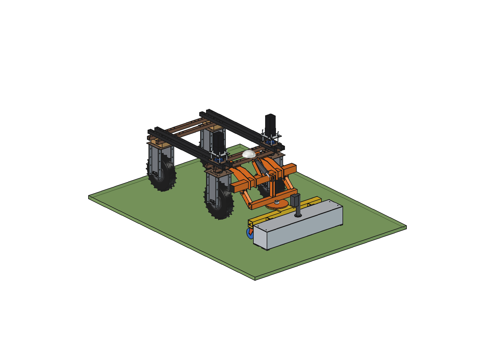
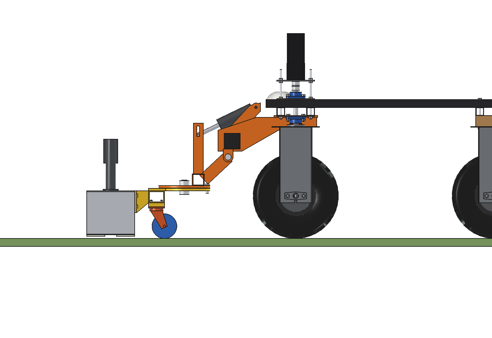
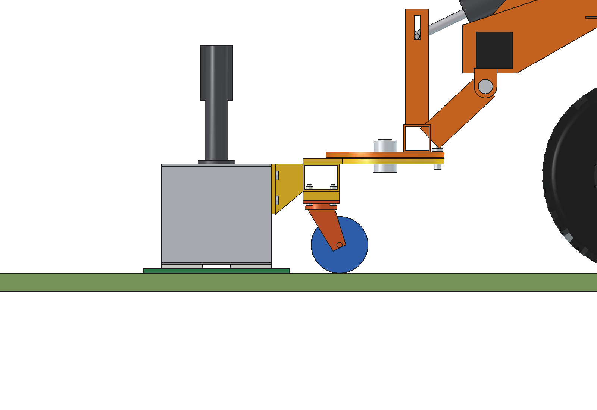
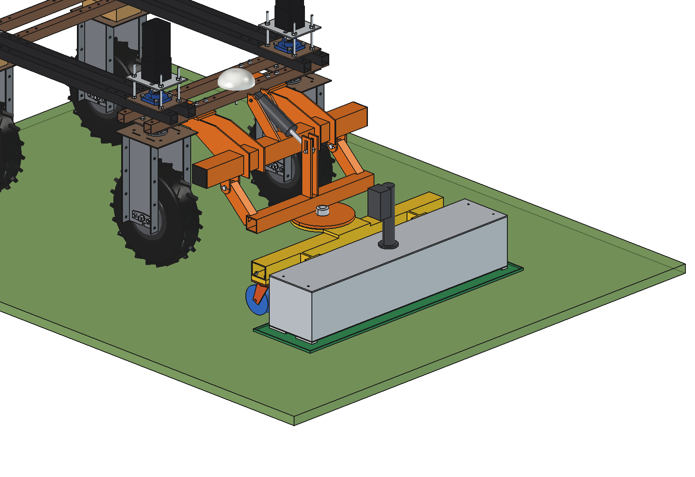
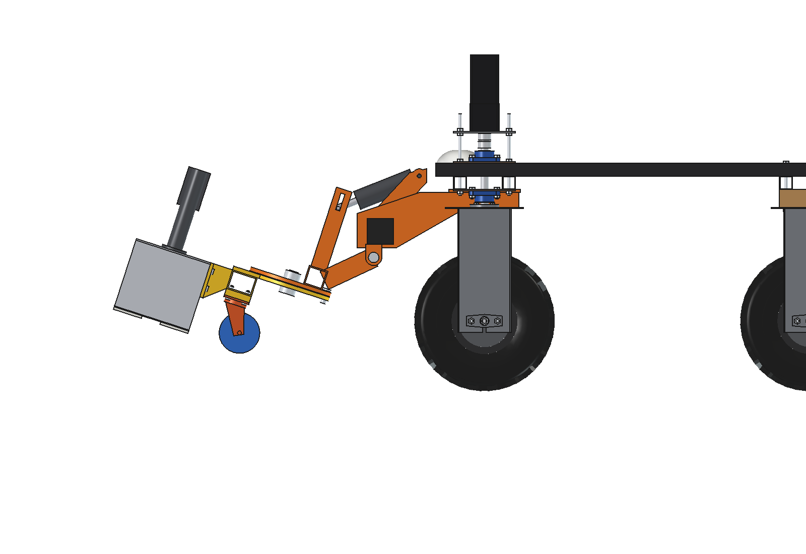
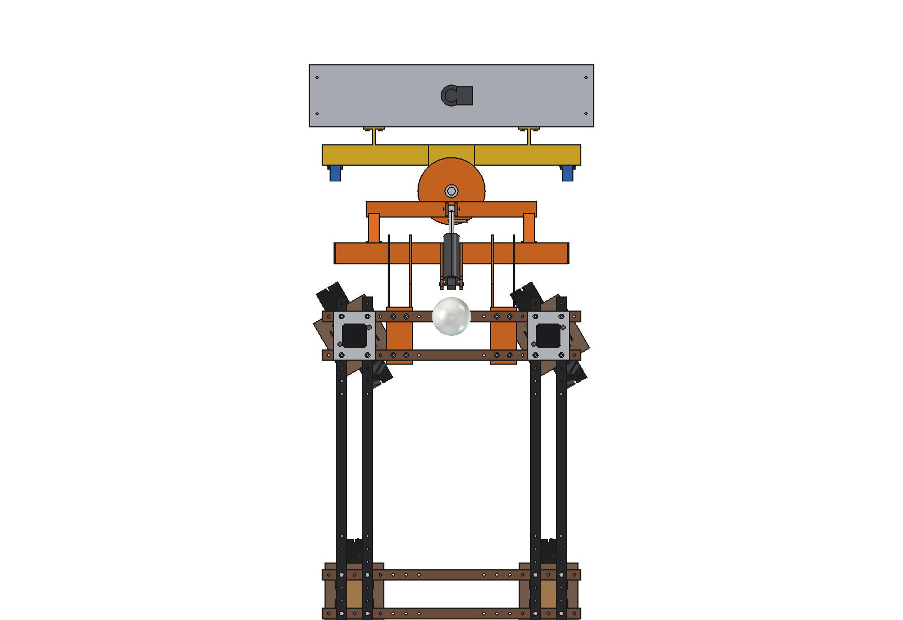
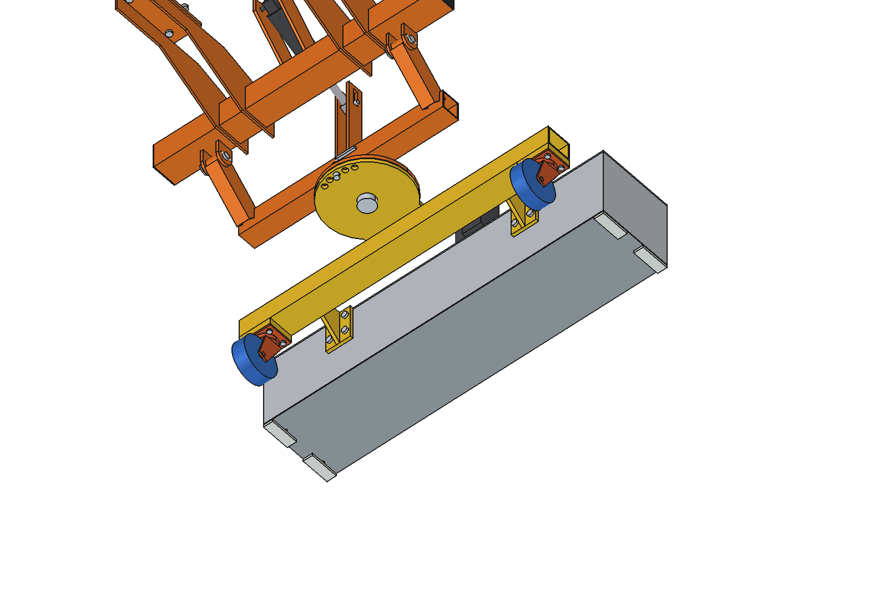
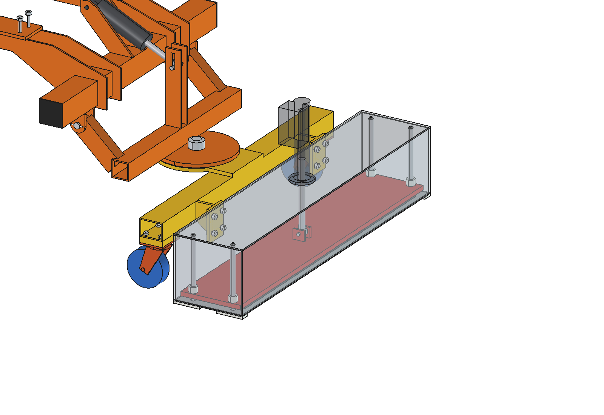
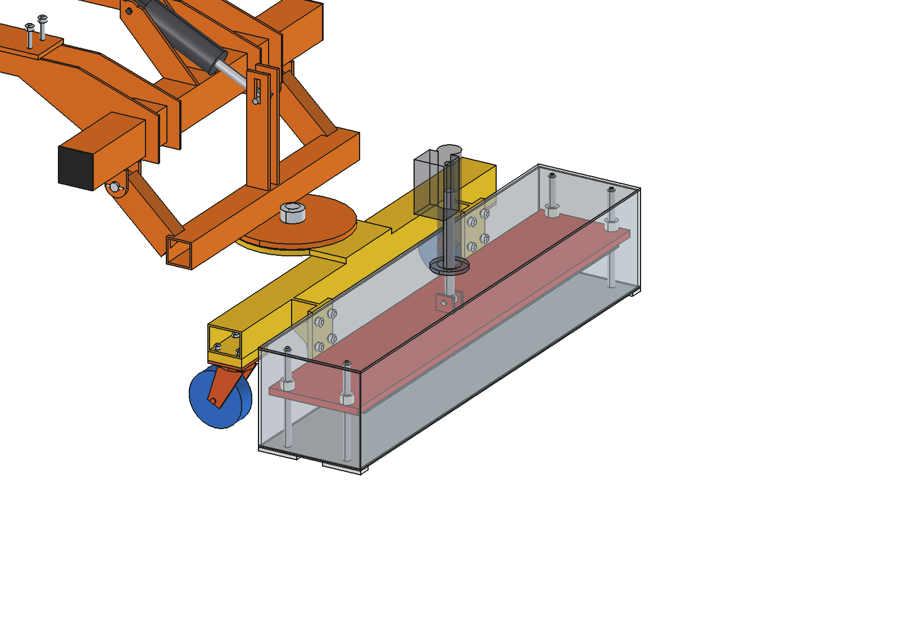

# Magnet sweeper (simple)

Flat permanent magnet that the Bruut OpenAgbot (standard robot) carries 20 mm over grassland, festival fields, paths
and yards to pick up loose iron: nails, screws, tent pegs, wire, nuts and bottle caps, before they end up in the feed,
in a mower or in a tyre. It is a closed aluminium box 1100 x 240 mm with a stainless (non-magnetic) bottom; inside, a
magnet core of 2 rows of NdFeB blocks lies on that bottom. The iron sticks to the underside of the box. **Emptying**:
the robot drives the box over a flat collecting tray (10 mm high) at the field edge and a small actuator lifts the
core 100 mm inside the box: the field at the bottom collapses and the iron drops into the tray. Nothing scrapes or
touches the iron and the arms do not have to lift.

The head goes on the front toolbar, lift arms, carrier and king pin of the
[push blade](../../push%20blade/simple/README.md) and runs on the castor wheels of the
[broom](../../broom%20sweeper/simple/README.md) (both imported, not copied).

<p align="center">
  
</p>

| Work (on the castors, skin 20 mm over the floor) | Emptying: core up, box over the tray |
| --- | --- |
|  |  |
|  |  |
|  |  |
|  |  |

## Build

- **Mount, lift arms, carrier, king pin, lock pin, lift actuator**: from `push blade/simple`, with the 3000 N
  actuator of the broom (the head is ~99 kg on the arms). Lock pin in the middle hole: the box runs straight.
- **Castors**: 2 swivel castors O125 x 40 PU under the cross beam at x +-450, as on the broom.
- **Head frame** (weldment): swivel plate O260 x 12, spine plate, cross beam 80 x 60 x 4 and 2 brackets
  (side plate 10 mm + flange 80 x 10) that hold the box 70 mm in front of the beam, so the castors can swivel round
  when reversing. 2 x 2 M10 (A2 stainless, non-magnetic) through flange and rear wall.
- **Box**: aluminium 5754, walls 4 mm, lid 5 mm; bottom (skin) stainless 304, 3 mm; 4 PE skids 8 mm under the
  corners (they touch only on bumps).
- **Magnet core**: steel back plate 1070 x 210 x 15 with 2 rows of 10 NdFeB N35 blocks 100 x 100 x 10 (NiCuNi,
  glued and potted), front row north down, rear row south down. It slides on 4 stainless guide rods O16 in PE bushes.
- **Release actuator**: 24 V, 3000 N, stroke 100 on the lid; rod with an eye on a clevis on the back plate.
  Extended = core down (work), retracted = core up (release).
- **Collecting tray** (not on the robot): PE tray 1200 x 320 x 10 at the field edge.

Mass ~125 kg (lift group 99 kg, of which the core 42 kg; mount 22 kg). Size 1100 x 1160 x 682 mm (x, y, z).

## Key figures (`mgs_calc.report()`)

| | |
| --- | --- |
| Field under a row | 140 mT at the skin, 104 mT at the floor (24 mm), 77 mT at 39 mm (part in the grass), 20 mT with the core lifted |
| Pick-up reach (pull > 2 x weight), nail 3 x 70 | 35 mm at the weakest place across the face, 56 mm at the best (46 / 69 mm at 1 x weight) |
| Bottle cap / M10 nut / steel tent peg | 29-47 / 38-60 / 33-53 mm |
| On a hard floor (24 mm) | all parts over the whole width |
| In mown grass (part 15 mm into the thatch, 39 mm) | under the poles; a second pass shifted 50 mm takes the rest |
| Release | the pull drops to 0.1-0.25 x the weight: all parts fall off; ~1350 N needed (core 410 N + 75 nails on the poles), 3000 N actuator, ~17 s |
| Work rate | 0.95 m effective at 1.2 m/s: ~4100 m2/h (0.41 ha/h); ~2.2 ha per battery charge (~350 W) |
| Emptying | every ~0.75 ha at 4 kg iron per ha (3 kg on the skin), about every 110 min |
| Drag on grass | ~195 N (hub motors 1100 N continuous) |
| Axle load front / rear, working | 44 / 91 kg, 146 kg on the castors |
| Axle load, **lifted, no ballast** | 287 / -5 kg: tips forward; 4 plates (44 kg) for a short hop over a kerb (rear 12 %) |
| Lift actuator | ~2875 N, 3000 N rating |

**Use**: drive the field in overlapping passes on the castors (pass pattern and logging of the covered area as with
the field marker); empty over the tray at the field edge without lifting. Lift only over a kerb or threshold, and only
with at least 4 counterweight plates on the rear stacks ([counterweights](../../counterweights/simple/README.md)).

Why and how these come out: see [RATIONALE.md](RATIONALE.md), including the list *Estimated, not measured*.

## Files

| File | Contents |
| --- | --- |
| `mgs_params.py` | all dimensions; push-blade and broom interface from `pbl_params` / `bsw_params`, magnet and work parameters, masses from the model |
| `mgs_parts.py` | one function per head part (castors from `bsw_parts`), robot coordinates, work pose |
| `build_mgs.py` | model tree (mount, lift and actuator from build_pbl), `set_pose(lift, core)`, checks (`check_interference`, `check_holes`, `check_poses`, `clearance`, `ground_contact`), mass, `render_all()`, STEP |
| `mgs_calc.py` | 2D magnet field and pull per part, reach, release force, axle loads and ballast, actuator, drag, work rate |
| `run_in_freecad.py` | reload, build, print the key figures |
| `Magnet_Sweeper.FCStd`, `Magnet_Sweeper.step` | generated model (robot hidden in the FCStd) |
| `previews/` | images |

## Use

```python
exec(open(r"F:\veldrobot\aanbouwdelen\magnet sweeper\simple\run_in_freecad.py").read())
import build_mgs
build_mgs.set_pose(lift=0, core=1)   # release: core lifted
build_mgs.check_poses()              # lift -4..18 x core down/up x steering -30..30: must be {}
build_mgs.clearance()                # 148 mm to the front tyres (carrier, lift -4)
```

No animation (simple variant): the poses are checked statically with `check_poses()`.
