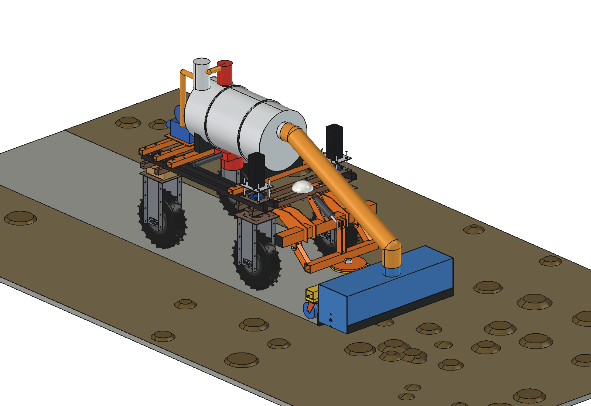
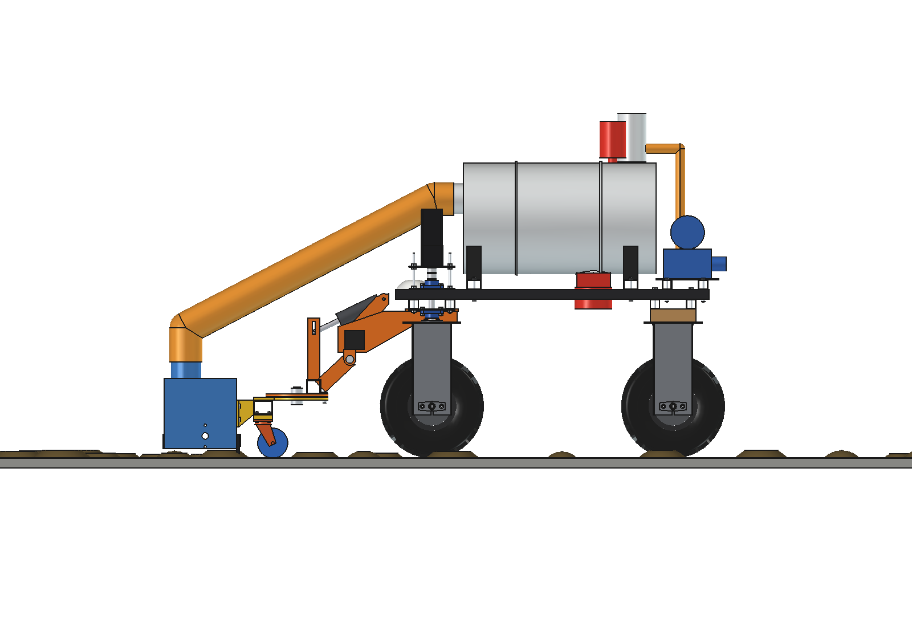
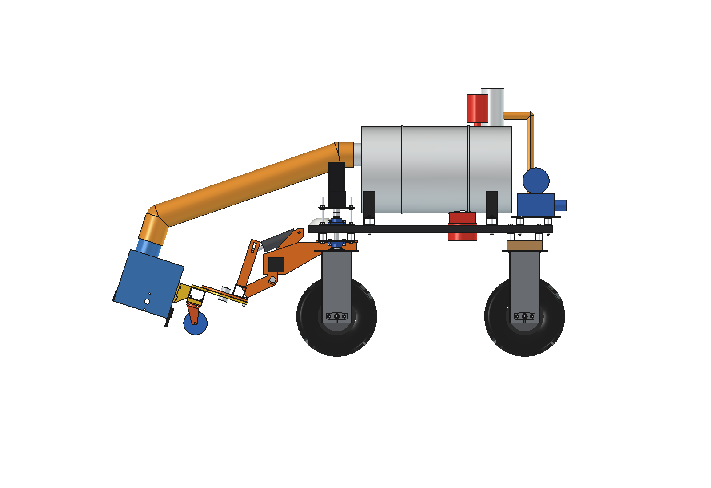
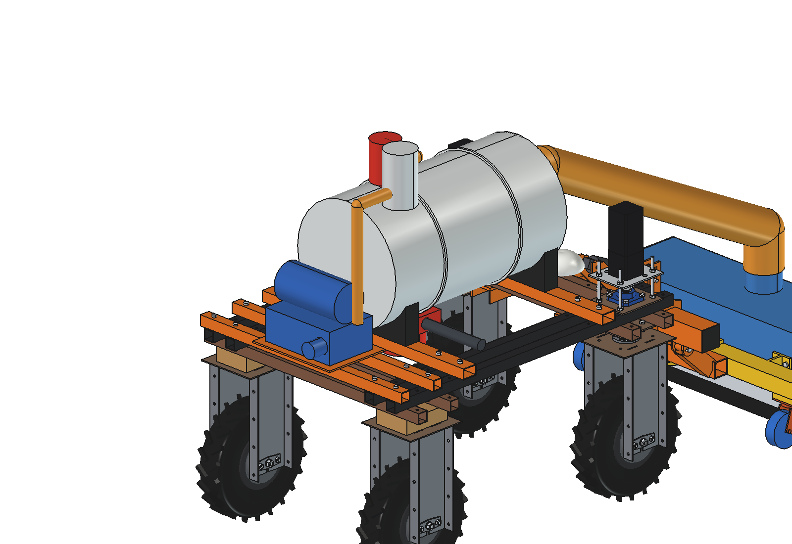
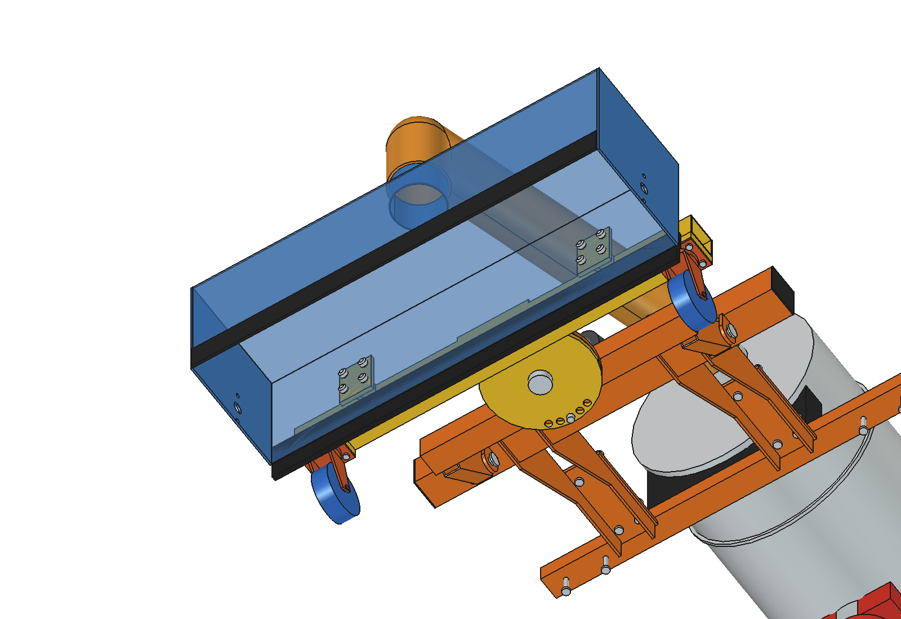
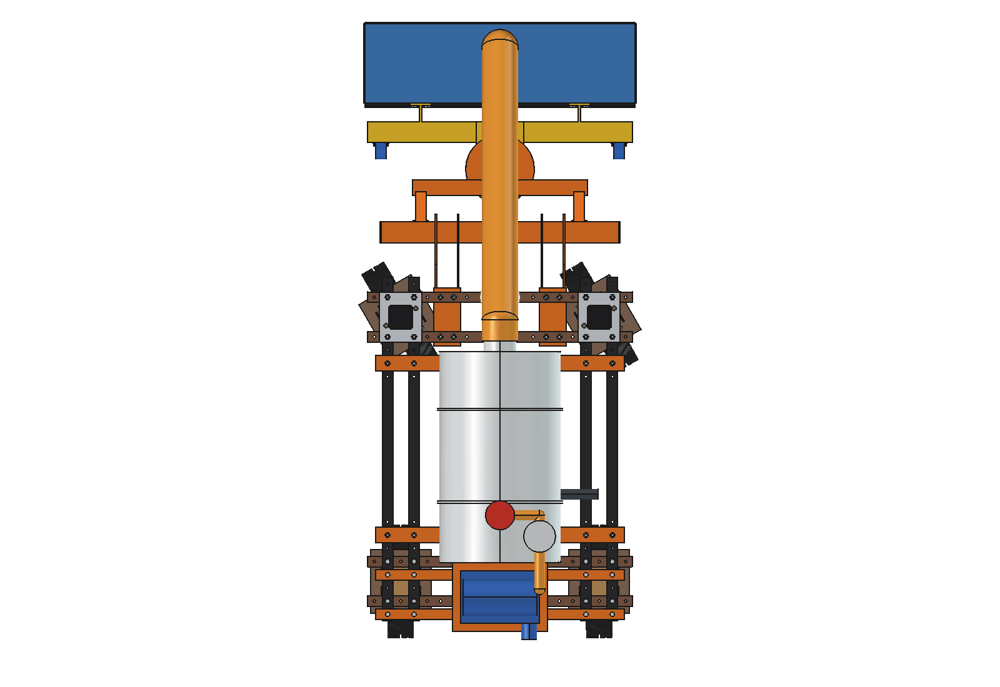

# Manure vacuum collector (simple): FreeCAD model

Sucks fresh manure from a solid barn floor into a tank and empties it at the pit, instead of pushing it along the
alley. Built from the [debris vacuum](../../debris%20vacuum/simple/README.md) (imported, not copied):

- **Nozzle in front**: the debris vacuum's steel hood (1 m) on the magnet sweeper's head frame and castors, the push
  blade's lift arms, king pin and actuator, and the same PU hose O125, **without the brush roller**. A **rubber
  squeegee lip** (12 mm) on the rear wall presses 5 mm into the floor line and gathers the manure in the hood; the
  front flap rides 40 mm high so the manure gets in.
- **Vacuum tank** on the upper beams: stainless 2.5 mm cylinder O460 × 800 (130 l) with 2 stiffening rings, on PE
  saddles on the debris vacuum's cross bars; the hose enters at the same inlet stub as the debris bin.
- **Float valve and moisture trap** on the tank top: when the tank is full the float closes the suction line, so no
  liquid reaches the pump.
- **Rotary-vane vacuum pump** (oil-free, 48 V, ~0.9 kW, 60 m³/h) on a shelf behind the tank (2 cross tubes on the
  upper beams at y −475 / −625).
- **Knife-gate dump valve** O150 under the tank with a 24 V actuator: over the pit grid it opens, the pump can blow
  the tank empty (reversed) or the manure runs out by gravity.

Why it is designed this way: [RATIONALE.md](RATIONALE.md).

| | | |
| --- | --- | --- |
|  |  |  |
| side, collecting | nozzle lifted 18° | tank, float valve, trap, pump, dump valve |
|  |  | |
| nozzle from below: squeegee lip | front wheels at 30° | |

## Key figures

From the model (`build_mvc.mass_properties`, checks) and `mvc_calc.report()`.

| | |
| --- | --- |
| Mass | 182 kg empty (mount 23 kg, nozzle on the lift 61 kg, tank with pump and valves 90 kg); +133 kg manure full |
| Tank | 130 l; fills in ~6 min at 0.25 m/s with 1.5 l/m² on a 1 m strip: ~87 m of alley per load |
| Vacuum | 0.5 bar in ~5 s; it lifts manure up to ~5 m, so the 0.7 m up to the tank is easy |
| Herd of 100 | ~2200 l/day on the alleys: ~17 loads, ~9 min per cycle (60 m to the pit): ~2.5 h/day |
| Energy | ~1.1 kW collecting, ~2.8 kWh/day: ~1.5 charges a day (docking at the charger between rounds) |
| Axle loads, full | 476 kg in all: front 313 / rear 163 kg (the nozzle and the mount are in front) |
| Grip | wet concrete µ 0.3: 1330 N for ~340 N of lip drag and rolling: margin 3.9 |
| Size | 1030 × 2336 × 1434 mm |

Checks: `check_interference()` = [], `check_holes()` = {} (the shelf and cross-bar bolts in the upper-beam holes),
`check_poses()` = {} (lift −4 / 0 / 9 / 18° × steering −30 / 0 / 30°).

## Files

| File | Contents |
| --- | --- |
| `mvc_params.py` | all dimensions and work figures; imports `dvc_params` |
| `mvc_parts.py` | flap, squeegee lip and clamp, tank, saddles, float valve, trap, vacuum hoses, shelf, pump, dump valve, scene |
| `build_mvc.py` | model (mount, lift, head, castors, hose from `build_dvc` / `dvc_parts`), `set_pose`, checks, mass, `render_all` |
| `mvc_calc.py` | fill time, pump-down, lift height, loads per day, axle loads, grip, energy |
| `run_in_freecad.py` | reload, build, print the report |
| `Manure_Vacuum.FCStd`, `.step` | generated |

## Estimated, not measured

- 1.5 l of manure per m² of alley between cleanings, 55 l per cow per day with 40 % on the alleys, 60 m to the pit.
- Pump 60 m³/h and 0.9 kW, lip drag 150 N, floor grip 0.3, rolling 0.04, robot 161.5 kg.
- Front axle 313 kg full: the hub motors and front tyres of the standard robot are not rated here; a heavier robot
  (XL) or a 100 l tank is the safer choice for daily use.
