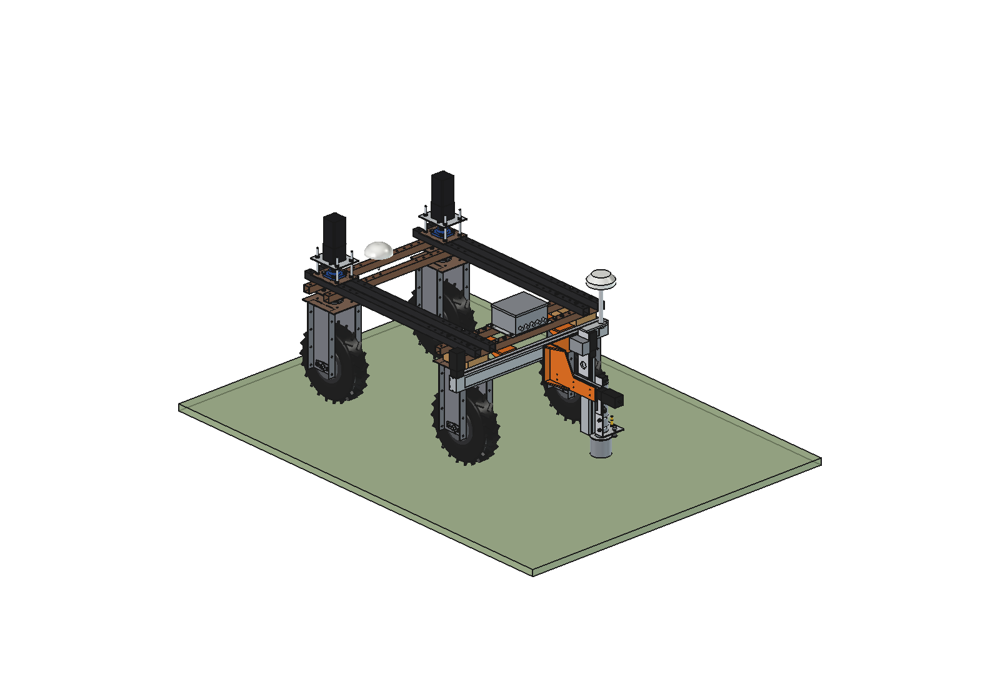
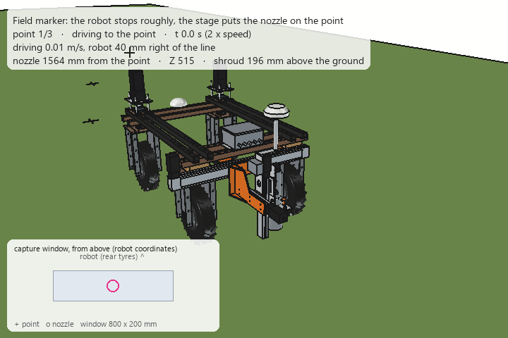

# Field marker for the Bruut

Implement that **stakes out points in the field from a coordinate list**: it drives to each point and marks the exact
spot with paint, a flag, a peg or a pilot hole. Typical jobs are pile and post positions on a building site, planting
positions in a tree nursery or orchard, fence lines, solar-park pile positions and the corners of trial plots.

The robot only has to stop *roughly* on the point. A small **XYZ stage behind the robot** (long X axis across the
driving direction, short Y axis, Z axis down to the ground) puts the tool on the exact spot. The position of the tool
is measured directly by a GNSS antenna (or a total-station prism) on a mast **straight above the tool tip**, so the
robot works like a surveyor holding a rover pole.

| | Variant | Contents |
| --- | --- | --- |
| [Simple](simple/README.md) | `simple/` | FreeCAD model: XYZ stage from 3 bought linear modules, spray-paint head with a sprung shroud, GNSS mast above the nozzle; calculations, animation, parts list (≈ €1,450); why: [RATIONALE](simple/RATIONALE.md) |





This README sets out the idea, the requirements and all the functions such a machine can have. The
[simple variant](simple/) is the first model: paint only, built as simply as possible.

**Jump to:** [Use cases](#use-cases) · [Concept](#concept) · [Accuracy](#accuracy) · [Marking heads](#marking-heads) ·
[More functions](#more-functions) · [Requirements](#requirements) · [Workflow](#workflow-and-software) ·
[Capacity](#capacity-estimated) · [Variants](#variants) · [Design decisions](#design-decisions)

---

## Use cases

| Application | What is marked | Typical tolerance (check the job spec) | Head |
| --- | --- | --- | --- |
| Building site | pile positions, building corners (as offset pegs), foundation outlines, drill points for ground anchors | 10–50 mm | peg, paint, punch |
| Solar park | ram-pile positions of ground-mounted PV tables, often thousands per site | 20–50 mm | paint, flag |
| Fencing | post positions at equal spacing along a line, corner and gate posts | 20–50 mm | paint, punch |
| Tree nursery, orchard, agroforestry | planting positions in a row or grid, drill points for planting holes, stake positions | 20–30 mm | flag, punch, paint |
| Trial plots (agriculture, research) | plot corners, plot numbers, sample points, the same spots again every season | 20 mm | peg, paint |
| Utilities and drainage | cable and pipe routes, drain lines, valve and manhole positions | 50 mm | paint (lines), RFID marker |
| Sports fields and events | lines, corners, goal and tent positions | 10–20 mm | paint |
| Archaeology, soil research | excavation grid pegs, borehole and sample positions | 20 mm | peg, probe |

## Concept

### Top view

```
                    front (+y)
          FL ┌────────────────────────┐ FR      robot GNSS antenna on the front cross beam
             │           ◯            │         (navigation, and the second end of the heading baseline)
             │                        │
             │         Bruut          │
             │                        │
          RL └────────────────────────┘ RR
        ═════════════════╤══════════════════════   X axis behind the rear tyres, stroke 800 (tool x ±400)
                         │                          (module 1050 long: about as wide as the robot)
                     ┌───┴───┐  Y slide ±100 mm
                     │   ◎   │  mast + tool tip on the same vertical line
                     └───────┘
              ◄────── capture window: X ±400, Y ±100 around the nominal tool point ──────►
```

### Carriage (side view)

```
         ◯   GNSS antenna or 360° prism, about 1 m above the ground
         │   mast, fixed to the Y carriage (moves in X and Y, not in Z)
   ┌─────┴─────┐
   │ IMU       │  Y carriage on the X carriage, on the X beam
   │   Z axis  │  stroke 300 mm (simple): park 200 mm above the ground, reach 100 mm below it
   │     │     │
   └─────┼─────┘
       [===]     quick-change plate + marking head (paint, flag, peg, punch, probe, ...)
         ▼       tool tip: senses the ground (touch-off) before it marks
```

### Why it is built like this

- **The robot cannot stop exactly.** Hub motors on lugged tyres in soft soil stop within a few centimetres at best, and
  creeping in millimetre steps is not reliable. The stage takes over the last part: the robot stops anywhere inside the
  capture window and the stage moves the tool onto the point. Robot positioning and marking accuracy are decoupled.
- **A long X axis** (across the driving direction) does more than correct: the robot does not have to drive exactly
  on the line, and it can mark two neighbouring points across the row (up to 0.8 m apart) from one stop. Reaching
  outside the tyres sounds useful but does not work with a linear module: the module is always ≈ 250 mm longer than its
  stroke, so its end would hit the fence before the tool gets there. The simple model keeps the module about as wide
  as the robot.
- **A short Y axis** (±100 mm) corrects the stopping error in the driving direction. A longer Y stroke is not needed:
  the robot can always drive a bit further.
- **Antenna above the tool.** With the antenna (or prism) on the carriage, right above the tool tip, the horizontal
  lever arm between the measured point and the tool is almost zero. A heading error then hardly matters; only the tilt
  of the robot has to be corrected, with an IMU on the carriage. The robot's own antenna stays on the front beam; the
  two receivers together give a moving-baseline heading (about 1.5 m baseline) for navigation.
- **At the rear.** Marks are made behind the robot and the robot drives on forwards, so it never drives over a flag or
  peg it has just placed. The rear is free of the steering stacks and stepper motors at the front, and the operator can
  see the marks and reload the magazines.
- **Bought linear modules** instead of profile + rails + belts (as on the [dockweed drill](../dockweed%20drill/)):
  aligned, sealed and bolt-on. All three axes use the same NEMA 23 closed-loop motor, Y and Z the same module.

### Mounting

Behind the rear wheel units, on the 50 mm hole grid: two identical welded hangers under the two rear lower beams
(4 × M10 each, at x ±175/225, the same holes as the brush hangers). The base of the X module bolts to their flanges.
Nominal tool point at y = −900; at the front-most Y position everything stays ≥ 19 mm behind the rear tyres
(y = −716). All values are in `mrk_params.py` and are taken from `agbot_params.py`, so the design can be adapted to the
XL and the slim robot.

## Accuracy

"Exact" means: as exact as the position source. The budget below is estimated (1σ, per point, robot at standstill).

| Source | RTK GNSS | Robotic total station |
| --- | --- | --- |
| Position of the antenna or prism | ≈ 10 mm (fixed solution, base station within ~10 km; worse under trees and near buildings) | ≈ 2 mm |
| Tilt of the robot, corrected with an IMU of ±0.1° at 1 m mast height (uncorrected: 3° roll = 52 mm!) | 1.7 mm | 1.7 mm |
| Heading error 0.5° × lever arm antenna → tool (0 in the simple model: the mast is on the nozzle axis) | 0 mm | 0 mm |
| Stage: backlash, deflection, belt stretch | 1 mm | 1 mm |
| Tool and ground: paint dot centre, flag wire bending in grass, peg in stones | 3–5 mm | 3 mm |
| **Total (root sum square), 1σ** | **≈ 11 mm** | **≈ 4 mm** |
| **Target, 95 % of the points** (simple model with paint: 21 / 8 mm, `mrk_calc.accuracy()`) | **≤ 25 mm** | **≤ 10 mm** |

With the robot's own antenna instead of the mast (1.5 m from the nozzle) the heading term alone is 13 mm and the
95 % figure becomes ≈ 34 mm: that is why the mast antenna is worth its €320.

Notes:

- Averaging the position for a few seconds at standstill removes noise, not multipath. Under trees, next to buildings or
  in a hall the GNSS result is not good enough: use the total station there.
- The **touch-off** matters on a tilted robot: when the robot rolls 3°, a tool tip that goes 200 mm down moves 10 mm
  sideways. The Z axis senses the ground (in the simple model: a sprung spray shroud and an inductive sensor; for
  heavier heads the motor current or a load cell), and the stage position is corrected for the real contact height
  before the tool goes into the soil.
- GNSS **height** is about twice as uncertain as the horizontal position (≈ 20 mm). Good enough for rough grade pegs
  and ground level maps, not for finished floor levels.
- Before every job: **site calibration** on two or more known control points (similarity transformation to the site
  grid), and a **control point check** at the start and end of the job, both stored in the log.

## Marking heads

All heads fit the same quick-change plate on the Z axis (in the simple model: 2 pins in keyholes and 2 star knobs, no
tools; plus a connector for power and signals). The controller reads which head is fitted (resistor or ID chip) and
refuses jobs the head cannot do.

| Head | How it works | Mark | Notes |
| --- | --- | --- | --- |
| **Paint** (in the simple model) | upside-down marking spray can (500 ml) in a PVC 75 guide, pressed onto its nozzle by a servo lever, sprung PVC 110 shroud on the ground; later also a pressurised paint tank with a solenoid valve and a fan nozzle | dot (Ø ≈ 57), cross, circle, arrow, point number, lines | ≈ 450 dots per can (estimated). Biodegradable or turf paint for grassland and sports fields. The X/Y stage can "plot" a cross, a circle with the pile diameter or a 3-digit number next to the point |
| **Flag** | magazine with wire survey flags (wire 450–600 mm), a gripper pushes the wire into the soil | coloured flag | cheap, visible from far away, colour per point code. Magazine of 50–100 flags |
| **Peg** | magazine with wooden or plastic pegs (e.g. 25 × 25 × 300), pilot spike first, then pressed in | peg | press force is limited (see R5); in hard soil the peg is vibrated in. Magazine of 10–20 pegs |
| **Punch / dibber** | pointed punch Ø20–40, pressed 100–200 mm deep | hole | pilot hole for a post or a stake, or a planting hole for whips and cuttings |
| **Lime / chalk** | small hopper with a metering roller | powder dot or line | classic outline marking on a building site, no paint residue in the field |
| **Small auger** | electric auger Ø50–100, up to 300 mm deep | hole | planting holes, pilot holes. A bigger auger (Ø150+) needs its own implement (torque, reaction force) |
| **Soil probe** | gouge auger 0–30 cm, pushed in and pulled out | sample | see [More functions](#more-functions) |
| **Pointer** | tip with a cross-line laser pointing down | none | finds and shows a point for a person, measures existing points (touch) |

Point codes in the job file select the head and the mark style, for example `PILE` → peg + paint circle,
`TREE` → orange flag, `CORNER` → offset pegs at 1 m on both lines.

## More functions

The marker is in fact a **precise point platform**: a robot that brings a tool to an exact spot and records what it
did. Besides staking out it can do the following.

### Surveying and checking

1. **Survey-in / as-built**: put the pointer tip on an existing peg, nail, post or borehole and store its coordinates.
   Measure an existing fence, tree row or drain end without a surveyor walking the field.
2. **Check existing marks**: drive past all points of an earlier job, look down with the camera on the carriage, detect
   the mark and measure its offset. Result: a list of pegs that were knocked over or moved by machines.
3. **Ground level map**: the touch-off on every point gives the ground height relative to the antenna. Combined with the
   GNSS height this gives a terrain map (≈ 20 mm) for drainage, levelling or before/after comparison of earthworks.
4. **Grade pegs**: drive a peg until its top is at a design height (e.g. NAP level of a future ground level). Accuracy
   limited by the GNSS height, so for rough grading.
5. **Photo per point**: the downward camera takes a picture of every mark with point ID, time and deviation, as proof
   for the client.
6. **Find again**: drive to a stored point and stand over it with the laser pointer: a buried drain end, a valve, a
   lost marker, a dead tree that has to be replaced.

### Soil

7. **Soil sampling** with a gouge probe at georeferenced points or along a sampling pattern, with numbered sample
   positions. Next year the robot takes the samples at exactly the same spots.
8. **Penetrometer**: a cone pushed in at constant speed (about 30 mm/s) with a load cell on the Z axis gives the
   cone index against depth: a compaction map of the field. The press force (R5) limits the range to about 2.5–3 MPa
   with a 1 cm² cone, which covers the level where roots get into trouble.
9. **Spot sensor readings**: push in a moisture, EC or temperature probe, read, pull out. Or install permanent sensor
   stations at exact positions.

### Planting and placing

10. **Precision planting and sowing at points**: dibber hole, then drop a seed, acorn, nut, bulb or cutting. For tree
    nurseries, agroforestry rows and reforestation trials.
11. **Buried electronic markers**: bury a passive RFID or ball marker above a drain, cable, valve or tree position, so it
    can be found later with a locator even when all visible marks are gone.
12. **Pilot holes for posts and stakes**, followed later by a separate post-driver implement on the same coordinates.

### Lines and layout

13. **Line marking while driving**: paint a continuous line; the X axis keeps the nozzle on the design line while the
    robot itself wanders ±100 mm. Straight lines, curves, offsets, utility routes, sports field lines.
14. **Fly-by marking**: for dense patterns with a lower tolerance (e.g. planting grid of 1 × 1 m), paint dots without
    stopping. The X axis follows the cross-track error, the nozzle fires a valve latency (10–20 ms) ahead of the point.
15. **Floor layout on concrete** (shed, barn, slab) with the total station: wall lines, anchor and drill points, text.
16. **Mark trees or plants**: spray a coloured dot on a stem (tilted paint head) for lifting, sale or removal, or mark
    weed patches and dock plants for a human crew or a follow-up implement such as the dockweed drill.

### Job handling

17. **Clean-up**: pull the flags out again after the job, with the flag gripper in reverse.
18. **Route planning that respects marks**: the planner orders the points (row by row or shortest route) and never puts
    a wheel track over a point that is already marked.
19. **Offset marking**: when the real point will be dug out, mark offset pegs on the lines through the point
    (e.g. 1 m outside the excavation), as surveyors do.
20. **Multi-robot**: a big solar or tree-nursery job split over several robots with one shared job file and progress.

## Requirements

### Functional

| # | Requirement | Value (first estimate) |
| --- | --- | --- |
| F1 | Horizontal accuracy of the mark, 95 % of the points | ≤ 25 mm with RTK GNSS, ≤ 10 mm with a robotic total station |
| F2 | Capture window (robot stops anywhere inside) | X ±400 mm, Y ±100 mm around the nominal tool point |
| F3 | Z stroke | simple (paint): 300 mm, park 200 mm above the ground, reach 100 mm below it. Heads that go into the soil (punch, probe): ≈ 500 mm |
| F4 | Ground contact | touch-off on every point, contact point corrected for tilt |
| F5 | Heads | paint, flag, peg, punch as a minimum; changing a head ≤ 1 min, without tools |
| F6 | Quality gate | only mark with an RTK fix (or a total-station lock) and an IMU at rest; re-measure when the deviation is above the tolerance; stop the job when the control point check fails |
| F7 | Log per point | design and as-marked coordinates, deviation, fix status, head, time, photo |
| F8 | Capacity | ≥ 200 points per hour at 3 m spacing with paint (see [Capacity](#capacity-estimated)) |
| F9 | Robots | standard, XL and slim, through `mrk_params.py` |

### Robot and mounting

| # | Requirement |
| --- | --- |
| R1 | Power from the robot battery (48 V); stage motors through a DC-DC converter (48 → 36 V, the LiFePO4 pack reaches 58 V) |
| R2 | Bolted on the 50 mm hole grid of the rear lower beams, no drilling or welding on the robot |
| R3 | Tool and mast stay clear of the rear tyres over the whole stage range (simple model: ≥ 19 mm) |
| R4 | Interlock: the robot only drives with the Z axis up and the head parked |
| R5 | Press force ≤ ≈ 350 N: a downward tool force at y = −1000 unloads the rear axle by 1.5 × the force, and the rear wheels have to keep grip (robot 161.5 kg, estimated) |
| R6 | Second GNSS receiver on the mast, together with the robot antenna as a moving baseline for heading. Optional 360° prism on the same mast |
| R7 | Implement mass as low as possible; the simple model is 35 kg and the front axle keeps 45 % of the load |

### Construction and maintenance

| # | Requirement |
| --- | --- |
| B1 | Bought, readily available parts: linear modules with NEMA 23 closed-loop steppers (the same motor on all axes), PVC drain pipe, U-bolts, hobby servo, M12 sensor |
| B2 | Plate parts laser cut (DXF), only straight lines and arcs |
| B3 | Rails and belts covered (brush strip or bellows) against dust, mud and paint mist; electronics IP65 |
| B4 | Every head can be cleaned or emptied without removing the stage |

## Workflow and software

1. **Prepare the job** at the office, for example in QGIS or from the CAD drawing of the contractor.
   Input: CSV (`id, E, N, H, code`), GeoJSON, GeoPackage or Shapefile, DXF (points, blocks, polylines → points at a set
   spacing), LandXML, KML.
2. **Coordinate systems**: RD New + NAP (EPSG:28992 / 7415, through RDNAPTRANS™), ETRS89 / UTM 31N (EPSG:25831),
   WGS84, or a local site grid from the site calibration.
3. **Site calibration and control check** on known points (see [Accuracy](#accuracy)).
4. **Per point**:
   1. drive so that the point falls inside the capture window, stop;
   2. settle (1–2 s), check the RTK fix, the age of the corrections and the IMU;
   3. average position and attitude for 2–3 s;
   4. compute the target in robot coordinates → stage X and Y; outside the window → reposition the robot;
   5. move the stage, measure again with the mast antenna (closed loop, one correction step);
   6. lower Z to touch-off, correct for the contact height, mark;
   7. raise Z, photo, write the log line, next point.
5. **Report**: as-marked file (CSV, GeoJSON, DXF), deviation statistics, photos, control point checks, as an HTML or
   PDF report for the client.
6. **Live view**: progress on a map in a browser, pause, skip or redo a point, reload a magazine.

Corrections: NTRIP from a network RTK service or from an own base station (the same one the robot uses).

## Capacity (estimated)

Points at 3 m spacing in a row, robot at 0.5 m/s (`mrk_calc.cycle()`; flag and peg with the same stage and an
estimated marking time):

| Head | Drive | Settle + measure | Stage | Z down + up | Mark | Photo + log | Per point | Points per hour |
| --- | --- | --- | --- | --- | --- | --- | --- | --- |
| Paint, stop-and-mark (simple model) | 7.0 s | 4.0 s | 0.7 s | 3.7 s | 0.9 s | 0.5 s | 16.8 s | ≈ 215 |
| Paint, fly-by at 0.3 m/s (dot 45 mm longer) | 10 s | – | – | – | – | – | 10 s | ≈ 360 |
| Flag | 7.0 s | 4.0 s | 0.7 s | 3.7 s | 3 s | 0.5 s | ≈ 19 s | ≈ 190 |
| Peg | 7.0 s | 4.0 s | 0.7 s | 3.7 s | 8 s | 0.5 s | ≈ 24 s | ≈ 150 |

Plus reloading: a 500 ml spray can lasts roughly 450 dots (estimated), a flag magazine 50–100 points, a peg magazine
10–20. Standing still to measure is the biggest item after driving: a receiver that holds a stable fix sooner is the
cheapest way to more points per hour.

## Variants

| Variant | Folder | Contents |
| --- | --- | --- |
| Simple (built) | [`simple/`](simple/) | X + Y + Z stage from bought linear modules (X belt 800, Y/Z ball screw 200/300), paint head with a spray can, servo and sprung shroud (touch-off), mast with its own GNSS receiver above the nozzle, IMU / inclinometer. Paint only, ≈ €1,450 in parts |
| Advanced (planned) | `advanced/` | the same stage with more heads on the quick-change plate (flag, peg, punch, soil probe, pointer) and magazines, a downward camera, 360° prism for a total station, paint tank for lines, drag chains and covers, `mrk_kin.py` for the full robot pose (GNSS + IMU) → stage set points |

## Design decisions

Taken in the simple model (the reasons are in [simple/RATIONALE.md](simple/RATIONALE.md)):

- **Rear, not between the axles.** Under the chassis the tool would be sheltered, but the stroke is limited to the
  650 mm between the tyres and the robot would drive over standing flags.
- **X belt module, Y and Z ball-screw modules.** A belt is light and fast over 800 mm and only has to hold position;
  the short Y and Z axes get a stiff ball screw. Y and Z are the same module, all three motors are the same.
- **X stroke 800, not 1100.** A longer module sticks out far beyond the robot and its end, not the tool, would reach a
  fence first.
- **Spray can, not a tank.** No pump, hoses or cleaning; every builders' merchant sells the cans. A tank comes with line
  marking (advanced).
- **Own receiver on the mast.** It removes the heading error (13 mm) and gives a heading at standstill.

## Safety and responsibility

- The robot's own safety stops apply; the stage and Z axis add pinch points: covers and a low Z speed near the ground.
- Paint mist: use low-pressure nozzles, no marking in strong wind.
- **A mark is not a utility check.** In the Netherlands a KLIC notification is required before digging or drilling;
  the marker does not replace it.
- On a building site the contractor or surveyor remains responsible for the stake-out. The log with control point
  checks and photos makes their check easier, not unnecessary.

## Comparable machines

For orientation: commercial stake-out and layout robots exist, for example Civ Robotics CivDot (construction and solar),
TinyMobileRobots TinySurveyor (outdoor marking), Turf Tank (sports field lines), HP SitePrint and Dusty Robotics
(indoor floor layout). This design aims at the same tasks on an open, cheap and modular robot, with a physical stage
instead of steering the whole robot onto the point.

## Estimated, not measured

- Robot mass (161.5 kg) and centre of gravity: they set the maximum press force (R5).
- RTK accuracy at the actual site (base distance, multipath, trees).
- IMU tilt accuracy at standstill (assumed ±0.1°).
- Stopping accuracy of the robot (sets the capture window F2).
- Valve and servo latency of the paint head (10–20 ms assumed).
- Paint consumption per dot, flag and peg push force in different soils, soil penetration resistance.
- Masses and dimensions of the bought linear modules (simple model: 35 kg in total).

The full list for the simple model is in [simple/README.md](simple/README.md#estimated-not-measured).
