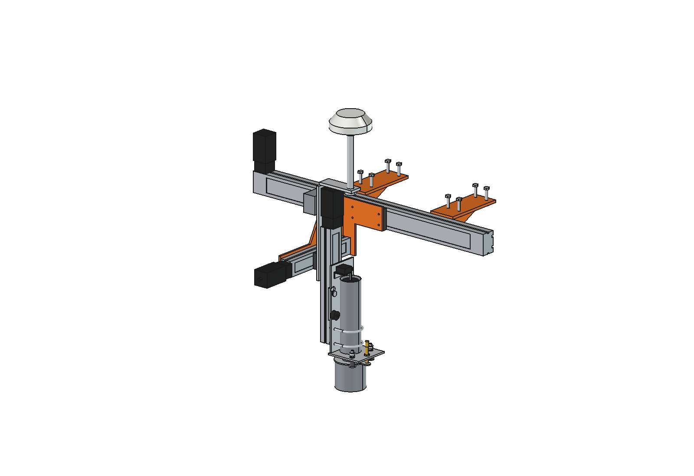
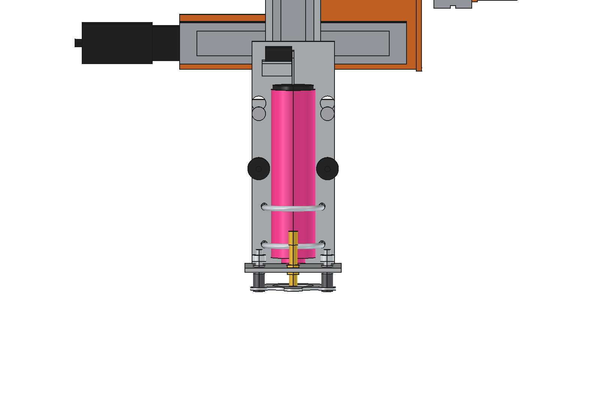
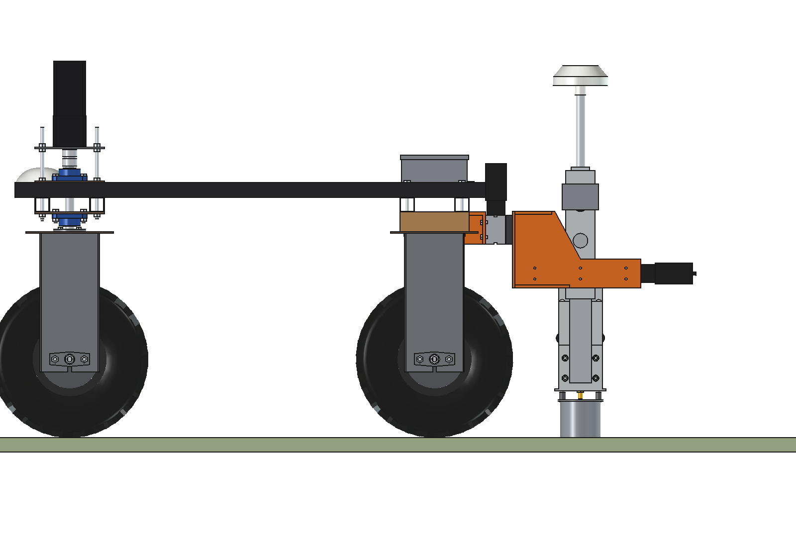
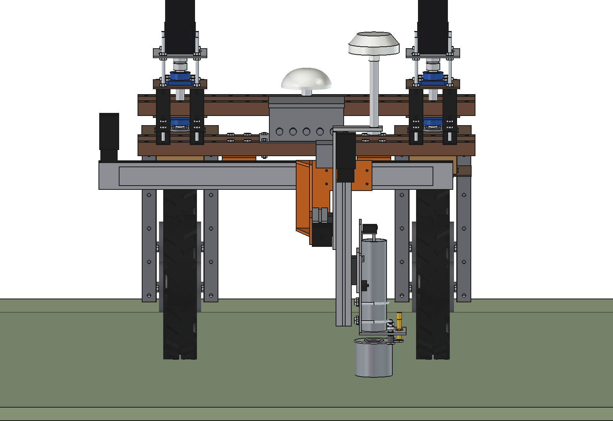
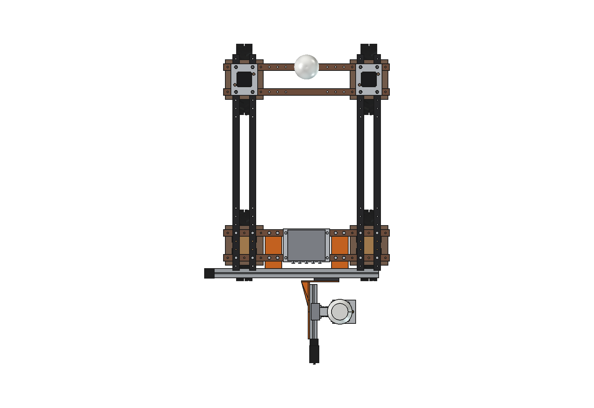

# Field marker (simple): FreeCAD model

Marks points in the field with spray paint, at a position given by coordinates, behind the standard Bruut OpenAgbot.
The robot only has to stop **roughly** behind the point. A stage built from three bought linear modules then puts the
nozzle **exactly** on it:

- **X** (across, belt module, stroke 800): the nozzle reaches from x −400 to +400, as wide as the robot;
- **Y** (along, ball-screw module, stroke 200): the robot may stop up to 100 mm too early or too late;
- **Z** (up/down, the same ball-screw module, stroke 300): lowers the paint head until it touches the ground.

The paint head is an upside-down **marking-spray can** in a PVC drain pipe. A waterproof servo pushes the can 5 mm down
onto its nozzle and it sprays. Under the head hangs a sprung **spray shroud** (PVC 110): it rests on the ground while
spraying (wind shield, clean round dot, always the same nozzle height) and an inductive sensor sees it lift, so the Z
axis knows where the ground is. A **second GNSS antenna** stands on a mast straight above the nozzle: the robot
measures where the nozzle really is, like a surveyor with a rover pole.

Everything is bought or laser cut: three linear modules with NEMA 23 closed-loop motors, standard PVC pipe, U-bolts,
star knobs, a hobby servo, an M12 proximity sensor. The steel parts (2 hangers, 1 bracket) are laser cut and welded,
the aluminium plates are laser cut; one plate is bent. Nothing to machine, nothing to drill in the robot.

Why it is designed this way is explained in [RATIONALE.md](RATIONALE.md); the concept and all other functions in the
[marker README](../README.md).


*The robot stops 60 mm too early, 75 mm too far and 30 mm too far, 40 mm right of the line; each time the stage
moves the nozzle onto the point (panel bottom left: the capture window seen from above). Twice real speed.*

| | | |
| --- | --- | --- |
|  |  |  |
| stage without the robot: X module, steel bracket, Y and Z module, mast | paint head: PVC guide, U-bolts, servo, shroud on 2 sprung rods, sensor | head with the pipes hidden: spray can, pusher, lever, nozzle seat |
|  |  |  |
| side view: nozzle on the ground at y −900 | from behind | from above: X module behind the rear wheels |

## Key figures

From the model (`build_mrk.mass_properties`, `check_fit`, `size`) and `mrk_calc.report()`. Robot 161.5 kg
(agbot comparison, not weighed).

| | |
| --- | --- |
| Reach of the nozzle (capture window) | x −400 … +400, y −800 … −1000 (800 × 200 mm), behind the rear tyres |
| Z | shroud from 196 mm above to 104 mm below the ground (uneven ground, robot pitch) |
| Mass | 35 kg (fixed part 18 kg, moving in X 17.5 kg, in Y 8.6 kg, in Z 3.1 kg) |
| Overall size | 1050 × 817 × 870 mm (x × y × z); antenna at 985 mm |
| Clearance to the rear tyres | ≥ 19 mm over the whole stroke; hangers 16 mm from the wheel brackets |
| Accuracy, 95 % of the points (estimated) | ≈ 21 mm with RTK GNSS, ≈ 8 mm with a robotic total station (prism on the mast) |
| Without tilt correction | 3° roll = 52 mm off: the IMU / inclinometer is not optional |
| Dot | Ø ≈ 57 mm, nozzle 134 mm above the ground; ≈ 450 dots per 500 ml can (estimated) |
| Cycle at 3 m spacing | drive 7.0 s, settle + measure 4.0 s, stage 0.7 s, Z down 2.2 s, spray 0.9 s, Z up 1.5 s, photo 0.5 s = 16.8 s → **≈ 215 points per hour** |
| X drive | 55 N, 0.88 Nm on the pulley (1.4 × reserve at 1.2 Nm), 300 rpm |
| Y, Z drive | 29 N / 54 N, a few hundredths of a Nm on the ball screw: the motors are oversized on purpose (same motor everywhere, heavier heads later) |
| Press force | Z can push 1350 N: limited in the driver to 300 N. At 356 N the rear axle loses half its load |
| Axle loads | rear 109 kg, front 88 kg (45 % front) |
| Hangers | 320 N per rear M10 (× 144 safe, with × 2 for shocks); X module bends 0.04 mm |
| Power | ≈ 63 W for the marker; ≈ 9 h on a full battery with driving |

## How a point is marked

1. The job is a list of points (CSV, GeoJSON, DXF, …). The robot drives so that the next point comes within the
   capture window and stops (it does not need to be closer than ±100 mm in y and ±400 mm in x).
2. Standstill 1.5 s, then 2.5 s averaging: RTK fix, mast antenna position, tilt from the IMU / inclinometer.
3. The point in robot coordinates → X and Y set points; both modules move together (0.7 s).
4. Z down quickly to 40 mm above the expected ground, then slowly (40 mm/s) until the sensor sees the shroud lift
   (≈ 5 mm). The Z position at that moment is the ground height; X/Y are corrected for the tilt × contact height.
5. Servo presses the can for 0.6 s.
6. Z up, photo, log line (design point, measured nozzle position, deviation, fix status, time).

Fly-by (no stop) is possible for lower tolerances: shroud up, the X axis follows the line, the servo fires a valve
latency before the point. At 0.3 m/s the dot becomes ≈ 45 mm longer.

## Parts list

Quantities for one marker. Prices are rough estimates (2026) to give an idea of the total, not quotes.

| Qty | Part | Specification | Where to get it | Price (est.) |
| --- | --- | --- | --- | --- |
| 1 | Linear module X | belt drive, 80 mm wide profile, stroke 800, carriage ≈ 80 × 150, motor mount for NEMA 23, dust cover | CNC/automation web shops ("belt linear module 80 800 mm") | €180 |
| 2 | Linear module Y, Z | ball screw SFU1605, 60 mm wide, cover strip, stroke 200 (Y) and 300 (Z), inline motor mount NEMA 23 | same shop, same type | €2 × 110 |
| 3 | Stepper motor + driver | NEMA 23 closed loop 2.2 Nm with encoder, driver 24–50 V (Z: version with 24 V brake recommended) | CNC shops | €3 × 75 |
| 1 | GNSS receiver | multiband RTK (e.g. u-blox ZED-F9P board), moving base with the robot's receiver | RTK shops (ArduSimple, SparkFun, …) | €220 |
| 1 | GNSS antenna | multiband survey antenna, 5/8"-11 thread | same | €100 |
| 1 | Inclinometer / IMU | 2-axis, ≤ 0.1° at standstill (e.g. Murata SCL3300 board) | electronics shops | €40 |
| 1 | Servo | 35 kg·cm, waterproof (IP67), metal gears | RC / robotics shops | €30 |
| 1 | Proximity sensor | inductive M12, non-flush, Sn 4 mm, PNP, M12 connector | automation shops | €15 |
| 1 | PVC drain pipe 75 × 1.8 | 270 mm (can guide) | builders' merchant | €5 |
| 1 | PVC pipe 110 × 3.2 | 100 mm (spray shroud) | builders' merchant | €5 |
| 2 | U-bolt M8 for 76 mm pipe | with nuts and washers | hardware store (exhaust clamps) | €4 |
| 2 | Stainless rod Ø10 | 55 mm, M6 thread in one end | hardware store | €4 |
| 2 + 2 + 2 | Flanged bushing 10 × 12 × 10, compression spring Ø17, free length ≈ 36, ≈ 1 N/mm, solid ≤ 18; shaft collar Ø10 | | bearing / hardware store | €15 |
| 2 + 2 | Shoulder bolt Ø12 (hook pins), star knob M8 with stud | | hardware store | €12 |
| 1 | Control box | IP66 ≈ 220 × 180 × 100, microcontroller, DC-DC 48 → 36 V 10 A, fuses, cable glands | electronics shops | €120 |
| 1 | Aluminium tube 25 × 2 | 220 mm (mast) + shaft collar Ø25 | hardware store | €10 |
| | Laser-cut steel S235 | 2 hangers (top plate 10, web 8, flange 8 mm), XY bracket (adapter 8, Y plate 8, 2 gussets 8 mm) | laser cutter, weld yourself | €120 |
| | Laser-cut aluminium | Z adapter 10, mast bracket 10, head mount 8, head plate 6 (bent), shroud ring 4, servo bracket 3, lever 3 mm | laser cutter (with bending) | €90 |
| | Bolts | 8 × M10 × 60 (hangers), 8 × M8 × 20 + T-slot nuts (X module), M6 and M5 for the modules and plates | hardware store | €20 |
| | Marking spray | 500 ml upside-down marking paint (fluorescent; turf-friendly for grassland) | builders' merchant | €6 per can |
| | | | **total, roughly** | **≈ €1,450** |

## Making it

- **Laser cutting:** all plates are flat contours with holes (no machining). The welded steel parts come with
  tabs and slots so they hold themselves while welding: the hanger (top plate + web + flange) and the XY bracket
  (adapter plate + Y plate + 2 gussets). Weld, then drill/ream the holes in the adapter plate to the hole pattern of
  your X carriage if it differs.
- **Bending:** the head plate (6 mm aluminium) has one 90° bend: vertical leg on the head mount, horizontal leg under
  the tube (nozzle seat, bushings, sensor).
- **PVC:** cut to length with a hand saw; the shroud is screwed to the ring with 3 small screws.
- **Assembly order:** hangers on the robot → X module on the hangers (T-slot nuts) → XY bracket on the X carriage →
  Y module on the Y plate → Z adapter on the Y carriage → Z module → head mount → head. The head hangs on 2 pins and
  is held by 2 star knobs: no tools to take it off.
- **Cables:** a drag chain 15 × 30 on top of the X module to the XY bracket, and a short one along the Y module
  (not modelled). The receiver + IMU box sits on the Z adapter, so the antenna cable is only 0.3 m long.

## Calibration

| What | How |
| --- | --- |
| Home position | each module has an inductive home switch; home after switching on and after a stall |
| Nozzle under the antenna | spray a dot, measure it with a survey pole / total station; the offset goes in the config (should be < 2 mm by construction) |
| IMU / inclinometer offset | mark the same point twice, the second time with the robot turned 180°; half the difference is the tilt offset × mast height |
| Control points | at the start and end of every job, put the nozzle on a known point and log the difference (see the concept README) |

## Files

| File | Contents |
| --- | --- |
| `Field_Marker.FCStd` | the model, with the robot model hidden next to it. Generated, so do not edit by hand |
| `Field_Marker.step` | the marker only, in robot coordinates |
| `mrk_params.py` | all dimensions, the robot interface, the strokes, the stack offsets, the head and the operating parameters |
| `mrk_parts.py` | one function per part; each returns a `Part` shape in robot coordinates (reference pose: nozzle at x 0, y −900, parked) |
| `build_mrk.py` | model tree with the moving slides, colours, `set_pose`, collision check over the whole stroke, clearance, mass, images, STEP |
| `mrk_calc.py` | accuracy budget, axle loads and press force, drives, spray dot, cycle time and capacity, hangers, power (pure Python) |
| `animate_mrk.py` | animation: robot + marker on grass, three points with stop errors |
| `make_gif_mrk.py` | frames to GIF with a caption and the capture-window panel |
| `run_in_freecad.py` | macro: open in FreeCAD and run (F6) to rebuild and print the key figures |
| `previews/` | images and the GIF |

## Axes

Same as the robot model: x = right, y = driving direction (front = +y), z = up, ground = z 0, mm. The origin is the
centre of the robot.

- X module: base against the hangers at y −640, z 530 … 610, x −616 … +435 (drive end with the motor at −x).
- Nozzle axis: x −400 … +400, y −800 … −1000 (nominal −900). The mast and antenna are on the same axis.
- Z carriage centre `zc` 215 … 515; the shroud touches flat ground at `zc` 319 (`P.zc_for_ground()`).

## Rebuilding and using

In FreeCAD's Python console (folder in `sys.path`, or via `run_in_freecad.py`):

```python
import build_mrk
build_mrk.build()                                  # builds, saves FCStd and STEP (robot hidden)
build_mrk.set_pose(x=300, y=-950, zc=build_mrk.P.ZC_WORK, lift=6)   # move the stage (only the slides move)
build_mrk.set_pose()                               # back to the reference pose
build_mrk.check_interference()                     # overlap in the current pose (must be empty)
build_mrk.check_fit()                              # overlap over the whole stroke, 74 poses (must be empty)
build_mrk.clearance()                              # smallest distance to the rear tyres and wheel brackets
build_mrk.mass_properties()                        # mass and centre of gravity
build_mrk.render_all()                             # all images in previews/, save FCStd + STEP
```

```python
import mrk_calc
mrk_calc.report()                                  # key figures
mrk_calc.accuracy("ts")                            # error budget with a total station
mrk_calc.cycle(spacing=1.0)                        # time per point for a 1 m grid
mrk_calc.axle_loads(press=300)                     # with a heavier head pressing on the ground
```

## Animation

Builds a separate document `Marker_on_robot_animation` with the robot from `agbot design` (not modified), the marker,
grass, three design points (black crosses) and the paint dots. The robot drives at 0.5 m/s and stops 60 mm too
early, 75 mm too far and 30 mm too far, 40 mm right of the line. Per point: settle and measure, stage to the point,
Z down until the shroud lifts 6 mm, spray, Z up. Timing from `mrk_calc` (the same as the capacity figure).
Frames at 5 per second of real time; the GIF plays at 10 fps (2 × speed).

```python
import animate_mrk
animate_mrk.build()
animate_mrk.play()                                 # live, animate_mrk.stop()
animate_mrk.summary()                              # time per point, stage set points, all inside the window?
animate_mrk.check_fit()                            # overlap in every stage pose of the run (must be empty)
animate_mrk.render_all(r"C:\temp\mrk_frames")
import make_gif_mrk
make_gif_mrk.main(r"C:\temp\mrk_frames", r"previews\animation_staking_out.gif")
```

## Model tree

```
Field_marker (field_marker_simple)
  Mount          2 hangers (top plate 10 + web 8 + flange 8 mm, welded), 8 x M10 into the beams, 8 x M8 into the
                 X module; control box on the rear lower beams
  X_axis         belt linear module 80, L1050, motor standing up at -x
  X_slide        moves in x: X carriage, XY bracket (adapter plate, Y plate, 2 gussets), Y module + motor
    Y_slide      moves in y: Y carriage, Z adapter, Z module + motor, mast bracket, mast, antenna, receiver box
      Z_slide    moves in z: Z carriage, head mount plate, 2 hook pins, 2 star knobs
        Head     bent head plate, PVC guide tube, spray can, pusher, 2 U-bolts, servo + bracket + lever,
                 bushings, springs, M12 sensor
          Shroud moves up on touch-off: ring, PVC 110 shroud, 2 rods, 2 collars
Robot (hidden in the FCStd; for checking only)
```

## Maintenance

- **Can:** loosen nothing: lift the servo lever, pull the can up out of the tube, put a new one in. Clean the nozzle
  seat and the inside of the shroud with a rag now and then (paint mist).
- **Modules:** wipe the cover strips; grease the ball screws twice a season (grease nipple on the carriage). Park the
  stage in the middle and Z up for transport; the Z motor holds with its brake (or its detent torque).
- **Shroud:** if the dot gets oval, the shroud does not sit flat: check that the rods slide freely in the bushings.
- **Spares that fit everything:** one NEMA 23 + driver, one ball-screw module (Y and Z are the same type).

## Estimated, not measured

- Robot: 161.5 kg, centre of gravity y +95, z 543 (agbots/agbot comparison, not weighed). Sets the press force limit.
- Masses of the bought parts: belt module 5.5 kg/m + carriage 0.8 kg, ball-screw module 4 kg/m + carriage 0.35 kg,
  motor 1.4 kg, antenna 0.45 kg, control box 3 kg. Module dimensions are generic (check with the supplier and adjust
  `xm_*` / `sm_*`).
- Accuracy: RTK 10 mm (1σ, fixed, base < 10 km), total station 2 mm, IMU 0.1°, heading 0.5°, stage 1 mm, dot centre
  3 mm.
- Paint: 60–80 m of 50 mm line per 500 ml can, spray cone 22°, overspray factor 3 → ≈ 450 dots per can.
- Friction of the carriages 20 N, ball-screw efficiency 0.9, X profile I = 90 cm⁴; usable motor torque 1.2 Nm at speed,
  detent 0.06 Nm.
- Shroud springs ≈ 1 N/mm, 10 N preload; the sensor switches after ≈ 5 mm lift; solid after 8 mm.
- Time per point: settle 1.5 s, measure 2.5 s (depends on the receiver and on how long the fix needs to be stable).
- Power: 15 W per motor holding, servo 10 W, GNSS 3 W, controller 5 W; driving 150 W average.

See RATIONALE § 9.
