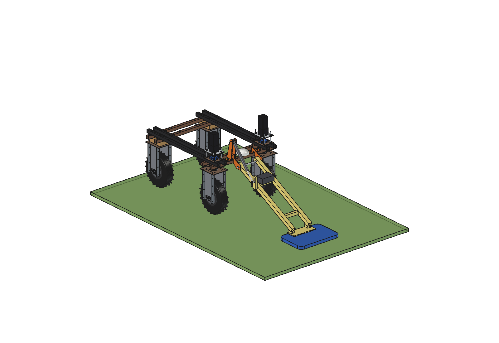
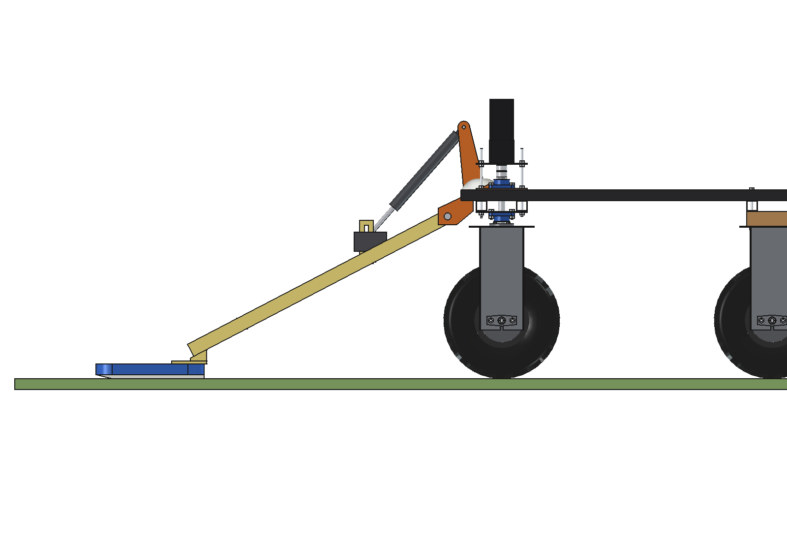
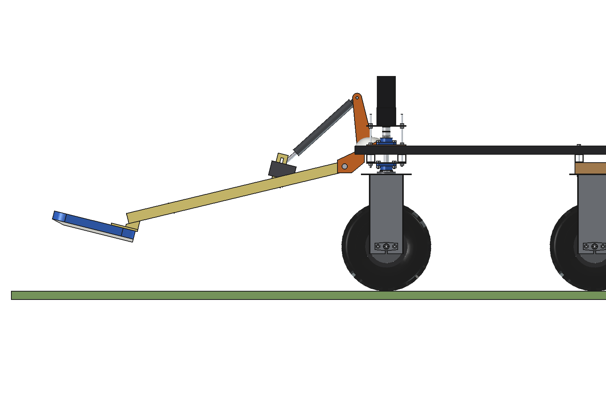
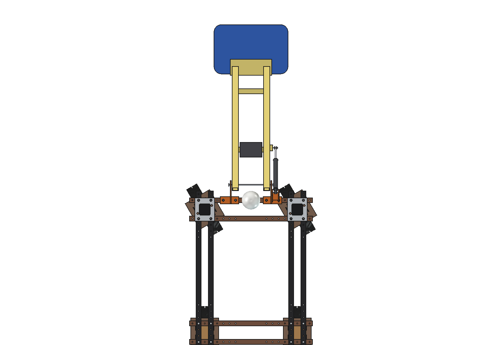
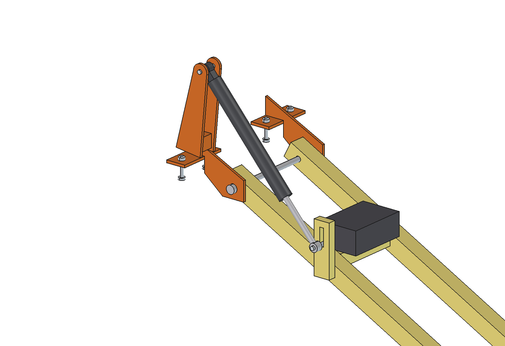
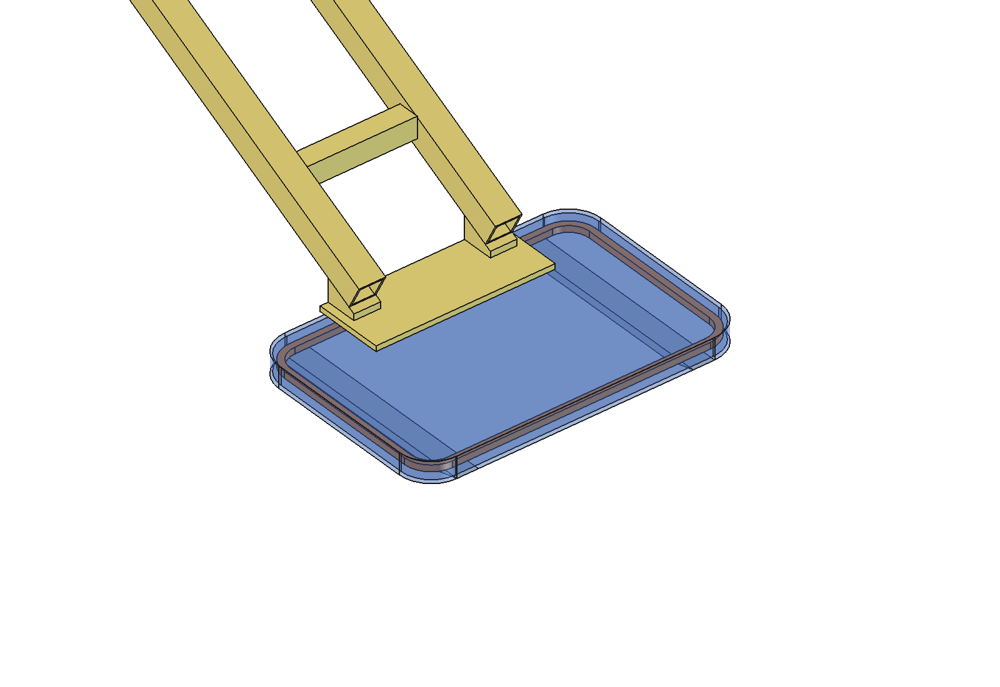

# Metal detector (simple)

Pulse-induction (PI) metal detector for the Bruut OpenAgbot (standard robot). It maps buried and hidden metal in
grassland and arable fields (drink cans, fence wire, horseshoes, bolts, tent pegs, plough points) and logs a GNSS point
with the signal strength at every hit. The map goes to the field marker to stake out the spots, or tells the
[magnet sweeper](../../magnet%20sweeper/simple/README.md) where to drive.

A 600 x 400 mm search coil in an ABS housing slides on 2 PE skids 1.2 m in front of the robot, on a boom of 2 glass
fibre (GFRP) tubes that pivots on 2 small steel brackets on the front outer lower beam. In front of the pivot there is
no metal except the coil itself: GFRP tubes, plates and lug, nylon bolts. A 500 N actuator on the right bracket lifts
the boom at the headland; in work its rod pin floats in a slot, so the coil follows the ground.

<p align="center">
  
</p>

| Work (coil on its skids) | Lifted 14 degrees (headland, transport) |
| --- | --- |
|  |  |
|  |  |



## Build

- **Root brackets** (steel, 2 x): base plate 150 x 60 x 8 with 2 M10 into the grid holes (x +-125, +-225) of the front
  outer lower beam, side plate 8 mm down to the pivot (y 700, z 600) in front of the beam. Clear of the GNSS mount at
  x 0. Pivot pin O16 stainless through both side plates and both boom tubes (nylon bushes).
- **Boom**: 2 GFRP square tubes 50 x 50 x 4 (x +-127), 2 GFRP cross tubes 40 x 40 x 4, a GFRP carrier plate 10 mm with
  2 wedges on the coil housing.
- **Search coil**: mono loop 600 x 400 (24 turns 0.6 mm litz) in an ABS housing 40 mm high, 2 PE skids 15 mm with a
  turned-up nose. Coil plane 35 mm over the ground.
- **Electronics**: PI board (400 pulses/s, 16 averaged: 25 samples/s) in an IP67 box on the rear cross tube, 24 V
  from the robot; logger with the robot's RTK-GNSS.
- **Lift actuator**: 24 V 500 N, stroke 100, on a mast welded to the right bracket; rod pin in a 40 mm slot in a GFRP
  lug on the right tube (float).

Mass ~18 kg (boom 9.7 kg, brackets, pin and actuator 8.1 kg). Size 600 x 1455 x 952 mm (x, y, z).

## Key figures (`mdt_calc.report()`)

| | |
| --- | --- |
| Detection depth (below the ground) | drink can ~490 mm, horseshoe ~420, 1 m coil of fence wire ~600, plough point ~710, bolt M10 / bottle cap / tent peg ~150 mm |
| Nails | not reliably: a 600 mm coil is too big for a nail (a O250 coil would see one to ~45 mm); surface nails are the job of the magnet sweeper |
| Robot steel | coil 1.31 m from the front lower beam; the changing part of the robot signal is 5 % of the threshold (needs >= 0.97 m) |
| Nearest steel to the winding | 1.02 m (left bracket, bounding box) |
| Sampling | 25 samples/s, every 40 mm at 1 m/s, ~10 samples while a target passes under the coil |
| Position of a hit | ~0.10 m (RTK 20 mm, heading 1 degree over the 1.23 m lever arm 21 mm, signal peak along the coil 100 mm) |
| Work rate | 0.5 m swath at 1 m/s: 1800 m2/h (0.18 ha/h); ~186 W, ~10 h and ~1.8 ha per charge |
| Axle load front / rear, working | 93 / 78 kg, 6 kg on the skids |
| Lift actuator | ~400 N, 500 N rating, 47 mm of the stroke, ~3 s |
| Clearance to the front tyres | 238 mm (steering 30 degrees, lifted) |

Why and how these come out: see [RATIONALE.md](RATIONALE.md), including the list *Estimated, not measured*.

## Files

| File | Contents |
| --- | --- |
| `mdt_params.py` | all dimensions, detection model, work parameters, masses from the model |
| `mdt_parts.py` | one function per part, robot coordinates, work pose; `actuator(lift)` |
| `build_mdt.py` | model tree (Mount, Boom about the pivot, Actuator), `set_pose(lift)`, checks (`check_interference`, `check_holes`, `check_poses`, `clearance`, `ground_contact`), mass, `render_all()`, STEP |
| `mdt_calc.py` | detection depth per target, robot interference, sampling, position error, axle loads, actuator, drag, work rate |
| `run_in_freecad.py` | reload, build, print the key figures |
| `Metal_Detector.FCStd`, `Metal_Detector.step` | generated model (robot hidden in the FCStd) |
| `previews/` | images |

## Use

```python
exec(open(r"F:\veldrobot\aanbouwdelen\metal detector\simple\run_in_freecad.py").read())
import build_mdt
build_mdt.set_pose(lift=14)
build_mdt.check_poses()        # lift -3..14 x steering -30..30: must be {}
build_mdt.clearance()          # tyres 238 mm, winding 1.02 m from the nearest steel
```

No animation (simple variant): the poses are checked statically with `check_poses()`.
