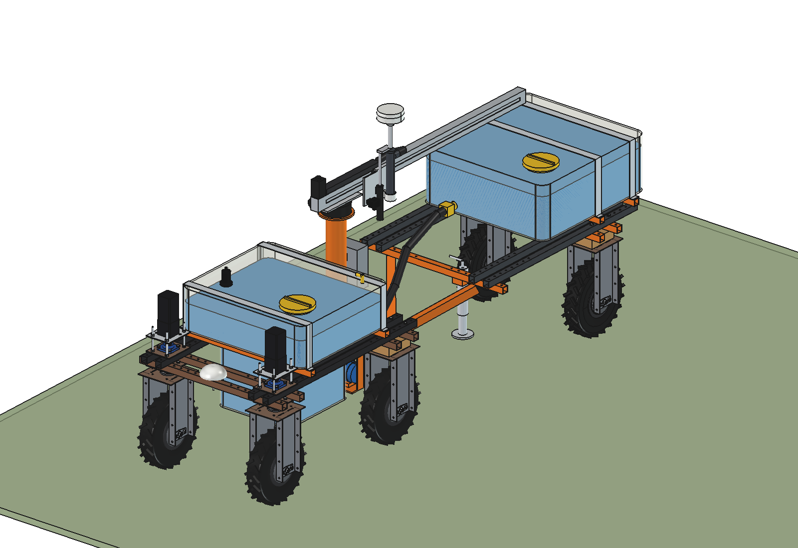
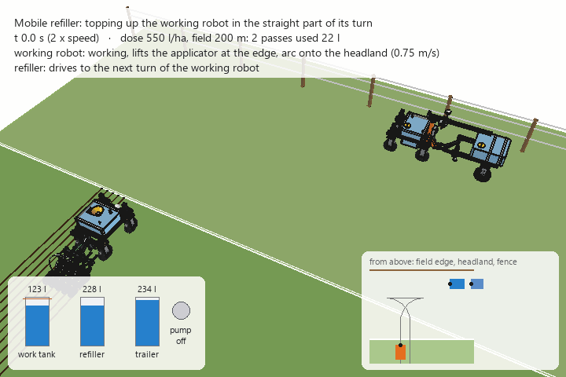

# Mobile refiller for the Bruut

A **support robot** that brings what the working robots use up — liquid fertilizer, water, seed, granular fertilizer,
paint, batteries — out to them in the field, so they never have to drive back to the farm. It is a Bruut OpenAgbot with
a tank (or hopper), a pump (or auger) and a **boom with a spout**. A **RTK antenna sits straight above the spout**, so
the robot knows where the spout is to the centimetre, and a **camera next to it** confirms that the spout is above the
filler opening before anything flows.

The trick is *when* it refills: a small working robot has to turn at every headland anyway. With a turn with three points (forward
arc, straight reverse along the headland, forward arc into the next pass) there is a straight piece of 3.8 m in every
turn. The refiller waits beside that straight, puts its spout in the funnel of the working robot and **drives along
while it pumps**. The working robot only stands still for about 3 seconds and never leaves the field. The refiller only
drives along the headland, or to the robot when that is easier.

| | Variant | Contents |
| --- | --- | --- |
| [Liquid](liquid/README.md) | `liquid/` | FreeCAD model: T-shaped 268 l tank, 24 V transfer pump, slewing boom with trolley and spout, RTK antenna and camera on the spout, powered trailer of 246 l (6 driven wheels in total), receiver kit for the working robot; calculations, animation of a refill in the turn; why: [RATIONALE](liquid/RATIONALE.md) |
| Granular / seed | concept (below) | auger instead of pump, hopper instead of tank, same boom, spout and positioning |
| Stationary / on a tractor | concept (below) | the same spout head with RTK and camera on a fixed buffer at the field edge (gravity) or on a tractor / telehandler |





*The working robot (orange, liquid fertilizer applicator) lifts its applicator, turns onto the headland and stops.
The refiller (blue) has already swung its boom over the spot. Spout down, pump on, both drive along the headland; the
work tank is full after 9 s, spout up, boom back. The working robot turns into its next pass, the refiller reverses to
the place of the next turn. Twice real speed.*

**Jump to:** [Why](#why-a-refiller) · [How a refill in the turn works](#how-a-refill-in-the-turn-works) ·
[Modes](#modes-of-operation) · [Use cases](#use-cases) · [The machine](#the-machine) ·
[Positioning](#positioning-rtk-on-the-spout-camera-for-confirmation) · [More wheels and the trailer](#more-wheels-and-the-trailer) ·
[Variants](#variants) · [Software](#software-and-planning) · [Requirements](#requirements) · [Numbers](#numbers-liquid-variant) ·
[Safety](#safety-and-responsibility) · [Estimated](#estimated-not-measured)

---

## Why a refiller

Small field robots are light on purpose: less soil compaction, cheap, safe, they can work day and night. But a light
robot carries a small tank. The [liquid fertilizer applicator](../liquid%20fertilizer%20applicator/) has a work tank
of about 150 l between the axles. At 505 l/ha that is **0.29 ha, or about 80 minutes of work**. Then the robot has to
go and get more.

| Without a refiller | With a refiller |
| --- | --- |
| The working robot drives to the farm tank every 0.29 ha: 2 × the distance at 1 m/s, filling, back to the exact spot | The working robot never leaves the field; it stops about 3 s per refill |
| Field efficiency 89 % (farm tank 200 m away), 80 % (500 m), 69 % (1 km), 53 % (2 km) | Field efficiency of the working robot does not depend on the distance to the farm |
| A bigger tank on the working robot: more weight on the soil, a higher centre of gravity, the front axle becomes light when the implement is lifted ([RATIONALE applicator § 6](../liquid%20fertilizer%20applicator/advanced/RATIONALE.md)) | The working robot can keep a **small** tank: it is topped up every turn. Lighter, more stable, less compaction where it matters (in the crop) |
| Every working robot needs its own trips | One refiller serves one or more working robots; it drives only on the headland or the farm track, where compaction does not matter as much |
| Big doses (diluted digestate, mineral concentrate: several m³/ha) are not practical with a small robot | The limit becomes the logistics (refiller trips), not the tank of the working robot |

The refiller turns "tank size" from a design limit of the working robot into a logistics question. In the
[applicator rationale](../liquid%20fertilizer%20applicator/advanced/RATIONALE.md) both inspiration sources
(Bartlema/NCOK disc applicator, Fieldworkers fertilizing robot) already named refilling via a docking station or
buffer tank on the headland as the key; this is that buffer, made mobile.

## How a refill in the turn works

### The turn

A Bruut with a 1 m implement cannot make a U-turn to the next pass (the smallest turning circle is 2.1 m). It turns
with three points, as in the [agbot slim](../agbots/) analysis:

```
                         fence / farm track
   ─────────────────────────────────────────────────────────────────────────
        ┌───────┐ boom ┌──────────┐
        │REFILL ├──────┤ TRAILER  │      refiller waits here (outside the turn),
        └───┬───┘      └──────────┘      drives along the straight while it pumps
            │ spout
       ◄════╪═══════════════════  straight reverse along the headland, 3.8 m (R 2.4 m, pass 1 m)
      ╱     ▼  funnel            ╲
     │  arc into the next pass    │  arc onto the headland
     │                            │
   ══╪════════════ field edge ════╪══════════════════════════════════════════
     ▼ next pass                  ▲ pass just finished
```

1. The working robot finishes a pass, lifts its implement at the field edge and drives a forward arc (R 2.4 m) onto
   the headland. It stops with its wheels pointing along the headland.
2. It reverses 3.8 m along the headland (the "straight").
3. It drives a forward arc into the next pass, lowers the implement and works.

The refiller waits **beside the straight, on the outside of the turn**. The corners of the working robot swing up to
0.73 m outside its path in the arcs; with the robots' centre lines 1.45 m apart there is 0.23 m left at that moment and
0.47 m when both drive side by side.

### The refill

1. **Plan.** The working robot sends its tank level and the position of its next turn. The refiller knows where the
   working robot will stop (the end of the first arc) and drives there in time.
2. **Boom out early.** The refiller swings its boom out over the stop point with the spout raised. The head stays
   ~100 mm above the funnel rim of the working robot, so the working robot simply drives in under it.
3. **Confirm.** The working robot stops. The camera on the head sees the fiducial target next to the funnel (an
   ArUco/AprilTag plate) and corrects the spout position by a few centimetres (0.5 s). If the camera does not find the
   target, nothing flows.
4. **Spout down** 185 mm into the funnel (1.9 s), **pump on**.
5. **Drive along.** The working robot reverses along the headland, the refiller drives beside it. The boom follows
   the funnel: slew angle and trolley position from the two RTK positions, every control cycle. When the working robot
   speeds up the refiller lags a few centimetres; the boom takes that up.
6. **Stop when full.** The level sensor in the work tank stops the pump (with a float valve in the funnel as a
   mechanical backup). Spout up, the boom swings back while both are still driving.
7. The working robot turns into its next pass. The refiller reverses with its trailer to the place of the next turn on
   this headland (two passes further, because the turns alternate between both ends of the field).

In the animation: 22 l in 8.9 s at 150 l/min, the working robot stands still 2.7 s before the straight (camera and spout
down, while it sets its wheels straight anyway) and 0.7 s after it (steering for the arc).

### How much fits in one turn

The pump runs for the whole straight: 10.3 s at 150 l/min is **about 25 l per turn**. That has to cover what the
working robot used in two passes (one round trip). Extra standstill needed (liquid variant, 1 m working width):

| Dose | Field 100 m | Field 200 m | Field 400 m |
| --- | --- | --- | --- |
| 100–250 l/ha | 0 s | 0 s | 0 s |
| 505 l/ha (applicator standard) | 0 s | 0 s | 6 s |
| 1000 l/ha | 0 s | 6 s | 22 s |
| 2000 l/ha (diluted digestate) | 6 s | 22 s | 54 s |

A few seconds of extra standstill are still far cheaper than a trip to the farm. For long fields and big doses: a
bigger pump (2", 300 l/min), refill only every other turn with a larger amount, or let the refiller wait at both
headlands (two refillers, or one that crosses over during the long passes).

## Modes of operation

| Mode | When | How |
| --- | --- | --- |
| **Top-up in the turn** (above) | normal field work, every turn or every other turn | refiller drives only on the headland, synchronised with the turn |
| **Drive to the robot** | irregular fields, no headland space, the working robot has an urgent low level, spot work (weeding, marking, soil sampling) | the working robot stops where it is; the refiller drives to it (any heading), docks and fills standing still |
| **Docking station at the field edge** | many robots, long working days, night work | the refiller stands at a fixed spot (or a fixed buffer with the same spout head); the working robots come to it during their turns |
| **Shuttle** | farm tank far away | the refiller (with trailer) shuttles between the farm tank / IBC and the field while the working robot keeps working on its own 80-minute buffer |
| **Fleet** | 2–4 working robots in one field or neighbouring fields | one refiller serves several robots; the planner chooses which turn of which robot it serves next |
| **Stationary buffer** | no refiller robot (yet) | an IBC on a stand at the field edge with an electric valve and the same spout head; flows by gravity |
| **On a tractor or telehandler** | the farm already has a tractor driving to the field anyway | front-loader tank or 3-point-hitch tank with the boom and spout head; the operator drives, the head docks automatically |

## Use cases

### Liquids (this model)

| Product | Working robot | Typical amount | Notes |
| --- | --- | --- | --- |
| Liquid fertilizer: mineral concentrate, UAN, ammonium sulphate solution, liquid fraction of digestate, renure | [liquid fertilizer applicator](../liquid%20fertilizer%20applicator/) | 90–2000 l/ha | the main use; small frequent doses become practical |
| Biostimulants, micronutrients, seaweed extract | sprayer robot, applicator | 50–300 l/ha | small amounts, high value: track every litre |
| Crop protection (spot spraying) | spot-spraying robot | 10–200 l/ha | closed transfer, rinse water on board, operator certification: see [Safety](#safety-and-responsibility) |
| Water for planting, transplanting, young trees | planting robot, tree nursery | 1–10 l per plant | the refiller can also water directly: spout on each planting position (RTK) |
| Water for watering troughs in strip grazing | none (the refiller is the job) | 50–100 l per cow per day | moves with the strip; fills the trough at a fixed time |
| Water for dust suppression on farm tracks and yards | none | | sprays from the spout while driving |
| Water for the dockweed drill or a weeding robot (wet milling, hot water, foam) | dockweed drill, weeding robot | | the same docking principle |
| Wash water / rinse water | all | | clean nozzles, knives and the robot itself at the field edge |
| Additive for silage or slurry (acid, inoculant) | | | |

### Granular, seed and solids (auger variant)

| Product | Working robot | Notes |
| --- | --- | --- |
| Grass seed | [overseeder](../overseeder/) (8 rows) | a 1 m overseeder sows 25–35 kg/ha: a small hopper is enough for a long time; the refiller makes it possible to run several seeders |
| Cover-crop seed, catch-crop mixtures | seeder robot | |
| Granular fertilizer, lime, gypsum | spreader robot | heavier: 100–1000 kg/ha |
| Slug pellets, biological control (granules) | spreader robot | small amounts, high value |
| Bedding material (sawdust, lime, dried manure solids) for cubicles | barn robot | the same refiller works inside the barn (no RTK there: camera + UWB / markers) |
| Feed additives, minerals | [feed pusher auger](../feed%20pusher%20auger/) or a feeding robot | |

### Other things to bring

| What | For | How |
| --- | --- | --- |
| **Batteries** | every robot | swap-battery cassette instead of a tank; the boom becomes a lifting arm, the "funnel" a battery slot with a connector. A mobile charger (battery pack + DC-DC on the refiller) can also charge through a docking connector while the working robot turns |
| Paint cans, flags, pegs | [field marker](../marker/) | magazine instead of a tank |
| Plants, cuttings, trays | planting robot | |
| Tools and spare parts (knives, discs, pump hoses) | all | |

### The other way round: a buffer that collects

The same machine with an empty tank or bin can **take things away** from the working robots: stones from a stone
picker, harvested produce, dock roots from the [dockweed drill](../dockweed%20drill/), soil samples, rinse water. The
working robot unloads into the refiller's hopper at the headland, again during the turn.

## The machine

The liquid variant (see [liquid/](liquid/README.md) for all dimensions, the model and the calculations):

```
            RTK antenna (on the spout axis, moves down with the spout)
               ◯
    boom ══════╪════════════════ ◄── belt linear module, trolley moves out to 1.5 m
       ┃      [▼] spout + camera     (slew 360° on a worm slew drive)
       ┃
   column (hose inside, swivel at the top)
 ┌─────┴─────────────────┐
 │  tank 268 l (T-shape: │      trailer 246 l, 2 driven hub motors
 │  sump between beams)  ├─hitch─┐ ┌──────────────┐
 └──┬───────────────┬────┘       └─┤   tank       │
   (O)   pump      (O)              └──(O)────────┘
```

- **Base:** an unmodified Bruut OpenAgbot. Everything bolts to the 50 mm hole grid of the beams.
- **Tank:** rotomoulded PE, upper part on two cradle tubes on the upper beams, a sump down between the beams. Low
  centre of gravity and the pump below the liquid level (always primed).
- **Pump:** 24 V centrifugal transfer pump hanging under the rear beams; electric ball valves to choose the robot tank
  or the trailer tank.
- **Boom:** column at the rear of the robot, worm slew drive, an 80 mm belt linear module as boom with a trolley. The
  hose goes up inside the column through a swivel. Polar reach: any point 0.35–1.5 m from the column, all round.
- **Head:** spout (PP 50) moved 185 mm down by a 24 V actuator, camera looking down, RTK antenna on a short mast on
  the spout cap.
- **Trailer:** a robot chassis without front units: same beams, same rear wheel units with hub motors (driven), tank,
  A-frame drawbar with an eye on a vertical pin.
- **Receiver kit on the working robot:** work tank on the same cradle, funnel Ø300 with a strainer, a fiducial target
  plate next to it, an ultrasonic level sensor, vent.

## Positioning: RTK on the spout, camera for confirmation

- **The antenna sits on the spout axis.** The robot's own antenna sits on its front beam; the spout is up to 1.5 m away
  on a rotating boom. A heading error of 1° would already put the spout 26 mm off. With an antenna straight above the
  spout the horizontal lever arm is zero: the spout position is measured, not calculated through the robot pose, the
  slew angle and the boom deflection. Only the tilt matters (IMU in the head).
- **Both robots are on the same RTK base**, so their positions are consistent with each other to ±2 cm even if the base
  itself is off.
- **The camera is the second, independent check.** It looks down past the spout at the fiducial plate next to the
  funnel. It confirms "this is the right robot, the funnel is under me" (the tag carries an ID) and corrects the last
  few centimetres. No tag in view, no flow.
- **Tolerance.** The funnel is Ø300: the spout may be 125 mm off at the rim and 73 mm at the tip when lowered. With
  GNSS only the error is about 45 mm (2σ, estimated), with the camera about 15 mm.
- **Level and flow.** Ultrasonic level sensors in all tanks, a flow meter on the refiller (litres per working robot,
  per field, per task: traceability), a float valve in the funnel as a mechanical overfill stop.

## More wheels and the trailer

A full refiller train weighs about 1 t (robot 162 kg + kit 120 kg + 322 kg liquid, trailer 107 kg + 295 kg liquid).
The four hub motors of the robot (Quinder 8", 550 W: 44 Nm continuous = 21 kgf per wheel at the tyre) give 4 × 21 = 84 kgf; rolling resistance on a grass headland alone is
about 80 kgf. Then there is little left for a slope:

| Full train | 4 driven wheels (robot only) | 6 driven wheels (powered trailer) |
| --- | --- | --- |
| max. grade, dry or wet grass | 0 % (84 vs 80 kgf) | **5 %** (126 kgf) |
| empty, wet grass | 10 % | 18 % |

That is why the trailer has **driven wheels**: the same rear wheel units with hub motors as the robot. The trailer
controller shares the load with the robot's motors (torque or current split). Driven trailer wheels also help when
reversing: by giving the two trailer wheels slightly different speeds the trailer can be **steered actively**, so the
train can reverse in a straight line along the headland to the next turn (as in the animation).

Other ways to more traction and capacity:
- The **XL robot** (`agbots/agbot design big`: 16" hub motors, 60 mm beams) as the base: more motor force and load
  per wheel, a bigger tank.
- A **6-wheel robot** (a middle axle with two more rear-type units): more traction without a trailer, but a longer
  wheelbase and more scrubbing in turns.
- **Two trailers** for long shuttle distances, on flat land.

## Variants

### Liquid (modelled)

See [liquid/README.md](liquid/README.md). Pump transfer, open funnel, 150 l/min.

### Granular and seed (concept)

- Hopper instead of tank (the same T-shape: a sump with the auger inlet between the beams).
- **Auger** (Ø76–100, flexible or rigid) up the column and along the boom, or a **flexible spiral conveyor** inside a
  hose: no swivel needed for solids, only a rotating outlet.
- Dosing by auger revolutions, checked with **load cells** under the hopper (kg instead of litres).
- The spout ends in a sock or a sleeve that seals on the receiving hopper; a dust cover against wind loss.
- Seed in particular: gentle conveying (low auger speed, or a belt). Mixtures can separate in an auger: test.

### Gravity (stationary buffer)

- IBC (1000 l) or a tank on a stand at the field edge, outlet ≥ 1 m above the funnel of the working robot.
- Electric ball valve + flow meter; the same spout head with RTK and camera on a short fixed boom (or a slewing boom
  on the stand).
- Flow by gravity through 2" at 1 m head: in the order of 100 l/min (estimated). No pump, no robot: the cheapest
  start, and a good test bench for the docking.

### On a tractor, telehandler or ATV

- Tank on the front linkage or the loader, boom and head as in the liquid variant.
- The operator drives to the headland; the head docks by itself (RTK + camera) and the pump stops on the level of the
  working robot. Useful when the tractor goes to the field anyway, or for very big doses.

### Docking station

- A fixed point at the field edge with a buffer (IBC, farm tank connection, or the refiller parked), a charging
  connector and possibly a roof. The working robots come to it during their turns.

## Software and planning

- **Tank model per working robot**: level now (sensor) and predicted (dose × width × speed); when does it need what.
- **Turn calendar**: the working robot's path plan gives the position and time of every turn. The refiller planner
  picks the turns it serves (every turn, every other turn, or "drive to the robot" when that is shorter), with the
  amount per turn.
- **Synchronisation protocol** (radio, e.g. ROS 2 / MQTT over a field mesh):
  `REQUEST(turn, litres)` → `READY(boom over stop point)` → working robot `STOPPED` → `TARGET_OK` (camera) →
  `SPOUT_DOWN` → working robot drives (refiller follows, both send poses at 10–20 Hz) → `FULL` / `ABORT` →
  `SPOUT_UP` → `CLEAR`. Every state has a timeout; on any loss of link or position fix: pump off, spout up.
- **Refiller path** on the headland: drive only on the headland or the farm track; avoid the sweep of the working
  robot's arcs (planner keeps the refiller outside the swept area).
- **Logistics**: when the refiller tank drops below what the next N turns need, it switches the valve to the trailer
  tank, and later drives to the farm tank while the working robot keeps going on its own buffer (80 min at 505 l/ha).
- **Logging**: litres per field, per working robot and per position (task map: dose as applied), product batch,
  time, operator.

## Requirements

### Functional
- Top up a working robot in its headland turn while both drive, with ≤ 5 s extra standstill at normal doses.
- Also dock with the working robot standing still, at any heading (drive-to-the-robot mode).
- Spout position measured directly (antenna on the spout axis); independent confirmation (camera + tag ID) before flow.
- No flow without: spout down in the funnel, level below full, link and fix OK. Mechanical overfill stop.
- Measure and log what goes where (flow meter, level sensors).
- No spill: drip-free nozzle, spout up only after the pump has stopped and the hose has drained (or a check valve in
  the nozzle).

### Robot and mounting
- Unmodified robot: everything bolted to the beam hole grid.
- Keep clear of the front-wheel steering sweep and the stepper motors.
- Wheel loads within the hub motors' rating when full (204 kg per rear wheel in the liquid variant, the Quinder datasheet allows 500 kg).
- Centre of gravity as low as possible: tank sump between the beams, pump under the beams.

### Product and maintenance
- Chemical resistance (PE tank, PP/PVDF pump, EPDM/FKM seals, stainless fittings) for fertilizers and crop
  protection.
- Rinse programme: rinse water tank or rinse the whole line through the spout into a container.
- Everything reachable from the outside: pump, valves, filters, swivel.

## Numbers (liquid variant)

From `liquid/mrl_calc.py` and the model; see the [liquid README](liquid/README.md) for more.

| | |
| --- | --- |
| Capacity | refiller 268 l + trailer 246 l = 515 l; work tank on the working robot 147 l |
| One load | 1.02 ha at 505 l/ha, 4.7 h of work for one working robot |
| Refill in the turn | 150 l/min, about 25 l per turn while driving; working robot stands still about 3 s |
| Trip to a farm tank 500 m away | 22 min, while the working robot has 81 min of buffer |
| Masses | kit on the robot 120 kg, trailer 107 kg (both dry); full train about 1 t |
| Wheel loads full | robot front 111 kg, rear 204 kg, trailer 188 kg per wheel |
| Traction | full: max. grade 5 % continuous with 6 driven wheels (0 % with 4); up to about 10 % for short spells at peak current (18 A) |
| Tipping | robot full 29°, with the boom fully out to the side 27°; trailer full 25° |
| Docking tolerance | 125 mm at the funnel rim, 73 mm at the tip; error ≈ 45 mm with GNSS only, ≈ 15 mm with the camera |
| Headland | about 1.2 m deeper than without the refiller (6.4 m instead of 5.2 m) |

## Safety and responsibility

- **Fertilizers and crop protection are hazardous.** Transport and transfer of crop protection products is regulated
  (operator certification, closed transfer, no point-source pollution): check national rules before using the
  refiller for crop protection. Start with water and fertilizers.
- **Spills**: the refiller works on the headland near ditches. Keep a distance to watercourses, use a drip-free
  nozzle and a check valve, and stop on any fault. A spill kit on the refiller.
- **People and animals**: two robots and a swinging boom at 1.35–1.8 m height. Person detection on both robots, the
  boom only moves with both robots in "docking" state, the slew drive is torque-limited, emergency stops on both.
- **Tipping**: 27–29° static is fine on flat headlands; on slopes keep the tank lower (fill to 80 %), keep the boom
  in, and drive slower in turns. Baffles in the tank against sloshing.
- **Road**: the train is not a road vehicle.

## Estimated, not measured

- Robot mass and centre of gravity (161.5 kg, 500 mm in front of the rear axle, 450 mm high), as in the other implements.
- Rolling resistance c_rr 0.08 on grass, μ 0.6 / 0.35 (motor: Quinder datasheet, see below).
- The continuous force per motor (21 kgf) is from the datasheet 550 W S1 point (44 Nm at 74 rpm) over a tyre radius of 0.215 m; the tyre radius is assumed.
- Pump curve (18 m shut-off, 190 l/min free flow), losses in hose, swivel and valves (K 9), efficiency 0.4.
- Masses of bought parts (pump 9 kg, slew drive 9 kg, control box 6 kg, hub motor 9 kg, ...).
- Docking error budget (RTK 20 mm, heading of the working robot 25 mm, relative motion 30 mm, tilt 10 mm).
- Battery 2.4 kWh. Gravity flow of a stationary buffer.
- Everything for the granular, seed, battery, tractor and docking-station variants: concepts only.
