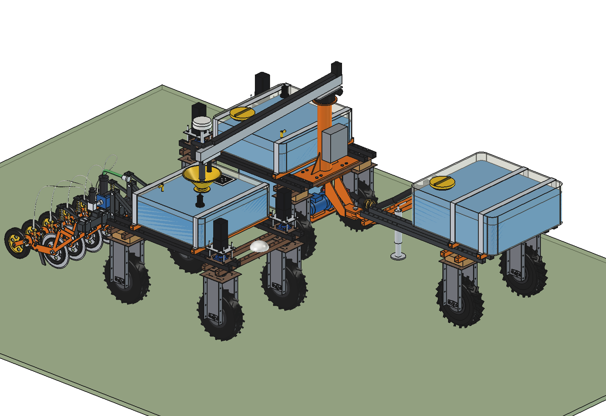
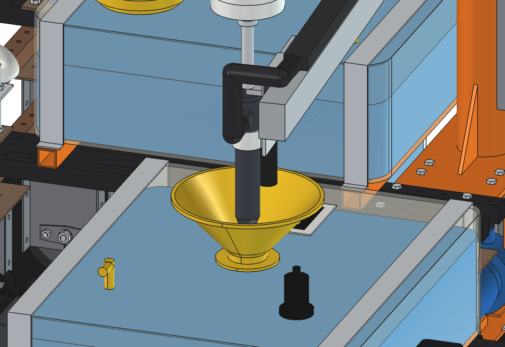
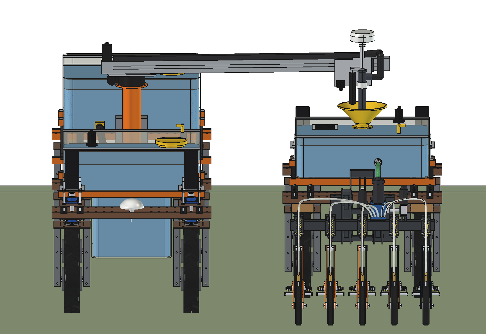
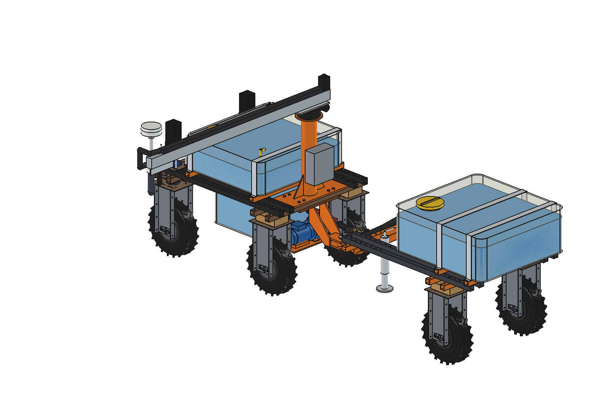
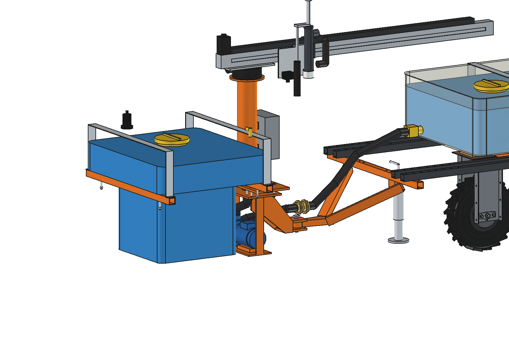
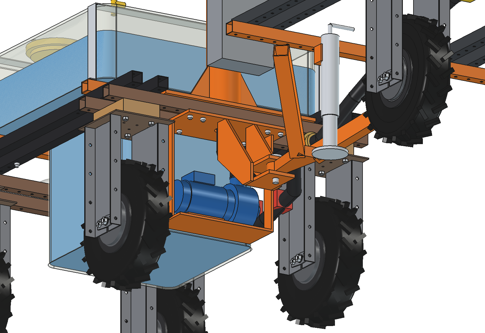
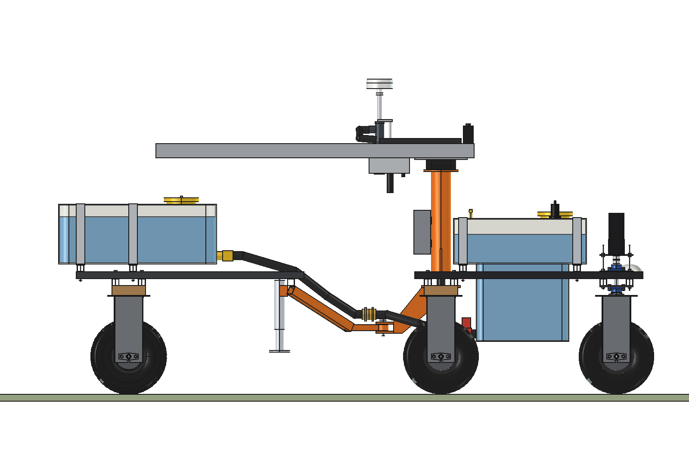
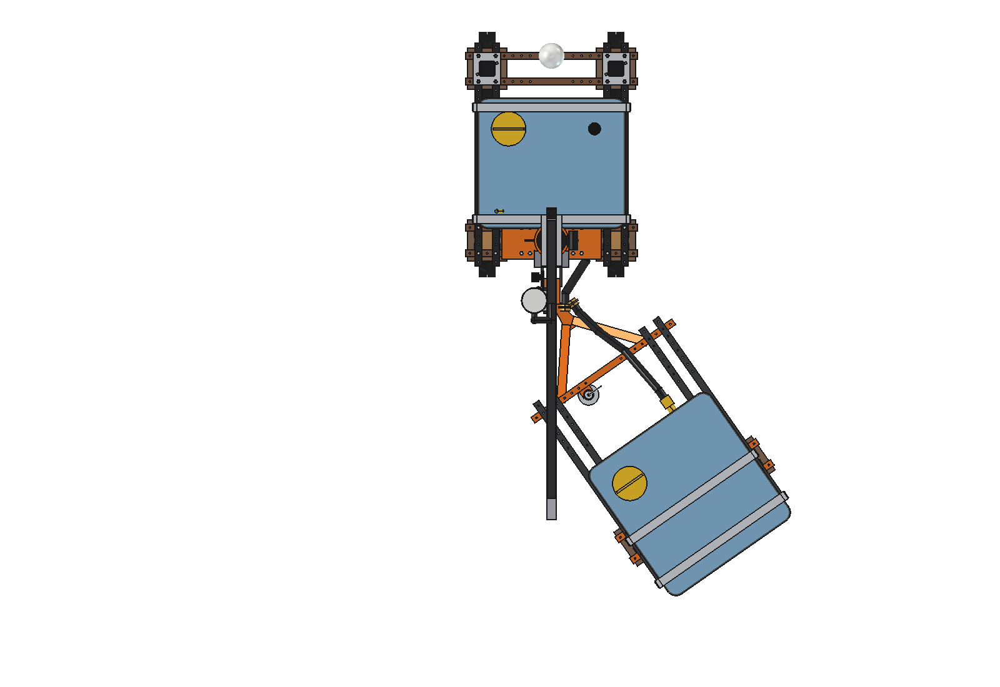
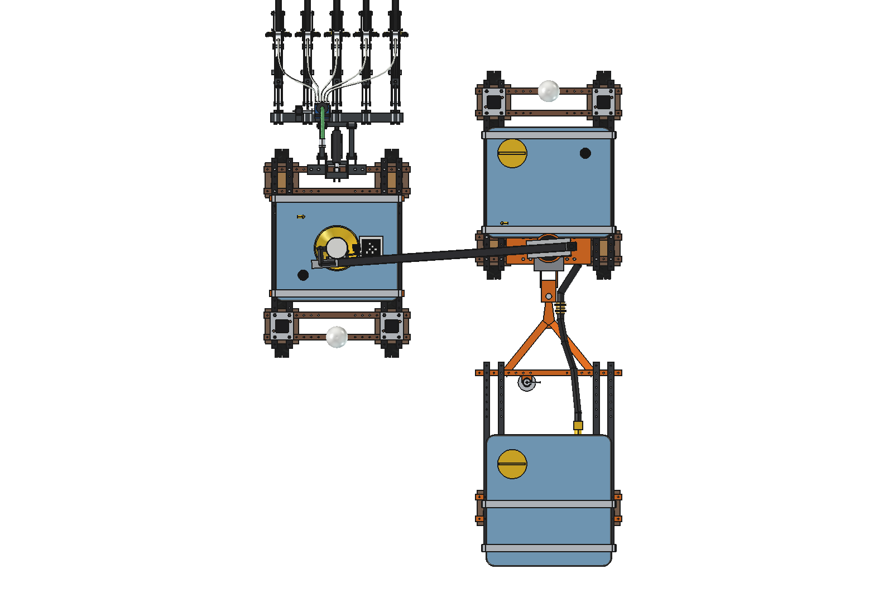

# Mobile refiller, liquid: FreeCAD model

A standard Bruut OpenAgbot as a **support robot for liquids**. It carries 268 l in a T-shaped tank, pulls a powered
trailer with another 246 l, and tops up the work tank of a working robot on the headland: a slewing boom with a trolley
puts a spout into the funnel of the working robot, **while both robots drive** along the straight part of the turn.
An RTK antenna sits straight above the spout and a camera next to it confirms the funnel before anything flows.

The idea, all uses (water, seed, granular fertilizer, batteries, ...), the other variants and the refill procedure are
in the [mobile refiller README](../README.md). Why the dimensions and choices are what they are: [RATIONALE.md](RATIONALE.md).


*The working robot (standard Bruut with the [liquid fertilizer applicator advanced](../../liquid%20fertilizer%20applicator/advanced/)
and the receiver kit) lifts its applicator, drives a forward arc onto the headland and stops. The refiller has already
swung its boom over the stop point. Camera check, spout down, pump on (150 l/min); both drive 3.8 m along the headland,
the boom follows the funnel. After 8.9 s the work tank is full (22 l, what 2 passes of 200 m at 550 l/ha used), spout
up, boom back. The working robot turns into its next pass; the refiller reverses 5.8 m to the next turn on this
headland. Bottom left: tank levels and pump; bottom right: the headland from above. Twice real speed.*

| | | |
| --- | --- | --- |
|  |  |  |
| docked: boom out, spout in the funnel of the working robot | spout in the funnel, camera beside it, antenna on the spout | from the front: 1.45 m between the centre lines |
|  |  |  |
| boom fully out (1.5 m) to the left, spout down | robot hidden, tank shell hidden: the liquid shows the T-shape with the sump between the beams; pump under the rear beams | from behind/below: pump, sub-frame, clevis hitch, hoses |
|  |  |  |
| side view | trailer articulated 35° | docked, from above |

## Key figures

From the model (`build_mrl.mass_properties`, `check_fit`, `clearance`, `size`), `mrl_calc.report()` and
`animate_mrl.summary()`. Robot 161.5 kg (agbot comparison, not weighed). Liquid 1.2 kg/l.

| | |
| --- | --- |
| Capacity | refiller 268 l (of which 112 l in the sump between the beams), trailer 246 l: **515 l**; work tank on the working robot 147 l |
| Mass (dry) | kit on the robot 120 kg (boom 20 kg), trailer 107 kg; full train about 1,006 kg |
| Wheel loads, full | robot front 111 kg, rear **204 kg**, trailer 188 kg per wheel; hitch load 26 kg (Quinder datasheet: max. 500 kg per motor) |
| Traction, full | 126 kgf from 6 driven wheels (21 kgf each, motor-limited) vs 80 kgf rolling resistance: **max. grade 5 %** (0 % with only the robot's 4 motors); peak 44 kgf per motor gives about 10 % for short spells |
| Tipping (static, sideways) | robot empty 31.5°, full 29.0°, full with the boom out to the side 26.6°; trailer full 24.8° |
| Overall size | 1000 × 3445 × 1849 mm (w × l × h, boom parked backwards); antenna top 1.80 m |
| Boom reach | spout 0.35–1.50 m from the column, slew 360°; spout stroke 185 mm |
| Docking | centre lines 1.45 m apart, opposite heading; head 98 mm above the funnel rim (raised), spout tip 64 mm in the funnel (lowered) |
| Docking tolerance | 125 mm at the funnel rim, 73 mm at the lowered tip; error ≈ 45 mm with GNSS only, ≈ 15 mm with the camera (2σ, estimated) |
| Pump | 24 V centrifugal, 1.5": operating point 164 l/min at 4.6 m head (static lift 0.77 m), limited to 150 l/min; 370 W electric |
| Refill in the turn | straight 3.8 m in 10.3 s: **about 25 l per turn while driving**. Animation: 22 l in 8.9 s, working robot stands still 2.7 s (camera + spout down) and 0.7 s (steering) |
| Extra standstill | 0 s up to 505 l/ha on 200 m fields; 6 s at 1000 l/ha / 200 m; 22 s at 2000 l/ha / 200 m (table in the [concept README](../README.md#how-much-fits-in-one-turn)) |
| Logistics (505 l/ha) | one load = 1.02 ha = 4.7 h of work; refill trip to a farm tank 500 m away 22 min, while the working robot has 81 min of buffer |
| Without refiller | the working robot drives to the farm every 0.29 ha: field efficiency 89 / 80 / 69 / 53 % at 0.2 / 0.5 / 1 / 2 km |
| Energy per load (500 m trip) | pump 20 Wh, driving 253 Wh; about 6 loads per 2.4 kWh battery |
| Boom and column | 206 Nm at the column foot (static, boom out), 1.4 kN per M10 with ×2 shock; slew torque 14 Nm; boom tip deflection 3 mm |
| Clearance | sump 107 mm from the front tyres steered 30°; trailer articulates to 85° before contact; headland 1.2 m deeper (6.4 m) |

## The model

```
Robot (agbot design, unchanged)
  Mobile_refiller
    MR_tank      cradle tubes 40x40x3 on the upper beams (y -375 / +275), rubber strips, tank (T-shape) + liquid,
                 fill lid, vent, level sensor, 2 straps
    MR_pump      pump under the rear beams, pump cradle, suction hose with ball valve, branch from the trailer
                 (ball valve, camlock), discharge hose up into the column
    MR_frame     sub-plate under the rear lower beams, hitch side plates, clevis, pin, 8 x M10 (sandwich with the
                 column base plate), column 114.3 x 4 with gussets and flange, worm slew drive, control box
    MR_slew      (rotates)  root plate, boom = belt linear module 80 (1815 long), NEMA 23, hose carrier
      MR_trolley (moves along the boom)  carriage, head plate, PE sleeve, spout actuator, camera, spout hose
        MR_spout (moves down)  spout PP 50, inlet, arm + actuator rod, mast, RTK antenna
    MR_trailer   (articulates about the hitch pin)
      TR_frame   3 lower + 4 upper chassis beams (robot parts), A-frame drawbar with eye, parking jack
      TR_L_unit / TR_R_unit   robot rear wheel units (hub motor driven)
      TR_tank    cradle, tank + liquid, fill lid, outlet valve, straps, hose to the hitch, camlock
Receiver_kit (on the working robot; built in the docked scene and the animation)
    cradle, work tank 147 l + liquid, straps, funnel O300 + strainer, fiducial target, level sensor, vent
```

Moving the model: `build_mrl.set_pose(phi, r, s)` (slew angle in degrees, + = counter-clockwise seen from above,
0 = boom forward, 180 = parked backwards; trolley radius in mm; spout down in mm), `build_mrl.set_trailer(angle)`,
`build_mrl.set_levels(refiller=..., trailer=..., receiver=...)` in litres.

## Parts list

Quantities for one refiller with trailer and one receiver kit, without the base robot. Prices are rough estimates
(2026) to give an idea of the total, not quotes.

| Qty | Part | Specification | Price (est.) |
| --- | --- | --- | --- |
| 1 | Refiller tank | PE 6 mm, 860 × 760 × 260 upper part + 500 × 530 sump, outlet 1.5" at the rear of the sump, lid Ø200, vent. Welded from PE sheet, or rotomoulded in series | €400 |
| 1 | Trailer tank | PE 860 × 900 × 340, ≈ 250 l, outlet 1.5" at the front (standard rectangular tank) | €250 |
| 1 | Work tank (receiver kit) | PE 840 × 730 × 260, ≈ 150 l (needed for the applicator anyway) | €180 |
| 1 | Transfer pump | 24 V DC centrifugal / self-priming, 1.5", ~150 l/min, PP + FKM/EPDM (chemical version) | €450 |
| 2 | Electric ball valve | 1.5", 24 V, PVC/PP or stainless | €240 |
| 1 | Flow meter | 1.5" (oval gear or turbine), pulse output | €150 |
| 1 | Swivel | 1.5" rotary union at the top of the column | €120 |
| ~10 m | Hose and fittings | 1.5" chemical suction/delivery hose, camlock pair, hose clamps, bends | €200 |
| 1 | Slew drive | worm slew drive ~3" with 24 V gearmotor (self-locking) | €650 |
| 1 | Boom | belt linear module 80, 1815 mm, stroke ~1150, with NEMA 23 closed-loop motor and driver | €470 |
| 1 | Spout actuator | 24 V linear actuator, stroke 200, with end switches | €80 |
| 1 | Spout, sleeve, hose carrier | PP pipe 50, PE sleeve, plastic energy chain 50 × 30 | €80 |
| 1 | RTK GNSS for the spout | dual-frequency receiver (e.g. F9P class) + survey antenna, corrections from the farm base | €500 |
| 1 | Camera + computer | global-shutter camera IP67 looking down + small computer (vision, tag detection) | €250 |
| 1 | IMU | in the head (tilt of the mast) | €40 |
| 3 | Level sensors | ultrasonic, IP67 (refiller, trailer, work tank) | €180 |
| 1 | Control box | IP66, controller, motor drivers (slew, trolley, actuator), pump contactor, radio | €350 |
| — | Steel (laser cut, welded) | column 114.3 × 4 with base plate 12 mm and gussets, sub-plate 10 mm, hitch plates, clevis 12 mm, pump cradle, cradle tubes 40 × 40 × 3 (4×), straps 50 × 3 (6×), drawbar 50 × 50 × 3 A-frame with eye | €450 |
| 7 | Chassis beams for the trailer | 40 × 40 × 2 tube with the 50 mm hole grid (3 × 1000, 4 × 1300) | €150 |
| 2 | Trailer wheel units | hub motor 8" with 4.00-8 tyre, controller, wheel bracket (laser cut), wooden block | €700 |
| 1 | Parking jack | small drawbar jack | €40 |
| 1 | Receiver kit parts | funnel Ø300 with strainer, fiducial target plate, vent, float valve | €70 |
| — | Fasteners | M10 bolts (8 sub-frame + 8 cradle + trailer), M8, hitch pin Ø20 | €60 |
| | **Total** | without the base robot | **≈ €6,000** |

## Use

In FreeCAD 1.1 (macro `run_in_freecad.py`: puts this folder on `sys.path`, reloads the modules, builds and prints
the report):

```python
import build_mrl, mrl_calc
build_mrl.build()                       # robot + refiller + trailer, saves Mobile_Refiller_Liquid.FCStd and .step
build_mrl.check_interference()          # must be empty
build_mrl.check_fit()                   # boom over 0..330 deg, 3 radii, spout up/down; trailer -60..60 deg: must be empty
build_mrl.clearance()                   # steering sweep vs sump, trailer articulation, heights
build_mrl.mass_properties()
build_mrl.build_docked()                # scene: docked next to the working robot with the applicator
build_mrl.check_docked()                # must be empty
build_mrl.render_all()                  # all images in previews/
print(mrl_calc.report())

import animate_mrl
animate_mrl.build()                     # document Mobile_refiller_animation
animate_mrl.play()                      # live, animate_mrl.stop()
animate_mrl.summary()                   # events and key figures of the run
animate_mrl.check_fit()                 # refiller vs working robot in the docked frames: must be empty
animate_mrl.render_all(r"C:\temp\mrl_frames")
import make_gif_mrl
make_gif_mrl.main(r"C:\temp\mrl_frames", r"previews\animation_refill_in_turn.gif")
```

`mrl_calc.py` and `make_gif_mrl.py` also run in a normal Python (`python mrl_calc.py`). The scenario of the animation
(dose, field length, speeds, where the refiller waits, camera) is at the top of `animate_mrl.py`.

The animation needs `agbots/agbot design` (robot) and `liquid fertilizer applicator/advanced` (applicator, loaded
unchanged). The docked scene loads the applicator too; without it the working robot is built without applicator.

## Files

| File | Contents |
| --- | --- |
| `mrl_params.py` | all dimensions: robot interface, tank, pump, column, boom, head, trailer, receiver kit, docking distance, traction values |
| `mrl_parts.py` | one function per part (shapes in robot coordinates) |
| `build_mrl.py` | model tree, `COLOR`, poses (boom, trailer), tank levels, docked scene and IK of the boom, checks, mass, renders, STEP |
| `mrl_calc.py` | capacity, wheel loads, traction, tipping, pump and hose, refill window in the turn, logistics, energy, boom loads, docking tolerance |
| `animate_mrl.py` | animation: working robot turning with three points, refiller docking and following, tank levels |
| `make_gif_mrl.py` | frames to GIF with caption, tank gauges and a map of the headland |
| `run_in_freecad.py` | macro: reload, build, print the report |
| `Mobile_Refiller_Liquid.FCStd`, `.step` | generated model (STEP: refiller kit and trailer, without robot and liquid) |
| `README.md`, `RATIONALE.md` | this file; why it is built like this |
| `previews/` | images and `animation_refill_in_turn.gif` |

## Checks done

- No overlap between the kit, the trailer and the robot (`check_interference`), over the whole boom range and with the
  trailer articulated −60…60° (`check_fit`). Two exceptions on purpose, listed in `PAIRS_OK`: hose ends in fittings,
  and the flexible part of the trailer hose at the hitch (drawn rigid, it bends when the trailer articulates). The spout
  only goes down in the docking sectors beside the robot (60–120° and 240–300°); above the trailer tank it would touch
  the lid, which the software blocks.
- Docked scene and every 3rd frame of the animation between "boom ready" and "boom parked": no overlap between the
  refiller and the working robot with its applicator and receiver kit (`check_docked`, `animate_mrl.check_fit`).
- Front wheels steered ±30°: 107 mm to the tank sump.

## Estimated, not measured

- Robot: mass 161.5 kg, centre of gravity 500 mm in front of the rear axle and 450 mm high; steering stack, stepper
  motor, wooden blocks, hub motor and tyre as in `agbot design`.
- Hub motors: Quinder 8" 48 V (datasheet in `Davilot/`): 550 W S1, 44 Nm at 74 rpm = 21 kgf continuous per wheel at an assumed tyre radius of 0.215 m; peak 18 A about 86 Nm = 40 kgf; max. load 500 kg; max. speed 7 km/h;
  rolling resistance 0.08; μ 0.6 dry / 0.35 wet.
- Liquid 1.2 kg/l, viscosity 3 mm²/s.
- Pump curve (18 m shut-off head, 190 l/min free flow), minor losses K 9, wire-to-water efficiency 0.4.
- Masses of bought parts: pump 9 kg, slew drive 9 kg, control box 6 kg, boom module 5.5 kg/m, hub motor 9 kg, tyre
  3 kg; hose 0.6 kg/m.
- Boom profile I ≈ 60 cm⁴; the column and plates were not checked by FEM.
- Docking error budget: spout RTK 20 mm, working robot GNSS + heading 25 mm, relative motion 30 mm, tilt 10 mm (2σ);
  the refiller lags 0.06 s² × the acceleration of the working robot (animation).
- Turn: R 2.4 m, 0.5 m/s in the arcs, 0.4 m/s reversing, 0.5 m/s² (as `agbot slim`); corner sweep 0.73 m.
- Logistics: working robot 0.75 m/s × 1 m at 80 % field efficiency; farm tank fills at 200 l/min; 3 min handling.
- Battery 2.4 kWh, 80 % usable; drive efficiency 0.6.
- Prices.
