# Mobile refiller, simple (IBC): FreeCAD model

A standard Bruut OpenAgbot carrying a **standard 1000 l IBC**, which you set on with pallet forks and take to the
field. A pump under the IBC, a fixed mast with a short arm, and a hose that hangs down to a drip-stop nozzle. There is
no boom, trailer or camera. The RTK antenna sits on the arm tip, straight above the nozzle.

The trick is in the **field pattern of the working robot**. It skips passes so that every turn is a U-turn in one go
(order 1, 7, 2, 8, 3, 9, ...). The refiller stands **inside that turn**, on the headland. The working robot stops on the
straight part of its turn with its funnel under the nozzle, is topped up and drives on into its next pass. It never
has to drive to the refiller. At the next turn on this headland the turn is 1 m further along, so the refiller drives
1 m further. The refiller stays on the headland all the time.

The concept, all uses and the other variants are in the [mobile refiller README](../README.md). The variant with a
slewing boom, trailer and refilling while driving is [liquid](../liquid/README.md). Why the dimensions and choices are
what they are: [RATIONALE.md](RATIONALE.md).

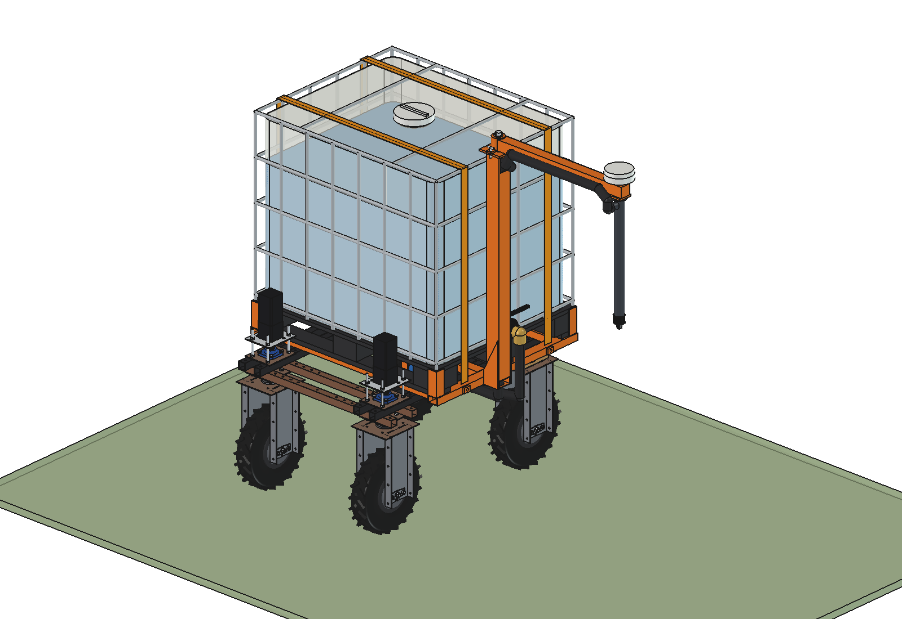

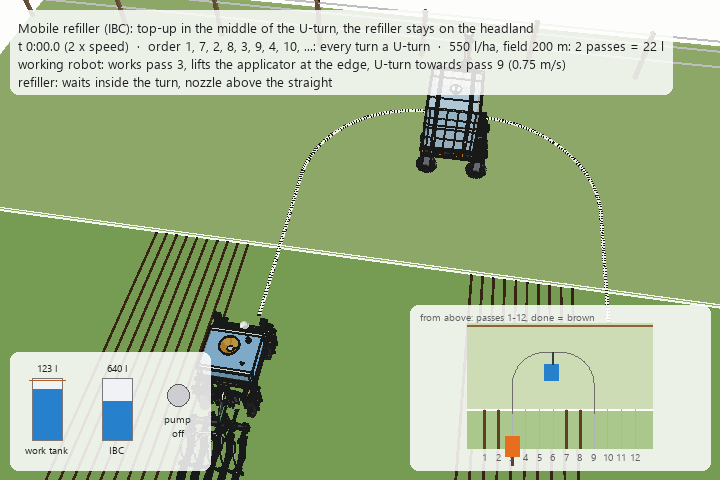

*The working robot (standard Bruut with the [liquid fertilizer applicator advanced](../../liquid%20fertilizer%20applicator/advanced/)
and a receiver kit) finishes pass 3, lifts its applicator and drives the U-turn towards pass 9. The refiller is waiting
inside the turn. The working robot stops on the straight with its funnel under the nozzle. Pump on, 22 l at 120 l/min
(what 2 passes of 200 m used at 550 l/ha). The level sensor stops the pump, the nozzle closes, and the working robot
drives on into pass 9 and lowers its applicator. Once it is back in the field, the refiller drives 1 m further. Time
skip (9 min: pass 9 down, U-turn at the far end, pass 4 back up), then the same at turn 4 → 10. Bottom left: tank
levels and pump; bottom right: the field from above, with the passes already done in brown. Twice real speed.*

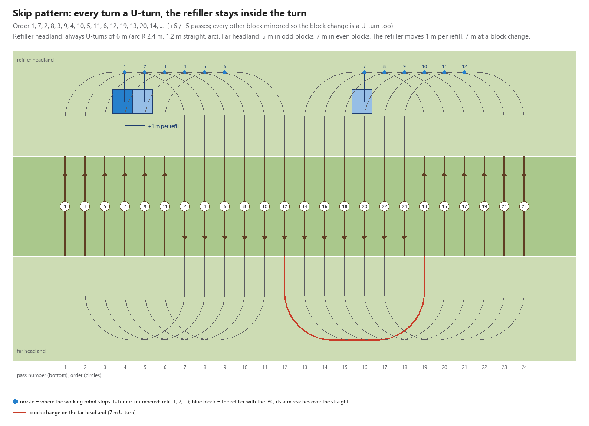

| | | |
| --- | --- | --- |
| 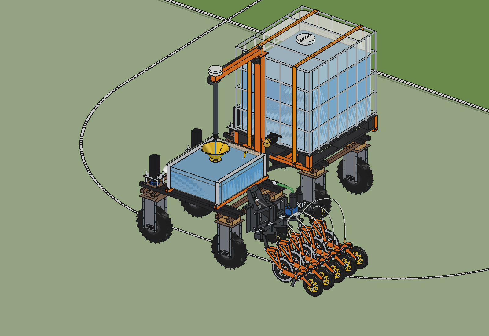 | 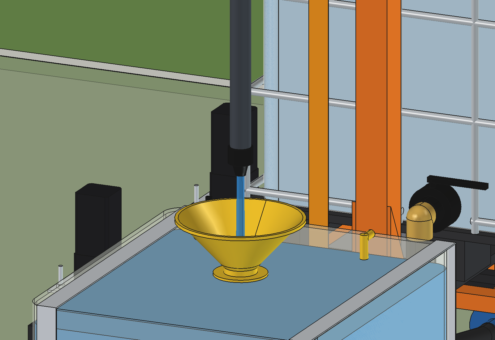 | 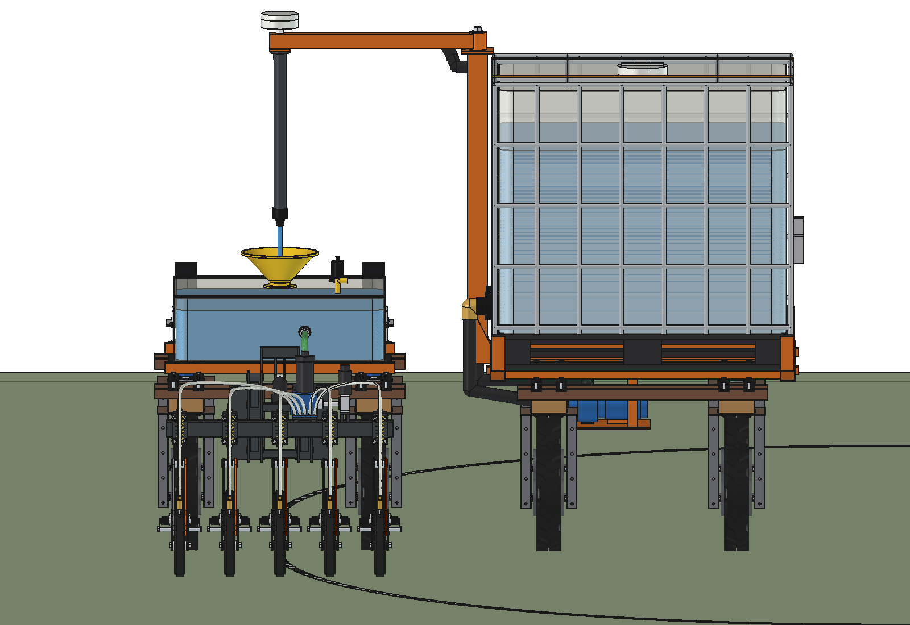 |
| working robot stopped on the straight of its U-turn, funnel under the nozzle | nozzle 106 mm above the funnel rim, antenna straight above it | along the headland: 225 mm between the refiller and the working robot |
| 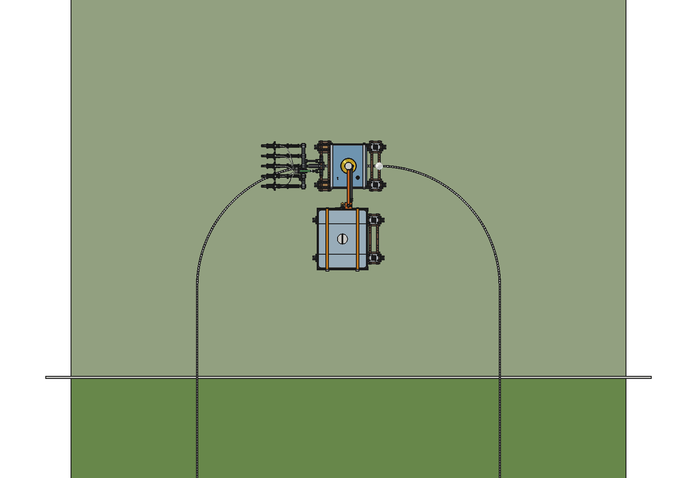 | 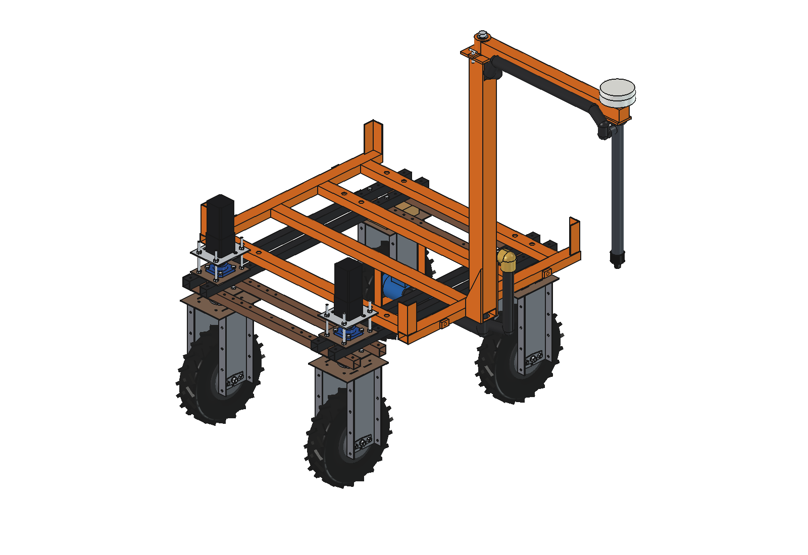 | 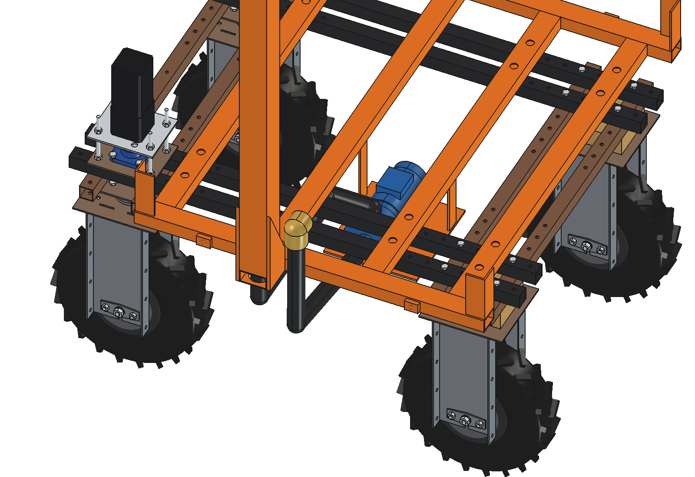 |
| from above: the refiller inside the U-turn (rear-axle path of the working robot drawn on the ground) | IBC hidden: bed on the upper beams, corner guides, mast with gussets | IBC and arm hidden: the pump hangs inside the frame under the IBC, below the valve: always flooded |
| 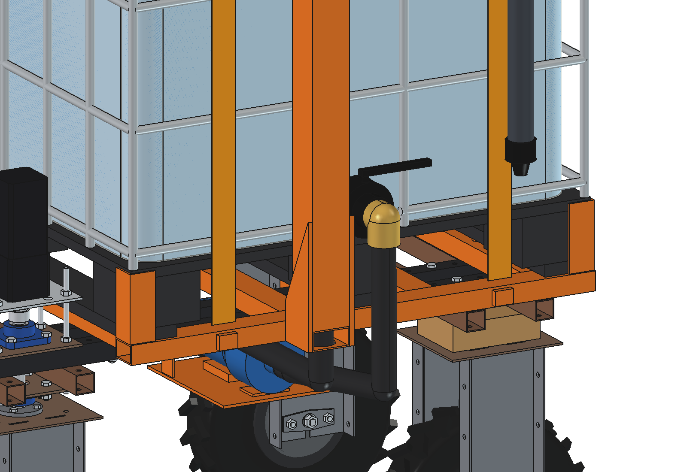 | 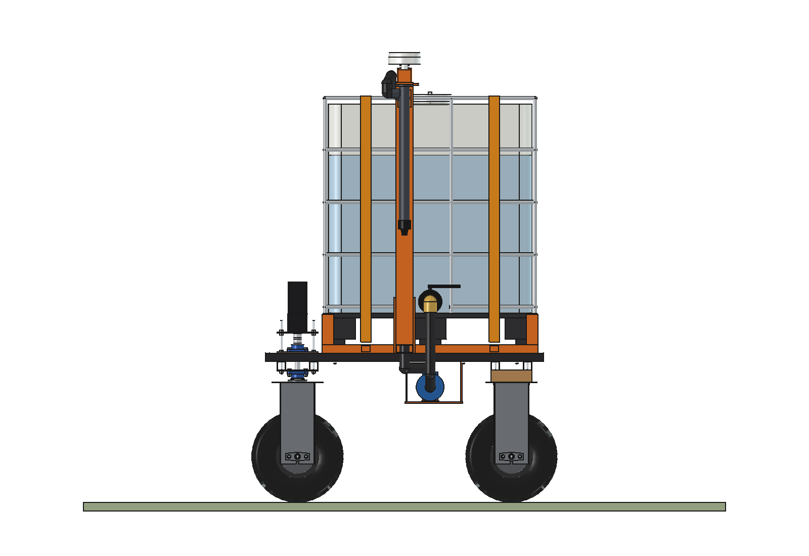 | 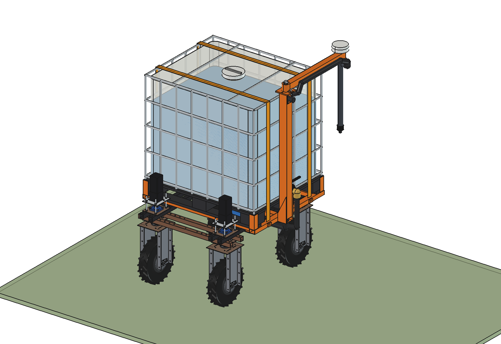 |
| IBC valve with camlock elbow, suction hose down, mast beside it | side view | arm folded back along the IBC for transport (pin) |

## Key figures

From the model (`build_mrs.mass_properties`, `check_fit`, `clearance`, `check_docked`), `mrs_calc.report()` and
`animate_mrs.summary()`. Robot 161.5 kg (agbot comparison, not weighed). Liquid 1.2 kg/l.

| | |
| --- | --- |
| Capacity | standard IBC 1000 l (1058 l to the brim); work tank on the working robot 147 l |
| Mass | kit 75 kg (bed, mast, arm, pump, hoses, straps), IBC 58 kg empty; full: **1,494 kg** in total |
| Wheel loads, full | front 295 kg, rear 452 kg per wheel, heaviest (left rear, mast side) **470 kg** (datasheet: 500 kg). With UAN (1.32 kg/l): 507 kg, so fill to 980 l at most |
| Field pattern | jump N = 6: order 1, 7, 2, 8, ... in blocks of 12 passes, every other block mirrored. U-turns of **6 m** on the refiller headland (arc R 2.4 m, 1.2 m straight, arc), 5 m or 7 m on the far headland. Never reversing |
| Turn | U-turn 8.7 m, 17.5 s; turn with three points to the neighbouring pass (liquid variant) 29.4 s |
| Refiller position | inside the turn, centre line 1.45 m from the straight; arm out to 1.45 m, nozzle above the middle of the straight. **Moves 1 m per refill** (7 m at a block change every 6 refills) |
| Clearance | 225 mm to the working robot (on the straight; the arcs stay further away); headland **5.3 m**: the refiller adds nothing (liquid variant 6.4 m) |
| Refill | 120 l/min; standstill = stop and start 1.0 s + check 0.5 s + pumping + closing 1.0 s. Animation: 22 l, **12.7 s standstill**, refiller moves 1 m in 3.7 s |
| Standstill per refill | 505 l/ha: 8 / 13 / 23 s for fields of 100 / 200 / 400 m (2–2.5 % of the round trip); 1000 l/ha: 12 / 22 / 42 s (4 %) |
| Nozzle | tip at 1250 mm, 106 mm above the funnel rim; the stream may be 128 mm off the funnel axis, the error is ≈ 46 mm (2σ, RTK only) |
| Pump | 24 V centrifugal 1.5": 165 l/min free at 4.4 m, throttled to 120 l/min, ≈ 170 W |
| Tipping (static) | full: sideways **16.4°**, backwards 17.9°; empty 22.3° sideways (centre of gravity 1.23 m high when full) |
| Traction | full on wet grass: rolling resistance 120 kgf > 84 kgf continuous (4 × 21): only short moves (peak 4 × 44 kgf, up to 3.8 % grade). Continuously on grass up to 630 l; full on a hard track up to 2.6 % (8.8 % at peak) |
| Bed and mast | cross tubes 58 MPa, side rails 23 MPa (×2 dynamic); 12 × M10, 514 N shear each at 0.5 g; arm tip deflection 0.35 mm |
| Logistics (505 l/ha) | one IBC = 1.98 ha = 9.2 h of work. Swapping the IBC at a yard 500 m away takes 30 min, against 81 min of buffer in the work tank |
| Overall size | 2168 × 1531 × 2155 mm (w × l × h, arm out); IBC top 1.90 m, antenna top 2.11 m; arm folded: 1409 × 1630 mm |

## The model

```
Robot (agbot design, unchanged; its own GNSS antenna is hidden: it moves to the arm tip)
  Mobile_refiller
    MRS_frame   bed: 4 cross tubes 60x40x3 (3 bolted with 4 x M10 each through the upper-beam holes, heads inside the
                tube; 1 welded at y 0 that carries the mast), 2 side rails under the pallet edges, 4 corner guides,
                lashing eyes, mast outrigger + gussets, mast 80x80x4 (hose inside), top plate, pivot pin
    MRS_ibc     IBC 1000 l: 4-way pallet, HDPE bottle + liquid, galvanised cage, DN50 valve, DN150 cap
    MRS_straps  2 ratchet straps 50 mm
    MRS_pump    24 V transfer pump under the IBC (inside the frame), cradle on the cross tubes, camlock elbow on the
                valve, suction hose, discharge hose up inside the mast
    MRS_arm     (pivots on the mast: 0 = out, 90 = folded back) arm 60x60x3 with boss, lock pin, tip plate,
                drop pipe PP 50, drip-stop nozzle, RTK antenna above the nozzle, hose along the arm
Receiver_kit (on the working robot; built in the refill scene and the animation)
    cradle, work tank 147 l + liquid, straps, funnel O300 + strainer, level sensor, vent
```

Moving the model: `build_mrs.set_arm(angle)` (0 = out to the left, 90 = folded backwards),
`build_mrs.set_levels(ibc=..., receiver=...)` in litres.

## Parts list

Quantities for one refiller and one receiver kit, without the base robot. Prices are rough estimates (2026) to give an
idea of the total, not quotes.

| Qty | Part | Specification | Price (est.) |
| --- | --- | --- | --- |
| 1 | IBC | standard 1000 l composite IBC, 1200 × 1000 × 1160, DN50 valve, DN150 cap. Reconditioned, or the one the product comes in | €150 |
| — | Bed (laser cut, welded) | 60 × 40 × 3 tube: 4 cross tubes 1100 long, 2 side rails 1010, outrigger 90 (80 × 40 × 3); corner guides angle 50 × 5 (4 × 140), 4 lashing eyes, 2 gussets 10 mm | €180 |
| 1 | Mast and arm | mast 80 × 80 × 4 × 1210 with a window for the hose, top plate 130 × 130 × 10, pivot pin Ø30; arm 60 × 60 × 3 × 830 with boss and lock tab, tip plate, lock pin Ø12 | €120 |
| 12 | Bolts | M10 × 55 with nut and washer (heads inside the cross tubes) | €15 |
| 2 | Ratchet straps | 50 mm, LC 2000 daN | €30 |
| 1 | Transfer pump | 24 V DC centrifugal, 1.5", about 150 l/min free flow, PP housing with FKM/EPDM seals; PWM speed controller | €450 |
| 1 | Pump cradle | 6 mm plate, 2 hangers bolted under the cross tubes | €40 |
| 1 | Valve adapter | S60×6 → 1.5" camlock coupler with a 90° elbow | €45 |
| ~5 m | Hose | 1.5" chemical suction/delivery hose, clamps | €90 |
| 1 | Drop pipe and nozzle | PP 50 with flange and side inlet; drip-stop nozzle (spring check valve, opens at ~0.3 bar) | €80 |
| 1 | Flow meter (optional) | 1.5", pulse output: litres per working robot and per field | €150 |
| 1 | Antenna mount | the robot's own GNSS antenna moved to the arm tip, longer cable | €30 |
| 1 | Electrics | DC-DC 48 → 24 V 20 A, pump relay/PWM; radio through the robot's own controller | €120 |
| 1 | Receiver kit | funnel Ø300 with strainer, ultrasonic level sensor, vent, float valve (the work tank is needed anyway) | €150 |
| | **Total** | without the base robot | **≈ €1,650** |

The [liquid variant](../liquid/README.md) costs about €6,000 in parts: slew drive, linear module, spout actuator,
camera, second RTK receiver, trailer with hub motors.

## Use

In FreeCAD 1.1 (macro `run_in_freecad.py`: puts this folder on `sys.path`, reloads the modules, builds and prints
the report):

```python
import build_mrs, mrs_calc
build_mrs.build()                       # robot + refiller, saves Mobile_Refiller_Simple.FCStd and .step
build_mrs.check_interference()          # must be empty
build_mrs.check_fit()                   # arm 0..90 deg: must be empty
build_mrs.clearance()                   # steering sweep, stepper motors, widest point on the left, heights
build_mrs.mass_properties()
build_mrs.build_docked()                # scene: working robot stopped under the nozzle in its U-turn
build_mrs.check_docked()                # must be empty
build_mrs.render_all()                  # all images in previews/
print(mrs_calc.report())

import animate_mrs
animate_mrs.build()                     # document Mobile_refiller_simple_animation
animate_mrs.play()                      # live, animate_mrs.stop()
animate_mrs.summary()                   # events and key figures of the run
animate_mrs.check_fit(step=3)           # (overlaps, smallest outline gap, frames checked in 3D): overlaps must be empty
animate_mrs.render_all(r"C:\temp\mrs_frames")
import make_gif_mrs
make_gif_mrs.main(r"C:\temp\mrs_frames", r"previews\animation_refill_in_u_turn.gif")
make_gif_mrs.pattern_png(r"previews\pattern_skip_passes.png")
```

`mrs_calc.py` and `make_gif_mrs.py` also run in a normal Python (`python mrs_calc.py`,
`python make_gif_mrs.py --pattern previews\pattern_skip_passes.png`). The scenario of the animation (dose, field
length, which turns, speeds, camera) is at the top of `animate_mrs.py`.

The animation and the refill scene need `agbots/agbot design` (robot) and `liquid fertilizer applicator/advanced`
(applicator, loaded unchanged).

## Files

| File | Contents |
| --- | --- |
| `mrs_params.py` | all dimensions: robot interface, IBC, bed, straps, mast and arm, nozzle, pump, receiver kit, field pattern, traction values |
| `mrs_parts.py` | one function per part (shapes in robot coordinates) |
| `build_mrs.py` | model tree, `COLOR`, arm pose, levels, refill scene, checks, mass, renders, STEP |
| `mrs_calc.py` | skip pattern and turns, room inside the turn, refill standstill, wheel loads, tipping, traction, pump and hose, nozzle tolerance, bed and mast, logistics, energy |
| `animate_mrs.py` | animation: working robot in the skip pattern with U-turns, refill on the straight, refiller moves 1 m |
| `make_gif_mrs.py` | frames to GIF with caption, gauges and a map of the field; the pattern diagram |
| `run_in_freecad.py` | macro: reload, build, print the report |
| `Mobile_Refiller_Simple.FCStd`, `.step` | generated model (STEP: kit and IBC, without robot and liquid) |
| `README.md`, `RATIONALE.md` | this file; why it is built like this |
| `previews/` | images, `pattern_skip_passes.png` and `animation_refill_in_u_turn.gif` |

## Checks done

- No overlap between the kit, the IBC and the robot (`check_interference`), and over the whole arm range 0–90°
  (`check_fit`; the lock pin is pulled while folding). Exceptions on purpose, listed in `PAIRS_OK`: hose ends in
  fittings, pins in their holes, and the flexible hose loop at the pivot (drawn rigid, it bends when the arm folds).
- Refill scene: no overlap between the refiller and the working robot with its applicator and receiver kit
  (`check_docked`); nozzle exactly above the funnel axis, 106 mm above the rim.
- Animation: in every 3rd frame while the working robot is on the headland, the outlines of the two robots stay at
  least 225 mm apart; the frames where it stands under the nozzle were also checked in 3D with the real shapes: no
  overlap (`animate_mrs.check_fit`). In the calculation (outlines, whole turn both ways) the smallest gap is 225 mm, on
  the straight.
- Front wheels steered ±30°: 85 mm from the steered parts to the bed bolts; the IBC (and its corner guides) stays
  20 mm behind the steering stacks (stepper motors) above the front wheels.
- Widest point on the left below 1.3 m: 722 mm (the camlock elbow on the valve); the calculation assumes 725 mm.

## Estimated, not measured

- Robot: mass 161.5 kg, centre of gravity in the middle and 450 mm high; steering stack, stepper motor, wooden
  blocks, hub motor and tyre as in `agbot design`. **The chassis beams (40 × 40 × 2) are not checked for 1.5 t**:
  the bolted cross tubes put the load on the upper beams close to the lower beams (≤ 150 mm), the welded one at y 0
  in the middle of their span. A test or FEM of the frame with a full IBC is still needed.
- Hub motors: Quinder 8" 48 V, 550 W S1 = 44 Nm = 21 kgf continuous per wheel at an assumed tyre radius of 0.215 m,
  peak 44 kgf; max. load 500 kg per motor; rolling resistance 0.08 on grass, 0.03 on a hard track; μ 0.35 wet.
- IBC: empty mass 58 kg (datasheet 56–59 kg), pallet height 145 mm, valve axis 200 mm above the base; the bottle is
  modelled with a flat bottom (a real one slopes to the valve). Valve on a 1000 mm face.
- Liquid 1.2 kg/l, viscosity 3 mm²/s. Sloshing in the unbaffled IBC is not modelled: the tipping angles are static.
- Pump curve (18 m shut-off head, 190 l/min free flow), minor losses K 7, wire-to-water efficiency 0.4; the drip-stop
  nozzle holds the hose full (opening pressure above the 0.7 m column in the drop pipe).
- Nozzle error budget (antenna RTK 20 mm, tilt 15 mm, working robot GNSS + heading 25 mm, stopping position 30 mm,
  2σ) and 10 mm wind drift of the stream.
- Working robot: turn radius R 2.4 m (R_min 2.1 m), 0.5 m/s in the turn, 0.75 m/s working, 0.5 m/s², the arc starts
  1.8 m beyond the field edge (applicator lifted); outline 1000 × 2532 mm with the applicator.
- Logistics: working robot 0.75 m/s × 1 m at 80 % field efficiency; refiller 0.5 m/s full, 1 m/s empty; 5 min to
  swap the IBC with a telehandler or forklift.
- Battery 2.4 kWh, 80 % usable; drive efficiency 0.6.
- Prices.
