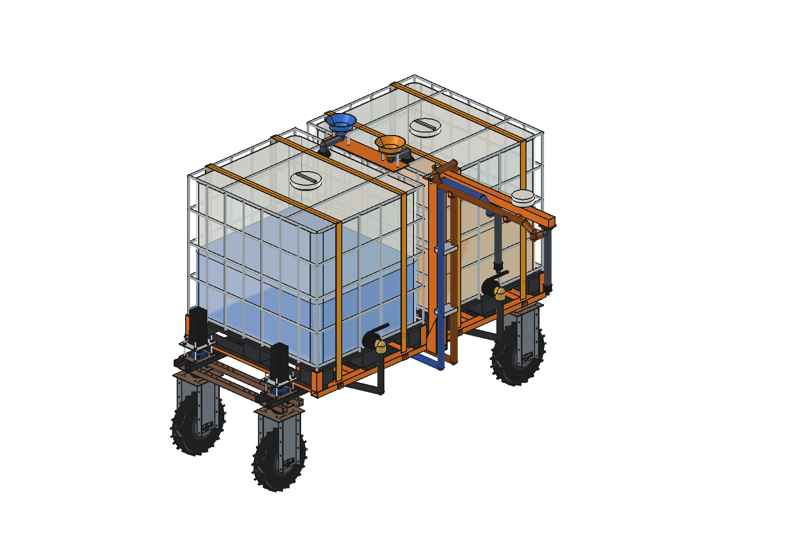
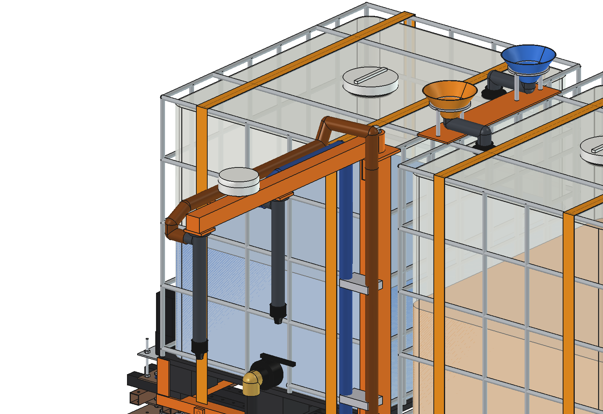
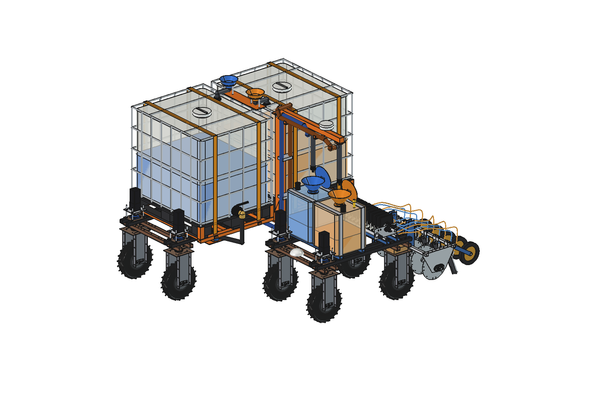
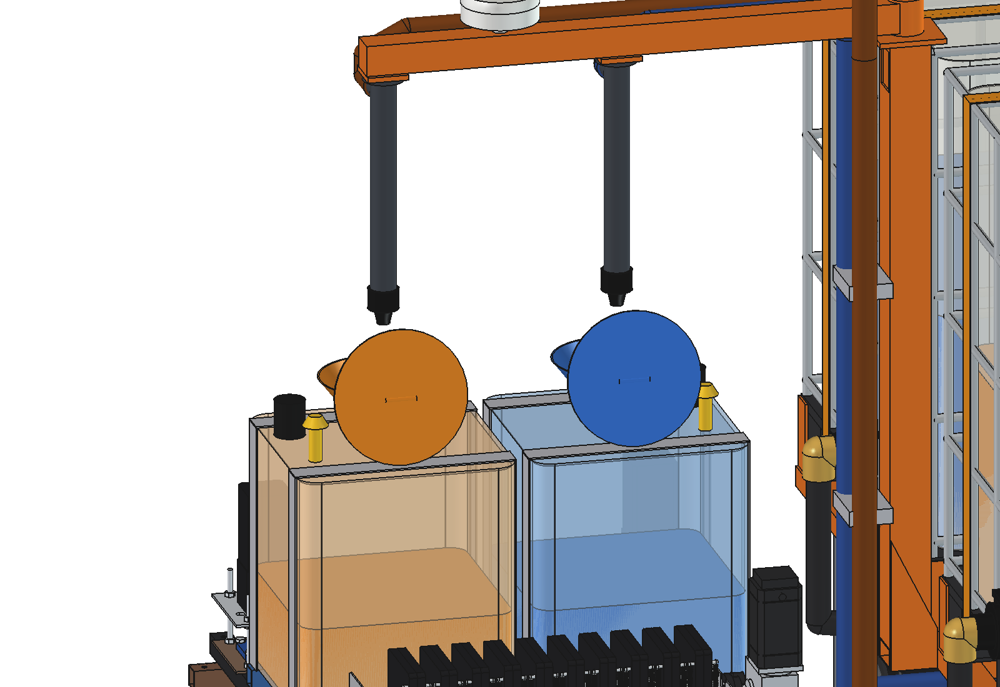
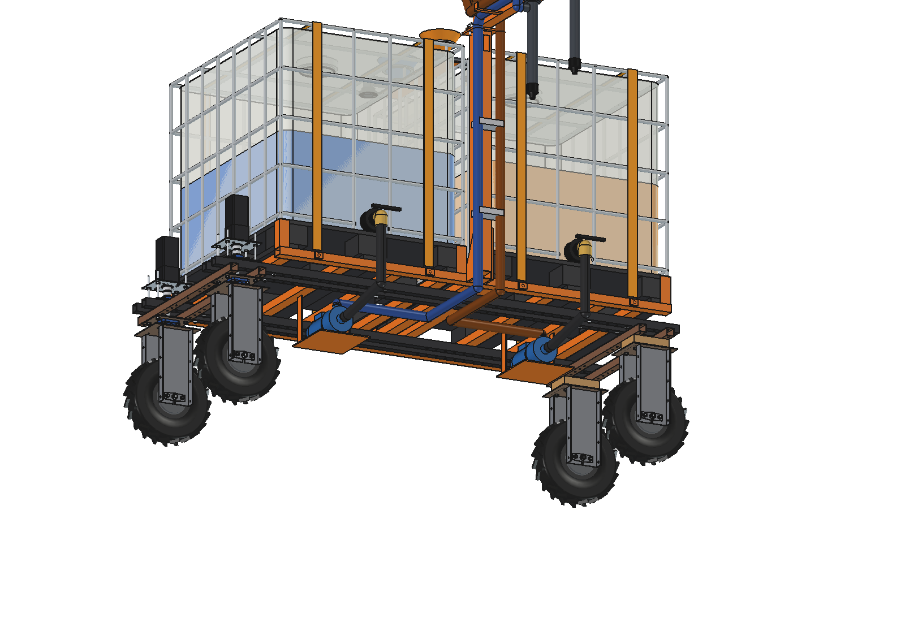
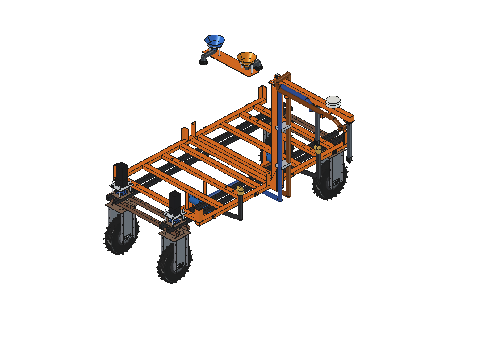
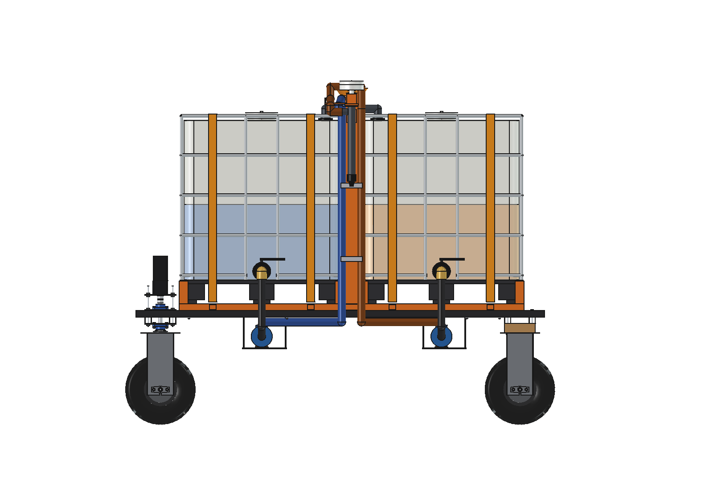
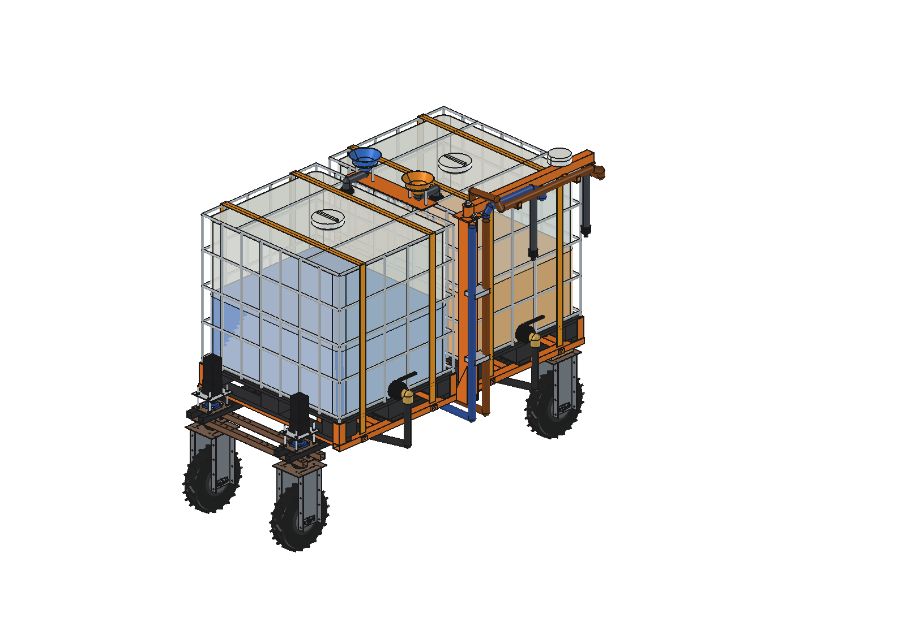

# Mobile refiller with two IBCs (two liquids): FreeCAD model

The [simple refiller](../simple/README.md) for a working robot that applies **two liquids**: the
[precision applicator V4](../../liquid%20fertilizer%20applicator/precision_applicator/combined_v4/README.md), with a
work tank and a fill funnel per liquid, the funnels 455 mm apart across the robot.

- The **robot frame is lengthened**: wheelbase **2200** instead of 1000, upper beams 2500 instead of 1300 (the
  robot of `agbots/agbot design` with three parameters changed while it is built, `mrd_params.ROBOT_OVERRIDE`).
- **Two standard 1000 l IBCs** stand one behind the other on one bed: **IBC A (blue liquid) in front, IBC B (orange)
  behind**, each with its own 24 V transfer pump under it (as the simple refiller).
- The two discharge hoses run **side by side** under the beams to the mast, up its outer face on stand-off clamps
  and along the arm (B crosses over the arm and A at the pivot and runs outside A) to **two drop pipes with a
  drip-stop nozzle each, 455 mm apart**: nozzle A over funnel A, nozzle B over funnel B. The RTK antenna sits on the
  arm in the middle between the nozzles, above the centre line of the working robot.
- It works as the simple refiller: the working robot skips passes (U-turns only), the refiller stands **inside the
  turn**, the working robot stops on the straight of its turn with both funnels under the nozzles, both pumps run at
  the same time, and the refiller drives 1 m on for the next turn.
- A **fill bridge** over the gap between the IBCs carries two funnels, side by side 455 mm apart like the ones on the
  working robot, each draining into the top of its own IBC. The
  [IBC trailer with two liquids](../stationary/ibc_trailer_two_liquids/README.md) lifts its arm and fills both IBCs
  in one stop: the refiller reloads on the headland without anyone handling an IBC.

Animations (no text in the picture): [two_liquids_animations](../two_liquids_animations/README.md): the refill in the
turn, and the refiller reloading at the trailer and going back to the next turn.

| | |
| --- | --- |
|  |  |
|  |  |
|  |  |
|  |  |

## Key figures

From the model (`build_mrd.check_interference`, `check_fit`, `check_docked`, `nozzles_over_funnels`, `clearance`)
and `mrd_calc.report()`. Robot 173 kg (161.5 kg standard + longer upper beams, estimated). Liquid 1.2 kg/l.

| | |
| --- | --- |
| Robot | Bruut with wheelbase 2200 (wheels at y ±1100), upper beams 2500; front and rear units, steering and hub motors unchanged |
| IBCs | A: y −20 … 980 (25 mm behind the front stepper-motor plates), B: y −1120 … −120; 100 mm gap for the mast cross tube |
| Bed | 9 cross tubes 60 × 40 × 3: 4 bolted through the upper-beam holes (y −975, −775, 325, 925), 5 welded to the side rails (y −500, −175, −70, 75, 600: no holes there); side rails over both IBCs |
| Nozzles | x −1222.5 (A) and −1677.5 (B), y −70: 455 apart, tips z 1460, 106 above the funnel rims of the working robot; offset nozzle–funnel 0.0 mm in the refill scene |
| Working robot | stands beside the refiller, same heading, centre lines 1450 apart (as the simple refiller) |
| Fill bridge | funnels Ø200 at (±227.5, −70), rim z 2060, PP 50 pipes over the cage into DN50 bulkhead fittings in the IBC tops |
| Interference | none: kit against itself and the robot; arm 0 … 90° (the flexible hose loop over the pivot excluded when folded); refill scene with the working robot (tyres as cylinders) |
| Overall size | 2360 × 2731 × 2155 mm (arm out) |
| **Wheel loads** | full IBCs (2 × 1000 l): 773 kg on the left rear wheel, the datasheet allows 500 kg. **Max 570 l per IBC** (1.2 kg/l; 520 l with UAN 1.32 kg/l): then 498 kg on the left rear wheel, 1780 kg in total |
| Tipping (static) | 570 l each: sideways 18.2°, backwards 44°; empty 18.6° sideways (the long wheelbase makes backwards tipping no issue) |
| Traction | rolling resistance on grass exceeds the continuous force of the 4 hub motors above 266 l per IBC (84 kgf); at 570 l each it needs 143 kgf, the peak force is 176 kgf: on grass only short moves, on a hard track up to 996 l each |
| Refill | 2 pumps of 120 l/min at the same time: 2 × 20 l (two 200 m passes at 500 l/ha) in 10 s + 2.5 s check and closing |

The lengthened robot can carry two IBCs, but not two full ones: on 4 wheels of 500 kg the limit is about 570 l per IBC,
and continuous driving on a grass headland about 270 l per IBC. The animations use 380 … 560 l. See
[RATIONALE](RATIONALE.md) for the options (a third axle, bigger wheels, or the XL robot).

## The model

```
Robot (agbot design, lengthened while built: chassis_length 2200, beam_length_2 2500; own GNSS antenna hidden)
  Mobile_refiller_2ibc
    MRD_frame     cross tubes, side rails, M10 bolts, corner guides, lashing eyes, mast outrigger + gussets (between
                  the IBCs, left), mast 80 x 80 x 4, top plate, pivot pin, hose clamps on stand-offs
    MRD_ibc_A/B   IBC 1000 l (pallet, bottle, liquid, cage, valve, cap), ratchet straps
    MRD_pump_A/B  pump under the IBC, cradle, camlock elbow, suction hose, discharge hose to the top of the mast
    MRD_fill      fill bridge on the cage tops, 2 funnels with supports, 2 PP pipes, 2 bulkhead fittings
    MRD_arm       (turns on the mast: 0 = out to the left, 90 = folded back) arm, lock pin, 2 tip plates, hose saddles,
                  RTK antenna, 2 drop pipes, 2 nozzles, the two arm hoses
```

## Files

| File | Contents |
| --- | --- |
| `Mobile_Refiller_Two_IBC.FCStd/.step` | refiller on the lengthened robot, arm out, 500 l per IBC (generated) |
| `mrd_params.py` | robot override, IBC shifts, bed tubes, nozzles and reach, hose lanes, fill bridge, limits |
| `mrd_parts.py` | bed, IBCs and pumps (shapes of `../simple/mrs_parts.py` moved), hoses, clamps, saddles, mast and arm (`../stationary/stc_parts.py` per nozzle), fill bridge |
| `mrd_calc.py` | masses, wheel loads, max fill, tipping, traction, fill time (pure Python) |
| `build_mrd.py` | lengthened robot, refiller, `set_arm()`, `set_levels()`, checks, refill scene with the precision applicator V4, images, STEP |
| `run_in_freecad.py` | macro: reload, build, print `mrd_calc.report()` |

## Usage

```python
import build_mrd
build_mrd.build()
build_mrd.check_interference(); build_mrd.check_fit()      # both empty
build_mrd.build_docked(); build_mrd.check_docked()          # empty
build_mrd.render_all()
```

```bash
"C:/Program Files/FreeCAD 1.1/bin/python.exe" -B mrd_calc.py
```

A build with the checks takes about 2 minutes: start it with `QtCore.QTimer.singleShot` from the MCP.

## Estimated, not measured

- The lengthened robot: 4 × 1.2 m more upper beam (12 kg), beams not checked for bending between the axles with
  two IBCs (2.2 m span, 40 × 40 × 2): a stiffer beam or a centre support may be needed.
- Mast, arm, two drop pipes 32 kg; hoses 9 kg; electrics 4 kg; bed 62 kg.
- Everything in the list of the [simple refiller](../simple/README.md) (pump curve, IBC dimensions, hub motor forces).
- The hose loop over the pivot is drawn rigid with the arm out; folded, it bends round the mast top.
