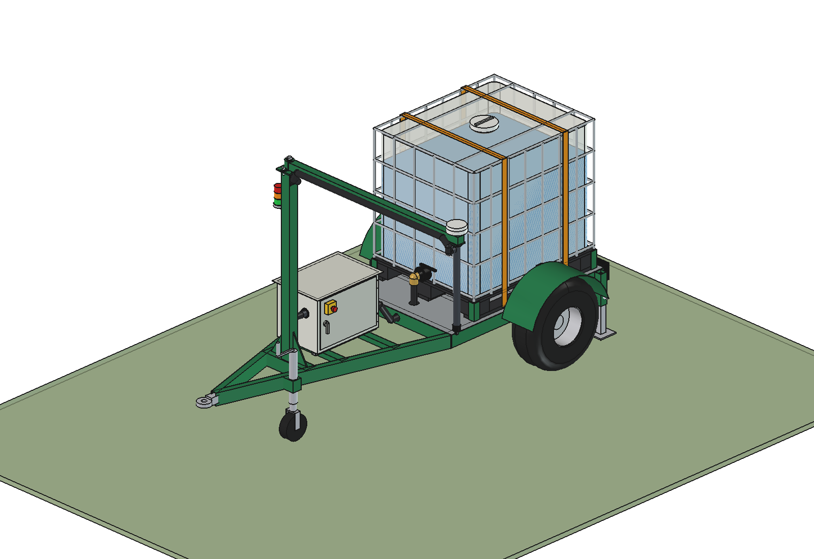
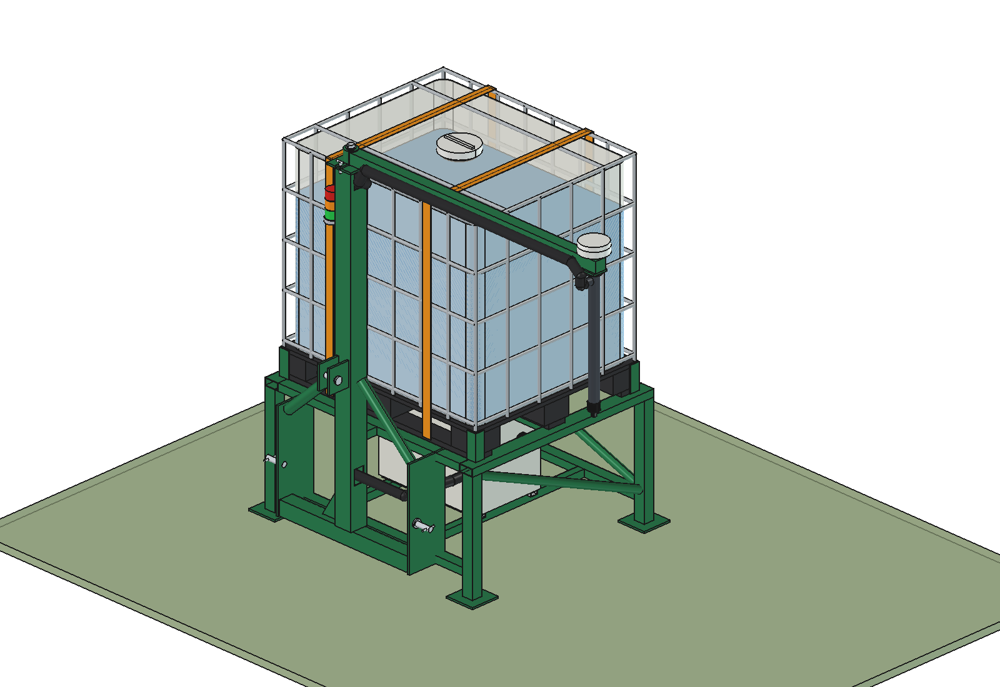
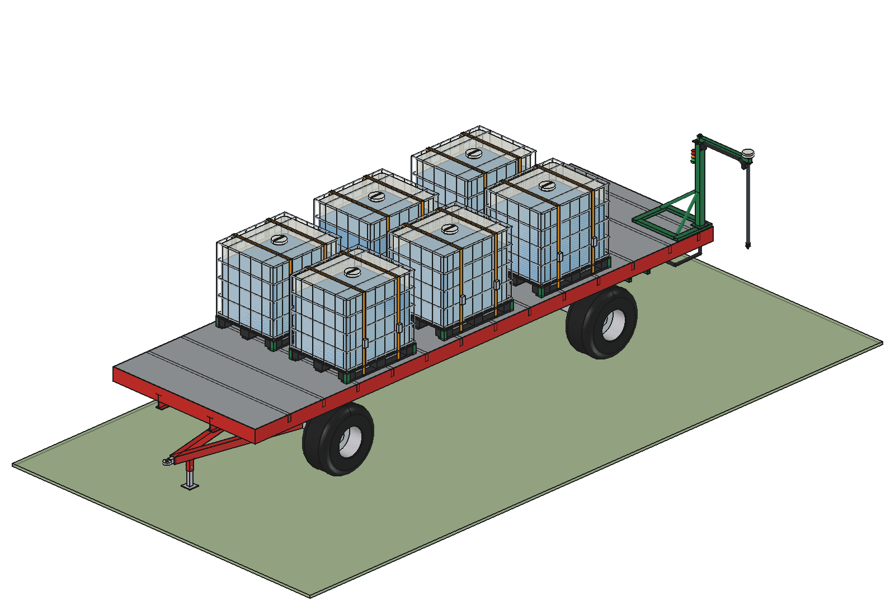
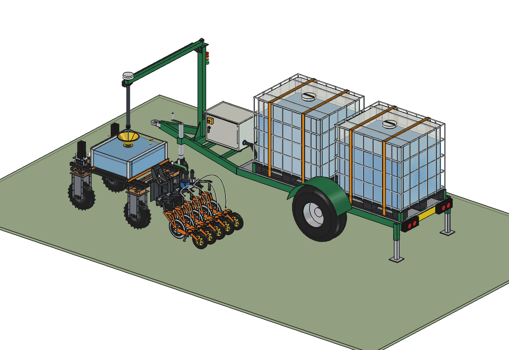
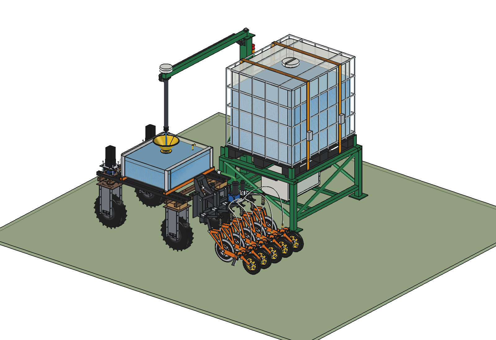
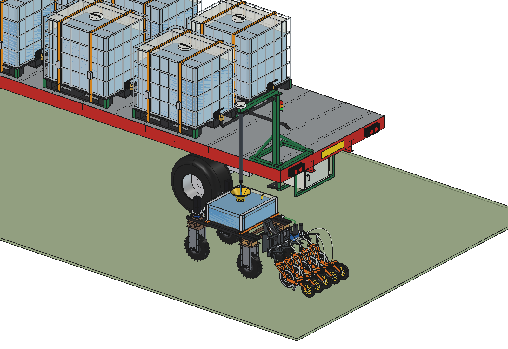
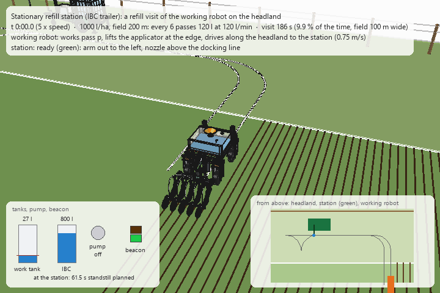

# Stationary refill station

A **refill station that stands still on the headland**. The working robot drives to it when its work tank is low,
stops with its funnel under the nozzle, is topped up and drives back to where it stopped. There is no refiller robot:
the IBCs stand on a carrier that a tractor, pick-up or ATV parks at the field edge.

All three carriers share the same refill head (same parts, same software):

- **Own control box**: a lockable steel enclosure (600 × 400 × 450, IP55) with the 24 V transfer pump and its motor,
  a LiFePO4 battery (25.6 V 50 Ah), the controller, the RTK receiver, the radio, the DC-DC charger, a flow meter
  and a motorised ball valve. Emergency stop on the door.
- **Mast with a swinging arm**, a drop pipe and a **drip-stop nozzle**. The arm is pinned in its position: out to
  the left, out to the right, or folded for transport.
- **RTK antenna straight above the nozzle**: the station measures the exact position of its nozzle (averaged while it
  stands still) and sends it to the working robot as the docking point.
- **Status beacon** on the mast (green ready, amber pumping, red fault).

The concept, all uses and the moving refillers are in the [mobile refiller README](../README.md).

| | Carrier | IBCs | Contents |
| --- | --- | --- | --- |
| [IBC trailer](ibc_trailer/README.md) | dedicated single-axle trailer with an A-frame drawbar, jockey wheel and two drop legs | **1 or 2** | control box and mast on the drawbar; both configurations from one script (`cfg(1)`, `cfg(2)`); why: [RATIONALE](ibc_trailer/RATIONALE.md) |
| [Three-point frame](three_point/README.md) | welded frame on four legs with a cat. 2 three-point hitch; the mast is the hitch tower | **1** | control box under the platform; the tractor sets it down on the headland; why: [RATIONALE](three_point/RATIONALE.md) |
| [Flat wagon](flat_wagon/README.md) | standard 8 m bale wagon (as in the photo), unchanged except two holes and two box hangers | **6** (2 to 8) | mast skid on the rear left corner, control box under the deck, suction header along the deck; why: [RATIONALE](flat_wagon/RATIONALE.md) |

| | | |
| --- | --- | --- |
|  |  |  |
| IBC trailer, 1 IBC | three-point frame | flat wagon with 6 IBCs |
|  |  |  |
| 2 IBCs: the working robot stopped under the nozzle | the working robot beside the frame | the working robot beside the rear of the wagon |

## Key figures

From the models (`build_*.mass_properties`, `check_*`, `clearance`) and the calculations (`*_calc.report()`).
Liquid 1.2 kg/l, IBCs full.

| | Trailer 1 IBC | Trailer 2 IBC | Three-point | Flat wagon (6 IBC) |
| --- | --- | --- | --- | --- |
| Capacity | 1000 l: 1.98 ha | 2000 l: 3.96 ha | 1000 l: 1.98 ha | 6000 l: 11.9 ha |
| Work for one working robot (505 l/ha) | 9.2 h | 18.3 h | 9.2 h | 55 h |
| Mass full | 1,683 kg | 3,064 kg | 1,490 kg | 10.2 t (wagon 2.5 t) |
| Carrier + kit dry | 425 kg | 548 kg | 232 kg | wagon + 143 kg kit |
| Loads full | 787 kg per tyre (10.0/80-12, 1030); nose 108 kg | 1,456 kg per tyre (11.5/80-15.3, 1700); nose 153 kg | 1,575 kg at 610 mm behind the lower pins; 363 kg front ballast on a 4.3 t tractor | 2,564 kg per tyre (500/50-17, ≈ 2575) |
| Tipping sideways, static | 34° (wheel - jockey wheel) | 32.5° | 30.9° (legs) | 31.3° |
| Overall size, arm out (w × l × h) | 2.58 × 3.52 × 2.13 m | 2.61 × 4.97 × 2.14 m | 2.30 × 1.45 × 2.11 m | 3.32 × 8.42 × 2.64 m |
| Transport width | 1.71 m | 1.77 m | 1.41 m | 2.49 m |
| Nozzle reach from the mast | 1,650 mm | 1,650 mm | 1,500 mm | 840 mm (mast on the corner) |
| Nozzle tip / antenna top | 1,250 / 2,105 mm | 1,250 / 2,105 mm | 1,250 / 2,105 mm | 1,270 / 2,600 mm |
| Pump at 120 l/min | 198 W | 203 W | 194 W | 224 W |

Common to all: the working robot is topped up with **120 l per visit** (it calls when 27 l are left). A visit costs
**2–15 % of its time**, depending on the dose and on how far the station is along the headland:

| Visit (field 200 m long, station in the middle of the headland) | Field 50 m wide | 100 m | 200 m |
| --- | --- | --- | --- |
| 250 l/ha: every 24 passes | 136 s (2.0 %) | 186 s (2.7 %) | 286 s (4.1 %) |
| 505 l/ha: every 10 passes | 127 s (4.3 %) | 177 s (5.9 %) | 277 s (9.0 %) |
| 1000 l/ha: every 6 passes | 136 s (7.5 %) | 186 s (9.9 %) | 286 s (14.5 %) |

Without any refiller the working robot loses 30 % (farm tank 500 m away) or 44 % (1 km) of its time. The moving
refillers ([liquid](../liquid/README.md), [simple](../simple/README.md)) cost 2–3 %: the station is cheaper and
simpler, but the working robot has to drive to it. On wide fields: move the station halfway, or use two.

**Battery**: standby 7 W (RTK receiver, controller, radio) = 168 Wh/day; pumping 1000 l takes only 28 Wh. One charge
lasts 5–6 days; a 100 W solar panel (≈ 300 Wh/day, not modelled) makes it independent.

## How a visit works

A visit at the [IBC trailer](ibc_trailer/README.md#a-refill-visit-animation) (`ibc_trailer/animate_sit.py`): pass
end, along the headland, 120 l at 120 l/min (standstill 61.5 s), turn round, back into the next pass.

1. The working robot predicts its tank level. When the next return to the station headland will leave less than the
   reserve (27 l), it sends `REQUEST(litres)` to the station.
2. The station checks its own level, sets the beacon to green and answers `READY(nozzle position)`. The nozzle
   position is the averaged RTK position of the antenna above the nozzle.
3. At the end of its pass the working robot drives along the headland to the station, lines up beside it on the arm
   side and stops with its funnel under the nozzle (the nozzle hangs 106 mm above the funnel rim; the stream may be
   128 mm off the funnel axis, the error is about 43 mm, 2σ).
4. `STOPPED` → the station opens the motorised valve and starts the pump (beacon amber). The flow meter counts the
   litres; the level sensor in the work tank sends `FULL`, the station stops the pump and closes the valve, the
   drip-stop nozzle closes.
5. `CLEAR` → the working robot drives back to the turn where it left the field and continues.
   Every state has a timeout; loss of link, a fault or the emergency stop: pump off, valve closed, beacon red.

The arm is not motorised: the operator pins it on the side where the robots come (left or right) when parking the
station. The working robot needs nothing extra: the same [receiver kit](../simple/README.md) as for the simple
refiller (work tank, funnel Ø300, level sensor).

## Shared files (single source of truth)

The three carriers use the same IBC, control box, mast, arm and calculations. These live here; each carrier folder
has its own `*_params.py`, `*_parts.py`, `build_*.py`, `*_calc.py` and `run_in_freecad.py`.

| File | Contents |
| --- | --- |
| `stc_params.py` | common dimensions: IBC (taken from `../simple/mrs_params.py`), control box and its contents, mast and arm, nozzle, antenna, beacon, pump curve, battery, working robot and docking |
| `stc_parts.py` | IBC in IBC-local coordinates (shapes from `../simple/mrs_parts.py`), control box (enclosure, door, emergency stop, pump, flow meter, motorised valve, battery, DIN plate), mast and arm from a spec (`mast_spec`), beacon, wheels, mudguards, jockey wheel, drop legs, tow eye, lights |
| `stc_build.py` | model tree helpers, `COLOR`, `build_ibc`, `build_box`, `build_mast_arm`, the working robot in the refill scene (robot, applicator and receiver kit via `../simple/build_mrs.py`), interference / fit / docking checks, mass, STEP export, images |
| `stc_calc.py` | pump and hose operating point, a visit of the working robot (detour, docking, pumping), comparison with driving to the farm, battery, nozzle tolerance, steel sections |

Use in FreeCAD: run `run_in_freecad.py` of a carrier (it puts this folder on `sys.path`), then e.g.
`build_sit.render_all()`. The calculations also run without FreeCAD: `python sit_calc.py`.

## Estimated, not measured

- Robot, applicator and receiver kit: as in the [simple refiller](../simple/README.md#estimated-not-measured).
- Pump curve (18 m shut-off, 190 l/min free flow), losses (K 8), efficiency 0.4.
- Masses of bought parts: pump 8 kg, battery 12 kg, enclosure 22 kg, electronics 3 kg, IBC 58 kg, tyres and rims.
- Standby power 7 W, solar yield 3 full-sun hours per day.
- Docking: 25 s to leave the turn, line up and stop; 0.5 m/s on the headland; reserve 27 l.
- Tyre load ratings, wagon mass and payload (the wagon is a simplified generic 8 m bale wagon, not a specific model).
- Tractor for the three-point frame (4.3 t, 1.75 t on the front axle, wheelbase 2.45 m, lower links 1.05 m behind the
  rear axle).
