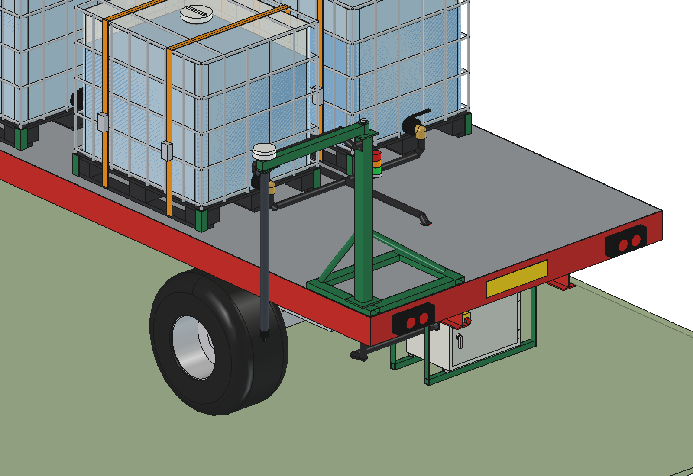
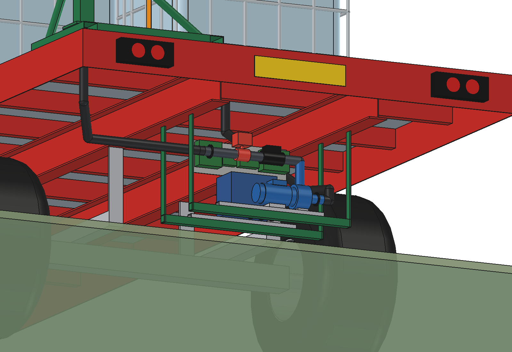
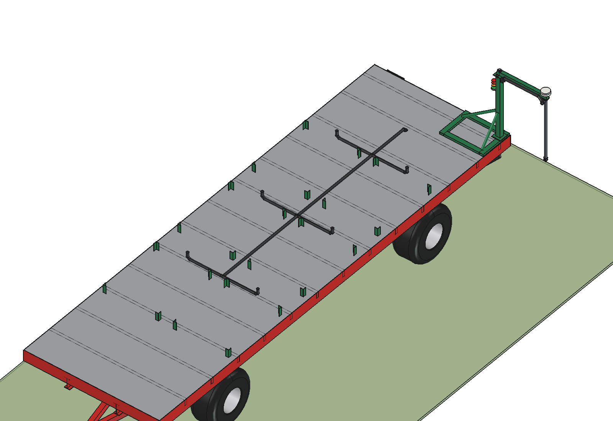
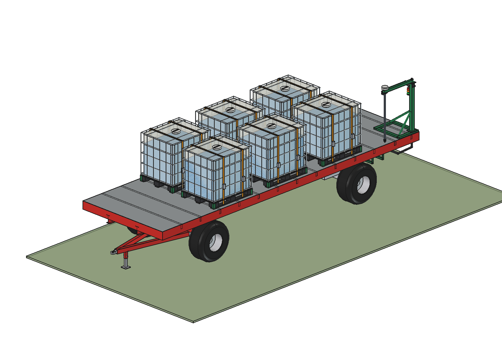
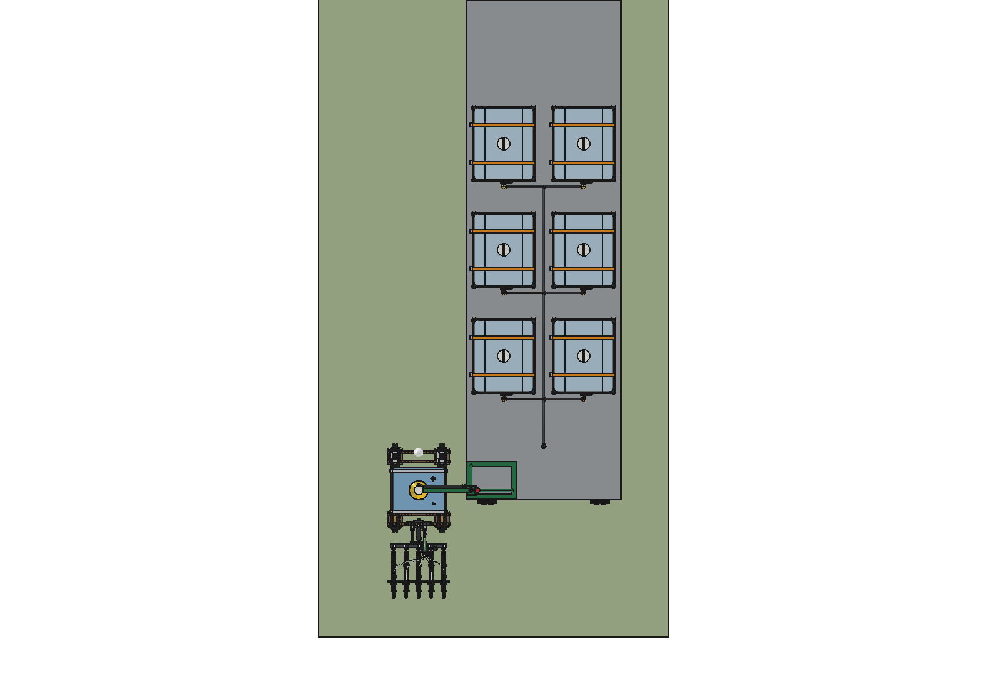
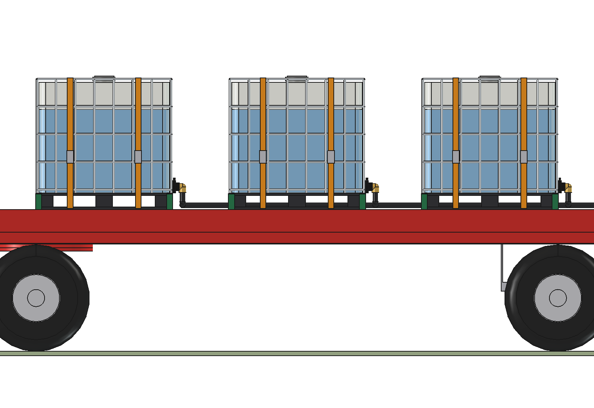
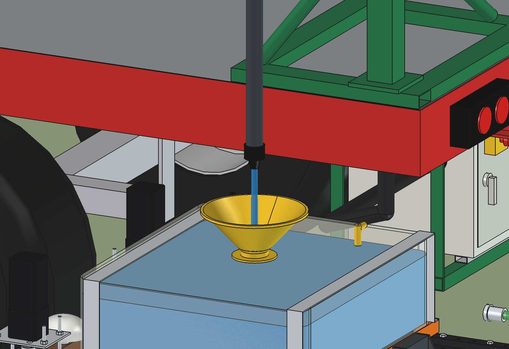

# Stationary refill station: flat wagon (bale wagon)

A **standard two-axle flat wagon** (8 × 2.48 m, turntable steering, as in the photo) carries rows of standard 1000 l
IBCs, two across, valves to the rear. The wagon itself is not changed except for **two holes in the deck and two box
hangers**. The refill kit:

- a **suction header** along the middle of the deck (each IBC valve has a short hose to it), down through the deck;
- the **control box** (pump + motor, battery, controller, RTK receiver, radio) hung under the deck behind the rear
  axle, between the main beams: the pump lies 0.8 m below the bottoms of the IBCs;
- a small **skid with the mast** on the rear left corner of the deck; the arm swings out to the left with the drop
  pipe, the drip-stop nozzle and the **RTK antenna straight above the nozzle**, higher than the IBC tops.

The wagon is parked along the headland with its left side towards the headland lane. The working robot drives to
the rear left corner when its work tank is low and stops with its funnel under the nozzle.

How a visit works, the shared parts and the comparison with the other carriers: [stationary README](../README.md).
Why it is built like this: [RATIONALE.md](RATIONALE.md).


| | | |
| --- | --- | --- |
|  |  |  |
| the working robot stopped under the nozzle beside the rear of the wagon | the mast skid on the rear left corner, the header coming down through the deck | the control box under the deck behind the rear axle (enclosure hidden) |
|  |  |  |
| IBCs hidden: corner guides, valve hoses to the header in the middle | transport: arm folded forwards along the left edge, nozzle 20 mm above the deck | from above |
|  |  | |
| side view | nozzle 126 mm above the funnel rim | |

## Key figures

From the model (`build_sfw.mass_properties`, `check_*`, `clearance`) and `sfw_calc.report()`. Liquid 1.2 kg/l.

| | |
| --- | --- |
| Capacity | 3 rows = 6 IBCs = 6000 l: 11.9 ha at 505 l/ha, 55 h of work for one working robot |
| Mass | wagon 2.5 t (model, simplified generic wagon); kit: skid, guides, box hangers 41 kg, control box 68 kg, mast and arm 27 kg, hoses 7 kg |
| Full, 3 rows | 10.2 t; front axle 5.1 t, rear 5.1 t (rows centred between the axles); 2,564 kg per tyre (500/50-17, ≈ 2,575 kg) |
| Other numbers of rows | 1 row 5.2 t (1,306 kg per tyre), 2 rows 7.7 t (1,935), **4 rows 12.7 t: too much** for these tyres (3,448) and the payload |
| Tipping sideways (static) | 31.3° full (cg 1.62 m high) |
| Size | 2485 × 8421 × 2639 mm in transport; 3315 wide with the arm out |
| Heights | deck 1250, IBC top 2430, arm 2460–2520, antenna top 2600, nozzle 1270 |
| Arm | mast at x −1160 on the rear left corner, reach 840 mm: nozzle 2.0 m left of the centre line; 0 = out, −90 = folded forwards along the left edge |
| Pump | under the deck, axis at 592 mm; bottoms of the IBCs at 1395 mm: always flooded. 11.9 m of hose: 120 l/min, 224 W |
| Mast and arm | 72 Nm at the foot, 5 / 12 MPa (× 2), tip deflection 0.5 mm |

Checks: `check_interference()` (kit and wagon), `check_fit()` (arm −90 → 0°) and `check_docked()` are empty.

## The model

```
Wagon (App::Part, not part of the kit; wagon coordinates: origin = middle of the deck on the ground, y forward)
  deck chequer plate (2 holes), border profile 200, cross members, main beams IPE 200, axles, tyres, rims,
  turntable rings, front bolster, rear springs and hangers, drawbar, tow eye, drawbar stand, rear lights, plate
Station (App::Part)
  Kit          mast skid 80x40x3 and base plate, corner guides, box supports 40x40x3, box hangers 40x8
  IBC_ibc1..6  IBCs turned 90 deg (valve to the rear), camlock elbows, straps
  Control_box  turned 180 deg (door to the rear) under the deck
  Hoses        suction: valve hoses to the header in the middle, header to the rear, down through the deck, to the
               box; discharge: box -> under the deck to the left -> up through the deck and the skid into the mast
  Mast         mast 80x80x4 with two struts, top plate, pivot pin, beacon; Arm: as the other carriers (higher)
```

## Files

| File | Contents |
| --- | --- |
| `sfw_params.py` | wagon (estimated), IBC rows (`n_rows`), skid, box position, mast, arm height, nozzle |
| `sfw_parts.py` | one function per wagon and kit part, placements, hoses |
| `build_sfw.py` | `build`, `set_arm`, `set_levels`, `check_interference`, `check_fit`, `clearance`, `mass_properties`, `build_docked`, `check_docked`, `render_all` |
| `sfw_calc.py` | masses, axle and tyre loads for 1–4 rows, tipping, pump, mast; `python sfw_calc.py` |
| `run_in_freecad.py` | macro: reload, build, print the report |
| `Stationary_Flat_Wagon.FCStd`, `.step` | generated (the STEP contains the kit and the IBCs, not the wagon) |

Shared parts and calculations: `../stc_*.py`.

## Estimated, not measured

- The wagon: dimensions, deck height, tyres and their load rating, mass (from steel volume, simplified: no brakes,
  springs as blocks), payload 10 t. Check the real wagon before loading 6 IBCs: deck strength, axle and tyre ratings.
- Everything listed in the [stationary README](../README.md#estimated-not-measured).
