# Stationary refill station: IBC trailer (1 or 2 IBCs)

A dedicated single-axle trailer for **one or two standard 1000 l IBCs**. A tractor, pick-up or ATV parks it on the
headland: jockey wheel down, two drop legs down at the rear. On the A-frame drawbar sit the **control box** (pump +
motor, battery, controller, RTK receiver, radio) and the **mast** with the swinging arm, the drop pipe, the
drip-stop nozzle and the **RTK antenna straight above the nozzle**. The working robot drives to the trailer when its
work tank is low and stops with its funnel under the nozzle.

How a visit works, the shared parts and the comparison with the other carriers: [stationary README](../README.md).
Why it is built like this: [RATIONALE.md](RATIONALE.md).

| | |
| --- | --- |
|  | 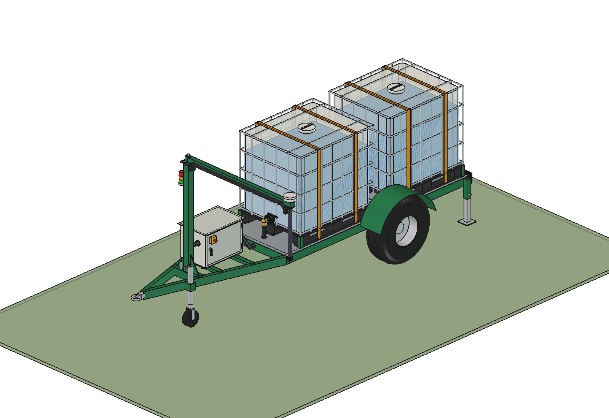 |
| 1 IBC: 10.0/80-12 tyres, deck at 483 mm | 2 IBCs in line: 11.5/80-15.3 tyres, deck at 560 mm |
| 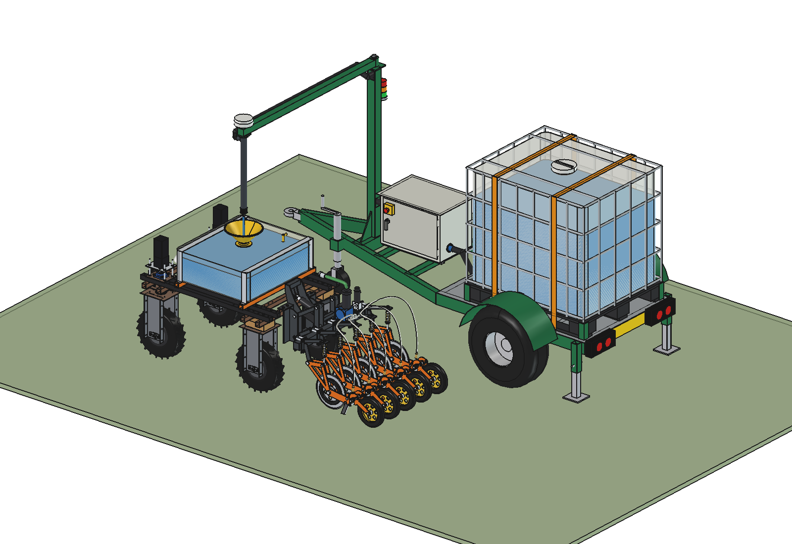 |  |
| the working robot (with the [liquid fertilizer applicator](../../../liquid%20fertilizer%20applicator/advanced/) and the receiver kit) stopped under the nozzle | the same with 2 IBCs; the robot stands beside the drawbar and the wheel |

### A refill visit (animation)


The working robot finishes pass p (1000 l/ha, 200 m: every 6 passes 120 l), lifts its applicator at the edge,
drives along the headland to the trailer and stops with its funnel under the nozzle. The station pumps 120 l at
120 l/min from the IBC (800 → 680 l) into the work tank (27 → 147 l), beacon amber; standstill 61.5 s, the same as
`stc_calc.refill_time`. Then the robot turns round on the headland (forward arc, reverse arc), drives back under the
arm and turns into pass p + 1. GIF at 5 × speed, 20 × while pumping. Why it drives like this:
[RATIONALE § 7](RATIONALE.md#7-the-refill-visit-in-the-animation).

The same visit at the trailer with 2 IBCs: both IBCs hang on one suction header and go down together
(2 × 800 → 2 × 740 l); the robot docks beside the drawbar, the box and the wheel.

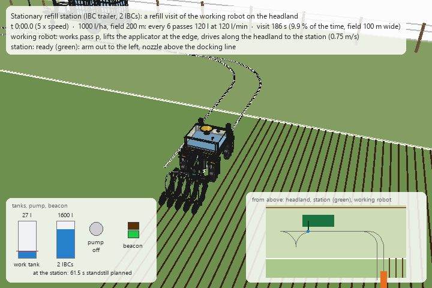

| | | |
| --- | --- | --- |
| 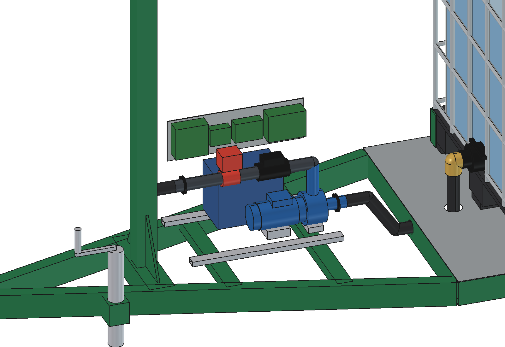 | 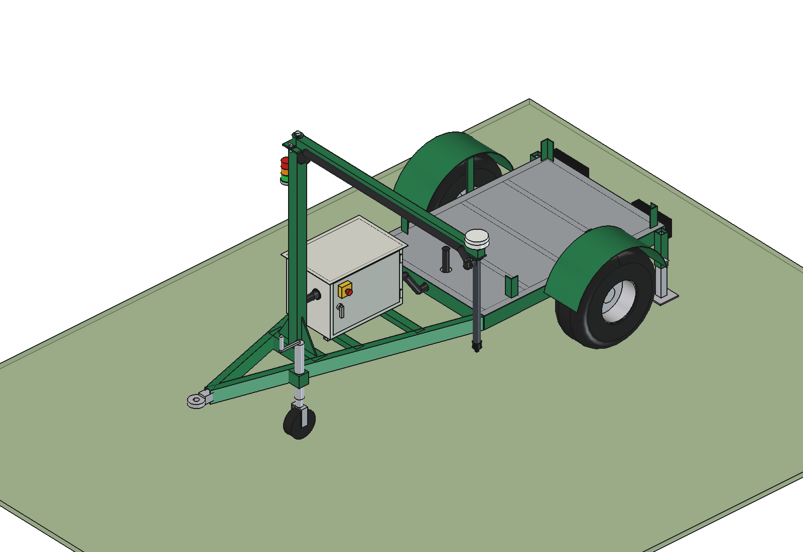 | 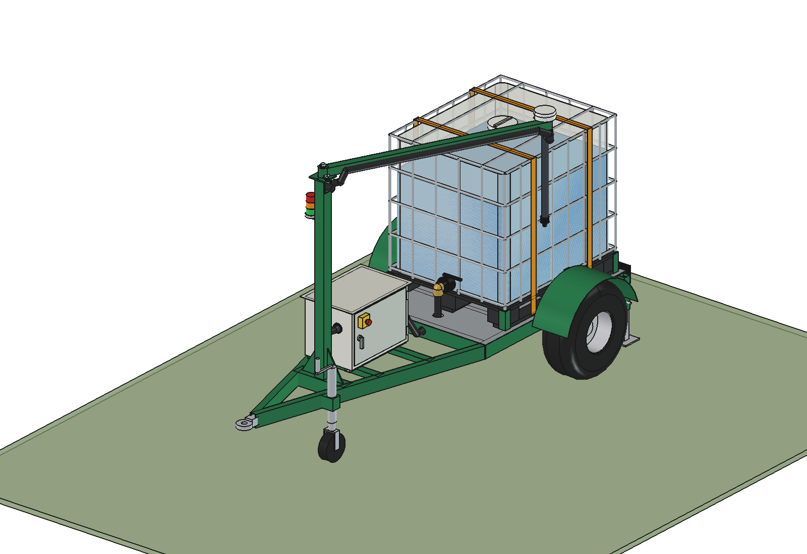 |
| control box opened (door to the left): pump below the IBC valve, flow meter, motorised valve, battery, DIN plate | frame without the IBC: floor, corner guides, elbow through the floor to the suction header | transport: arm pinned at 65° with the nozzle beside the IBC (x −700): inside the trailer width |
| 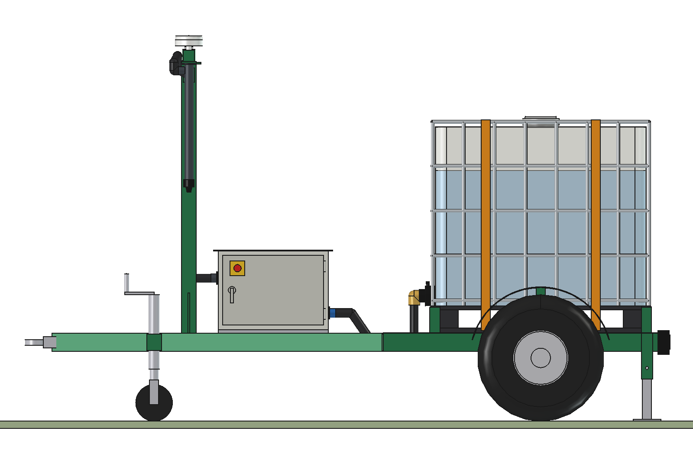 | 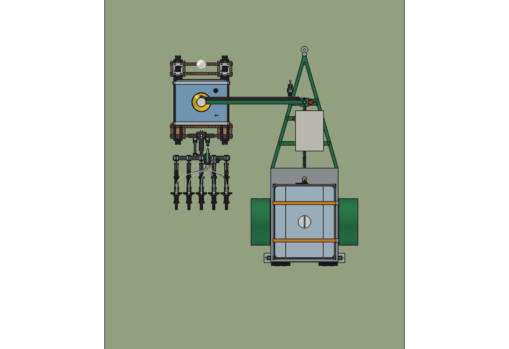 | 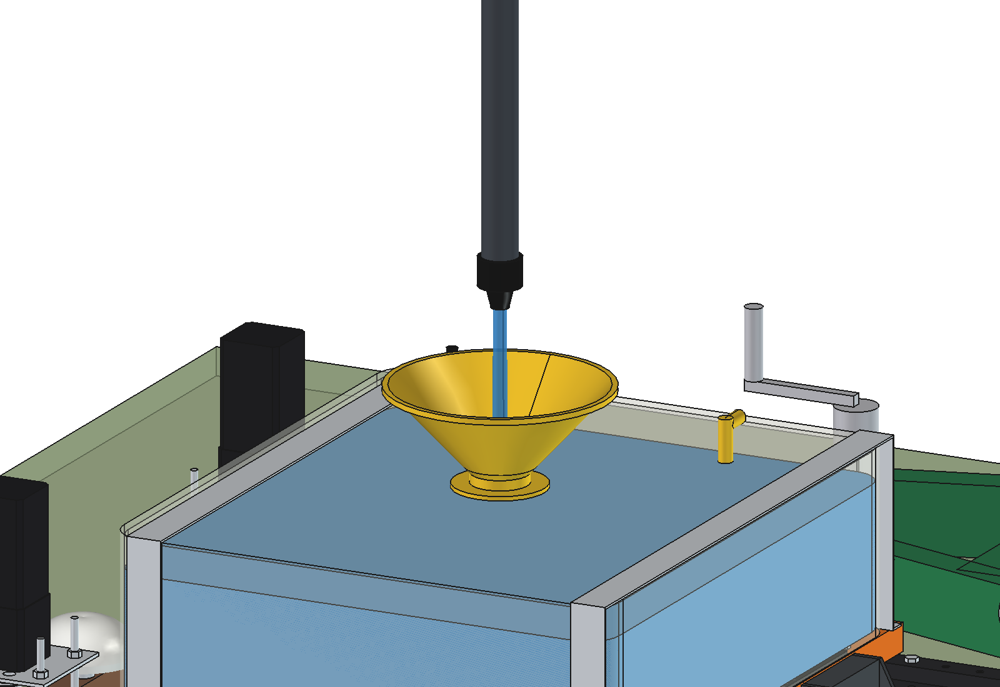 |
| side view | from above: 377 mm between the trailer and the working robot | nozzle 106 mm above the funnel rim |
| 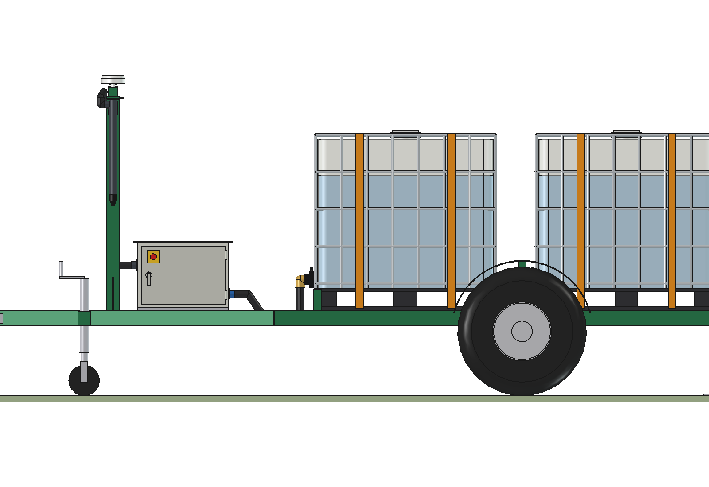 | 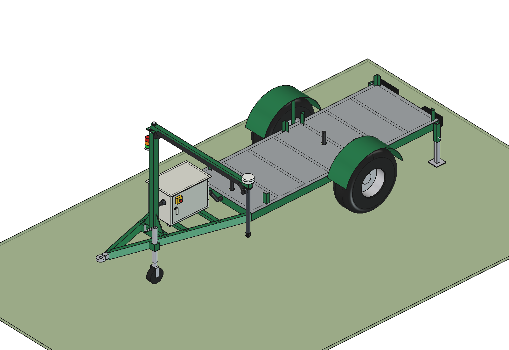 | 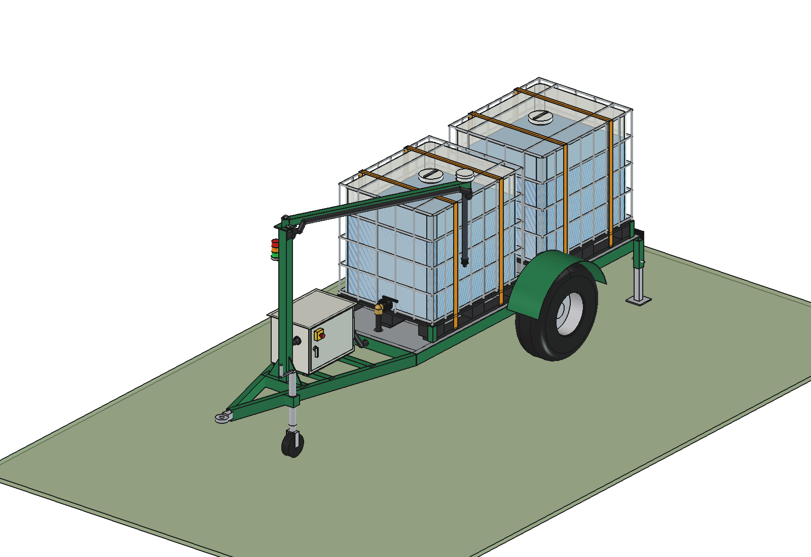 |
| 2 IBCs: the rear IBC's valve in the 250 mm gap | both elbows go down to one suction header under the floor | 2 IBCs, transport |

## Key figures

From the model (`build_sit.mass_properties`, `check_*`, `clearance`) and `sit_calc.report()`. Liquid 1.2 kg/l.

| | 1 IBC | 2 IBCs |
| --- | --- | --- |
| Capacity | 1000 l: 1.98 ha at 505 l/ha, 9.2 h of work | 2000 l: 3.96 ha, 18.3 h |
| Mass dry | trailer 323 kg, control box 68 kg, mast and arm 33 kg | trailer 446 kg, box 68 kg, mast 32 kg |
| Mass full | 1,683 kg | 3,064 kg |
| Axle / tyres full | 1,575 kg: 787 kg per tyre (10.0/80-12, ≈ 1030 kg) | 2,912 kg: 1,456 kg per tyre (11.5/80-15.3, ≈ 1700 kg) |
| Nose load | 108 kg at the eye, 142 kg on the jockey wheel | 125–153 kg at the eye, 187 kg on the jockey wheel |
| Tipping sideways (static, full) | 36° over the wheels, 34° over the line wheel – jockey wheel | 34° / 32.5° |
| Drawbar (A-frame 100 × 50 × 4) | 83 MPa (× 2.5 dynamic) | 117 MPa |
| Size (w × l × h) | 1714 × 3455 mm (transport), 2579 wide with the arm out, 2133 high | 1776 × 4905 mm, 2610 wide arm out, 2140 high |
| Heights | deck 483, IBC top 1663, eye 430 | deck 560, IBC top 1740, eye 508 |
| Arm | reach 1,650 mm (nozzle 1.65 m left or right of the centre line); 0 = left, −180 = right, 65° = transport | same |
| Clearance at the refill | 377 mm between the working robot and the trailer (below 1.3 m) | 663 mm |
| Pump | axis 590 mm below the bottom of the IBC (628): always flooded. 120 l/min, 198 W | axis 668 / bottle 706, 203 W |
| Mast and arm | 168 Nm at the foot, 11 MPa / 27 MPa (× 2), nozzle deflection 3.3 mm | same |

Checks: `check_interference()` and `check_fit()` (arm from the transport lock over the left and the front to the
right) are empty for both configurations; `check_docked()` (working robot with applicator and receiver kit) is empty.
Animation: `animate_sit.check_docked(n)` is empty and `animate_sit.check_fit(n)` finds no overlap in any frame, for
1 and 2 IBCs (every 2nd frame; the frames where the outlines come within 400 mm, including the docked pose and the
passes under the arm, are checked in 3D: 28 for 1 IBC, 31 for 2 IBCs); `summary(n)` gives the range of the key
figures (litres, levels, speeds, lift, times).

## The model

```
Station (App::Part, trailer coordinates: origin = middle of the axle on the ground, y towards the tow eye)
  Frame         side rails and front / rear rail 100x50x4, cross members 80x40x3 (holes for the header), floor
                plate 3 mm (holes for the elbows), corner guides, A-frame drawbar 100x50x4, box cross members,
                mast cross beam, tow eye 40
  Running_gear  square axle 70 with stubs, clamp plates, tyres, rims, mudguards
  Parking       jockey wheel with clamp, two drop legs (sleeve, leg with foot, pin), rear lights, number plate
  IBC_ibc1(2)   IBC turned -90 deg (valve forward): pallet, bottle + liquid, cage, valve, cap, camlock elbow, straps
  Control_box   (turned 90 deg: door to the left) enclosure, roof, door, emergency stop, glands, pump, feet,
                discharge line, flow meter, motorised valve, battery, DIN plate with controller / RTK / radio / DC-DC
  Hoses         suction: elbows down through the floor, header under the floor, up to the box;
                discharge: box -> into the mast -> up inside
  Mast          mast 80x80x4, gussets, top plate, pivot pin, beacon; Arm (rotates): arm 60x60x3, lock pin, tip
                plate, drop pipe PP 50, drip-stop nozzle, RTK antenna, hose along the arm
```

## Files

| File | Contents |
| --- | --- |
| `sit_params.py` | trailer dimensions; `cfg(n)` derives everything for 1 or 2 IBCs (deck height, IBC positions, A-frame, box, mast, reach, transport angle) |
| `sit_parts.py` | one function per trailer part, placements of the IBCs, box and mast, hoses |
| `build_sit.py` | `build(n)`, `set_arm`, `set_levels`, `check_interference`, `check_fit`, `clearance`, `mass_properties`, `build_docked(n)`, `check_docked`, `docked_gap`, `render_all` |
| `sit_calc.py` | masses, axle and nose load, tyres, tipping, drawbar, mast, pump; `python sit_calc.py` |
| `animate_sit.py` | animation of a refill visit, 1 or 2 IBCs (`n`): `build(n)`, `play(n)`, `stop()`, `summary(n)`, `check_docked(n)`, `check_fit(n)`, `render_all(folder, n)`; separate document `Stationary_IBC_trailer_<n>_on_robot_animation` with the field, the headland, the trailer, the working robot (agbot design + applicator advanced + receiver kit). Thin wrapper around `../stc_anim.py` |
| `make_gif_sit.py` | frames to GIF with caption, tank / pump / beacon panel and a map from above (`../stc_gif.py`): `make_gif_sit.main(folder, "previews/animation_refill_visit.gif")` (`_2ibc.gif` for 2 IBCs) |
| `run_in_freecad.py` | macro: reload, build (`N_IBC = 2` before running for 2 IBCs), print the report |
| `Stationary_IBC_Trailer_1/2.FCStd`, `.step` | generated |
| `previews/` | images (`1_*` one IBC, `2_*` two IBCs) |

Shared parts and calculations: `../stc_*.py` (see the [stationary README](../README.md#shared-files-single-source-of-truth)).

## Estimated, not measured

- Tyre load ratings (implement tyres at 25 km/h), tyre and rim masses.
- Trailer frame from steel volume (S235); no brakes and no suspension modelled.
- Animation: speeds of the working robot on the headland (0.5 m/s, 0.3 m/s for the last 2 m, 0.4 m/s in the
  turn-round, 0.4 m/s reversing), acceleration 0.5 m/s², steering rate 35°/s, applicator lift 60 mm/s.
- Everything listed in the [stationary README](../README.md#estimated-not-measured).
