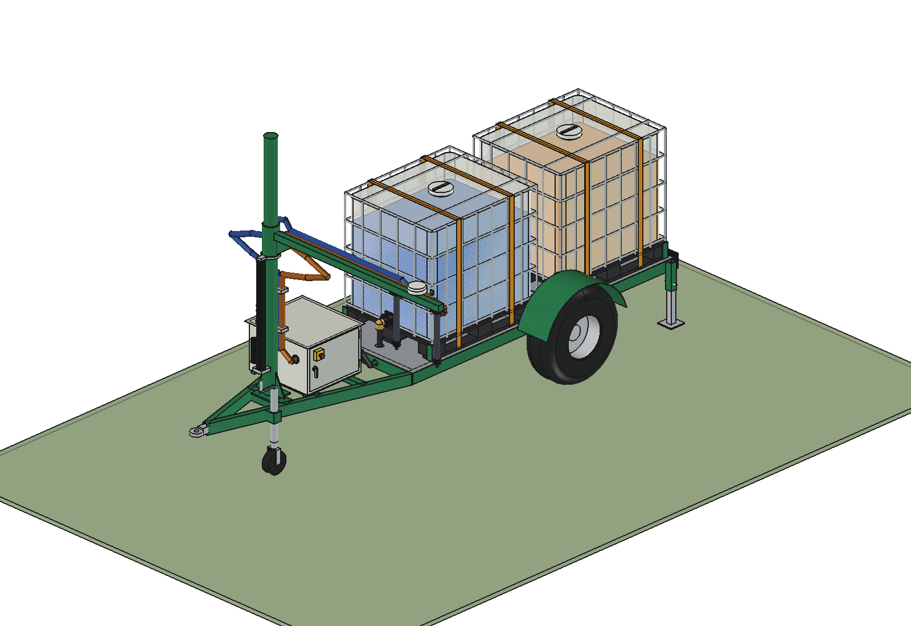
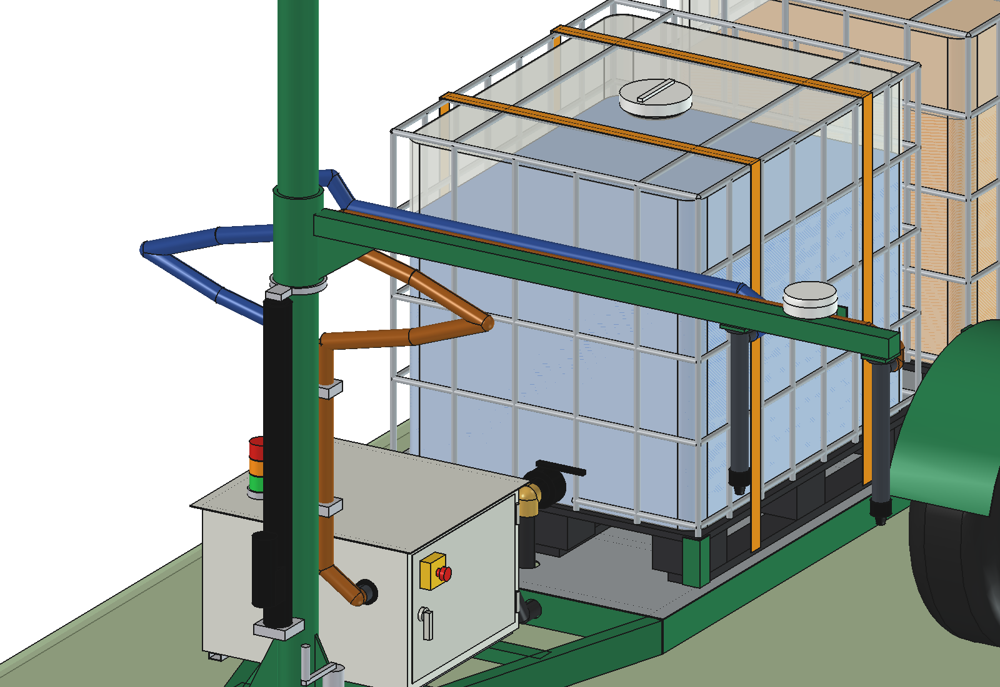
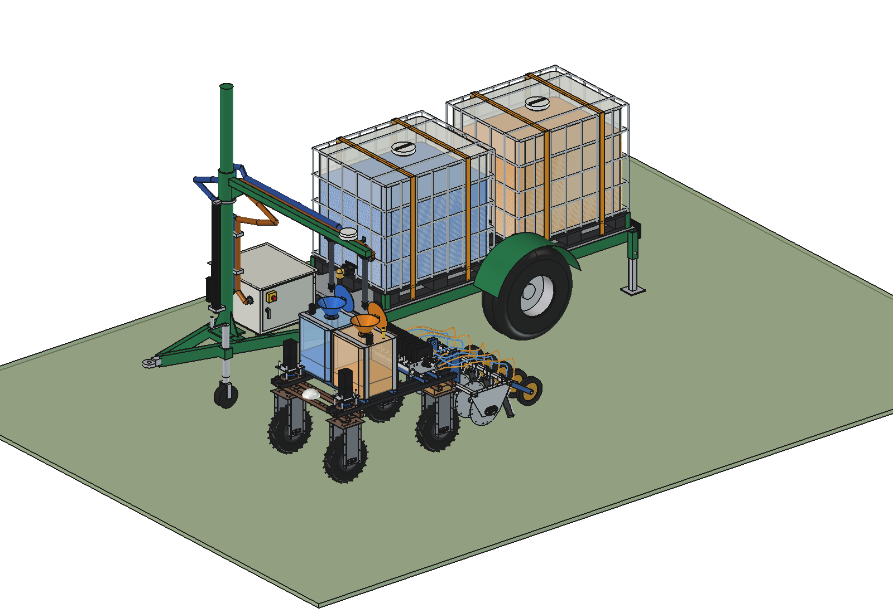
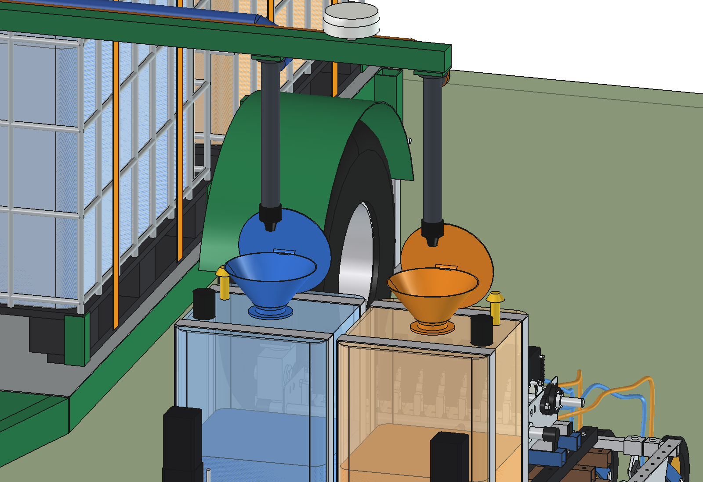
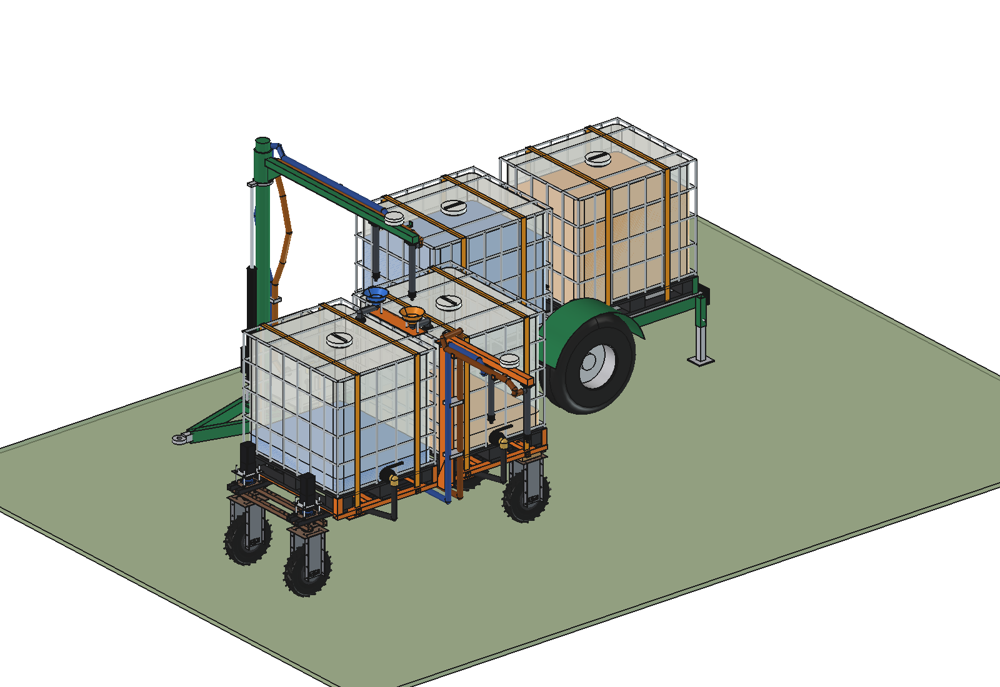
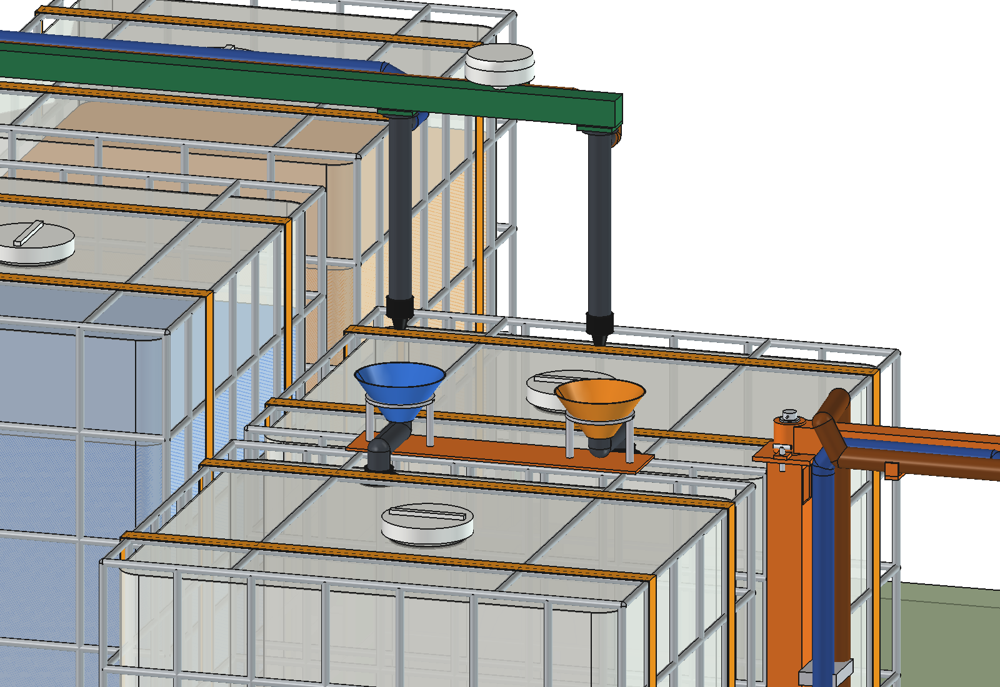
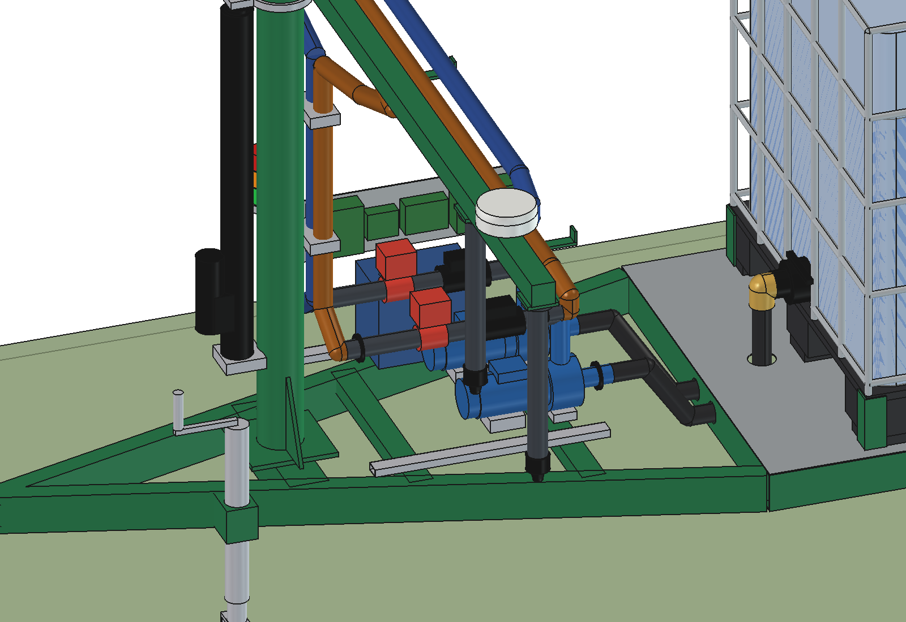
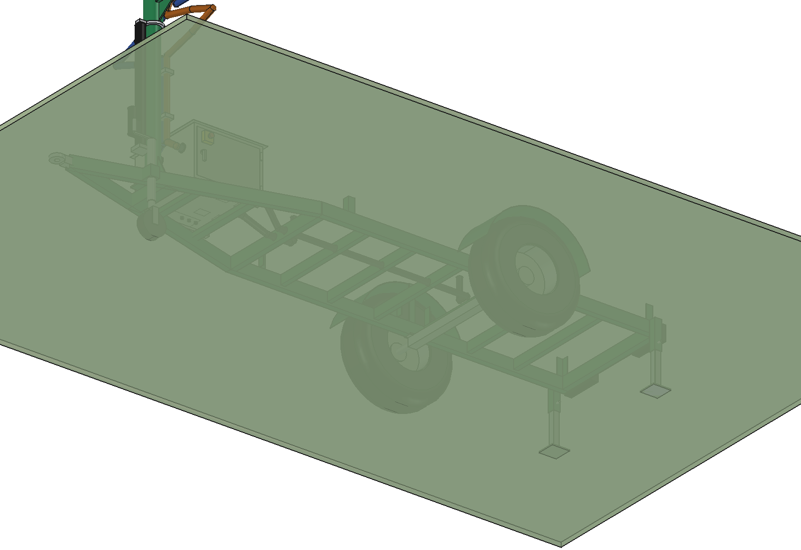
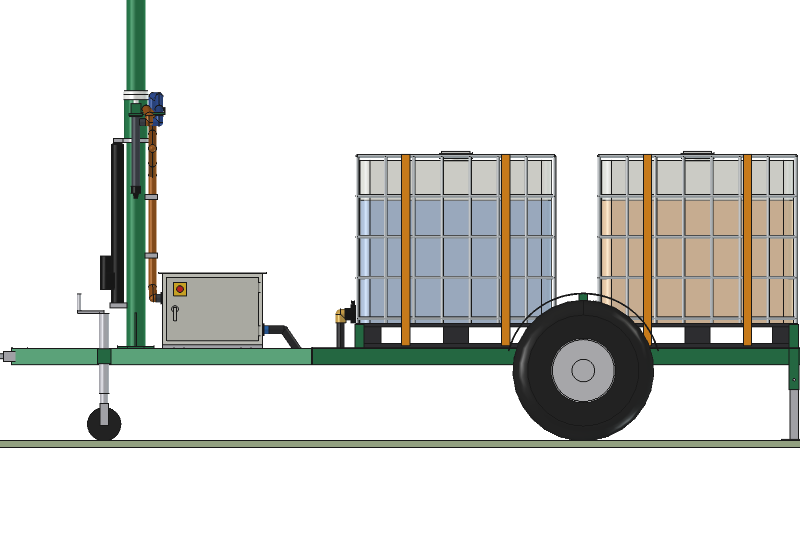
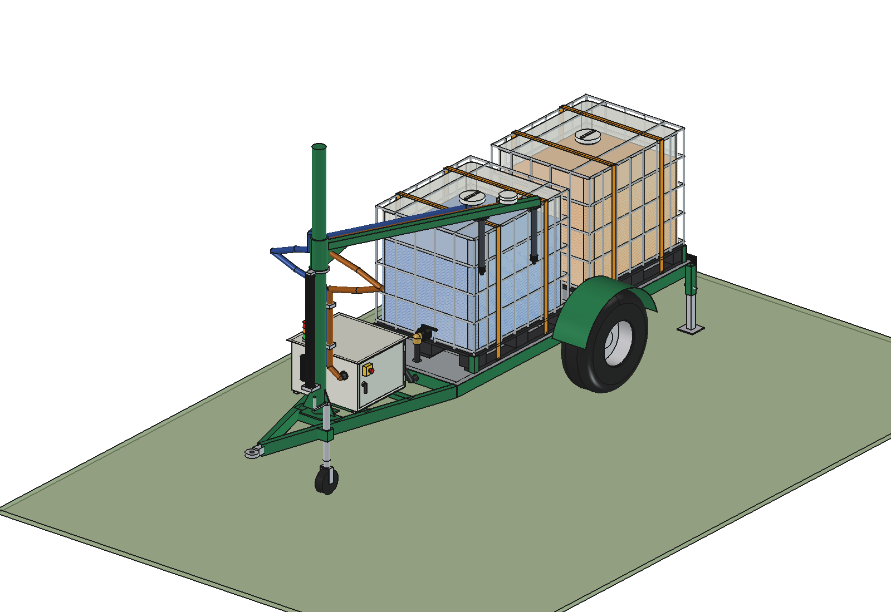

# Stationary refill station: IBC trailer with two liquids

The [2-IBC trailer](../ibc_trailer/README.md) for a working robot that applies **two liquids**, the
[precision applicator V4](../../../liquid%20fertilizer%20applicator/precision_applicator/combined_v4/README.md), and for
the [mobile refiller with two IBCs](../../simple_two_ibc/README.md) that serves it:

- **IBC 1 (front) holds liquid A (blue), IBC 2 (rear) liquid B (orange)**; each has its **own suction line** under
  the floor (side by side, through the cross members and the front rail) and its **own pump**;
- **one control box with two pumps** (each with a flow meter and a motorised ball valve), one battery, controller,
  RTK receiver and radio; the box is 660 deep instead of 400;
- the two **discharge hoses run side by side** up the back of the mast and **along the arm** to **two drop pipes with
  a drip-stop nozzle each, 455 mm apart** (the funnel pitch of the applicator V4): the working robot stops beside the
  trailer with funnel A under nozzle A and funnel B under nozzle B, and both pumps run at the same time;
- a **lifting arm**: the arm rides on a sleeve on a round mast, an electric linear actuator lifts it 706 mm. Low
  (nozzles at z 1460) it fills the working robot; high (nozzles at z 2166) it fills the **mobile refiller with two
  IBCs**, which stops at the same place with the two fill funnels on its fill bridge under the nozzles. A slack loop
  in each hose takes up the lift.

Animations (no text in the picture): [two_liquids_animations](../../two_liquids_animations/README.md): the working
robot filled at the trailer, and the mobile refiller reloading at the trailer.

| | |
| --- | --- |
|  |  |
|  |  |
|  |  |
|  |  |
|  |  |

## Key figures

From `build_sit2.check_interference`, `check_fit`, `check_docked`, `check_docked_refiller`, `clearance` and
`mass_properties`:

| | |
| --- | --- |
| Trailer | as `../ibc_trailer` with 2 IBCs: tyres 11.5/80-15.3, deck z 561, mast at y 2685 (trailer origin = middle of the axle) |
| Reach | working robot centre line 1650 from the mast (as the 1-IBC trailer); nozzle A 1422.5, nozzle B 1877.5 |
| Nozzles | low: tips z 1460, 106 above the funnel rims of the applicator V4; high (+706): z 2166, 106 above the fill funnels of the mobile refiller; offset nozzle–funnel 0.0 mm in both scenes |
| Lift | round mast Ø114.3 × 5 to z 2896, sleeve Ø140, linear actuator 24 V, stroke 706, 40 mm/s (18 s); thrust collar and rod move up with the arm |
| Interference | none: arm low and high; arm swung from the transport lock over the front to the right (the slack loops excluded while swung: they are redrawn for the lift, not for the swing); with the working robot docked; with the mobile refiller docked and the arm high |
| Overall size | 2806 × 4971 × 2896 mm (arm out to the left) |
| Mass | trailer 446 kg, control box with 2 pumps 150 kg, mast with arm, sleeve and actuator 179 kg, 2 empty IBCs 122 kg, 2 × 800 l: 1920 kg |
| Pumping | 2 × 120 l/min at the same time: the working robot (2 × 62 l) in 33 s; the mobile refiller (2 × 500 l) in 4.3 min |

## Files

| File | Contents |
| --- | --- |
| `Stationary_IBC_Trailer_Two_Liquids.FCStd/.step` | trailer with arm out and low, 800 l per IBC (generated) |
| `sit2_params.py` | liquids per IBC, suction lines, box with two pumps, lifting arm, hose layout |
| `sit2_parts.py` | cross members and front rail with two line holes, deeper box with two pumps, suction and discharge hoses, round mast, sleeve, actuator, collar, slack loops, arm with two drop pipes (inlets on the back), hose saddles |
| `build_sit2.py` | build (frame from `../ibc_trailer`, IBC/box/mast parts from `../stc_parts.py`), `set_arm()`, `set_lift()`, `set_levels()`, checks, refill scenes with the working robot and with the mobile refiller, images, STEP |
| `run_in_freecad.py` | macro: reload, build, print the sizes |

## Usage

```python
import build_sit2
build_sit2.build()
build_sit2.check_interference(); build_sit2.check_fit()
build_sit2.set_lift(build_sit2.P.lift_high); build_sit2.check_interference()
build_sit2.build_docked(); build_sit2.check_docked()                     # working robot
build_sit2.build_docked_refiller(); build_sit2.check_docked_refiller()   # mobile refiller, arm high
build_sit2.render_all()
```

All checks together take about a minute: start them with `QtCore.QTimer.singleShot` from the MCP.

## Estimated, not measured

- Linear actuator (stroke 706, 40 mm/s, load: arm with two full drop pipes and hoses about 45 kg plus friction of
  the sleeve); the sleeve needs PE bushes and an index pin for the swing (not modelled).
- The slack loops: hose length and bend radius at the low position not checked against the hose datasheet.
- Second pump, flow meter and valve 11.5 kg, deeper box +9 kg.
- Everything in the lists of [../ibc_trailer](../ibc_trailer/README.md) and [../README.md](../README.md).
