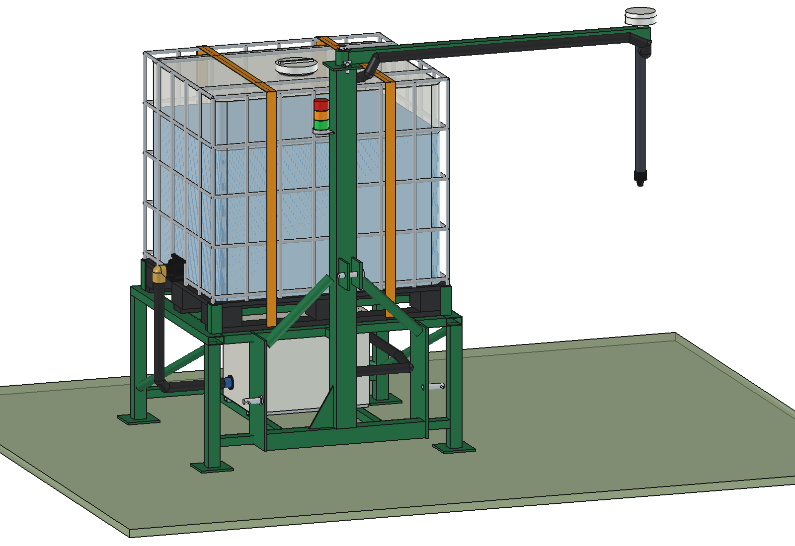
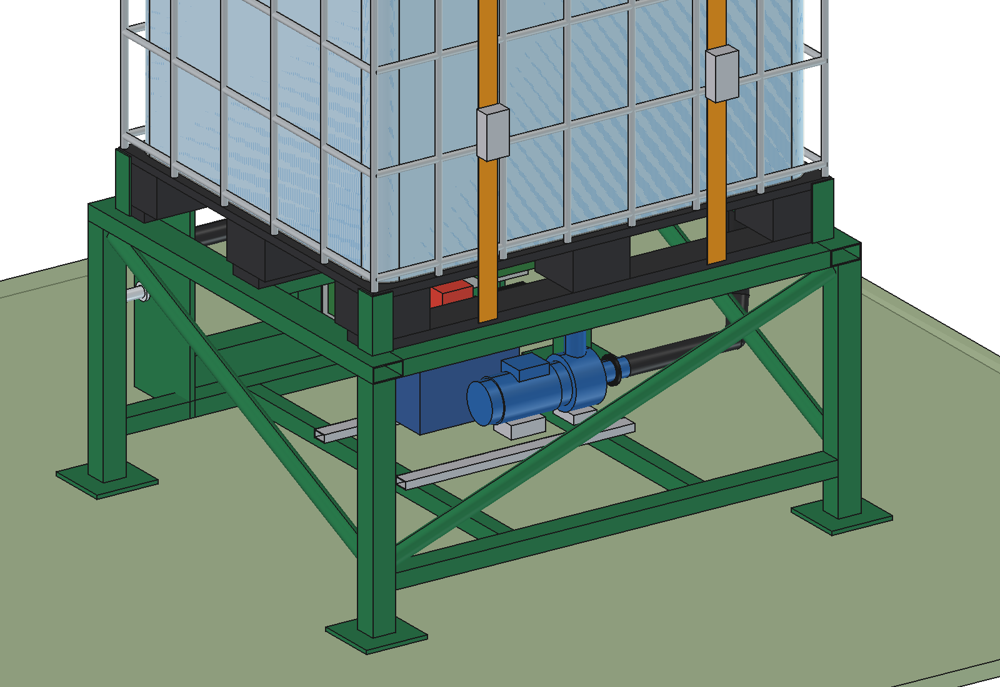
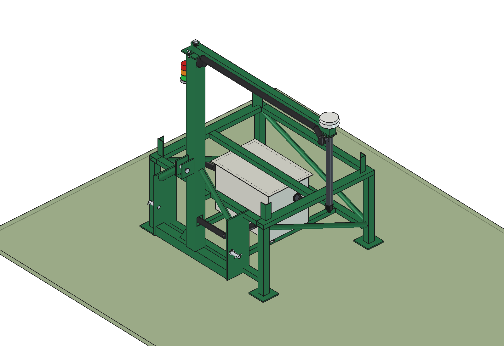
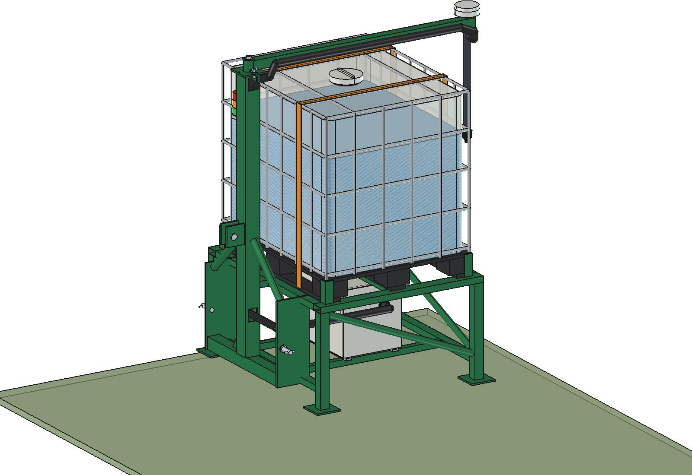
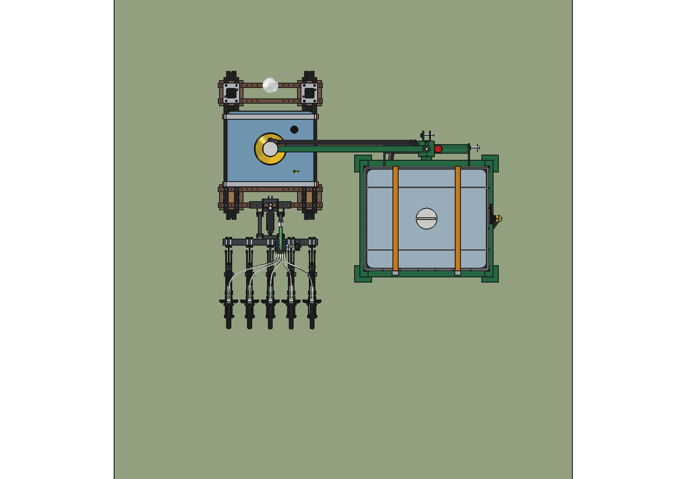
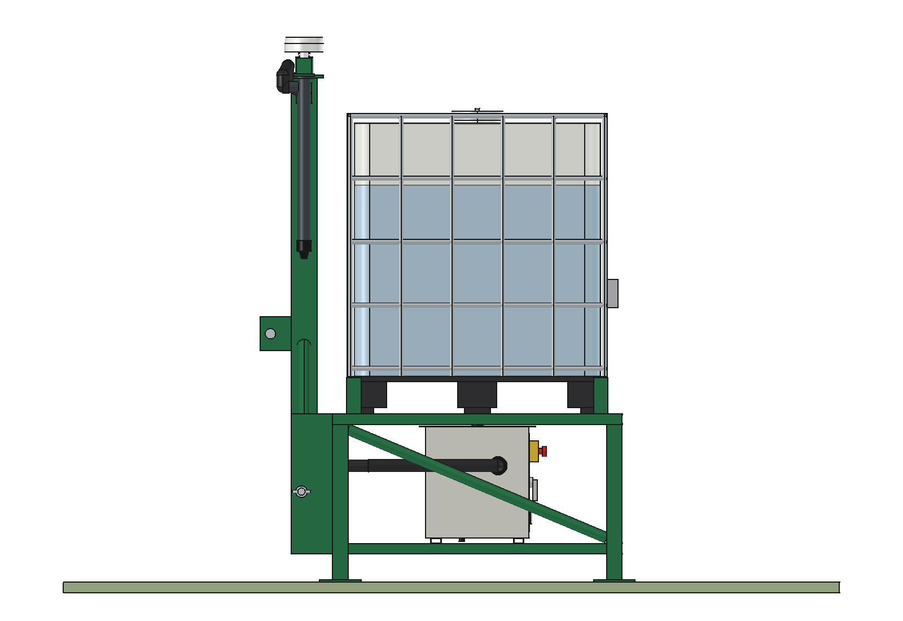
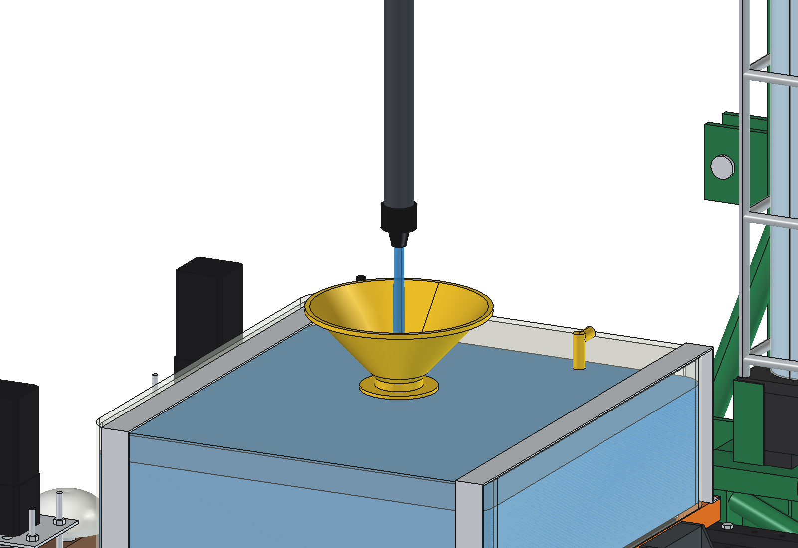
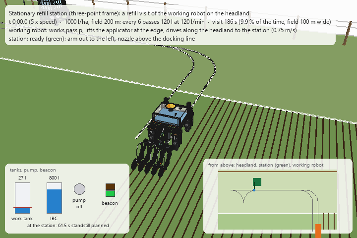

# Stationary refill station: three-point frame (1 IBC)

A welded frame on four legs carries one standard 1000 l IBC. The tractor picks it up on its **three-point linkage
(category 2)**, drives it to the headland and sets it down on its legs. The **control box** (pump + motor, battery,
controller, RTK receiver, radio) hangs protected under the platform. The **mast is also the hitch tower**: the top
link attaches to it, and on its top the arm swings with the drop pipe, the drip-stop nozzle and the **RTK antenna
straight above the nozzle**. The working robot drives to the frame when its work tank is low and stops with its
funnel under the nozzle.

How a visit works, the shared parts and the comparison with the other carriers: [stationary README](../README.md).
Why it is built like this: [RATIONALE.md](RATIONALE.md).


| | | |
| --- | --- | --- |
|  |  |  |
| the working robot stopped under the nozzle | seen from the tractor: lower pins cat. 2 (825 mm), top link on the mast, braces | under the platform (enclosure hidden, door to the rear): pump 535 mm below the bottom of the IBC |
|  |  |  |
| frame without the IBC: platform, legs with foot plates, braces, box supports | lifted 300 mm by the tractor, arm folded back over the IBC | from above |
|  |  | |
| side view | nozzle 106 mm above the funnel rim | |

### A refill visit (animation)



The frame stands on its legs on the headland, parallel to the field edge (the tractor has gone), arm out to the
left. The working robot finishes pass p (1000 l/ha, 200 m: every 6 passes 120 l), drives along the headland and
stops on the left side of the frame with its funnel under the nozzle. The station pumps 120 l at 120 l/min
(IBC 800 → 680 l, work tank 27 → 147 l, beacon amber; standstill 61.5 s = `stc_calc.refill_time`). The robot turns
round on the headland, drives back under the arm and into pass p + 1. GIF at 5 × speed, 20 × while pumping. The
scene and the route are the same for all stations: see the
[IBC trailer RATIONALE § 7](../ibc_trailer/RATIONALE.md#7-the-refill-visit-in-the-animation).

## Key figures

From the model (`build_s3p.mass_properties`, `check_*`, `clearance`) and `s3p_calc.report()`. Liquid 1.2 kg/l.

| | |
| --- | --- |
| Capacity | 1000 l: 1.98 ha at 505 l/ha, 9.2 h of work for one working robot |
| Mass | frame and hitch 119 kg, control box 68 kg, mast and arm 43 kg, hoses 2 kg: **232 kg dry**, 1,490 kg full |
| On the tractor | cg 645 mm behind the lower pins: **1,575 kg at 610 mm** (lift capacity of the example tractor: 3,500 kg). Front axle down to 12 % on a 4.3 t tractor: **363 kg front ballast** for 20 % |
| Hitch loads, full | top link 15.4 kN, 10.6 kN per lower pin (Ø28: 17 MPa shear); mast above the platform 167 MPa (× 2 dynamic) without the braces: the two braces to the mast take most of it |
| Standing on the legs | tipping sideways 30.9°, backwards 29.4° (full, cg 1.15 m high) |
| Size | 1380 × 1220 mm footprint (feet); 2297 wide with the arm out, 1412 × 1745 mm in transport (arm folded back, 295 mm behind the feet), 2105 mm high |
| Heights | platform 650, IBC top 1830, lower pins 350 (standing), top link pin 960, nozzle 1250, antenna 2105 |
| Arm | reach 1,500 mm: 0 = left, 180 = right, 90 = folded back over the IBC (transport, also when hitched) |
| Pump | axis at 260 mm, bottom of the IBC at 795 mm: always flooded. 120 l/min, 194 W |

Checks: `check_interference()`, `check_fit()` (arm 0 → 180°, over the IBC) and `check_docked()` are empty.
Animation: `animate_s3p.check_docked()` is empty and `animate_s3p.check_fit()` finds no overlap in any frame (every
2nd frame; the 24 frames within 400 mm of the station, including the docked pose, checked in 3D); `summary()`
gives the range of the key figures.

## The model

```
Station (App::Part, frame coordinates: origin = middle of the IBC footprint on the ground, y towards the tractor)
  Frame        side rails 80x40x3 under the pallet edges, front / middle / rear rails, legs 60x60x4 with foot plates,
               lower rails 60x40x3, box supports 40x40x3, diagonal braces, corner guides
  Hitch        hitch plates 12 mm with lower pins cat. 2 (D28, 825 mm), mast foot beam 80x80x4, mast link,
               top link plates with pin D25 at 610 mm above the lower pins, braces from the plates to the mast
  IBC_ibc1     IBC turned 180 deg (valve to the right), camlock elbow, straps
  Control_box  turned 180 deg (door to the rear) under the platform: as in the stationary README
  Hoses        suction: valve -> down beside the side rail -> under the platform -> box; discharge: box -> forward
               -> into the mast (-x face) -> up inside
  Mast         mast 100x100x5 (= hitch tower), gusset, top plate, pivot pin, beacon; Arm: as the other carriers
```

## Files

| File | Contents |
| --- | --- |
| `s3p_params.py` | frame, hitch (cat. 2), mast, box position, the example tractor |
| `s3p_parts.py` | one function per frame and hitch part, placements, hoses |
| `build_s3p.py` | `build`, `set_arm`, `set_lift`, `set_levels`, `check_interference`, `check_fit`, `clearance`, `mass_properties`, `build_docked`, `check_docked`, `render_all` |
| `s3p_calc.py` | masses, tractor (lift, front ballast, top link, pins, mast), tipping on the legs, pump; `python s3p_calc.py` |
| `animate_s3p.py` | animation of a refill visit: `build()`, `play()`, `stop()`, `summary()`, `check_docked()`, `check_fit()`, `render_all(folder)`; separate document `Stationary_three_point_on_robot_animation`. Thin wrapper around `../stc_anim.py` |
| `make_gif_s3p.py` | frames to GIF (`../stc_gif.py`): `make_gif_s3p.main(folder, "previews/animation_refill_visit.gif")` |
| `run_in_freecad.py` | macro: reload, build, print the report |
| `Stationary_Three_Point.FCStd`, `.step` | generated |

Shared parts and calculations: `../stc_*.py`.

## Estimated, not measured

- The example tractor (4.3 t, 1.75 t front axle, wheelbase 2.45 m, lower links 1.05 m behind the rear axle,
  3.5 t lift capacity at 610 mm).
- Frame from steel volume (S235/S355); the mast stress ignores the braces (conservative).
- Everything listed in the [stationary README](../README.md#estimated-not-measured).
