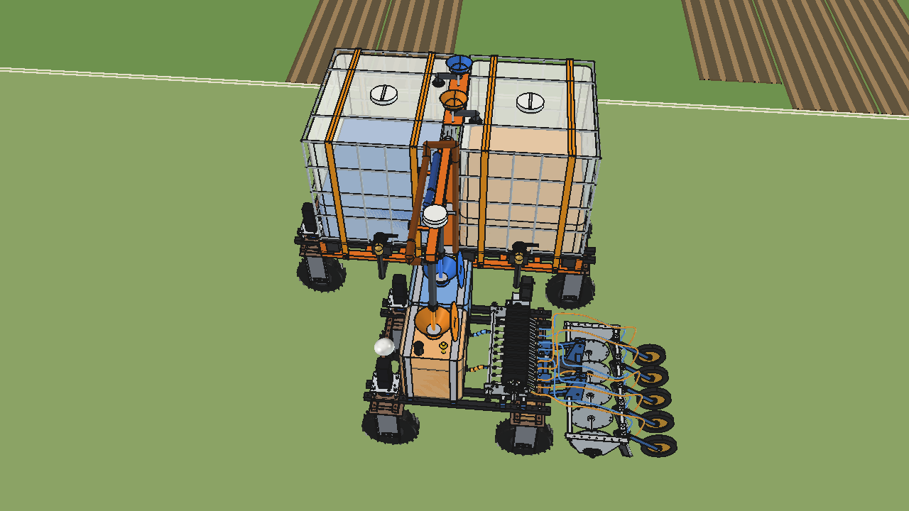
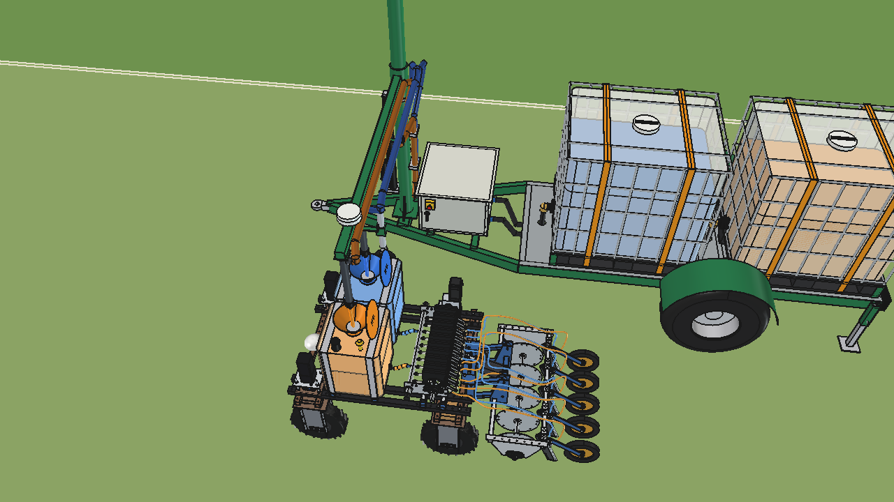
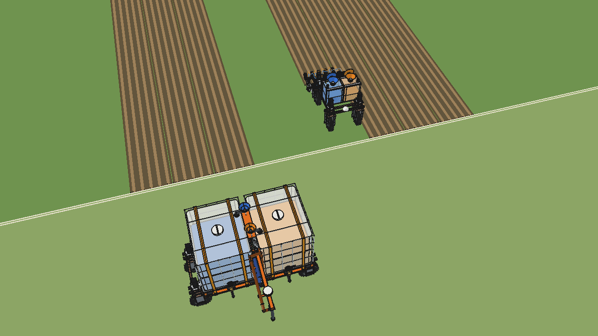
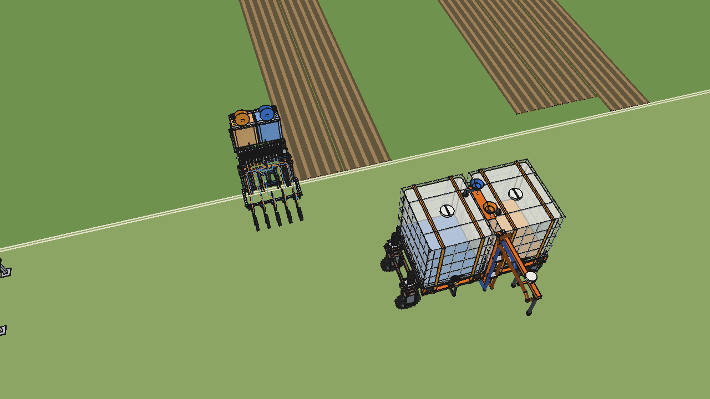

# Two liquids: refill animations (no text in the picture)

Four animations of the refill chain for the
[precision applicator V4](../../liquid%20fertilizer%20applicator/precision_applicator/combined_v4/README.md), which
applies two liquids from two work tanks with a fill funnel each (A blue on the right, B orange on the left). They are
rendered in FreeCAD from the real models, without caption, graphs or numbers: the picture tells the story.

| | Animation | What happens |
| --- | --- | --- |
| [MP4](previews/refill_in_the_turn.mp4) | **Refill in the turn** | The [mobile refiller with two IBCs](../simple_two_ibc/README.md) waits inside the U-turn. The working robot finishes pass 3, lifts its applicator, turns and stops on the straight of the turn with both funnels under the two nozzles. Both pumps run (blue and orange stream), the tanks rise and the IBCs drop. The working robot drives on into pass 9 and lowers its applicator; the refiller moves 1 m on for the next turn. |
| [MP4](previews/refill_at_the_trailer.mp4) | **Refill at the trailer** | The working robot leaves pass 6, drives along the headland to the [IBC trailer with two liquids](../stationary/ibc_trailer_two_liquids/README.md) and stops beside it with its funnels under the nozzles. The beacon turns amber, both liquids flow, the tanks fill up. It reverses along the headland and turns into pass 12. |
| [MP4](previews/refiller_reloads_at_trailer.mp4) | **Refiller reloads, then back to the turn** | The mobile refiller, nearly empty, drives along the headland to the trailer. The trailer lifts its arm 706 mm and fills both IBCs through the funnels on the refiller's fill bridge (shown fast). The arm is up before the refiller's front comes near the drop pipes and comes down once it has reversed out from under them; the refiller reverses to the spot of the next turn, the working robot comes out of pass 4, stops in its U-turn under the nozzles and is filled; it drives on into pass 10. |
| [MP4](previews/two_refills_reload_one_refill.mp4) | **Two refills, reload, one more refill** | The whole round: the refiller fills the working robot in the turn of pass 2 → 8 and moves 1 m on; the working robot works pass 8 down and pass 3 up out of sight (its tanks go down, shown fast) and is filled again in the turn 3 → 9. The refiller, now nearly empty, drives to the trailer, is reloaded with the arm up, reverses to the turn 4 → 10 and fills the working robot a third time. |

| refill in the turn | refill at the trailer | refiller reloads at the trailer | two refills, reload, one refill |
| --- | --- | --- | --- |
|  |  |  |  |

The MP4s (1280 × 720, 25 fps) and GIFs (640 × 360, 12.5 fps) are generated into `previews/` (the GIFs also into
`animations/` in the repo root) and are not in git; the stills are.

## Field and pace

- Passes of 1 m (5 rows at 200 mm), the skip pattern of the simple refiller (U-turns of 6 passes, R 2.4 m), field
  edge at y 0, headland behind it, a farm track with a fence. Worked passes are dark with five seams; the strip of the
  pass being worked grows behind the knives.
- The working robot lifts its applicator when the knives are 0.75 m from the field edge and lowers it 1.3 m before
  they re-enter (actuator 50 mm/s); the wheels roll and steer (Ackermann), the pumps run at 120 l/min each and the
  levels in all tanks follow the litres pumped.
- Playback: 2.5 × real time while driving, 2 × while filling the working robot, 4 × for the trailer arm and the
  refiller driving on the headland, 6 × while the working robot is away down its passes, 30 × while the trailer fills the refiller's IBCs (2 × 500 l in 4.3 min); the pace
  changes smoothly over a few seconds. The camera follows from the fence side and comes closer while liquid flows.

## Key figures of the runs

From `tla_plan.summary()`:

| | turn | station | cycle | rounds |
| --- | --- | --- | --- | --- |
| Real time | 68 s | 119 s | 387 s | 542 s |
| Video (25 fps) | 32 s | 54 s | 60 s | 120 s |
| Liquid | working robot A 40 → 76 l, B 36 → 76 l | working robot A 14 → 76 l, B 11 → 76 l; trailer 760/690 → 698/625 l | refiller 60/45 → 560 l each (trailer 900/880 → 400/365 l), then working robot 38/33 → 76 l | refiller 150/140 → 74/56 l after two refills (40/36 and 36/32 → 76 l), reloaded to 560 l each (trailer 900/880 → 414/376 l), then working robot 38/33 → 76 l |
| Pumping | 18 / 20 s | 31 / 33 s | 250 / 258 s, then 19 / 22 s | 18 / 20 s, 20 / 22 s, 243 / 252 s, 19 / 22 s |
| Smallest gap working robot – refiller | 169 mm (second arc of the U-turn) | – | 169 mm | 169 mm |
| Smallest gap to the trailer (below 1.3 m) | – | working robot 265 mm beside it, 845 mm turning into pass 12 | refiller 159 mm beside it | refiller 159 mm beside it |

The gap is the plan-view distance between the outline of the working robot with the lifted applicator and the outlines
of the refiller (robot, IBCs with guides, mast and hoses), checked every 0.1 s (`tla_plan.min_gap`); the gaps to the trailer are measured to its footprint below z 1300 (frame,
tyres, IBC cages, box, drawbar; `tla_plan.trailer_gap`), which also checks that the refiller's IBCs are never under
the trailer arm unless it is fully up. On top of that `TLA_JOB=check` places the real models every third frame where
two of them are within 7 m and looks for overlapping solids (`animate_tla.check_run`).

The trailer of *station* stands 9 m right of pass 6 (was 7.5 m: turning into pass 12 the working robot drove through
it). In *cycle* the arm used to go up only after the refiller had docked, so the front IBC drove through the low drop
pipes; now it is up before the refiller's front comes within 0.5 m of them. The docking
positions themselves are checked with booleans in the models (`build_mrd.check_docked`, `build_sit2.check_docked`,
`build_sit2.check_docked_refiller`): no overlaps, nozzles 0.0 mm off the funnel axes.

## Files

| File | Contents |
| --- | --- |
| `tla_params.py` | field, robots, speeds, pumps, the four scenarios (passes, start levels, trailer position), playback speeds, colours |
| `tla_plan.py` | pure Python: paths (lines, arcs, U-turn, reverse), speed profiles, steering, applicator lift, strips, pumps and levels, trailer arm lift, playback speed, camera; `summary()`, `min_gap()`, `trailer_gap()` |
| `animate_tla.py` | the scene in FreeCAD (working robot from combined_v4, refiller from simple_two_ibc, trailer from ibc_trailer_two_liquids, field) and one frame: `build(key)`, `apply_frame()`, `play()`, `render_all(folder)`, 3D check `check_run()` |
| `render_tla.py` | macro for its own FreeCAD process: all frames (or a range), test frames or the 3D check of one scenario |
| `make_video_tla.py` | frames → MP4 (1280 × 720) and GIF (640 × 360), plus a still; copies the GIF to `animations/` |
| `previews/` | stills (MP4s and GIFs generated, not in git) |

Nothing is copied: the robots and implements are built from their own folders.

## Usage

The plan alone (seconds): `"C:/Program Files/FreeCAD 1.1/bin/python.exe" -B tla_plan.py turn station cycle rounds`.

Rendering takes 30–90 min per scenario (810 / 1355 / 1490 / 3004 frames at 1280 × 720); they can run at the same
time, each in its own FreeCAD process (`TLA_RANGE=0:1500` splits a long one over several processes):

```bash
TLA_KEY=turn TLA_OUT=C:/temp/tla_turn TLA_LOG=C:/temp/tla_turn.log "C:/Program Files/FreeCAD 1.1/bin/freecad.exe" render_tla.py
```

```bash
"C:/Program Files/FreeCAD 1.1/bin/python.exe" make_video_tla.py C:/temp/tla_turn turn
```

`TLA_JOB=test` renders six frames spread over the run, `TLA_JOB=check` runs the 3D check. In the FreeCAD GUI: `animate_tla.build("cycle")`,
`animate_tla.play()`, `animate_tla.stop()`.

## Estimated, not measured

- Everything in the lists of the [precision applicator V4](../../liquid%20fertilizer%20applicator/precision_applicator/combined_v4/README.md),
  the [mobile refiller with two IBCs](../simple_two_ibc/README.md) and the [IBC trailer with two liquids](../stationary/ibc_trailer_two_liquids/README.md).
- Speeds (0.75 m/s working, 0.5 on the headland, 0.4 reversing, 0.25 creeping to a nozzle), 0.5 m/s², steering
  35°/s, trailer arm 40 mm/s; pump 120 l/min per liquid regardless of the head.
- The start levels and amounts are chosen to show the refills, not taken from a field plan; in *rounds* the field
  is cut short (the working robot turns 16 m into the field, out of sight) and its use between the turns is drawn
  as a straight drop of the levels.
