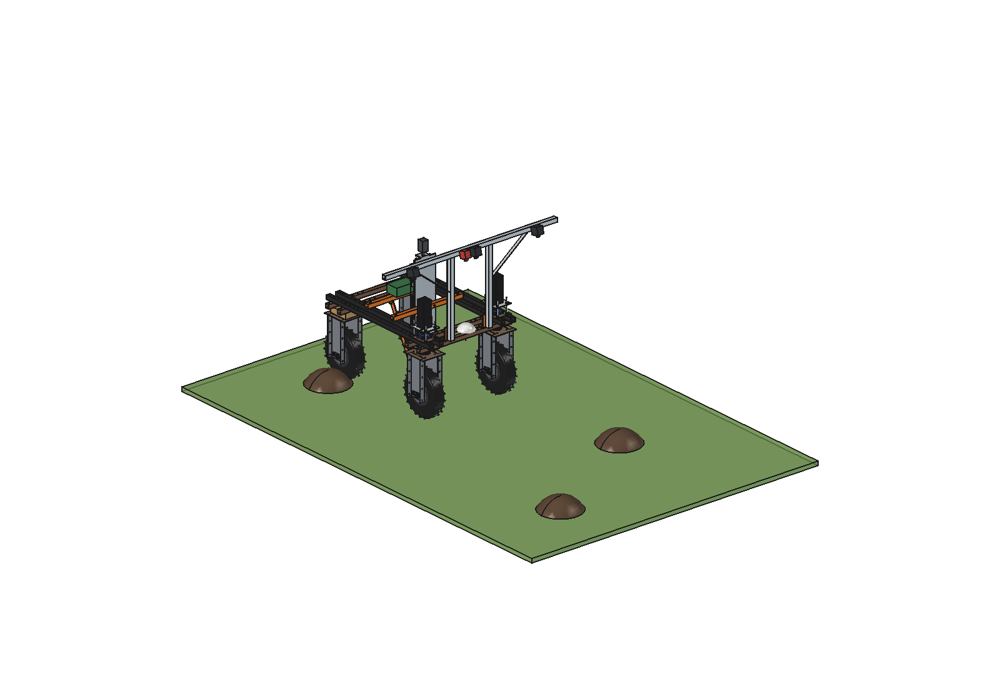
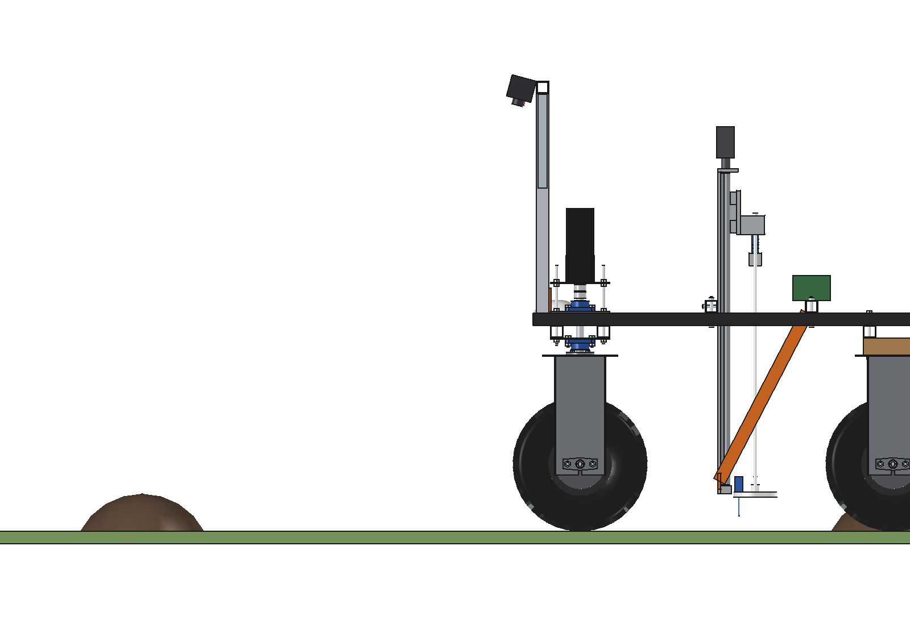
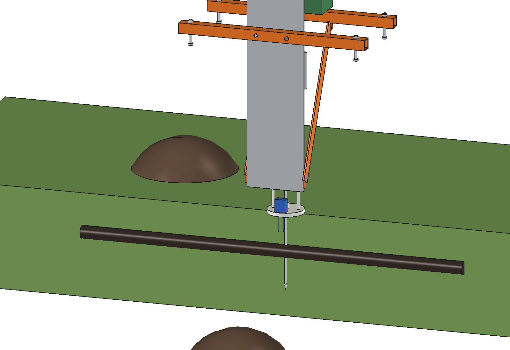
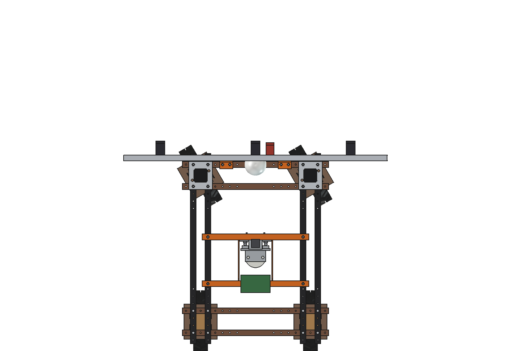
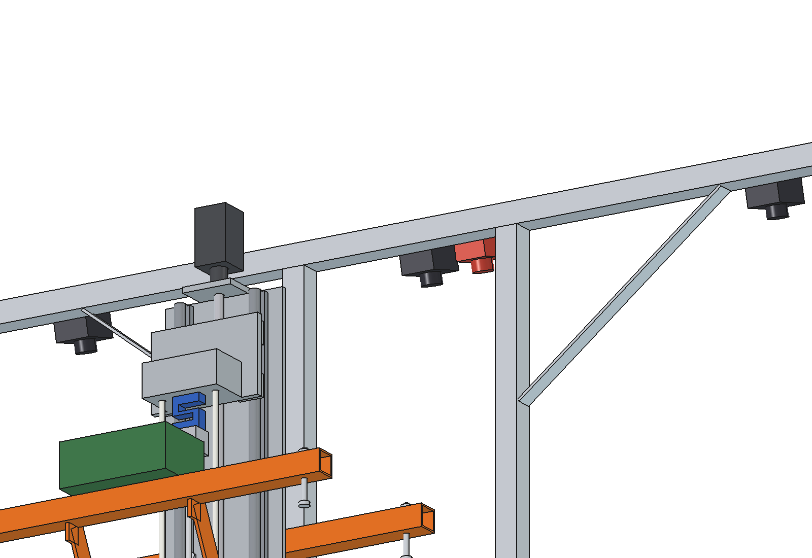

# Mole and tunnel mapper (simple)

Maps molehills and mole tunnels in grassland with the Bruut OpenAgbot (standard robot):

1. **Hills**: a camera bridge in front of the robot, 1.4 m high, carries 3 RGB cameras (4K) and a thermal camera
   looking down. They cover a 2.5 m strip at 0.3 mm per pixel. A fresh hill (dark, moist soil, a different
   temperature than the sward, not on the last map) gets a GNSS point.
2. **Tunnels**: the cone penetrometer of the [soil compaction meter](../../soil%20compaction%20meter/simple/README.md)
   (imported, unchanged) in the middle of the robot probes a ring of 16 points around a fresh hill. A sudden drop of
   the cone resistance 50-250 mm deep is a tunnel. The tunnel directions go on the map, for traps or the molehill
   spreader.

<p align="center">
  
</p>

| Side | Probing: the cone passes through a tunnel (cut-away, robot hidden) |
| --- | --- |
|  |  |
|  |  |

## Build

- **Camera bridge**: 2 steel brackets on the front outer lower beam (M10 into the grid holes x +-175 / +-225),
  2 aluminium posts 40 x 40 x 3 at x +-200, a cross bar 40 x 40 x 3 from x -900 to 900 at 1.4 m, 2 flat stays.
  3 RGB cameras (x -650, 0, 650) and a thermal camera (x 100) on the front face of the bar, tilted 15 degrees forward.
  Clear of the GNSS dome (x +-75) and the steering stacks (x 295..455).
- **Penetrometer**: `soil compaction meter/simple` as it is: bridges on the inner upper beams, ball-screw Z axis,
  load cell, rod O9.5 with a 30 degree cone, sprung foot with a moisture probe.

Mass ~40 kg (camera bridge 8 kg, penetrometer 32 kg). Size 1800 x 1035 x 1411 mm (x, y, z).

## Key figures (`mmp_calc.report()`)

| | |
| --- | --- |
| Cameras | 1.24 m per camera at 1.33 m height, 2.5 m strip; RGB 0.32 mm/px (a 250 mm hill is ~770 px), thermal 1.7 mm/px |
| Mapping | 2.34 m effective at 1.5 m/s: 1.26 ha/h, ~270 W: ~7 h, ~9 ha per charge |
| Probing | 26 s per point (to the ground, 300 mm at 30 mm/s, back, drive to the next point); 16 points = ~7 min per hill |
| Tunnel found | points 118 mm apart on a 300 mm ring: a 50 mm tunnel crossing the ring twice is hit ~85 % |
| Signal | ~170 samples (100 Hz) while the cone passes a 50 mm tunnel |
| Probing load | 1 in 4 fresh hills (9 per ha in an infested field): ~1 h per ha |

Why and how these come out: see [RATIONALE.md](RATIONALE.md), including the list *Estimated, not measured*.

## Files

| File | Contents |
| --- | --- |
| `mmp_params.py` | camera bridge, cameras and work parameters (penetrometer from `scm_params`) |
| `mmp_parts.py` | camera bridge parts; hills and tunnels for the renders |
| `build_mmp.py` | model tree (CamBridge + the soil compaction meter), `set_pose(tip)`, checks, mass, `render_all()`, STEP |
| `mmp_calc.py` | camera strip and resolution, mapping rate, probing time, tunnel hit chance |
| `run_in_freecad.py` | reload, build, print the key figures |
| `Mole_Mapper.FCStd`, `Mole_Mapper.step` | generated model (robot hidden in the FCStd) |
| `previews/` | images |

## Use

```python
exec(open(r"F:\veldrobot\aanbouwdelen\mole mapper\simple\run_in_freecad.py").read())
import build_mmp
build_mmp.set_pose(tip=-300)
build_mmp.check_poses()     # penetrometer park..600 deep x steering -30..30: must be {}
```
