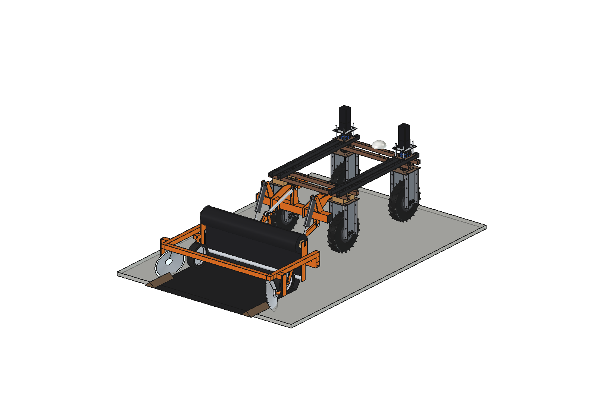
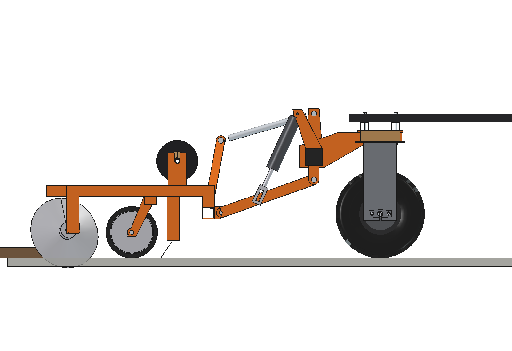
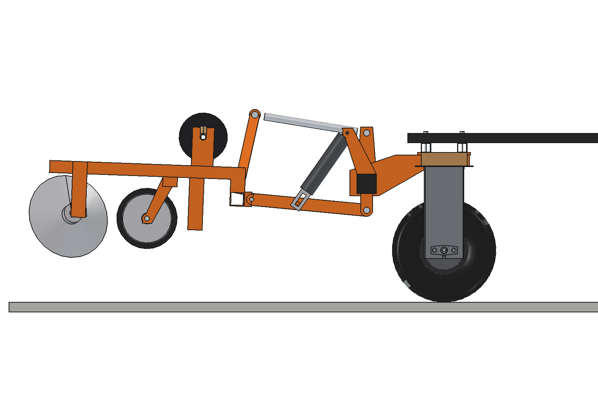
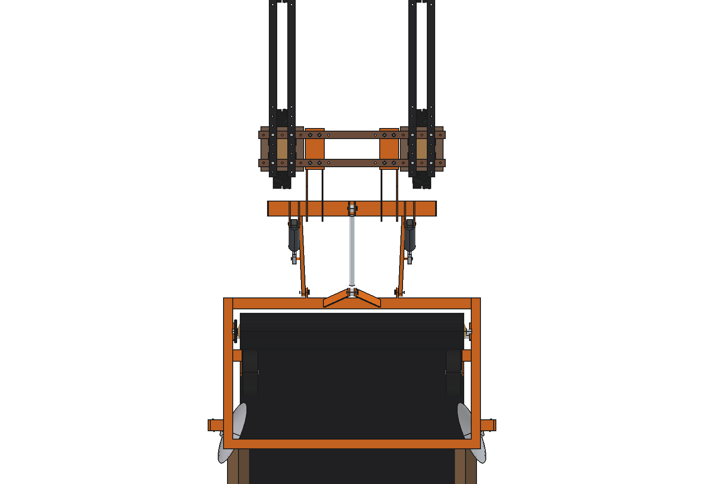
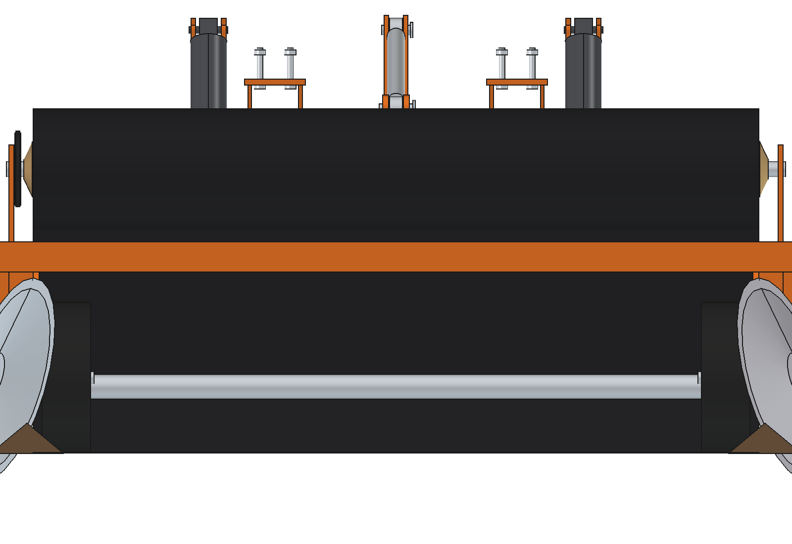
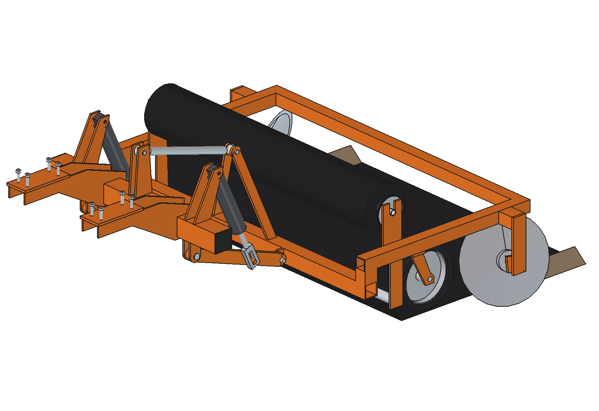

# Mulch layer (simple)

Category 0 implement for the [three-point hitch](../../three%20point%20hitch/simple/) of the Bruut OpenAgbot
(standard robot) that lays mulch foil (PE or biodegradable, 1.2 m wide) over the bed behind the robot. Two press
wheels push the foil edges down, two angled concave discs behind them throw soil onto the edges. At the end of the bed
the robot lifts the layer and the foil is cut by hand.

<p align="center">
  
</p>

| Side, work | Side, transport |
| --- | --- |
|  |  |
|  |  |



## Build

- **Hitch**: from `three point hitch/simple` (imported): rear toolbar, lower links, top link, 2 x 24 V 3000 N lift rods
  with a float slot.
- **Frame**: toolbar 60 x 60 x 4 with the lower hitch lugs and an A-frame mast (as the cultivator), stands, 2 side beams
  50 x 50 x 3 to y -2110, rear cross tube; roll holders with an open V-slot, guide bar O40 x 2 at 110 mm.
- **Roll**: foil 1200 wide, O200 on a core O76 (1075 m of PE 25 um, 30 kg), shaft O25 with cone chucks, band brake on
  a drum O120.
- **Press wheels**: 2 x O250 x 80 semi-pneumatic on steel rims, on the foil edges (x +-545).
- **Covering discs**: 2 x concave O350 x 4 at x +-655, 22 degrees to the travel, tilted 15 degrees, 50 mm deep, on stub
  shafts and arms from the side beams.

Implement 94 kg with a full roll (cg y -1615, z 321), hitch 43 kg. Size 1544 x 2010 x 773 mm (with the hitch and the
foil). No interference over the lift poses (-5..25 degrees); 486 mm from the rear tyres.

## Key figures (`mly_calc.report()`)

| | |
| --- | --- |
| Roll | 1075 m, 1290 m2, ~10 beds of 100 m |
| Work at 0.5 m/s, 90 s per bed end | 12 beds = 1.2 km = 1490 m2 per hour; a roll lasts 50 min |
| Pull | 730 N (discs 360, rolling 312, press wheels 29, foil tension 30), grip margin 1.51, 490 W |
| Lift rods | 1071 N each with a full roll (3000 N), 19.5 s to lift |
| Ground | discs 48 mm deep and press wheels on the bed in work; 221 mm clear lifted, pitch -2.1 degrees |
| Axle loads lifted, full roll | front axle -13 % without ballast (tips back): **3 counterweight plates per front stack** (154 kg) give 26 %; 2 with an empty roll |
| Energy | ~27 Wh per bed, ~70 beds per battery |

Why and how these come out: see [RATIONALE.md](RATIONALE.md), including the list *Estimated, not measured*.

## Files

| File | Contents |
| --- | --- |
| `mly_params.py` | all dimensions of the implement; hitch geometry read from `tph_params` (three point hitch/simple) |
| `mly_parts.py` | one function per part, robot coordinates, work pose |
| `build_mly.py` | model tree (hitch from `build_tph` + implement + foil), `set_pose()`, checks (`check_interference`, `check_poses`, `ground_contact`, `clearance`), mass, `render_all()`, STEP |
| `mly_calc.py` | roll, lift force (via `tph_calc`), axle loads with counterweight plates, pull, capacity and energy |
| `run_in_freecad.py` | reload, build, print the key figures |
| `Mulch_Layer.FCStd`, `Mulch_Layer.step` | generated model (robot hidden in the FCStd) |
| `previews/` | images |

## Use

```python
exec(open(r"F:\veldrobot\aanbouwdelen\mulch layer\simple\run_in_freecad.py").read())
import build_mly
build_mly.set_pose(25)          # transport, foil hidden
build_mly.check_poses()         # must be {}
```

Needs the folder `three point hitch/simple` next to this one (`mly_params` puts it on `sys.path`).
