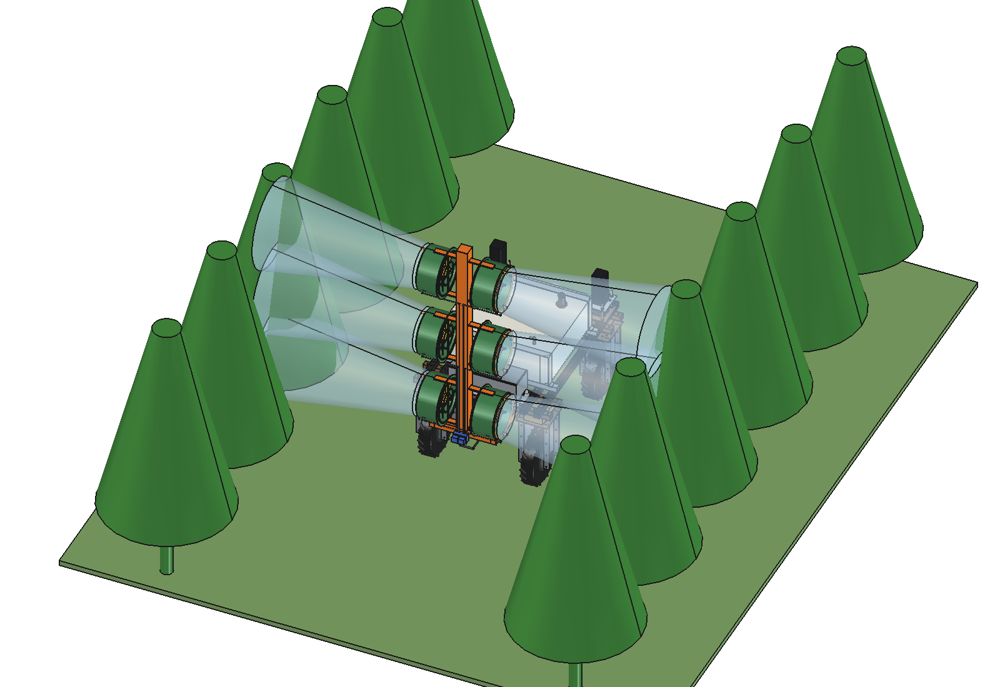
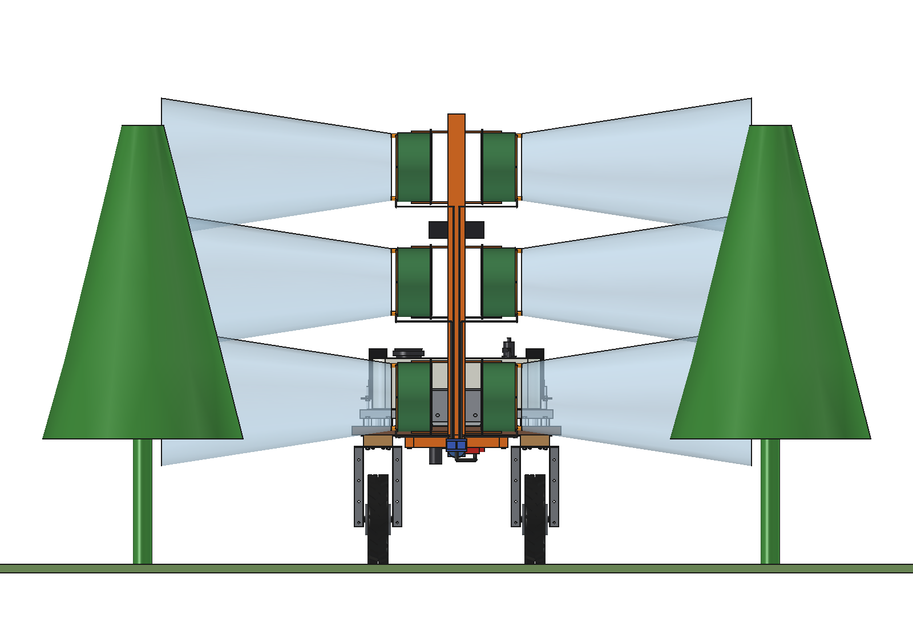
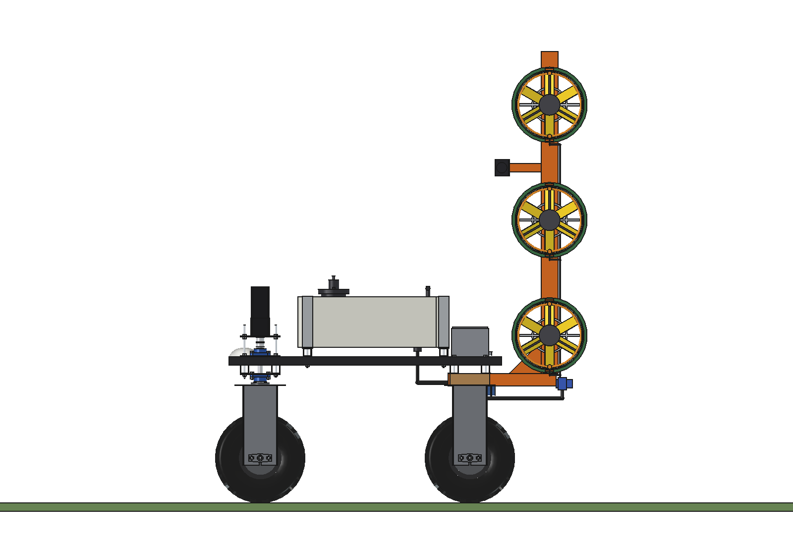
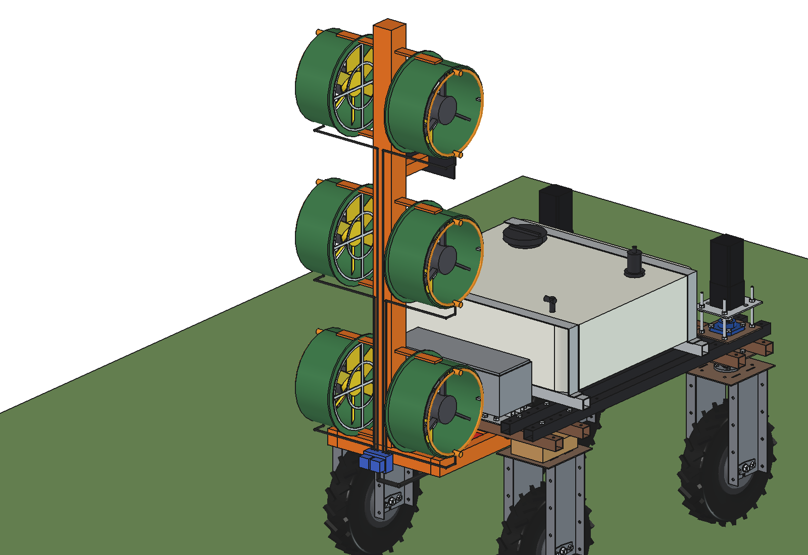

# Air-assisted orchard sprayer (simple)

Sprays the canopy of low fruit trees, vines or hedges on both sides of the alley. An air stream from 3 fans per side
carries the droplets into the leaves; a lidar per side measures the canopy and switches each height section on and
off, so gaps and young trees get nothing.

- **Tank, pump and control box of the [spot sprayer](../../spotspray%20unit/boom/)** (imported, unchanged): 120 l PE
  tank on the cradle on the upper beams, 24 V diaphragm pump (here the 7 bar version), suction filter, pressure
  regulator with bypass, IP66 control box on the rear lower beams (lidar computer and valve driver).
- **Tower** behind the robot: 2 arms 40 x 60 x 3 bolted under the rear lower beams (x +-225, grid holes at y -425 and
  -575, through the control box base plate), a cross beam 60 x 60 x 4 at y -880 and a mast 80 x 80 x 4 up to 2.15 m
  with a front gusset.
- **6 fan pods**, 3 per side at 0.8, 1.35 and 1.9 m, blowing sideways: an axial fan O300 (48 V, ~200 W, ~1700 m3/h)
  in a O330 shroud with an intake bell and guard, the motor on 3 spokes at the outlet, 80 mm intake gap to the mast,
  2 flat bars per pod to the mast.
- **Liquid**: a **nozzle ring** at each outlet with 2 hollow-cone nozzles (0.3 l/min at 7 bar), a **section valve per
  pod** (6 solenoid valves in a manifold behind the mast), lines O8 up the mast rear.
- **Canopy sensing**: a 2D lidar per side (vertical scan plane) on an arm 225 mm ahead of the nozzles: 0.36 s lead at
  working speed against 0.08 s valve latency.

<p align="center">
  
</p>

| Rear | Side |
| --- | --- |
|  |  |
|  |  |

## Key figures (`oas_calc.report()`)

| | |
| --- | --- |
| Air | 5100 m3/h per side, 7.3 m/s at the outlet; enough for a 0.6-2.1 m canopy band at 3 m row spacing up to 0.63 m/s (2.3 km/h) |
| Liquid | 3.6 l/min with all sections open: 317 l/ha at 0.63 m/s; ~2.5 l/min with sensing (30 % gaps), ~95 l/ha saved |
| Output | 0.68 ha/h; a 120 l tank lasts ~48 min (0.54 ha) |
| Power | ~1.7 kW (fans 1.2 kW, pump 150 W, drive 300 W): **~0.9 h per 1.9 kWh charge** (0.64 ha, 1.2 tanks) |
| Mass | ~105 kg empty (tank system and control box ~44, tower and fans ~61), +120 kg liquid |
| Axle loads | full: 386 kg, front 36 %, 123 kg per rear wheel; empty: front 32 % |
| Stability | sideways tip angle 26 degrees with a full tank (cg 758 mm high) |
| Mast | 46 kg on the mast; 0.3 g braking or sideways: 99 Nm at the foot, 3 MPa |

The fans dominate the power: for a whole orchard day the robot needs the
[hybrid range extender](../../Hybrid/) or a battery swap per tank. Low trees, vines and hedges up to ~2.2 m only;
higher trees need more air than 6 small fans give.

Checks: `check_interference()` [], `check_steering()` {}, `check_holes()` [] (4 arm bolts in lower-beam grid holes),
`clearance()` 152 mm to the rear tyres. See [RATIONALE.md](RATIONALE.md), including the list *Estimated, not measured*.

## Usage

```python
exec(open(r"F:\veldrobot\aanbouwdelen\orchard air sprayer\simple\run_in_freecad.py").read())
import build_oas
build_oas.check_interference(); build_oas.check_steering(); build_oas.check_holes(); build_oas.clearance()
build_oas.render_all()
```

```bash
"C:/Program Files/FreeCAD 1.1/bin/python.exe" -B oas_calc.py
```

## Files

| File | Contents |
| --- | --- |
| `oas_params.py` | tower, fan pods, nozzles, sections, lidar, operation (puts the spot sprayer folder on `sys.path`) |
| `oas_parts.py` | one function per part, robot coordinates; pods drawn on the right and mirrored |
| `build_oas.py` | model tree (spot sprayer tank, plumbing and control box via `ssp_parts`), checks, mass, `render_all()`, STEP |
| `oas_calc.py` | air volume and speed, dose and tank time, power and battery, lidar lead, axle loads, mast |
| `run_in_freecad.py` | reload, build, print the key figures |
| `Orchard_Air_Sprayer.FCStd`, `Orchard_Air_Sprayer.step` | generated model (robot hidden in the FCStd) |
| `previews/` | images |
