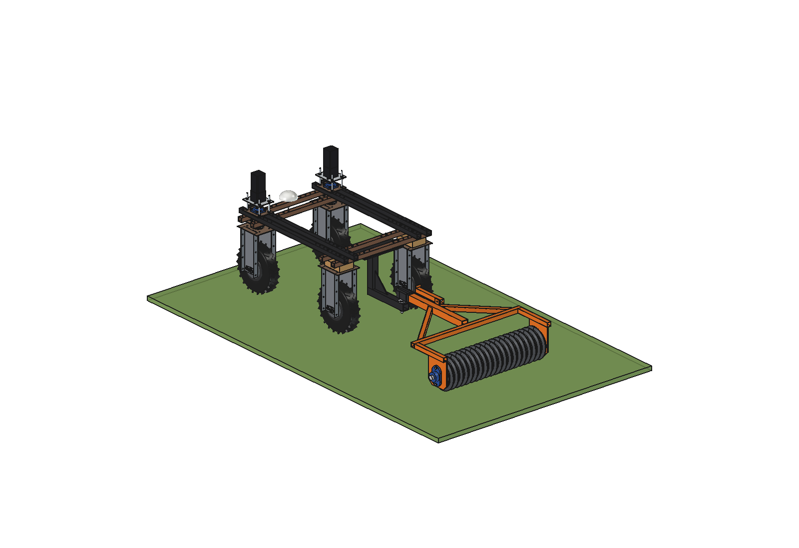
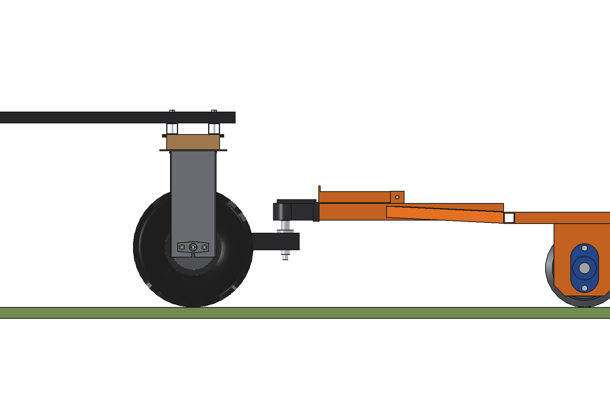
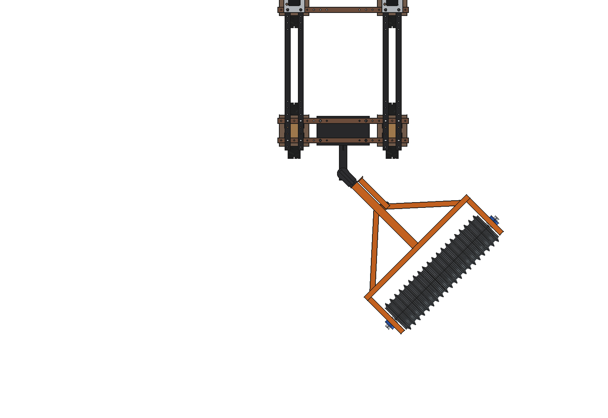
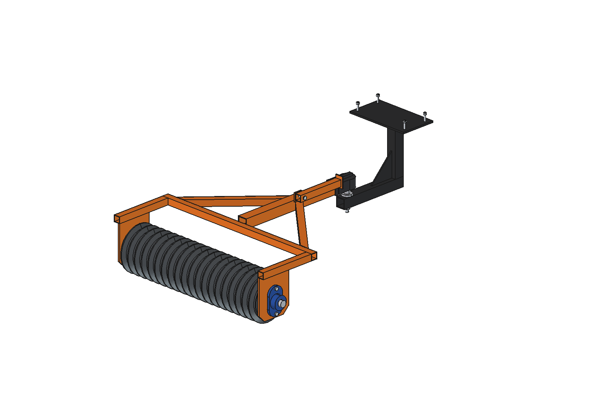
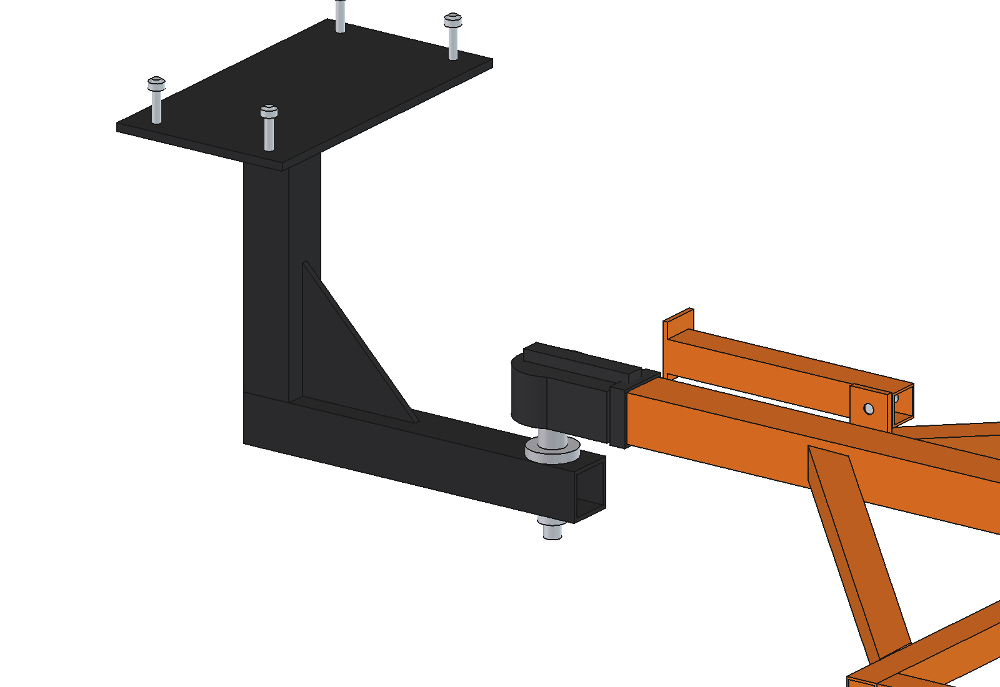

# Cambridge roll, simple

A 1 m ring roller trailed behind the Bruut on a simple tow hitch. It firms a seedbed, closes the soil after
overseeding and presses the seed in. Cheap: 20 bought cast-iron Cambridge rings on a Ø40 shaft, two flange bearings,
square tube and a small set of laser-cut plates. The tow hitch (bracket under the robot with a 50 mm tow ball) is
defined here and is also used by the [overseeder](../overrseeder/) and the
[combination](../overseeder%20with%20cambridge%20roll/).



| | |
| --- | --- |
| Working width | 1000 mm (20 rings × 50 mm) |
| Rings | cast iron, Ø280 over the ridge, bore 42 on a Ø40 shaft, turn freely and independently |
| Mass | 178 kg trailer (rings 133 kg), hitch bracket 17 kg |
| Load | 169 kg/m on the roll, 100 N (10 kg) on the tow ball |
| Draft | 100 N firm lawn, 150 N moist lawn, 250 N loose seedbed; 400 N up 5° on a seedbed |
| Robot pull | 580 N (wet grass, µ 0.45) … 900 N (dry, µ 0.65) on the level |
| Articulation | ±75° yaw, ±8° pitch without contact; ≥ 26 mm clearance to the robot up to 90° |
| Capacity | 1350 m²/h at 0.5 m/s |
| Parts | about € 850 including the hitch (estimated) |

## Construction

- **Tow hitch** (`Hitch`, fixed to the robot): top plate 10 mm under both rear lower beams with 4 × M10 in the 50 mm
  grid (x ±175), a leg and a bar of square tube 60 × 60 × 5, a gusset, and a bolt-on 50 mm tow ball (ISO 1103, M20
  stud through the bar). Ball centre at (0, −830, 330): 115 mm behind the rear tyres, so the coupling head stays clear
  of them in every articulation.
- **Roll** (`Roll`, rotates about the axle): 20 rings, shaft Ø40 C45, two shaft collars that hold the rings together.
- **Frame** (`Roll_frame`): two side plates 10 mm with a UCFL208 flange bearing each on the outside, two arms and a front
  cross beam of 40 × 40 × 3 on top of the plates, 20 mm above the rings.
- **Drawbar** (`Drawbar`): 60 × 60 × 4 from the cross beam to a 50 mm ball coupling head, two braces 40 × 40 × 3, and a
  parking leg on a lug (stowed along the drawbar, swung down when the roll is unhitched).

The frame functions in `cbr_parts.py` take the axle and cross beam position as arguments, so the combination uses the
same parts with a longer frame.

## Files

| File | Contents |
| --- | --- |
| `cbr_params.py` | all dimensions: robot interface, hitch, coupling, rings, frame, operation |
| `cbr_parts.py` | one function per part (also the general helpers `box_span`, `tube_span`, `rect_tube`, `bolt_x`) |
| `build_cbr.py` | model tree, `COLOR`, articulation, interference, `check_poses()`, `clearance()`, mass, `render_all()`, STEP. The tree helpers and checks are reused by the overseeder and the combination |
| `cbr_calc.py` | ring mass (Pappus), trailer mass and ball load, line load, draft, robot pull, shaft, capacity |
| `run_in_freecad.py` | macro: reload, build, print the key figures |
| `RATIONALE.md` | why the dimensions are what they are |
| `previews/` | images |

## Use

In FreeCAD 1.1 (macro or the MCP `execute_code`):

```python
exec(open(r"F:\veldrobot\aanbouwdelen\cambridge roll\cambridge roll\run_in_freecad.py").read())
import build_cbr
build_cbr.check_interference()      # must be empty
build_cbr.check_poses()             # yaw +-75, pitch +-8: must be empty
build_cbr.clearance()
build_cbr.mass_properties()
build_cbr.set_articulation(45, 0)   # swing the trailer about the ball
build_cbr.render_all()              # images in previews/ (takes a few minutes: start it with a QTimer)
```









## Estimated, not measured

- Robot mass 150 kg and the traction coefficient of the 4.00-8 tyres on grass (0.45 wet, 0.65 dry).
- Rolling resistance of the roll: 0.06 firm lawn, 0.09 moist lawn, 0.15 loose seedbed.
- Ring shape and mass: a generic Ø280 Cambridge ring (6.7 kg); bought rings differ per make. Check the bore and width.
- Masses of the bearings (2.1 kg each), coupling head (3.5 kg) and tow ball (1.6 kg).
- Prices.
